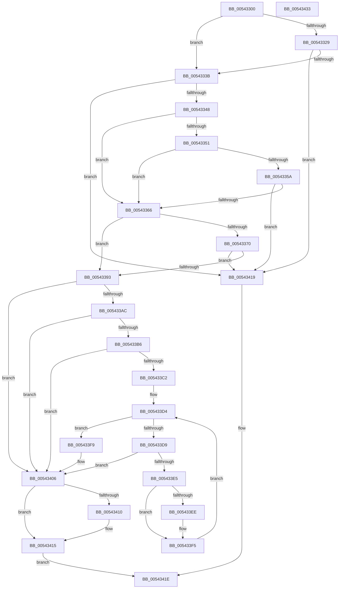

# HalStartDynamicProcessor

- RVA: `0x00543300`–`0x00543434` (길이 `308` bytes)
- VA: `0x0000000140543300`
- 실행 섹션: `.text`
- PDB 이름 있음: `예`; PDB Function 태그: `아니요`
- unwind 정보 RVA: `0x0005C954`
- 디코드: `83`개 명령, `308/308` bytes 표시
- 미해석 바이트: `0` (있으면 어셈블리에 `.byte`로 보존)

> 이 문서는 커널 이미지의 기계어와 PDB 기호를 분석해 생성했습니다. 4번과 5번은 함수 원형과 자료형을 바이너리 사용 방식에서 추정한 C 해석이며 원본 소스 복구 결과는 아닙니다.

## 1. Dependencies

- 직접 호출 지점: **6**; 고유 호출 대상: **6**
- 직접 호출자로 확인된 함수: **2**
- RIP 상대 이미지 참조: **8**

### Outgoing calls
- `0x0054333B` → [HalpQueryMaximumRegisteredProcessorCount](HalpQueryMaximumRegisteredProcessorCount_function_00543BE8.md) (function, `0x00543BE8`)
- `0x00543377` → [MmLockPagableSectionByHandle](../../page/A4/MmLockPagableSectionByHandle_function_00A4D1E0.md) (function, `0x00A4D1E0`)
- `0x0054337C` → [HalpMcUpdateLock](../4C/HalpMcUpdateLock_function_004C6214.md) (function, `0x004C6214`)
- `0x00543386` → [HalpCheckNumaConfiguration](../55/HalpCheckNumaConfiguration_function_00558C38.md) (function, `0x00558C38`)
- `0x005433A0` → [HalpInterruptStartProcessor](../../pagelk/B5/HalpInterruptStartProcessor_function_00B5BEF0.md) (function, `0x00B5BEF0`)
- `0x00543410` → [HalpMcUpdateUnlock](../4B/HalpMcUpdateUnlock_function_004B81D8.md) (function, `0x004B81D8`)

### Direct callers
- [KiStartDynamicProcessor](../../page/74/KiStartDynamicProcessor_function_007456C8.md) at `0x00745AE7`
- [HalpInterruptReinitialize](../../pagelk/B7/HalpInterruptReinitialize_function_00B79BEC.md) at `0x00B79D9E`

### Static image references
- `0x00543314` → RVA `0x00E10208` (`.data`; read)
- `0x00543329` → RVA `0x00E0A774` (`.data`; read)
- `0x00543348` → RVA `0x00F90698` (`.data`; read)
- `0x00543351` → RVA `0x00E10204` (`.data`; read)
- `0x0054335A` → RVA `0x00E0A818` (`.data`; read)
- `0x00543366` → RVA `0x00FC1C41` (`.data`; read)
- `0x00543370` → RVA `0x00FC2158` (`.data`; read)
- `0x005433B6` → RVA `0x00F90658` (`.data`; read)

## 2. Other-region calls and transfers

- 다른 실행 섹션으로 향하는 call: **2**
  - `0x00543377` → [MmLockPagableSectionByHandle](../../page/A4/MmLockPagableSectionByHandle_function_00A4D1E0.md) (`.text` → `PAGE`)
  - `0x005433A0` → [HalpInterruptStartProcessor](../../pagelk/B5/HalpInterruptStartProcessor_function_00B5BEF0.md) (`.text` → `PAGELK`)
- 별도 외부 분기/꼬리 이동을 확인하지 못했습니다.

## 3. Assembly (complete function range)

```asm
00543300  48 89 5C 24 08                  mov qword ptr [rsp + 8], rbx
00543305  48 89 6C 24 10                  mov qword ptr [rsp + 0x10], rbp
0054330A  48 89 74 24 18                  mov qword ptr [rsp + 0x18], rsi
0054330F  57                              push rdi
00543310  48 83 EC 20                     sub rsp, 0x20
00543314  83 3D ED CE 8C 00 00            cmp dword ptr [rip + 0x8cceed], 0
0054331B  41 8B F8                        mov edi, r8d
0054331E  41 0F B7 F1                     movzx esi, r9w
00543322  8B DA                           mov ebx, edx
00543324  48 8B E9                        mov rbp, rcx
00543327  74 12                           je 0x14054333b
00543329  8B 05 45 74 8C 00               mov eax, dword ptr [rip + 0x8c7445]
0054332F  3B 05 D3 CE 8C 00               cmp eax, dword ptr [rip + 0x8cced3]
00543335  0F 83 DE 00 00 00               jae 0x140543419
0054333B  E8 A8 08 00 00                  call 0x140543be8
00543340  3B D8                           cmp ebx, eax
00543342  0F 83 D1 00 00 00               jae 0x140543419
00543348  80 3D 49 D3 A4 00 00            cmp byte ptr [rip + 0xa4d349], 0
0054334F  75 15                           jne 0x140543366
00543351  80 3D AC CE 8C 00 00            cmp byte ptr [rip + 0x8cceac], 0
00543358  75 0C                           jne 0x140543366
0054335A  3B 1D B8 74 8C 00               cmp ebx, dword ptr [rip + 0x8c74b8]
00543360  0F 83 B3 00 00 00               jae 0x140543419
00543366  8A 05 D5 E8 A7 00               mov al, byte ptr [rip + 0xa7e8d5]
0054336C  84 C0                           test al, al
0054336E  75 23                           jne 0x140543393
00543370  48 8B 0D E1 ED A7 00            mov rcx, qword ptr [rip + 0xa7ede1]
00543377  E8 64 9E 50 00                  call 0x140a4d1e0
0054337C  E8 93 2E F8 FF                  call 0x1404c6214
00543381  0F B7 D6                        movzx edx, si
00543384  8B CF                           mov ecx, edi
00543386  E8 AD 58 01 00                  call 0x140558c38
0054338B  84 C0                           test al, al
0054338D  0F 84 86 00 00 00               je 0x140543419
00543393  4C 8B CD                        mov r9, rbp
00543396  41 B8 01 00 00 00               mov r8d, 1
0054339C  8B D7                           mov edx, edi
0054339E  8B CB                           mov ecx, ebx
005433A0  E8 4B 8B 61 00                  call 0x140b5bef0
005433A5  8B D8                           mov ebx, eax
005433A7  83 F8 04                        cmp eax, 4
005433AA  74 5A                           je 0x140543406
005433AC  8A 0D 8F E8 A7 00               mov cl, byte ptr [rip + 0xa7e88f]
005433B2  84 C9                           test cl, cl
005433B4  75 50                           jne 0x140543406
005433B6  4C 8B 05 9B D2 A4 00            mov r8, qword ptr [rip + 0xa4d29b]
005433BD  4D 85 C0                        test r8, r8
005433C0  74 44                           je 0x140543406
005433C2  49 8B 48 18                     mov rcx, qword ptr [r8 + 0x18]
005433C6  45 8B 58 3C                     mov r11d, dword ptr [r8 + 0x3c]
005433CA  BA 00 08 00 00                  mov edx, 0x800
005433CF  8B 34 B1                        mov esi, dword ptr [rcx + rsi*4]
005433D2  33 C9                           xor ecx, ecx
005433D4  41 3B CB                        cmp ecx, r11d
005433D7  73 20                           jae 0x1405433f9
005433D9  49 8B 00                        mov rax, qword ptr [r8]
005433DC  44 8B 14 88                     mov r10d, dword ptr [rax + rcx*4]
005433E0  44 3B D7                        cmp r10d, edi
005433E3  74 21                           je 0x140543406
005433E5  49 8B 40 10                     mov rax, qword ptr [r8 + 0x10]
005433E9  39 34 88                        cmp dword ptr [rax + rcx*4], esi
005433EC  75 07                           jne 0x1405433f5
005433EE  41 83 FA FF                     cmp r10d, -1
005433F2  0F 44 D1                        cmove edx, ecx
005433F5  FF C1                           inc ecx
005433F7  EB DB                           jmp 0x1405433d4
005433F9  48 8B 05 58 D2 A4 00            mov rax, qword ptr [rip + 0xa4d258]
00543400  48 8B 08                        mov rcx, qword ptr [rax]
00543403  89 3C 91                        mov dword ptr [rcx + rdx*4], edi
00543406  8A 05 35 E8 A7 00               mov al, byte ptr [rip + 0xa7e835]
0054340C  84 C0                           test al, al
0054340E  75 05                           jne 0x140543415
00543410  E8 C3 4D F7 FF                  call 0x1404b81d8
00543415  8B C3                           mov eax, ebx
00543417  EB 05                           jmp 0x14054341e
00543419  B8 02 00 00 00                  mov eax, 2
0054341E  48 8B 5C 24 30                  mov rbx, qword ptr [rsp + 0x30]
00543423  48 8B 6C 24 38                  mov rbp, qword ptr [rsp + 0x38]
00543428  48 8B 74 24 40                  mov rsi, qword ptr [rsp + 0x40]
0054342D  48 83 C4 20                     add rsp, 0x20
00543431  5F                              pop rdi
00543432  C3                              ret
00543433  CC                              int3
```

## 4. C-style interpretation (structured pseudocode)

```c
__int64 __fastcall HalStartDynamicProcessor(__int64 a1, int a2, int a3, unsigned __int16 a4)
{
    __int64 result;
    __int64 v_rsp;
    unsigned __int64 v_stack_p10;
    unsigned __int64 v_stack_p18;
    unsigned __int64 v_stack_p8;

    v_stack_p8 = v_rbx;
    v_stack_p10 = v_rbp;
    v_stack_p18 = v_rsi;
    v_rsp = (v_rsp) - (32);
    if ((*(unsigned int *)(v_rip + 9228013)) == 0) goto loc_0054333B;
    if (((unsigned int)((unsigned int)(*(unsigned int *)(v_rip + 9204805)))) >= (*(unsigned int *)(v_rip + 9227987))) goto loc_00543419;
loc_0054333B:
    result = HalpQueryMaximumRegisteredProcessorCount(a1, a2, a3, a4);
    if (((unsigned int)((unsigned int)(a2))) >= ((unsigned int)(result))) goto loc_00543419;
    if ((*(unsigned __int8 *)(v_rip + 10801993)) != 0) goto loc_00543366;
    if ((*(unsigned __int8 *)(v_rip + 9227948)) != 0) goto loc_00543366;
    if (((unsigned int)((unsigned int)(a2))) >= (*(unsigned int *)(v_rip + 9204920))) goto loc_00543419;
loc_00543366:
    if ((unsigned __int8)(*(unsigned __int8 *)(v_rip + 11004117)) != 0) goto loc_00543393;
    result = MmLockPagableSectionByHandle(*(unsigned __int64 *)(v_rip + 11005409), a2, a3, a4);
    result = HalpMcUpdateLock(*(unsigned __int64 *)(v_rip + 11005409), a2, a3, a4);
    result = HalpCheckNumaConfiguration((unsigned int)((unsigned int)((unsigned int)(a3))), a4, a3, a4);
    if ((unsigned __int8)(result) == 0) goto loc_00543419;
loc_00543393:
    result = HalpInterruptStartProcessor((unsigned int)((unsigned int)((unsigned int)(a2))), (unsigned int)((unsigned int)((unsigned int)(a3))), 1, a1);
    if (((unsigned int)(result)) == 4) goto loc_00543406;
    if ((unsigned __int8)(*(unsigned __int8 *)(v_rip + 11004047)) != 0) goto loc_00543406;
    if (*(unsigned __int64 *)(v_rip + 10801819) == 0) goto loc_00543406;
    a1 = 0;
loc_005433D4:
    if (0 >= ((unsigned int)((unsigned int)(*(unsigned int *)(*(unsigned __int64 *)(v_rip + 10801819) + 60))))) goto loc_005433F9;
    if (((unsigned int)((unsigned int)(*(unsigned int *)(*(unsigned __int64 *)(*(unsigned __int64 *)(v_rip + 10801819)) + a1 * 4)))) == ((unsigned int)((unsigned int)(a3)))) goto loc_00543406;
    if ((*(unsigned int *)(*(unsigned __int64 *)(*(unsigned __int64 *)(v_rip + 10801819) + 16) + a1 * 4)) == ((unsigned int)((unsigned int)(*(unsigned int *)(*(unsigned __int64 *)(*(unsigned __int64 *)(v_rip + 10801819) + 24) + a4 * 4))))) {
        a2 = (unsigned int)(0x800ULL);
        if (((unsigned int)((unsigned int)(*(unsigned int *)(*(unsigned __int64 *)(*(unsigned __int64 *)(v_rip + 10801819)) + a1 * 4)))) == -1) { a2 = 0; }
    }
    a1 = (unsigned int)((a1) + 1);
    goto loc_005433D4;
loc_005433F9:
    *(unsigned int *)(*(unsigned __int64 *)(*(unsigned __int64 *)(v_rip + 10801752)) + a2 * 4) = (unsigned int)((unsigned int)(a3));
loc_00543406:
    result = *(unsigned __int8 *)(v_rip + 11003957);
    if ((unsigned __int8)(*(unsigned __int8 *)(v_rip + 11003957)) == 0) {
        result = HalpMcUpdateUnlock(*(unsigned __int64 *)(*(unsigned __int64 *)(v_rip + 10801752)), a2, *(unsigned __int64 *)(v_rip + 10801819), a1);
    }
    goto loc_0054341E;
loc_00543419:
loc_0054341E:
    v_rsp = (v_rsp) + (32);
    return 2;
}
```

## 5. (Beta) C Style

```c
int64_t HalStartDynamicProcessor(int64_t Arg1, int32_t Arg2, int32_t Arg3, uint16_t Arg4)
{
    int64_t result;
    int64_t local_rsp;
    uint64_t v_stack_p10;
    uint64_t v_stack_p18;
    uint64_t v_stack_p8;

    v_stack_p8 = local_rbx;
    v_stack_p10 = local_rbp;
    v_stack_p18 = local_rsi;
    local_rsp = (local_rsp) - (32);
    if ((*(uint32_t *)(v_rip + 0x8CCEED)) == 0) goto loc_0054333B;
    if (((uint32_t)((uint32_t)(*(uint32_t *)(v_rip + 0x8C7445)))) >= (*(uint32_t *)(v_rip + 0x8CCED3))) goto loc_00543419;
loc_0054333B:
    result = HalpQueryMaximumRegisteredProcessorCount(Arg1, Arg2, Arg3, Arg4);
    if (((uint32_t)((uint32_t)(Arg2))) >= ((uint32_t)(result))) goto loc_00543419;
    if ((*(uint8_t *)(v_rip + 0xA4D349)) != 0) goto loc_00543366;
    if ((*(uint8_t *)(v_rip + 0x8CCEAC)) != 0) goto loc_00543366;
    if (((uint32_t)((uint32_t)(Arg2))) >= (*(uint32_t *)(v_rip + 0x8C74B8))) goto loc_00543419;
loc_00543366:
    if ((uint8_t)(*(uint8_t *)(v_rip + 0xA7E8D5)) != 0) goto loc_00543393;
    result = MmLockPagableSectionByHandle(*(uint64_t *)(v_rip + 0xA7EDE1), Arg2, Arg3, Arg4);
    result = HalpMcUpdateLock(*(uint64_t *)(v_rip + 0xA7EDE1), Arg2, Arg3, Arg4);
    result = HalpCheckNumaConfiguration((uint32_t)((uint32_t)((uint32_t)(Arg3))), Arg4, Arg3, Arg4);
    if ((uint8_t)(result) == 0) goto loc_00543419;
loc_00543393:
    result = HalpInterruptStartProcessor((uint32_t)((uint32_t)((uint32_t)(Arg2))), (uint32_t)((uint32_t)((uint32_t)(Arg3))), 1, Arg1);
    if (((uint32_t)(result)) == 4) goto loc_00543406;
    if ((uint8_t)(*(uint8_t *)(v_rip + 0xA7E88F)) != 0) goto loc_00543406;
    if (*(uint64_t *)(v_rip + 0xA4D29B) == 0) goto loc_00543406;
    Arg1 = 0;
loc_005433D4:
    if (0 >= ((uint32_t)((uint32_t)(*(uint32_t *)(*(uint64_t *)(v_rip + 0xA4D29B) + 0x3C))))) goto loc_005433F9;
    if (((uint32_t)((uint32_t)(*(uint32_t *)(*(uint64_t *)(*(uint64_t *)(v_rip + 0xA4D29B)) + Arg1 * 4)))) == ((uint32_t)((uint32_t)(Arg3)))) goto loc_00543406;
    if ((*(uint32_t *)(*(uint64_t *)(*(uint64_t *)(v_rip + 0xA4D29B) + 0x10) + Arg1 * 4)) == ((uint32_t)((uint32_t)(*(uint32_t *)(*(uint64_t *)(*(uint64_t *)(v_rip + 0xA4D29B) + 0x18) + Arg4 * 4))))) {
        Arg2 = (uint32_t)(0x800ULL);
        if (((uint32_t)((uint32_t)(*(uint32_t *)(*(uint64_t *)(*(uint64_t *)(v_rip + 0xA4D29B)) + Arg1 * 4)))) == -1) { Arg2 = 0; }
    }
    Arg1 = (uint32_t)((Arg1) + 1);
    goto loc_005433D4;
loc_005433F9:
    *(uint32_t *)(*(uint64_t *)(*(uint64_t *)(v_rip + 0xA4D258)) + Arg2 * 4) = (uint32_t)((uint32_t)(Arg3));
loc_00543406:
    result = *(uint8_t *)(v_rip + 0xA7E835);
    if ((uint8_t)(*(uint8_t *)(v_rip + 0xA7E835)) == 0) {
        result = HalpMcUpdateUnlock(*(uint64_t *)(*(uint64_t *)(v_rip + 0xA4D258)), Arg2, *(uint64_t *)(v_rip + 0xA4D29B), Arg1);
    }
    goto loc_0054341E;
loc_00543419:
loc_0054341E:
    local_rsp = (local_rsp) + (32);
    return 2;
}
```

## 6. Execution-region graph

[열기: 2D/3D 그래프와 함수 탐색 컨트롤 패널](../../../control-panel.html?section=text&rva=0x00543300&view=graph)

- 2D 그래프는 위에서 아래로 흐르고, 3D 그래프는 빈 공간을 드래그해 회전합니다. Shift+드래그는 이동, 휠은 확대·축소, 함수 노드 선택은 대상 보고서 이동입니다.

### Static fallback


