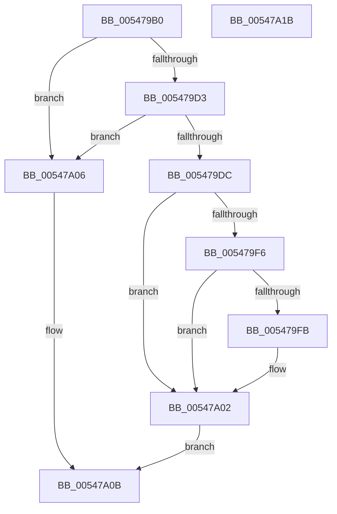

# HalStartNextProcessor

- RVA: `0x005479B0`–`0x00547A1C` (길이 `108` bytes)
- VA: `0x00000001405479B0`
- 실행 섹션: `.text`
- PDB 이름 있음: `예`; PDB Function 태그: `아니요`
- unwind 정보 RVA: `0x00060BC4`
- 디코드: `35`개 명령, `108/108` bytes 표시
- 미해석 바이트: `0` (있으면 어셈블리에 `.byte`로 보존)

> 이 문서는 커널 이미지의 기계어와 PDB 기호를 분석해 생성했습니다. 4번과 5번은 함수 원형과 자료형을 바이너리 사용 방식에서 추정한 C 해석이며 원본 소스 복구 결과는 아닙니다.

## 1. Dependencies

- 직접 호출 지점: **4**; 고유 호출 대상: **4**
- 직접 호출자로 확인된 함수: **2**
- RIP 상대 이미지 참조: **1**

### Outgoing calls
- `0x005479C7` → [HalpInterruptModel](../4A/HalpInterruptModel_function_004ACA38.md) (function, `0x004ACA38`)
- `0x005479D3` → [HalpQueryMaximumRegisteredProcessorCount](HalpQueryMaximumRegisteredProcessorCount_function_00543BE8.md) (function, `0x00543BE8`)
- `0x005479E6` → [HalpInterruptStartProcessor](../../pagelk/B5/HalpInterruptStartProcessor_function_00B5BEF0.md) (function, `0x00B5BEF0`)
- `0x005479FD` → [HalpInterruptStartBlockedProcessors](../55/HalpInterruptStartBlockedProcessors_function_00558914.md) (function, `0x00558914`)

### Direct callers
- [HalpInterruptReinitialize](../../pagelk/B7/HalpInterruptReinitialize_function_00B79BEC.md) at `0x00B79D30`
- [KeStartAllProcessors](../../init/C3/KeStartAllProcessors_function_00C36F78.md) at `0x00C37348`

### Static image references
- `0x005479EB` → RVA `0x00F90690` (`.data`; read)

## 2. Other-region calls and transfers

- 다른 실행 섹션으로 향하는 call: **1**
  - `0x005479E6` → [HalpInterruptStartProcessor](../../pagelk/B5/HalpInterruptStartProcessor_function_00B5BEF0.md) (`.text` → `PAGELK`)
- 별도 외부 분기/꼬리 이동을 확인하지 못했습니다.

## 3. Assembly (complete function range)

```asm
005479B0  48 89 5C 24 08                  mov qword ptr [rsp + 8], rbx
005479B5  48 89 74 24 10                  mov qword ptr [rsp + 0x10], rsi
005479BA  57                              push rdi
005479BB  48 83 EC 20                     sub rsp, 0x20
005479BF  41 8B F8                        mov edi, r8d
005479C2  8B DA                           mov ebx, edx
005479C4  48 8B F1                        mov rsi, rcx
005479C7  E8 6C 50 F6 FF                  call 0x1404aca38
005479CC  FF C8                           dec eax
005479CE  83 F8 03                        cmp eax, 3
005479D1  77 33                           ja 0x140547a06
005479D3  E8 10 C2 FF FF                  call 0x140543be8
005479D8  3B D8                           cmp ebx, eax
005479DA  73 2A                           jae 0x140547a06
005479DC  4C 8B CE                        mov r9, rsi
005479DF  45 33 C0                        xor r8d, r8d
005479E2  8B D7                           mov edx, edi
005479E4  8B CB                           mov ecx, ebx
005479E6  E8 05 45 61 00                  call 0x140b5bef0
005479EB  83 3D 9E 8C A4 00 00            cmp dword ptr [rip + 0xa48c9e], 0
005479F2  8B F8                           mov edi, eax
005479F4  74 0C                           je 0x140547a02
005479F6  83 F8 04                        cmp eax, 4
005479F9  75 07                           jne 0x140547a02
005479FB  8B CB                           mov ecx, ebx
005479FD  E8 12 0F 01 00                  call 0x140558914
00547A02  8B C7                           mov eax, edi
00547A04  EB 05                           jmp 0x140547a0b
00547A06  B8 02 00 00 00                  mov eax, 2
00547A0B  48 8B 5C 24 30                  mov rbx, qword ptr [rsp + 0x30]
00547A10  48 8B 74 24 38                  mov rsi, qword ptr [rsp + 0x38]
00547A15  48 83 C4 20                     add rsp, 0x20
00547A19  5F                              pop rdi
00547A1A  C3                              ret
00547A1B  CC                              int3
```

## 4. C-style interpretation (structured pseudocode)

```c
__int64 __fastcall HalStartNextProcessor(__int64 a1, int a2, int a3)
{
    __int64 result;
    __int64 v_rsp;
    unsigned __int64 v_stack_p10;
    unsigned __int64 v_stack_p8;

    v_stack_p8 = v_rbx;
    v_stack_p10 = v_rsi;
    v_rsp = (v_rsp) - (32);
    result = HalpInterruptModel(a1, a2, a3, a4);
    result = (unsigned int)((result) - 1);
    if (((unsigned int)(result)) > 3) goto loc_00547A06;
    result = HalpQueryMaximumRegisteredProcessorCount(a1, a2, a3, a4);
    if (((unsigned int)((unsigned int)(a2))) >= ((unsigned int)(result))) goto loc_00547A06;
    a3 = 0;
    result = HalpInterruptStartProcessor((unsigned int)((unsigned int)((unsigned int)(a2))), (unsigned int)((unsigned int)((unsigned int)(a3))), a3, a1);
    if ((*(unsigned int *)(v_rip + 10783902)) == 0) goto loc_00547A02;
    if (((unsigned int)(result)) == 4) {
        a1 = (unsigned int)((unsigned int)(a2));
        result = HalpInterruptStartBlockedProcessors(a1, (unsigned int)((unsigned int)((unsigned int)(a3))), a3, a1);
    }
    goto loc_00547A0B;
loc_00547A06:
loc_00547A0B:
    v_rsp = (v_rsp) + (32);
    return 2;
}
```

## 5. (Beta) C Style

```c
int64_t HalStartNextProcessor(int64_t Arg1, int32_t Arg2, int32_t Arg3)
{
    int64_t result;
    int64_t local_rsp;
    uint64_t v_stack_p10;
    uint64_t v_stack_p8;

    v_stack_p8 = local_rbx;
    v_stack_p10 = local_rsi;
    local_rsp = (local_rsp) - (32);
    result = HalpInterruptModel(Arg1, Arg2, Arg3, a4);
    result = (uint32_t)((result) - 1);
    if (((uint32_t)(result)) > 3) goto loc_00547A06;
    result = HalpQueryMaximumRegisteredProcessorCount(Arg1, Arg2, Arg3, a4);
    if (((uint32_t)((uint32_t)(Arg2))) >= ((uint32_t)(result))) goto loc_00547A06;
    Arg3 = 0;
    result = HalpInterruptStartProcessor((uint32_t)((uint32_t)((uint32_t)(Arg2))), (uint32_t)((uint32_t)((uint32_t)(Arg3))), Arg3, Arg1);
    if ((*(uint32_t *)(v_rip + 0xA48C9E)) == 0) goto loc_00547A02;
    if (((uint32_t)(result)) == 4) {
        Arg1 = (uint32_t)((uint32_t)(Arg2));
        result = HalpInterruptStartBlockedProcessors(Arg1, (uint32_t)((uint32_t)((uint32_t)(Arg3))), Arg3, Arg1);
    }
    goto loc_00547A0B;
loc_00547A06:
loc_00547A0B:
    local_rsp = (local_rsp) + (32);
    return 2;
}
```

## 6. Execution-region graph

[열기: 2D/3D 그래프와 함수 탐색 컨트롤 패널](../../../control-panel.html?section=text&rva=0x005479B0&view=graph)

- 2D 그래프는 위에서 아래로 흐르고, 3D 그래프는 빈 공간을 드래그해 회전합니다. Shift+드래그는 이동, 휠은 확대·축소, 함수 노드 선택은 대상 보고서 이동입니다.

### Static fallback


