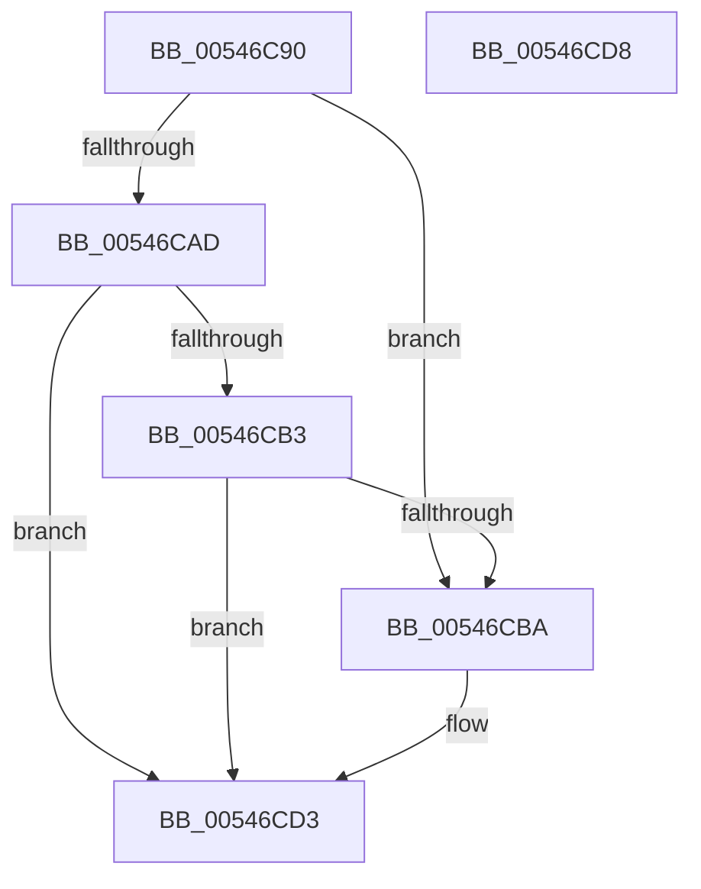

# HalStopProfileInterrupt

- RVA: `0x00546C90`–`0x00546CD9` (길이 `73` bytes)
- VA: `0x0000000140546C90`
- 실행 섹션: `.text`
- PDB 이름 있음: `예`; PDB Function 태그: `아니요`
- unwind 정보 RVA: `0x0005C788`
- 디코드: `21`개 명령, `73/73` bytes 표시
- 미해석 바이트: `0` (있으면 어셈블리에 `.byte`로 보존)

> 이 문서는 커널 이미지의 기계어와 PDB 기호를 분석해 생성했습니다. 4번과 5번은 함수 원형과 자료형을 바이너리 사용 방식에서 추정한 C 해석이며 원본 소스 복구 결과는 아닙니다.

## 1. Dependencies

- 직접 호출 지점: **1**; 고유 호출 대상: **1**
- 직접 호출자로 확인된 함수: **1**
- RIP 상대 이미지 참조: **3**

### Outgoing calls
- `0x00546CC7` → [guard_dispatch_icall](../6B/guard_dispatch_icall_function_006BAAD0.md) (function, `0x006BAAD0`)

### Direct callers
- [KiStopProfileTarget](../30/KiStopProfileTarget_function_00304510.md) at `0x0030470D`

### Static image references
- `0x00546CA2` → RVA `0x00FC2C28` (`.data`; read)
- `0x00546CBA` → RVA `0x00E03B20` (`.data`; read)
- `0x00546CCC` → RVA `0x00FC2B4C` (`.data`; read/write)

## 2. Other-region calls and transfers

- 다른 실행 섹션으로 향하는 call: **0**
- 별도 외부 분기/꼬리 이동을 확인하지 못했습니다.

## 3. Assembly (complete function range)

```asm
00546C90  48 83 EC 28                     sub rsp, 0x28
00546C94  65 8B 04 25 A4 01 00 00         mov eax, dword ptr gs:[0x1a4]
00546C9C  8B D0                           mov edx, eax
00546C9E  48 C1 E2 04                     shl rdx, 4
00546CA2  48 03 15 7F BF A7 00            add rdx, qword ptr [rip + 0xa7bf7f]
00546CA9  85 C9                           test ecx, ecx
00546CAB  75 0D                           jne 0x140546cba
00546CAD  8B 02                           mov eax, dword ptr [rdx]
00546CAF  85 C0                           test eax, eax
00546CB1  74 20                           je 0x140546cd3
00546CB3  83 E8 01                        sub eax, 1
00546CB6  89 02                           mov dword ptr [rdx], eax
00546CB8  75 19                           jne 0x140546cd3
00546CBA  48 8B 05 5F CE 8B 00            mov rax, qword ptr [rip + 0x8bce5f]
00546CC1  33 D2                           xor edx, edx
00546CC3  48 8B 40 10                     mov rax, qword ptr [rax + 0x10]
00546CC7  E8 04 3E 17 00                  call 0x1406baad0
00546CCC  F0 FF 0D 79 BE A7 00            lock dec dword ptr [rip + 0xa7be79]
00546CD3  48 83 C4 28                     add rsp, 0x28
00546CD7  C3                              ret
00546CD8  CC                              int3
```

## 4. C-style interpretation (structured pseudocode)

```c
__int64 __fastcall HalStopProfileInterrupt(int a1)
{
    __int64 result;
    __int64 v_rsp;

    v_rsp = (v_rsp) - (40);
    a2 = ((unsigned int)((unsigned int)((unsigned int)(*(unsigned int *)(gs_base + (0 + 420)))))) << (4);
    a2 = (a2) + (*(unsigned __int64 *)(v_rip + 10993535));
    if (a1 != 0) goto loc_00546CBA;
    if ((unsigned int)((unsigned int)(*(unsigned int *)(a2))) == 0) goto loc_00546CD3;
    result = (unsigned int)(((unsigned int)(*(unsigned int *)(a2))) - (1));
    *(unsigned int *)(a2) = (unsigned int)(result);
    if (!(condition_is_not_equal)) {
        result = *(unsigned __int64 *)(v_rip + 9162335);
        a2 = 0;
        result = *(unsigned __int64 *)(result + 16);
        result = guard_dispatch_icall(a1, a2, a3, a4);
    }
    v_rsp = (v_rsp) + (40);
    return result;
}
```

## 5. (Beta) C Style

```c
int64_t HalStopProfileInterrupt(int32_t Arg1)
{
    int64_t result;
    int64_t local_rsp;

    local_rsp = (local_rsp) - (40);
    a2 = ((uint32_t)((uint32_t)((uint32_t)(*(uint32_t *)(gs_base + (0 + 0x1A4)))))) << (4);
    a2 = (a2) + (*(uint64_t *)(v_rip + 0xA7BF7F));
    if (Arg1 != 0) goto loc_00546CBA;
    if ((uint32_t)((uint32_t)(*(uint32_t *)(a2))) == 0) goto loc_00546CD3;
    result = (uint32_t)(((uint32_t)(*(uint32_t *)(a2))) - (1));
    *(uint32_t *)(a2) = (uint32_t)(result);
    if (!(condition_is_not_equal)) {
        result = *(uint64_t *)(v_rip + 0x8BCE5F);
        a2 = 0;
        result = *(uint64_t *)(result + 0x10);
        result = guard_dispatch_icall(Arg1, a2, a3, a4);
    }
    local_rsp = (local_rsp) + (40);
    return result;
}
```

## 6. Execution-region graph

[열기: 2D/3D 그래프와 함수 탐색 컨트롤 패널](../../../control-panel.html?section=text&rva=0x00546C90&view=graph)

- 2D 그래프는 위에서 아래로 흐르고, 3D 그래프는 빈 공간을 드래그해 회전합니다. Shift+드래그는 이동, 휠은 확대·축소, 함수 노드 선택은 대상 보고서 이동입니다.

### Static fallback


