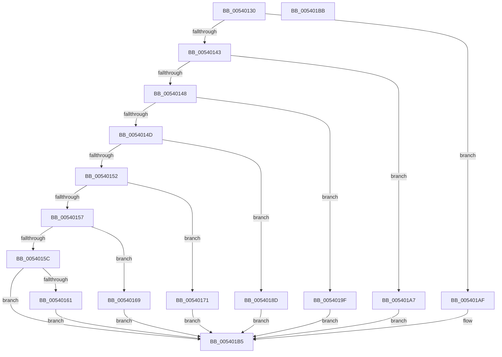

# HalWheaUpdateCmciPolicy

- RVA: `0x00540130`–`0x005401BC` (길이 `140` bytes)
- VA: `0x0000000140540130`
- 실행 섹션: `.text`
- PDB 이름 있음: `예`; PDB Function 태그: `아니요`
- unwind 정보 RVA: `0x0005CF00`
- 디코드: `42`개 명령, `140/140` bytes 표시
- 미해석 바이트: `0` (있으면 어셈블리에 `.byte`로 보존)

> 이 문서는 커널 이미지의 기계어와 PDB 기호를 분석해 생성했습니다. 4번과 5번은 함수 원형과 자료형을 바이너리 사용 방식에서 추정한 C 해석이며 원본 소스 복구 결과는 아닙니다.

## 1. Dependencies

- 직접 호출 지점: **1**; 고유 호출 대상: **1**
- 직접 호출자로 확인된 함수: **1**
- RIP 상대 이미지 참조: **7**

### Outgoing calls
- `0x00540176` → [KeQueryPerformanceCounter](../37/KeQueryPerformanceCounter_function_0037E7E0.md) (function, `0x0037E7E0`)

### Direct callers
- [WheapPropagatePolicyToHal](../../page/AC/WheapPropagatePolicyToHal_function_00AC1B2C.md) at `0x00AC1B70`

### Static image references
- `0x00540161` → RVA `0x00E100E2` (`.data`; write)
- `0x00540169` → RVA `0x00E0A76C` (`.data`; write)
- `0x00540184` → RVA `0x00E0FBF8` (`.data`; write)
- `0x00540197` → RVA `0x00E100BC` (`.data`; write)
- `0x0054019F` → RVA `0x00E101A0` (`.data`; write)
- `0x005401A7` → RVA `0x00E101A4` (`.data`; write)
- `0x005401AF` → RVA `0x00E1019C` (`.data`; write)

## 2. Other-region calls and transfers

- 다른 실행 섹션으로 향하는 call: **0**
- 별도 외부 분기/꼬리 이동을 확인하지 못했습니다.

## 3. Assembly (complete function range)

```asm
00540130  40 53                           push rbx
00540132  48 83 EC 20                     sub rsp, 0x20
00540136  48 83 64 24 40 00               and qword ptr [rsp + 0x40], 0
0054013C  8B DA                           mov ebx, edx
0054013E  83 E9 07                        sub ecx, 7
00540141  74 6C                           je 0x1405401af
00540143  83 E9 01                        sub ecx, 1
00540146  74 5F                           je 0x1405401a7
00540148  83 E9 01                        sub ecx, 1
0054014B  74 52                           je 0x14054019f
0054014D  83 E9 01                        sub ecx, 1
00540150  74 3B                           je 0x14054018d
00540152  83 E9 01                        sub ecx, 1
00540155  74 1A                           je 0x140540171
00540157  83 E9 01                        sub ecx, 1
0054015A  74 0D                           je 0x140540169
0054015C  83 F9 08                        cmp ecx, 8
0054015F  75 54                           jne 0x1405401b5
00540161  88 1D 7B FF 8C 00               mov byte ptr [rip + 0x8cff7b], bl
00540167  EB 4C                           jmp 0x1405401b5
00540169  89 1D FD A5 8C 00               mov dword ptr [rip + 0x8ca5fd], ebx
0054016F  EB 44                           jmp 0x1405401b5
00540171  48 8D 4C 24 40                  lea rcx, [rsp + 0x40]
00540176  E8 65 E6 E3 FF                  call 0x14037e7e0
0054017B  48 8B C3                        mov rax, rbx
0054017E  48 0F AF 44 24 40               imul rax, qword ptr [rsp + 0x40]
00540184  48 89 05 6D FA 8C 00            mov qword ptr [rip + 0x8cfa6d], rax
0054018B  EB 28                           jmp 0x1405401b5
0054018D  B8 02 00 00 00                  mov eax, 2
00540192  3B D8                           cmp ebx, eax
00540194  0F 46 D8                        cmovbe ebx, eax
00540197  89 1D 1F FF 8C 00               mov dword ptr [rip + 0x8cff1f], ebx
0054019D  EB 16                           jmp 0x1405401b5
0054019F  89 1D FB FF 8C 00               mov dword ptr [rip + 0x8cfffb], ebx
005401A5  EB 0E                           jmp 0x1405401b5
005401A7  89 1D F7 FF 8C 00               mov dword ptr [rip + 0x8cfff7], ebx
005401AD  EB 06                           jmp 0x1405401b5
005401AF  88 1D E7 FF 8C 00               mov byte ptr [rip + 0x8cffe7], bl
005401B5  48 83 C4 20                     add rsp, 0x20
005401B9  5B                              pop rbx
005401BA  C3                              ret
005401BB  CC                              int3
```

## 4. C-style interpretation (structured pseudocode)

```c
__int64 __fastcall HalWheaUpdateCmciPolicy(int a1, int a2)
{
    __int64 result;
    __int64 v_rbx;
    __int64 v_rsp;
    unsigned __int64 v_stack_p18;

    v_rsp = (v_rsp) - (32);
    a1 = (unsigned int)((a1) - (7));
    if (condition_is_equal) goto loc_005401AF;
    a1 = (unsigned int)((a1) - (1));
    if (condition_is_equal) goto loc_005401A7;
    a1 = (unsigned int)((a1) - (1));
    if (condition_is_equal) goto loc_0054019F;
    a1 = (unsigned int)((a1) - (1));
    if (condition_is_equal) goto loc_0054018D;
    a1 = (unsigned int)((a1) - (1));
    if (condition_is_equal) goto loc_00540171;
    a1 = (unsigned int)((a1) - (1));
    if (condition_is_equal) goto loc_00540169;
    if (a1 != 8) goto loc_005401B5;
    *(unsigned __int8 *)(v_rip + 9240443) = (unsigned __int8)((unsigned int)(a2));
    goto loc_005401B5;
loc_00540169:
    *(unsigned int *)(v_rip + 9217533) = (unsigned int)((unsigned int)(a2));
    goto loc_005401B5;
loc_00540171:
    result = KeQueryPerformanceCounter(v_stack_p18, a2, a3, a4);
    result = ((unsigned int)(a2)) * (v_stack_p18);
    *(unsigned __int64 *)(v_rip + 9239149) = result;
    goto loc_005401B5;
loc_0054018D:
    v_rbx = (unsigned int)(a2);
    if (((unsigned int)((unsigned int)(a2))) <= 2) { v_rbx = 2; }
    *(unsigned int *)(v_rip + 9240351) = (unsigned int)(v_rbx);
    goto loc_005401B5;
loc_0054019F:
    *(unsigned int *)(v_rip + 9240571) = (unsigned int)(v_rbx);
    goto loc_005401B5;
loc_005401A7:
    *(unsigned int *)(v_rip + 9240567) = (unsigned int)(v_rbx);
    goto loc_005401B5;
loc_005401AF:
    *(unsigned __int8 *)(v_rip + 9240551) = (unsigned __int8)(v_rbx);
loc_005401B5:
    v_rsp = (v_rsp) + (32);
    return 2;
}
```

## 5. (Beta) C Style

```c
int64_t HalWheaUpdateCmciPolicy(int32_t Arg1, int32_t Arg2)
{
    int64_t result;
    int64_t local_rbx;
    int64_t local_rsp;
    uint64_t v_stack_p18;

    local_rsp = (local_rsp) - (32);
    Arg1 = (uint32_t)((Arg1) - (7));
    if (condition_is_equal) goto loc_005401AF;
    Arg1 = (uint32_t)((Arg1) - (1));
    if (condition_is_equal) goto loc_005401A7;
    Arg1 = (uint32_t)((Arg1) - (1));
    if (condition_is_equal) goto loc_0054019F;
    Arg1 = (uint32_t)((Arg1) - (1));
    if (condition_is_equal) goto loc_0054018D;
    Arg1 = (uint32_t)((Arg1) - (1));
    if (condition_is_equal) goto loc_00540171;
    Arg1 = (uint32_t)((Arg1) - (1));
    if (condition_is_equal) goto loc_00540169;
    if (Arg1 != 8) goto loc_005401B5;
    *(uint8_t *)(v_rip + 0x8CFF7B) = (uint8_t)((uint32_t)(Arg2));
    goto loc_005401B5;
loc_00540169:
    *(uint32_t *)(v_rip + 0x8CA5FD) = (uint32_t)((uint32_t)(Arg2));
    goto loc_005401B5;
loc_00540171:
    result = KeQueryPerformanceCounter(v_stack_p18, Arg2, a3, a4);
    result = ((uint32_t)(Arg2)) * (v_stack_p18);
    *(uint64_t *)(v_rip + 0x8CFA6D) = result;
    goto loc_005401B5;
loc_0054018D:
    local_rbx = (uint32_t)(Arg2);
    if (((uint32_t)((uint32_t)(Arg2))) <= 2) { local_rbx = 2; }
    *(uint32_t *)(v_rip + 0x8CFF1F) = (uint32_t)(local_rbx);
    goto loc_005401B5;
loc_0054019F:
    *(uint32_t *)(v_rip + 0x8CFFFB) = (uint32_t)(local_rbx);
    goto loc_005401B5;
loc_005401A7:
    *(uint32_t *)(v_rip + 0x8CFFF7) = (uint32_t)(local_rbx);
    goto loc_005401B5;
loc_005401AF:
    *(uint8_t *)(v_rip + 0x8CFFE7) = (uint8_t)(local_rbx);
loc_005401B5:
    local_rsp = (local_rsp) + (32);
    return 2;
}
```

## 6. Execution-region graph

[열기: 2D/3D 그래프와 함수 탐색 컨트롤 패널](../../../control-panel.html?section=text&rva=0x00540130&view=graph)

- 2D 그래프는 위에서 아래로 흐르고, 3D 그래프는 빈 공간을 드래그해 회전합니다. Shift+드래그는 이동, 휠은 확대·축소, 함수 노드 선택은 대상 보고서 이동입니다.

### Static fallback


