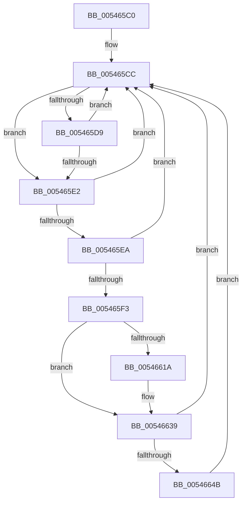

# HaliHaltSystem

- RVA: `0x005465C0`–`0x00546655` (길이 `149` bytes)
- VA: `0x00000001405465C0`
- 실행 섹션: `.text`
- PDB 이름 있음: `예`; PDB Function 태그: `아니요`
- unwind 정보 RVA: `0x000C3D3C`
- 디코드: `37`개 명령, `149/149` bytes 표시
- 미해석 바이트: `0` (있으면 어셈블리에 `.byte`로 보존)

> 이 문서는 커널 이미지의 기계어와 PDB 기호를 분석해 생성했습니다. 4번과 5번은 함수 원형과 자료형을 바이너리 사용 방식에서 추정한 C 해석이며 원본 소스 복구 결과는 아닙니다.

## 1. Dependencies

- 직접 호출 지점: **4**; 고유 호출 대상: **3**
- 직접 호출자로 확인된 함수: **0**
- RIP 상대 이미지 참조: **4**

### Outgoing calls
- `0x005465D9` → [InbvCheckDisplayOwnership](../59/InbvCheckDisplayOwnership_function_00590190.md) (function, `0x00590190`)
- `0x00546607` → [HalpAcpiPmRegisterRead](../41/HalpAcpiPmRegisterRead_function_0041DB30.md) (function, `0x0041DB30`)
- `0x0054662F` → [HalpAcpiPmRegisterRead](../41/HalpAcpiPmRegisterRead_function_0041DB30.md) (function, `0x0041DB30`)
- `0x0054664B` → [HalpShutdown](HalpShutdown_function_005469AC.md) (function, `0x005469AC`)

### Direct callers
- 이 함수 시작 RVA로 연결되는 직접 call은 확인되지 않았습니다. 간접 호출은 완전히 역산할 수 없습니다.

### Static image references
- `0x005465CC` → RVA `0x00F47580` (`.data`; read)
- `0x005465E2` → RVA `0x00FC2C68` (`.data`; read)
- `0x005465EA` → RVA `0x00F8FE60` (`.data`; read)
- `0x0054660C` → RVA `0x00F8FEF0` (`.data`; read)

## 2. Other-region calls and transfers

- 다른 실행 섹션으로 향하는 call: **0**
- 별도 외부 분기/꼬리 이동을 확인하지 못했습니다.

## 3. Assembly (complete function range)

```asm
005465C0  48 89 5C 24 10                  mov qword ptr [rsp + 0x10], rbx
005465C5  57                              push rdi
005465C6  48 83 EC 30                     sub rsp, 0x30
005465CA  33 FF                           xor edi, edi
005465CC  39 3D AE 0F A0 00               cmp dword ptr [rip + 0xa00fae], edi
005465D2  66 89 7C 24 40                  mov word ptr [rsp + 0x40], di
005465D7  75 09                           jne 0x1405465e2
005465D9  E8 B2 9B 04 00                  call 0x140590190
005465DE  84 C0                           test al, al
005465E0  74 EA                           je 0x1405465cc
005465E2  39 3D 80 C6 A7 00               cmp dword ptr [rip + 0xa7c680], edi
005465E8  74 E2                           je 0x1405465cc
005465EA  40 38 3D 6F 98 A4 00            cmp byte ptr [rip + 0xa4986f], dil
005465F1  74 D9                           je 0x1405465cc
005465F3  41 B9 02 00 00 00               mov r9d, 2
005465F9  48 89 7C 24 20                  mov qword ptr [rsp + 0x20], rdi
005465FE  4C 8D 44 24 40                  lea r8, [rsp + 0x40]
00546603  33 D2                           xor edx, edx
00546605  33 C9                           xor ecx, ecx
00546607  E8 24 75 ED FF                  call 0x14041db30
0054660C  40 38 3D DD 98 A4 00            cmp byte ptr [rip + 0xa498dd], dil
00546613  0F B7 5C 24 40                  movzx ebx, word ptr [rsp + 0x40]
00546618  74 1F                           je 0x140546639
0054661A  33 D2                           xor edx, edx
0054661C  48 89 7C 24 20                  mov qword ptr [rsp + 0x20], rdi
00546621  41 B9 02 00 00 00               mov r9d, 2
00546627  4C 8D 44 24 40                  lea r8, [rsp + 0x40]
0054662C  8D 4A 03                        lea ecx, [rdx + 3]
0054662F  E8 FC 74 ED FF                  call 0x14041db30
00546634  66 0B 5C 24 40                  or bx, word ptr [rsp + 0x40]
00546639  B8 00 81 00 00                  mov eax, 0x8100
0054663E  66 23 D8                        and bx, ax
00546641  B8 00 01 00 00                  mov eax, 0x100
00546646  66 3B D8                        cmp bx, ax
00546649  75 81                           jne 0x1405465cc
0054664B  E8 5C 03 00 00                  call 0x1405469ac
00546650  E9 77 FF FF FF                  jmp 0x1405465cc
```

## 4. C-style interpretation (structured pseudocode)

```c
__int64 __fastcall HaliHaltSystem(int a1, int a2)
{
    __int64 result;
    __int64 v_rbx;
    __int64 v_rdi;
    __int64 v_rsp;
    unsigned __int64 v_stack_m18;
    unsigned __int64 v_stack_p10;
    unsigned __int16 v_stack_p8;

    v_stack_p10 = v_rbx;
    v_rsp = (v_rsp) - (48);
    v_rdi = 0;
loc_005465CC:
    v_stack_p8 = 0;
    if ((*(unsigned int *)(v_rip + 10489774)) != 0) goto loc_005465E2;
    result = InbvCheckDisplayOwnership(a1, a2, a3, a4);
    if ((unsigned __int8)(result) == 0) goto loc_005465CC;
loc_005465E2:
    if ((*(unsigned int *)(v_rip + 10995328)) == 0) goto loc_005465CC;
    if ((*(unsigned __int8 *)(v_rip + 10786927)) == 0) goto loc_005465CC;
    v_stack_m18 = 0;
    a2 = 0;
    a1 = 0;
    result = HalpAcpiPmRegisterRead(a1, a2, v_stack_p8, 2);
    v_rbx = v_stack_p8;
    if ((*(unsigned __int8 *)(v_rip + 10787037)) != 0) {
        a2 = 0;
        v_stack_m18 = 0;
        a4 = 2;
        a3 = v_stack_p8;
        a1 = a2 + 3;
        result = HalpAcpiPmRegisterRead(a1, a2, a3, a4);
        v_rbx = (unsigned __int16)((v_stack_p8) | (v_stack_p8));
    }
    v_rbx = (unsigned __int16)((v_rbx) & ((unsigned __int16)((unsigned int)(0x8100ULL))));
    if (((unsigned __int16)(v_rbx)) != 256) goto loc_005465CC;
    result = HalpShutdown(a1, a2, a3, a4);
    goto loc_005465CC;
}
```

## 5. (Beta) C Style

```c
int64_t HaliHaltSystem(int32_t Arg1, int32_t Arg2)
{
    int64_t result;
    int64_t local_rbx;
    int64_t local_rdi;
    int64_t local_rsp;
    uint64_t v_stack_m18;
    uint64_t v_stack_p10;
    uint16_t v_stack_p8;

    v_stack_p10 = local_rbx;
    local_rsp = (local_rsp) - (48);
    local_rdi = 0;
loc_005465CC:
    v_stack_p8 = 0;
    if ((*(uint32_t *)(v_rip + 0xA00FAE)) != 0) goto loc_005465E2;
    result = InbvCheckDisplayOwnership(Arg1, Arg2, a3, a4);
    if ((uint8_t)(result) == 0) goto loc_005465CC;
loc_005465E2:
    if ((*(uint32_t *)(v_rip + 0xA7C680)) == 0) goto loc_005465CC;
    if ((*(uint8_t *)(v_rip + 0xA4986F)) == 0) goto loc_005465CC;
    v_stack_m18 = 0;
    Arg2 = 0;
    Arg1 = 0;
    result = HalpAcpiPmRegisterRead(Arg1, Arg2, v_stack_p8, 2);
    local_rbx = v_stack_p8;
    if ((*(uint8_t *)(v_rip + 0xA498DD)) != 0) {
        Arg2 = 0;
        v_stack_m18 = 0;
        a4 = 2;
        a3 = v_stack_p8;
        Arg1 = Arg2 + 3;
        result = HalpAcpiPmRegisterRead(Arg1, Arg2, a3, a4);
        local_rbx = (uint16_t)((v_stack_p8) | (v_stack_p8));
    }
    local_rbx = (uint16_t)((local_rbx) & ((uint16_t)((uint32_t)(0x8100ULL))));
    if (((uint16_t)(local_rbx)) != 256) goto loc_005465CC;
    result = HalpShutdown(Arg1, Arg2, a3, a4);
    goto loc_005465CC;
}
```

## 6. Execution-region graph

[열기: 2D/3D 그래프와 함수 탐색 컨트롤 패널](../../../control-panel.html?section=text&rva=0x005465C0&view=graph)

- 2D 그래프는 위에서 아래로 흐르고, 3D 그래프는 빈 공간을 드래그해 회전합니다. Shift+드래그는 이동, 휠은 확대·축소, 함수 노드 선택은 대상 보고서 이동입니다.

### Static fallback


