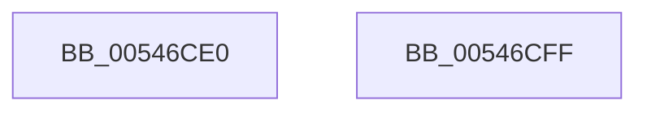

# HalpAcquirePmuAccessRequest

- RVA: `0x00546CE0`–`0x00546D00` (길이 `32` bytes)
- VA: `0x0000000140546CE0`
- 실행 섹션: `.text`
- PDB 이름 있음: `예`; PDB Function 태그: `아니요`
- unwind 정보 RVA: `0x000DB714`
- 디코드: `10`개 명령, `32/32` bytes 표시
- 미해석 바이트: `0` (있으면 어셈블리에 `.byte`로 보존)

> 이 문서는 커널 이미지의 기계어와 PDB 기호를 분석해 생성했습니다. 4번과 5번은 함수 원형과 자료형을 바이너리 사용 방식에서 추정한 C 해석이며 원본 소스 복구 결과는 아닙니다.

## 1. Dependencies

- 직접 호출 지점: **0**; 고유 호출 대상: **0**
- 직접 호출자로 확인된 함수: **2**
- RIP 상대 이미지 참조: **1**

### Outgoing calls
- 직접 디코드된 call 명령이 없습니다.

### Direct callers
- [HalpNotifyActorIfPmuAvailable](../../page/70/HalpNotifyActorIfPmuAvailable_function_00707880.md) at `0x0070794E`
- [HalpRequestPmuAccess](../../page/AD/HalpRequestPmuAccess_function_00ADB340.md) at `0x00ADB54E`

### Static image references
- `0x00546CE6` → RVA `0x00FC2B48` (`.data`; read)

## 2. Other-region calls and transfers

- 다른 실행 섹션으로 향하는 call: **0**
- 별도 외부 분기/꼬리 이동을 확인하지 못했습니다.

## 3. Assembly (complete function range)

```asm
00546CE0  33 C0                           xor eax, eax
00546CE2  44 8D 40 01                     lea r8d, [rax + 1]
00546CE6  F0 44 0F B1 05 59 BE A7 00      lock cmpxchg dword ptr [rip + 0xa7be59], r8d
00546CEF  33 C9                           xor ecx, ecx
00546CF1  BA 11 00 00 80                  mov edx, 0x80000011
00546CF6  41 3B C0                        cmp eax, r8d
00546CF9  0F 44 CA                        cmove ecx, edx
00546CFC  8B C1                           mov eax, ecx
00546CFE  C3                              ret
00546CFF  CC                              int3
```

## 4. C-style interpretation (structured pseudocode)

```c
__int64 __fastcall HalpAcquirePmuAccessRequest(int a1)
{
    __int64 result;

    result = 0;
    a1 = 0;
    if (0 == ((unsigned int)(result + 1))) { a1 = (unsigned int)((unsigned int)(0x80000011ULL)); }
    return (unsigned int)(a1);
}
```

## 5. (Beta) C Style

```c
int64_t HalpAcquirePmuAccessRequest(int32_t Arg1)
{
    int64_t result;

    result = 0;
    Arg1 = 0;
    if (0 == ((uint32_t)(result + 1))) { Arg1 = (uint32_t)((uint32_t)(0x80000011ULL)); }
    return (uint32_t)(Arg1);
}
```

## 6. Execution-region graph

[열기: 2D/3D 그래프와 함수 탐색 컨트롤 패널](../../../control-panel.html?section=text&rva=0x00546CE0&view=graph)

- 2D 그래프는 위에서 아래로 흐르고, 3D 그래프는 빈 공간을 드래그해 회전합니다. Shift+드래그는 이동, 휠은 확대·축소, 함수 노드 선택은 대상 보고서 이동입니다.

### Static fallback


