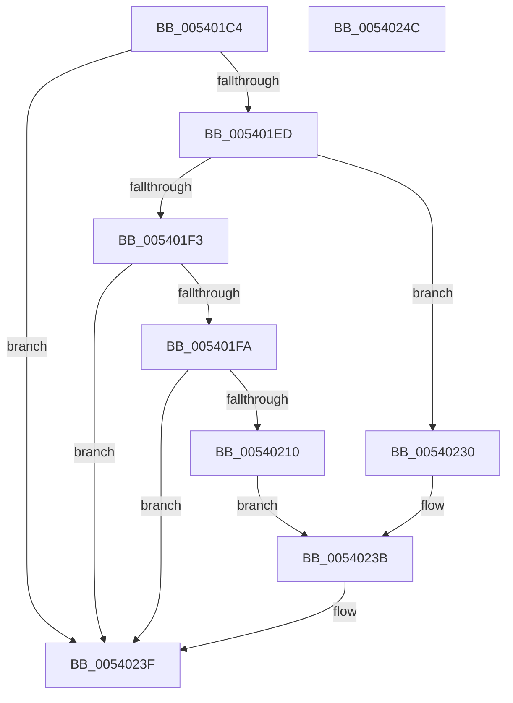

# HalpAddMcaToMemoryErrorSection

- RVA: `0x005401C4`–`0x0054024D` (길이 `137` bytes)
- VA: `0x00000001405401C4`
- 실행 섹션: `.text`
- PDB 이름 있음: `예`; PDB Function 태그: `아니요`
- unwind 정보 RVA: `0x0005CAAC`
- 디코드: `39`개 명령, `137/137` bytes 표시
- 미해석 바이트: `0` (있으면 어셈블리에 `.byte`로 보존)

> 이 문서는 커널 이미지의 기계어와 PDB 기호를 분석해 생성했습니다. 4번과 5번은 함수 원형과 자료형을 바이너리 사용 방식에서 추정한 C 해석이며 원본 소스 복구 결과는 아닙니다.

## 1. Dependencies

- 직접 호출 지점: **1**; 고유 호출 대상: **1**
- 직접 호출자로 확인된 함수: **1**
- RIP 상대 이미지 참조: **1**

### Outgoing calls
- `0x005401DD` → [memset](../6C/memset_function_006C6C40.md) (function, `0x006C6C40`)

### Direct callers
- [HalpCreateMcaMemoryErrorRecord](HalpCreateMcaMemoryErrorRecord_function_00540C78.md) at `0x00540D79`

### Static image references
- `0x00540220` → RVA `0x00E0A810` (`.data`; read)

## 2. Other-region calls and transfers

- 다른 실행 섹션으로 향하는 call: **0**
- 별도 외부 분기/꼬리 이동을 확인하지 못했습니다.

## 3. Assembly (complete function range)

```asm
005401C4  48 89 5C 24 08                  mov qword ptr [rsp + 8], rbx
005401C9  57                              push rdi
005401CA  48 83 EC 20                     sub rsp, 0x20
005401CE  48 8B FA                        mov rdi, rdx
005401D1  48 8B D9                        mov rbx, rcx
005401D4  33 D2                           xor edx, edx
005401D6  48 8B CF                        mov rcx, rdi
005401D9  44 8D 42 50                     lea r8d, [rdx + 0x50]
005401DD  E8 5E 6A 18 00                  call 0x1406c6c40
005401E2  48 8B 43 28                     mov rax, qword ptr [rbx + 0x28]
005401E6  48 0F BA E0 3A                  bt rax, 0x3a
005401EB  73 52                           jae 0x14054023f
005401ED  83 7B 04 01                     cmp dword ptr [rbx + 4], 1
005401F1  75 3D                           jne 0x140540230
005401F3  48 0F BA E0 3B                  bt rax, 0x3b
005401F8  73 45                           jae 0x14054023f
005401FA  48 8B 43 38                     mov rax, qword ptr [rbx + 0x38]
005401FE  48 8B C8                        mov rcx, rax
00540201  81 E1 C0 01 00 00               and ecx, 0x1c0
00540207  48 81 F9 80 00 00 00            cmp rcx, 0x80
0054020E  75 2F                           jne 0x14054023f
00540210  24 3F                           and al, 0x3f
00540212  83 CA FF                        or edx, 0xffffffff
00540215  8A C8                           mov cl, al
00540217  D3 E2                           shl edx, cl
00540219  48 63 C2                        movsxd rax, edx
0054021C  48 23 43 30                     and rax, qword ptr [rbx + 0x30]
00540220  48 23 05 E9 A5 8C 00            and rax, qword ptr [rip + 0x8ca5e9]
00540227  48 C7 07 02 00 00 00            mov qword ptr [rdi], 2
0054022E  EB 0B                           jmp 0x14054023b
00540230  48 C7 07 02 00 00 00            mov qword ptr [rdi], 2
00540237  48 8B 43 30                     mov rax, qword ptr [rbx + 0x30]
0054023B  48 89 47 10                     mov qword ptr [rdi + 0x10], rax
0054023F  48 8B 5C 24 30                  mov rbx, qword ptr [rsp + 0x30]
00540244  33 C0                           xor eax, eax
00540246  48 83 C4 20                     add rsp, 0x20
0054024A  5F                              pop rdi
0054024B  C3                              ret
0054024C  CC                              int3
```

## 4. C-style interpretation (structured pseudocode)

```c
__int64 __fastcall HalpAddMcaToMemoryErrorSection(__int64 a1, __int64 a2)
{
    __int64 result;
    __int64 v_rsp;
    unsigned __int64 v_stack_p8;

    v_stack_p8 = v_rbx;
    v_rsp = (v_rsp) - (32);
    a2 = 0;
    result = memset(0, a2, a2 + 80, a4);
    if (condition_is_above_or_equal) goto loc_0054023F;
    if ((*(unsigned int *)(a1 + 4)) != 1) goto loc_00540230;
    if ((*(unsigned int *)(a1 + 4)) >= 1) goto loc_0054023F;
    a1 = (unsigned int)((*(unsigned __int64 *)(a1 + 56)) & (448));
    if (a1 != 128) goto loc_0054023F;
    result = (unsigned __int8)((*(unsigned __int64 *)(a1 + 56)) & (63));
    a2 = (unsigned int)((a2) | (0xFFFFFFFFULL));
    a2 = (unsigned int)((a2) << ((unsigned __int8)((unsigned __int8)(result))));
    result = ((int)((unsigned int)(a2))) & (*(unsigned __int64 *)(a1 + 48));
    result = (result) & (*(unsigned __int64 *)(v_rip + 9217513));
    *(unsigned __int64 *)(a2) = 2;
    goto loc_0054023B;
loc_00540230:
    *(unsigned __int64 *)(a2) = 2;
loc_0054023B:
    *(unsigned __int64 *)(a2 + 16) = *(unsigned __int64 *)(a1 + 48);
loc_0054023F:
    result = 0;
    v_rsp = (v_rsp) + (32);
    return result;
}
```

## 5. (Beta) C Style

```c
int64_t HalpAddMcaToMemoryErrorSection(void *Arg1, void *Arg2)
{
    uint8_t *arg1 = (uint8_t *)Arg1;
    uint8_t *arg2 = (uint8_t *)Arg2;

    int64_t result;
    int64_t local_rsp;
    uint64_t v_stack_p8;

    v_stack_p8 = local_rbx;
    local_rsp = (local_rsp) - (32);
    Arg2 = 0;
    result = memset(0, Arg2, Arg2 + 80, a4);
    if (condition_is_above_or_equal) goto loc_0054023F;
    if ((*(uint32_t *)(arg1 + 0x4)) != 1) goto loc_00540230;
    if ((*(uint32_t *)(arg1 + 0x4)) >= 1) goto loc_0054023F;
    Arg1 = (uint32_t)((*(uint64_t *)(arg1 + 0x38)) & (448));
    if (Arg1 != 128) goto loc_0054023F;
    result = (uint8_t)((*(uint64_t *)(arg1 + 0x38)) & (63));
    Arg2 = (uint32_t)((Arg2) | (0xFFFFFFFFULL));
    Arg2 = (uint32_t)((Arg2) << ((uint8_t)((uint8_t)(result))));
    result = ((int32_t)((uint32_t)(Arg2))) & (*(uint64_t *)(arg1 + 0x30));
    result = (result) & (*(uint64_t *)(v_rip + 0x8CA5E9));
    *(uint64_t *)(arg2) = 2;
    goto loc_0054023B;
loc_00540230:
    *(uint64_t *)(arg2) = 2;
loc_0054023B:
    *(uint64_t *)(arg2 + 0x10) = *(uint64_t *)(arg1 + 0x30);
loc_0054023F:
    result = 0;
    local_rsp = (local_rsp) + (32);
    return result;
}
```

### 관측된 메모리 오프셋

구조체 형식이 확인되지 않은 접근은 인자 기준의 오프셋으로만 기록했습니다.

| 기준 인자 | 오프셋 표현 | 폭 (bit) | 접근 |
|---|---:|---:|---|
| `Arg1` | `+ 0x4` | `32` | `R` |
| `Arg1` | `+ 0x28` | `64` | `R` |
| `Arg1` | `+ 0x30` | `64` | `R` |
| `Arg1` | `+ 0x38` | `64` | `R` |
| `Arg2` | `+ 0x0` | `64` | `W` |
| `Arg2` | `+ 0x10` | `64` | `W` |

## 6. Execution-region graph

[열기: 2D/3D 그래프와 함수 탐색 컨트롤 패널](../../../control-panel.html?section=text&rva=0x005401C4&view=graph)

- 2D 그래프는 위에서 아래로 흐르고, 3D 그래프는 빈 공간을 드래그해 회전합니다. Shift+드래그는 이동, 휠은 확대·축소, 함수 노드 선택은 대상 보고서 이동입니다.

### Static fallback


