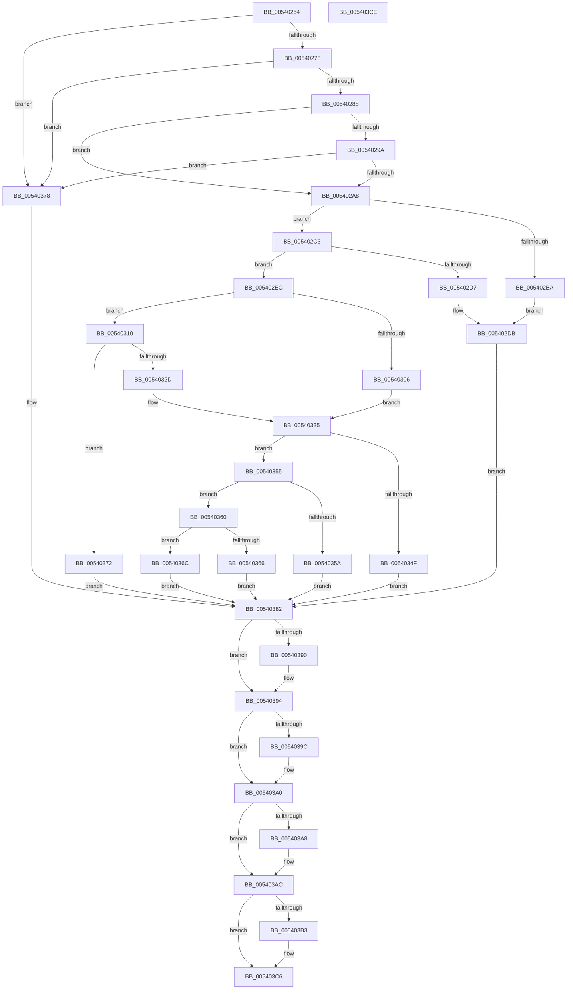

# HalpAddMcaToProcessorGenericSection

- RVA: `0x00540254`–`0x005403CF` (길이 `379` bytes)
- VA: `0x0000000140540254`
- 실행 섹션: `.text`
- PDB 이름 있음: `예`; PDB Function 태그: `아니요`
- unwind 정보 RVA: `0x00071750`
- 디코드: `102`개 명령, `379/379` bytes 표시
- 미해석 바이트: `0` (있으면 어셈블리에 `.byte`로 보존)

> 이 문서는 커널 이미지의 기계어와 PDB 기호를 분석해 생성했습니다. 4번과 5번은 함수 원형과 자료형을 바이너리 사용 방식에서 추정한 C 해석이며 원본 소스 복구 결과는 아닙니다.

## 1. Dependencies

- 직접 호출 지점: **0**; 고유 호출 대상: **0**
- 직접 호출자로 확인된 함수: **2**
- RIP 상대 이미지 참조: **0**

### Outgoing calls
- 직접 디코드된 call 명령이 없습니다.

### Direct callers
- [HalpCreateMcaMemoryErrorRecord](HalpCreateMcaMemoryErrorRecord_function_00540C78.md) at `0x00540DE0`
- [HalpCreateMcaProcessorErrorRecord](HalpCreateMcaProcessorErrorRecord_function_00541038.md) at `0x0054110A`

### Static image references
- 디코드된 RIP-relative 메모리 참조가 없습니다.

## 2. Other-region calls and transfers

- 다른 실행 섹션으로 향하는 call: **0**
- 별도 외부 분기/꼬리 이동을 확인하지 못했습니다.

## 3. Assembly (complete function range)

```asm
00540254  48 89 5C 24 08                  mov qword ptr [rsp + 8], rbx
00540259  44 0F B7 41 28                  movzx r8d, word ptr [rcx + 0x28]
0054025E  BB 10 00 00 00                  mov ebx, 0x10
00540263  4C 8B C9                        mov r9, rcx
00540266  41 8D 40 FF                     lea eax, [r8 - 1]
0054026A  44 8D 5B F4                     lea r11d, [rbx - 0xc]
0054026E  66 41 3B C3                     cmp ax, r11w
00540272  0F 86 00 01 00 00               jbe 0x140540378
00540278  41 BA 00 04 00 00               mov r10d, 0x400
0054027E  66 45 3B C2                     cmp r8w, r10w
00540282  0F 84 F0 00 00 00               je 0x140540378
00540288  41 0F B7 C0                     movzx eax, r8w
0054028C  B9 00 FC 00 00                  mov ecx, 0xfc00
00540291  66 23 C1                        and ax, cx
00540294  66 41 3B C2                     cmp ax, r10w
00540298  75 0E                           jne 0x1405402a8
0054029A  41 8D 42 FF                     lea eax, [r10 - 1]
0054029E  66 44 85 C0                     test ax, r8w
005402A2  0F 85 D0 00 00 00               jne 0x140540378
005402A8  41 0F B7 C0                     movzx eax, r8w
005402AC  B9 FC EF 00 00                  mov ecx, 0xeffc
005402B1  66 23 C1                        and ax, cx
005402B4  66 83 F8 0C                     cmp ax, 0xc
005402B8  75 09                           jne 0x1405402c3
005402BA  48 8B 0A                        mov rcx, qword ptr [rdx]
005402BD  C6 42 0A 01                     mov byte ptr [rdx + 0xa], 1
005402C1  EB 18                           jmp 0x1405402db
005402C3  B9 F0 EF 00 00                  mov ecx, 0xeff0
005402C8  41 0F B7 C0                     movzx eax, r8w
005402CC  66 23 C1                        and ax, cx
005402CF  48 8B 0A                        mov rcx, qword ptr [rdx]
005402D2  66 3B C3                        cmp ax, bx
005402D5  75 15                           jne 0x1405402ec
005402D7  C6 42 0A 02                     mov byte ptr [rdx + 0xa], 2
005402DB  41 80 E0 03                     and r8b, 3
005402DF  44 88 42 0D                     mov byte ptr [rdx + 0xd], r8b
005402E3  48 83 C9 24                     or rcx, 0x24
005402E7  E9 96 00 00 00                  jmp 0x140540382
005402EC  41 BA 00 EF 00 00               mov r10d, 0xef00
005402F2  41 0F B7 C0                     movzx eax, r8w
005402F6  66 41 23 C2                     and ax, r10w
005402FA  41 BA 00 01 00 00               mov r10d, 0x100
00540300  66 41 3B C2                     cmp ax, r10w
00540304  75 0A                           jne 0x140540310
00540306  C6 42 0A 01                     mov byte ptr [rdx + 0xa], 1
0054030A  48 83 C9 24                     or rcx, 0x24
0054030E  EB 25                           jmp 0x140540335
00540310  41 BA 00 E8 00 00               mov r10d, 0xe800
00540316  41 0F B7 C0                     movzx eax, r8w
0054031A  66 41 23 C2                     and ax, r10w
0054031E  49 0B CB                        or rcx, r11
00540321  41 BA 00 08 00 00               mov r10d, 0x800
00540327  66 41 3B C2                     cmp ax, r10w
0054032B  75 45                           jne 0x140540372
0054032D  44 88 5A 0A                     mov byte ptr [rdx + 0xa], r11b
00540331  48 83 C9 20                     or rcx, 0x20
00540335  41 0F B6 C0                     movzx eax, r8b
00540339  48 83 C9 08                     or rcx, 8
0054033D  44 8B C0                        mov r8d, eax
00540340  24 03                           and al, 3
00540342  41 C1 E8 04                     shr r8d, 4
00540346  88 42 0D                        mov byte ptr [rdx + 0xd], al
00540349  41 83 F8 03                     cmp r8d, 3
0054034D  75 06                           jne 0x140540355
0054034F  C6 42 0B 01                     mov byte ptr [rdx + 0xb], 1
00540353  EB 2D                           jmp 0x140540382
00540355  45 3B C3                        cmp r8d, r11d
00540358  75 06                           jne 0x140540360
0054035A  C6 42 0B 02                     mov byte ptr [rdx + 0xb], 2
0054035E  EB 22                           jmp 0x140540382
00540360  41 83 F8 05                     cmp r8d, 5
00540364  75 06                           jne 0x14054036c
00540366  C6 42 0B 03                     mov byte ptr [rdx + 0xb], 3
0054036A  EB 16                           jmp 0x140540382
0054036C  C6 42 0B 00                     mov byte ptr [rdx + 0xb], 0
00540370  EB 10                           jmp 0x140540382
00540372  C6 42 0A 00                     mov byte ptr [rdx + 0xa], 0
00540376  EB 0A                           jmp 0x140540382
00540378  48 8B 0A                        mov rcx, qword ptr [rdx]
0054037B  49 0B CB                        or rcx, r11
0054037E  C6 42 0A 08                     mov byte ptr [rdx + 0xa], 8
00540382  48 0B CB                        or rcx, rbx
00540385  48 89 0A                        mov qword ptr [rdx], rcx
00540388  49 0F BA 61 28 39               bt qword ptr [r9 + 0x28], 0x39
0054038E  72 04                           jb 0x140540394
00540390  80 62 0C 01                     and byte ptr [rdx + 0xc], 1
00540394  49 0F BA 61 28 3E               bt qword ptr [r9 + 0x28], 0x3e
0054039A  73 04                           jae 0x1405403a0
0054039C  44 20 5A 0C                     and byte ptr [rdx + 0xc], r11b
005403A0  49 0F BA 61 28 3D               bt qword ptr [r9 + 0x28], 0x3d
005403A6  72 04                           jb 0x1405403ac
005403A8  80 62 0C 08                     and byte ptr [rdx + 0xc], 8
005403AC  41 F6 41 14 02                  test byte ptr [r9 + 0x14], 2
005403B1  74 13                           je 0x1405403c6
005403B3  48 0F BA E9 0C                  bts rcx, 0xc
005403B8  48 89 0A                        mov qword ptr [rdx], rcx
005403BB  49 8B 41 1C                     mov rax, qword ptr [r9 + 0x1c]
005403BF  48 89 82 B8 00 00 00            mov qword ptr [rdx + 0xb8], rax
005403C6  48 8B 5C 24 08                  mov rbx, qword ptr [rsp + 8]
005403CB  33 C0                           xor eax, eax
005403CD  C3                              ret
005403CE  CC                              int3
```

## 4. C-style interpretation (structured pseudocode)

```c
__int64 __fastcall HalpAddMcaToProcessorGenericSection(__int64 a1, __int64 a2)
{
    __int64 result;
    unsigned __int64 v_stack_p8;

    v_stack_p8 = v_rbx;
    if (((unsigned __int16)(*(unsigned __int16 *)(a1 + 40) - 1)) <= ((unsigned __int16)(16 - 12))) goto loc_00540378;
    if (((unsigned __int16)(*(unsigned __int16 *)(a1 + 40))) == ((unsigned __int16)((unsigned int)(0x400ULL)))) goto loc_00540378;
    result = (unsigned __int16)(((unsigned __int16)(*(unsigned __int16 *)(a1 + 40))) & ((unsigned __int16)((unsigned int)(0xFC00ULL))));
    if (((unsigned __int16)(result)) != ((unsigned __int16)((unsigned int)(0x400ULL)))) goto loc_005402A8;
    if ((((unsigned __int16)((unsigned int)(0x400ULL) - 1)) & ((unsigned __int16)(*(unsigned __int16 *)(a1 + 40)))) != 0) goto loc_00540378;
loc_005402A8:
    result = (unsigned __int16)(((unsigned __int16)(*(unsigned __int16 *)(a1 + 40))) & ((unsigned __int16)((unsigned int)(0xEFFCULL))));
    if (((unsigned __int16)(result)) != 12) goto loc_005402C3;
    *(unsigned __int8 *)(a2 + 10) = 1;
    goto loc_005402DB;
loc_005402C3:
    result = (unsigned __int16)(((unsigned __int16)(*(unsigned __int16 *)(a1 + 40))) & ((unsigned __int16)((unsigned int)(0xEFF0ULL))));
    if (((unsigned __int16)(result)) != 16) goto loc_005402EC;
    *(unsigned __int8 *)(a2 + 10) = 2;
loc_005402DB:
    a3 = (unsigned __int8)((*(unsigned __int16 *)(a1 + 40)) & (3));
    *(unsigned __int8 *)(a2 + 13) = (unsigned __int8)(a3);
    a1 = (*(unsigned __int64 *)(a2)) | (36);
    goto loc_00540382;
loc_005402EC:
    result = (unsigned __int16)(((unsigned __int16)(a3)) & ((unsigned __int16)((unsigned int)(0xEF00ULL))));
    if (((unsigned __int16)(result)) != 256) goto loc_00540310;
    *(unsigned __int8 *)(a2 + 10) = 1;
    a1 = (a1) | (36);
    goto loc_00540335;
loc_00540310:
    result = (unsigned __int16)(((unsigned __int16)(a3)) & ((unsigned __int16)((unsigned int)(0xE800ULL))));
    a1 = (a1) | (16 - 12);
    if (((unsigned __int16)(result)) != ((unsigned __int16)((unsigned int)(0x800ULL)))) goto loc_00540372;
    *(unsigned __int8 *)(a2 + 10) = (unsigned __int8)(16 - 12);
    a1 = (a1) | (32);
loc_00540335:
    a1 = (a1) | (8);
    result = (unsigned __int8)(((unsigned __int8)(a3)) & (3));
    a3 = (unsigned int)(((unsigned int)((unsigned int)((unsigned __int8)(a3)))) >> (4));
    *(unsigned __int8 *)(a2 + 13) = (unsigned __int8)(result);
    if (((unsigned int)(a3)) != 3) goto loc_00540355;
    *(unsigned __int8 *)(a2 + 11) = 1;
    goto loc_00540382;
loc_00540355:
    if (((unsigned int)(a3)) != ((unsigned int)(16 - 12))) goto loc_00540360;
    *(unsigned __int8 *)(a2 + 11) = 2;
    goto loc_00540382;
loc_00540360:
    if (((unsigned int)(a3)) != 5) goto loc_0054036C;
    *(unsigned __int8 *)(a2 + 11) = 3;
    goto loc_00540382;
loc_0054036C:
    *(unsigned __int8 *)(a2 + 11) = 0;
    goto loc_00540382;
loc_00540372:
    *(unsigned __int8 *)(a2 + 10) = 0;
    goto loc_00540382;
loc_00540378:
    a1 = (*(unsigned __int64 *)(a2)) | (16 - 12);
    *(unsigned __int8 *)(a2 + 10) = 8;
loc_00540382:
    a1 = (a1) | (16);
    *(unsigned __int64 *)(a2) = a1;
    if (!(condition_is_below)) {
    }
    if (!(condition_is_above_or_equal)) {
    }
    if (!(condition_is_below)) {
    }
    if (((*(unsigned __int8 *)(a1 + 20)) & (2)) != 0) {
        *(unsigned __int64 *)(a2) = a1;
        result = *(unsigned __int64 *)(a1 + 28);
        *(unsigned __int64 *)(a2 + 184) = result;
    }
    result = 0;
    return result;
}
```

## 5. (Beta) C Style

```c
int64_t HalpAddMcaToProcessorGenericSection(void *Arg1, void *Arg2)
{
    uint8_t *arg1 = (uint8_t *)Arg1;
    uint8_t *arg2 = (uint8_t *)Arg2;

    int64_t result;
    uint64_t v_stack_p8;

    v_stack_p8 = local_rbx;
    if (((uint16_t)(*(uint16_t *)(arg1 + 0x28) - 1)) <= ((uint16_t)(16 - 12))) goto loc_00540378;
    if (((uint16_t)(*(uint16_t *)(arg1 + 0x28))) == ((uint16_t)((uint32_t)(0x400ULL)))) goto loc_00540378;
    result = (uint16_t)(((uint16_t)(*(uint16_t *)(arg1 + 0x28))) & ((uint16_t)((uint32_t)(0xFC00ULL))));
    if (((uint16_t)(result)) != ((uint16_t)((uint32_t)(0x400ULL)))) goto loc_005402A8;
    if ((((uint16_t)((uint32_t)(0x400ULL) - 1)) & ((uint16_t)(*(uint16_t *)(arg1 + 0x28)))) != 0) goto loc_00540378;
loc_005402A8:
    result = (uint16_t)(((uint16_t)(*(uint16_t *)(arg1 + 0x28))) & ((uint16_t)((uint32_t)(0xEFFCULL))));
    if (((uint16_t)(result)) != 12) goto loc_005402C3;
    *(uint8_t *)(arg2 + 0xA) = 1;
    goto loc_005402DB;
loc_005402C3:
    result = (uint16_t)(((uint16_t)(*(uint16_t *)(arg1 + 0x28))) & ((uint16_t)((uint32_t)(0xEFF0ULL))));
    if (((uint16_t)(result)) != 16) goto loc_005402EC;
    *(uint8_t *)(arg2 + 0xA) = 2;
loc_005402DB:
    a3 = (uint8_t)((*(uint16_t *)(arg1 + 0x28)) & (3));
    *(uint8_t *)(arg2 + 0xD) = (uint8_t)(a3);
    Arg1 = (*(uint64_t *)(arg2)) | (36);
    goto loc_00540382;
loc_005402EC:
    result = (uint16_t)(((uint16_t)(a3)) & ((uint16_t)((uint32_t)(0xEF00ULL))));
    if (((uint16_t)(result)) != 256) goto loc_00540310;
    *(uint8_t *)(arg2 + 0xA) = 1;
    Arg1 = (Arg1) | (36);
    goto loc_00540335;
loc_00540310:
    result = (uint16_t)(((uint16_t)(a3)) & ((uint16_t)((uint32_t)(0xE800ULL))));
    Arg1 = (Arg1) | (16 - 12);
    if (((uint16_t)(result)) != ((uint16_t)((uint32_t)(0x800ULL)))) goto loc_00540372;
    *(uint8_t *)(arg2 + 0xA) = (uint8_t)(16 - 12);
    Arg1 = (Arg1) | (32);
loc_00540335:
    Arg1 = (Arg1) | (8);
    result = (uint8_t)(((uint8_t)(a3)) & (3));
    a3 = (uint32_t)(((uint32_t)((uint32_t)((uint8_t)(a3)))) >> (4));
    *(uint8_t *)(arg2 + 0xD) = (uint8_t)(result);
    if (((uint32_t)(a3)) != 3) goto loc_00540355;
    *(uint8_t *)(arg2 + 0xB) = 1;
    goto loc_00540382;
loc_00540355:
    if (((uint32_t)(a3)) != ((uint32_t)(16 - 12))) goto loc_00540360;
    *(uint8_t *)(arg2 + 0xB) = 2;
    goto loc_00540382;
loc_00540360:
    if (((uint32_t)(a3)) != 5) goto loc_0054036C;
    *(uint8_t *)(arg2 + 0xB) = 3;
    goto loc_00540382;
loc_0054036C:
    *(uint8_t *)(arg2 + 0xB) = 0;
    goto loc_00540382;
loc_00540372:
    *(uint8_t *)(arg2 + 0xA) = 0;
    goto loc_00540382;
loc_00540378:
    Arg1 = (*(uint64_t *)(arg2)) | (16 - 12);
    *(uint8_t *)(arg2 + 0xA) = 8;
loc_00540382:
    Arg1 = (Arg1) | (16);
    *(void **)(arg2) = Arg1;
    if (!(condition_is_below)) {
    }
    if (!(condition_is_above_or_equal)) {
    }
    if (!(condition_is_below)) {
    }
    if (((*(uint8_t *)(arg1 + 0x14)) & (2)) != 0) {
        *(void **)(arg2) = Arg1;
        result = *(uint64_t *)(arg1 + 0x1C);
        *(uint64_t *)(arg2 + 0xB8) = result;
    }
    result = 0;
    return result;
}
```

### 관측된 메모리 오프셋

구조체 형식이 확인되지 않은 접근은 인자 기준의 오프셋으로만 기록했습니다.

| 기준 인자 | 오프셋 표현 | 폭 (bit) | 접근 |
|---|---:|---:|---|
| `Arg1` | `+ 0x14` | `8` | `R` |
| `Arg1` | `+ 0x1C` | `64` | `R` |
| `Arg1` | `+ 0x28` | `16` | `R` |
| `Arg1` | `+ 0x28` | `64` | `R` |
| `Arg2` | `+ 0x0` | `64` | `R` |
| `Arg2` | `+ 0x0` | `64` | `W` |
| `Arg2` | `+ 0xA` | `8` | `W` |
| `Arg2` | `+ 0xB` | `8` | `W` |
| `Arg2` | `+ 0xC` | `8` | `R/W` |
| `Arg2` | `+ 0xD` | `8` | `W` |
| `Arg2` | `+ 0xB8` | `64` | `W` |

## 6. Execution-region graph

[열기: 2D/3D 그래프와 함수 탐색 컨트롤 패널](../../../control-panel.html?section=text&rva=0x00540254&view=graph)

- 2D 그래프는 위에서 아래로 흐르고, 3D 그래프는 빈 공간을 드래그해 회전합니다. Shift+드래그는 이동, 휠은 확대·축소, 함수 노드 선택은 대상 보고서 이동입니다.

### Static fallback


