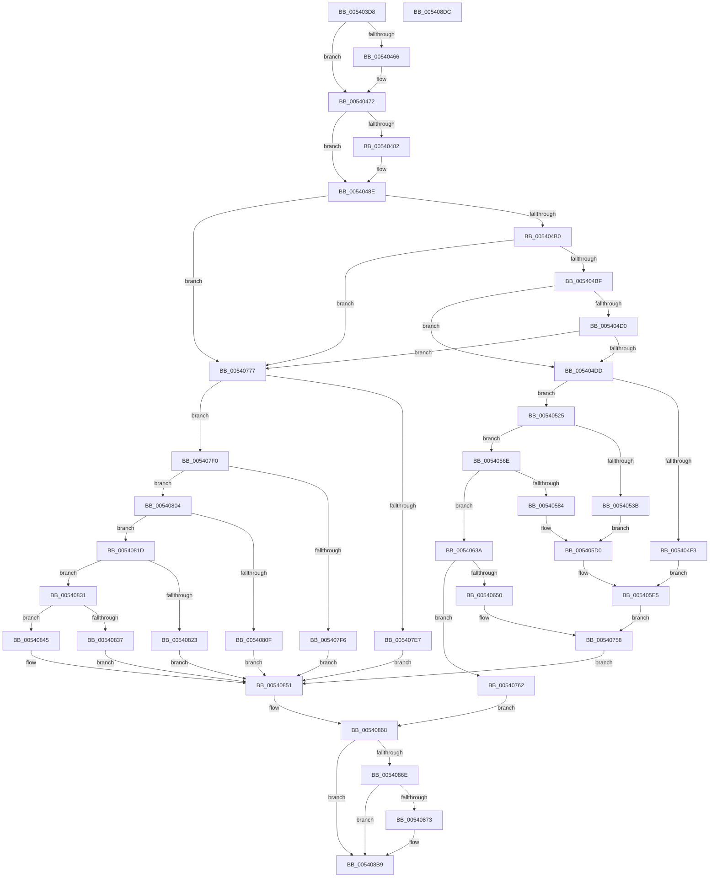

# HalpAddMcaToProcessorSpecificSection

- RVA: `0x005403D8`–`0x005408DD` (길이 `1,285` bytes)
- VA: `0x00000001405403D8`
- 실행 섹션: `.text`
- PDB 이름 있음: `예`; PDB Function 태그: `아니요`
- unwind 정보 RVA: `0x0007BBB4`
- 디코드: `325`개 명령, `1,285/1,285` bytes 표시
- 미해석 바이트: `0` (있으면 어셈블리에 `.byte`로 보존)

> 이 문서는 커널 이미지의 기계어와 PDB 기호를 분석해 생성했습니다. 4번과 5번은 함수 원형과 자료형을 바이너리 사용 방식에서 추정한 C 해석이며 원본 소스 복구 결과는 아닙니다.

## 1. Dependencies

- 직접 호출 지점: **4**; 고유 호출 대상: **4**
- 직접 호출자로 확인된 함수: **1**
- RIP 상대 이미지 참조: **5**

### Outgoing calls
- `0x00540444` → [guard_dispatch_icall](../6B/guard_dispatch_icall_function_006BAAD0.md) (function, `0x006BAAD0`)
- `0x00540451` → [HalpWheaGetApicId](HalpWheaGetApicId_function_005424D0.md) (function, `0x005424D0`)
- `0x0054076A` → [memset](../6C/memset_function_006C6C40.md) (function, `0x006C6C40`)
- `0x005408AE` → [memcpy](../6C/memcpy_function_006C6840.md) (function, `0x006C6840`)

### Direct callers
- [HalpCreateMcaProcessorErrorRecord](HalpCreateMcaProcessorErrorRecord_function_00541038.md) at `0x0054113A`

### Static image references
- `0x0054043D` → RVA `0x00FC1988` (`.data`; read)
- `0x005404FB` → RVA `0x00024DD8` (`.rdata`; read)
- `0x00540543` → RVA `0x00024DB8` (`.rdata`; read)
- `0x00540658` → RVA `0x00024E08` (`.rdata`; read)
- `0x0054077F` → RVA `0x00024D98` (`.rdata`; read)

## 2. Other-region calls and transfers

- 다른 실행 섹션으로 향하는 call: **0**
- 별도 외부 분기/꼬리 이동을 확인하지 못했습니다.

## 3. Assembly (complete function range)

```asm
005403D8  48 89 5C 24 10                  mov qword ptr [rsp + 0x10], rbx
005403DD  48 89 6C 24 18                  mov qword ptr [rsp + 0x18], rbp
005403E2  48 89 74 24 20                  mov qword ptr [rsp + 0x20], rsi
005403E7  57                              push rdi
005403E8  41 54                           push r12
005403EA  41 55                           push r13
005403EC  41 56                           push r14
005403EE  41 57                           push r15
005403F0  48 83 EC 40                     sub rsp, 0x40
005403F4  45 33 E4                        xor r12d, r12d
005403F7  4D 8B F8                        mov r15, r8
005403FA  4C 8D 42 10                     lea r8, [rdx + 0x10]
005403FE  4C 89 64 24 70                  mov qword ptr [rsp + 0x70], r12
00540403  4D 8D 50 0C                     lea r10, [r8 + 0xc]
00540407  4C 8B F2                        mov r14, rdx
0054040A  48 8B D9                        mov rbx, rcx
0054040D  4C 89 54 24 28                  mov qword ptr [rsp + 0x28], r10
00540412  4D 8D 58 08                     lea r11, [r8 + 8]
00540416  45 8D 6C 24 02                  lea r13d, [r12 + 2]
0054041B  4C 89 5C 24 20                  mov qword ptr [rsp + 0x20], r11
00540420  4C 09 2A                        or qword ptr [rdx], r13
00540423  41 8D 74 24 40                  lea esi, [r12 + 0x40]
00540428  8B 41 10                        mov eax, dword ptr [rcx + 0x10]
0054042B  8D 6E C1                        lea ebp, [rsi - 0x3f]
0054042E  89 44 24 70                     mov dword ptr [rsp + 0x70], eax
00540432  4D 8D 48 04                     lea r9, [r8 + 4]
00540436  48 8B 4C 24 70                  mov rcx, qword ptr [rsp + 0x70]
0054043B  8B D5                           mov edx, ebp
0054043D  48 8B 05 44 15 A8 00            mov rax, qword ptr [rip + 0xa81544]
00540444  E8 87 A6 17 00                  call 0x1406baad0
00540449  48 8B 4C 24 70                  mov rcx, qword ptr [rsp + 0x70]
0054044E  49 09 2E                        or qword ptr [r14], rbp
00540451  E8 7A 20 00 00                  call 0x1405424d0
00540456  49 89 46 08                     mov qword ptr [r14 + 8], rax
0054045A  49 8D 7E 40                     lea rdi, [r14 + 0x40]
0054045E  48 0F BA 63 28 3A               bt qword ptr [rbx + 0x28], 0x3a
00540464  73 0C                           jae 0x140540472
00540466  4C 09 6F 10                     or qword ptr [rdi + 0x10], r13
0054046A  48 8B 43 30                     mov rax, qword ptr [rbx + 0x30]
0054046E  48 89 47 20                     mov qword ptr [rdi + 0x20], rax
00540472  41 BD 10 00 00 00               mov r13d, 0x10
00540478  45 8D 4D F2                     lea r9d, [r13 - 0xe]
0054047C  44 84 4B 14                     test byte ptr [rbx + 0x14], r9b
00540480  74 0C                           je 0x14054048e
00540482  4C 09 6F 10                     or qword ptr [rdi + 0x10], r13
00540486  48 8B 43 1C                     mov rax, qword ptr [rbx + 0x1c]
0054048A  48 89 47 38                     mov qword ptr [rdi + 0x38], rax
0054048E  44 0F B7 5B 28                  movzx r11d, word ptr [rbx + 0x28]
00540493  41 B8 03 00 00 00               mov r8d, 3
00540499  41 0F B7 C3                     movzx eax, r11w
0054049D  41 BA 00 01 00 00               mov r10d, 0x100
005404A3  66 2B C5                        sub ax, bp
005404A6  66 41 3B C0                     cmp ax, r8w
005404AA  0F 86 C7 02 00 00               jbe 0x140540777
005404B0  BA 00 04 00 00                  mov edx, 0x400
005404B5  66 44 3B DA                     cmp r11w, dx
005404B9  0F 84 B8 02 00 00               je 0x140540777
005404BF  41 0F B7 C3                     movzx eax, r11w
005404C3  B9 00 FC 00 00                  mov ecx, 0xfc00
005404C8  66 23 C1                        and ax, cx
005404CB  66 3B C2                        cmp ax, dx
005404CE  75 0D                           jne 0x1405404dd
005404D0  8D 42 FF                        lea eax, [rdx - 1]
005404D3  66 44 85 D8                     test ax, r11w
005404D7  0F 85 9A 02 00 00               jne 0x140540777
005404DD  B9 FC EF 00 00                  mov ecx, 0xeffc
005404E2  41 0F B7 C3                     movzx eax, r11w
005404E6  66 23 C1                        and ax, cx
005404E9  B9 0C 00 00 00                  mov ecx, 0xc
005404EE  66 3B C1                        cmp ax, cx
005404F1  75 32                           jne 0x140540525
005404F3  48 09 6F 10                     or qword ptr [rdi + 0x10], rbp
005404F7  4C 8D 57 18                     lea r10, [rdi + 0x18]
005404FB  0F 10 05 D6 48 AE FF            movups xmm0, xmmword ptr [rip - 0x51b72a]
00540502  41 0F B6 D3                     movzx edx, r11b
00540506  49 23 D0                        and rdx, r8
00540509  48 C1 E2 16                     shl rdx, 0x16
0054050D  F3 0F 7F 07                     movdqu xmmword ptr [rdi], xmm0
00540511  49 8B 02                        mov rax, qword ptr [r10]
00540514  48 25 FF FF 3F FE               and rax, 0xfffffffffe3fffff
0054051A  48 0B D0                        or rdx, rax
0054051D  48 0B D1                        or rdx, rcx
00540520  E9 C0 00 00 00                  jmp 0x1405405e5
00540525  41 0F B7 C3                     movzx eax, r11w
00540529  B9 F0 EF 00 00                  mov ecx, 0xeff0
0054052E  66 23 C1                        and ax, cx
00540531  66 41 3B C5                     cmp ax, r13w
00540535  41 0F B7 C3                     movzx eax, r11w
00540539  75 33                           jne 0x14054056e
0054053B  48 09 6F 10                     or qword ptr [rdi + 0x10], rbp
0054053F  4C 8D 57 18                     lea r10, [rdi + 0x18]
00540543  0F 10 05 6E 48 AE FF            movups xmm0, xmmword ptr [rip - 0x51b792]
0054054A  66 C1 E8 02                     shr ax, 2
0054054E  0F B6 C8                        movzx ecx, al
00540551  F3 0F 7F 07                     movdqu xmmword ptr [rdi], xmm0
00540555  49 8B 12                        mov rdx, qword ptr [r10]
00540558  48 81 E2 FF FF 3C FE            and rdx, 0xfffffffffe3cffff
0054055F  48 C1 E1 10                     shl rcx, 0x10
00540563  48 0B D5                        or rdx, rbp
00540566  81 E1 00 00 03 00               and ecx, 0x30000
0054056C  EB 62                           jmp 0x1405405d0
0054056E  B9 00 EF 00 00                  mov ecx, 0xef00
00540573  66 23 C1                        and ax, cx
00540576  66 41 3B C2                     cmp ax, r10w
0054057A  41 0F B7 C3                     movzx eax, r11w
0054057E  0F 85 B6 00 00 00               jne 0x14054063a
00540584  48 09 6F 10                     or qword ptr [rdi + 0x10], rbp
00540588  4C 8D 57 18                     lea r10, [rdi + 0x18]
0054058C  0F 10 05 45 48 AE FF            movups xmm0, xmmword ptr [rip - 0x51b7bb]
00540593  66 C1 E8 04                     shr ax, 4
00540597  0F B6 C8                        movzx ecx, al
0054059A  41 0F B7 C3                     movzx eax, r11w
0054059E  66 C1 E8 02                     shr ax, 2
005405A2  0F B6 D0                        movzx edx, al
005405A5  48 81 E2 03 FE FF FF            and rdx, 0xfffffffffffffe03
005405AC  48 C1 E1 12                     shl rcx, 0x12
005405B0  48 C1 E2 10                     shl rdx, 0x10
005405B4  F3 0F 7F 07                     movdqu xmmword ptr [rdi], xmm0
005405B8  49 8B 02                        mov rax, qword ptr [r10]
005405BB  48 25 FF FF 00 FE               and rax, 0xfffffffffe00ffff
005405C1  48 0B C5                        or rax, rbp
005405C4  48 33 D0                        xor rdx, rax
005405C7  49 0B D1                        or rdx, r9
005405CA  81 E1 00 00 3C 00               and ecx, 0x3c0000
005405D0  48 33 D1                        xor rdx, rcx
005405D3  41 0F B6 C3                     movzx eax, r11b
005405D7  49 23 C0                        and rax, r8
005405DA  48 C1 E0 16                     shl rax, 0x16
005405DE  48 0B D0                        or rdx, rax
005405E1  48 83 CA 0C                     or rdx, 0xc
005405E5  49 89 12                        mov qword ptr [r10], rdx
005405E8  48 8B 43 28                     mov rax, qword ptr [rbx + 0x28]
005405EC  48 C1 E8 20                     shr rax, 0x20
005405F0  48 33 D0                        xor rdx, rax
005405F3  48 0F BA F2 19                  btr rdx, 0x19
005405F8  48 33 D0                        xor rdx, rax
005405FB  49 0B D5                        or rdx, r13
005405FE  49 89 12                        mov qword ptr [r10], rdx
00540601  48 8B 43 28                     mov rax, qword ptr [rbx + 0x28]
00540605  48 C1 E8 23                     shr rax, 0x23
00540609  48 8B C8                        mov rcx, rax
0054060C  48 33 CA                        xor rcx, rdx
0054060F  48 0F BA F1 1A                  btr rcx, 0x1a
00540614  48 33 C8                        xor rcx, rax
00540617  48 0F BA E9 07                  bts rcx, 7
0054061C  49 89 0A                        mov qword ptr [r10], rcx
0054061F  48 8B 43 28                     mov rax, qword ptr [rbx + 0x28]
00540623  48 C1 E8 21                     shr rax, 0x21
00540627  4C 8B C8                        mov r9, rax
0054062A  4C 33 C9                        xor r9, rcx
0054062D  49 0F BA F1 1D                  btr r9, 0x1d
00540632  4C 33 C8                        xor r9, rax
00540635  E9 1E 01 00 00                  jmp 0x140540758
0054063A  B9 00 E8 00 00                  mov ecx, 0xe800
0054063F  66 23 C1                        and ax, cx
00540642  B9 00 08 00 00                  mov ecx, 0x800
00540647  66 3B C1                        cmp ax, cx
0054064A  0F 85 12 01 00 00               jne 0x140540762
00540650  48 09 6F 10                     or qword ptr [rdi + 0x10], rbp
00540654  4C 8D 57 18                     lea r10, [rdi + 0x18]
00540658  0F 10 05 A9 47 AE FF            movups xmm0, xmmword ptr [rip - 0x51b857]
0054065F  41 0F B7 C3                     movzx eax, r11w
00540663  66 C1 E8 04                     shr ax, 4
00540667  0F B6 C8                        movzx ecx, al
0054066A  48 C1 E1 12                     shl rcx, 0x12
0054066E  81 E1 00 00 3C 00               and ecx, 0x3c0000
00540674  41 0F B6 C3                     movzx eax, r11b
00540678  49 23 C0                        and rax, r8
0054067B  4D 8B C3                        mov r8, r11
0054067E  48 C1 E0 16                     shl rax, 0x16
00540682  49 81 E0 00 FF FF FF            and r8, 0xffffffffffffff00
00540689  F3 0F 7F 07                     movdqu xmmword ptr [rdi], xmm0
0054068D  49 8B 12                        mov rdx, qword ptr [r10]
00540690  48 81 E2 FF FF 03 FE            and rdx, 0xfffffffffe03ffff
00540697  49 C1 E0 18                     shl r8, 0x18
0054069B  49 0B D1                        or rdx, r9
0054069E  48 33 D1                        xor rdx, rcx
005406A1  48 0B D0                        or rdx, rax
005406A4  48 83 CA 0C                     or rdx, 0xc
005406A8  49 89 12                        mov qword ptr [r10], rdx
005406AB  48 8B 43 28                     mov rax, qword ptr [rbx + 0x28]
005406AF  48 C1 E8 20                     shr rax, 0x20
005406B3  48 8B C8                        mov rcx, rax
005406B6  48 33 CA                        xor rcx, rdx
005406B9  48 0F BA F1 19                  btr rcx, 0x19
005406BE  48 33 C8                        xor rcx, rax
005406C1  49 0B CD                        or rcx, r13
005406C4  49 89 0A                        mov qword ptr [r10], rcx
005406C7  48 8B 43 28                     mov rax, qword ptr [rbx + 0x28]
005406CB  48 C1 E8 23                     shr rax, 0x23
005406CF  48 8B D0                        mov rdx, rax
005406D2  48 33 D1                        xor rdx, rcx
005406D5  48 0F BA F2 1A                  btr rdx, 0x1a
005406DA  48 33 D0                        xor rdx, rax
005406DD  49 8B C3                        mov rax, r11
005406E0  48 25 00 FE FF FF               and rax, 0xfffffffffffffe00
005406E6  66 41 C1 EB 02                  shr r11w, 2
005406EB  48 0F BA EA 07                  bts rdx, 7
005406F0  48 C1 E0 15                     shl rax, 0x15
005406F4  49 89 12                        mov qword ptr [r10], rdx
005406F7  4C 8B 4B 28                     mov r9, qword ptr [rbx + 0x28]
005406FB  49 C1 E9 21                     shr r9, 0x21
005406FF  41 81 E1 00 00 00 20            and r9d, 0x20000000
00540706  41 0F B6 CB                     movzx ecx, r11b
0054070A  48 C1 E1 21                     shl rcx, 0x21
0054070E  49 BB FF FF FF 1F F8 FF FF FF   movabs r11, 0xfffffff81fffffff
00540718  49 23 D3                        and rdx, r11
0054071B  4C 33 CA                        xor r9, rdx
0054071E  BA 00 00 00 C0                  mov edx, 0xc0000000
00540723  49 0F BA E9 08                  bts r9, 8
00540728  48 23 C2                        and rax, rdx
0054072B  4C 33 C8                        xor r9, rax
0054072E  48 B8 00 00 00 00 01 00 00 00   movabs rax, 0x100000000
00540738  4C 23 C0                        and r8, rax
0054073B  49 0F BA E9 09                  bts r9, 9
00540740  4D 33 C8                        xor r9, r8
00540743  48 B8 00 00 00 00 06 00 00 00   movabs rax, 0x600000000
0054074D  49 0F BA E9 0A                  bts r9, 0xa
00540752  48 23 C8                        and rcx, rax
00540755  4C 33 C9                        xor r9, rcx
00540758  B9 04 00 00 00                  mov ecx, 4
0054075D  E9 EF 00 00 00                  jmp 0x140540851
00540762  4C 8B C6                        mov r8, rsi
00540765  33 D2                           xor edx, edx
00540767  48 8B CF                        mov rcx, rdi
0054076A  E8 D1 64 18 00                  call 0x1406c6c40
0054076F  49 8B FC                        mov rdi, r12
00540772  E9 F1 00 00 00                  jmp 0x140540868
00540777  48 09 6F 10                     or qword ptr [rdi + 0x10], rbp
0054077B  4C 8D 57 18                     lea r10, [rdi + 0x18]
0054077F  0F 10 05 12 46 AE FF            movups xmm0, xmmword ptr [rip - 0x51b9ee]
00540786  B9 04 00 00 00                  mov ecx, 4
0054078B  F3 0F 7F 07                     movdqu xmmword ptr [rdi], xmm0
0054078F  4D 8B 0A                        mov r9, qword ptr [r10]
00540792  4D 0B C8                        or r9, r8
00540795  4D 89 0A                        mov qword ptr [r10], r9
00540798  48 8B 43 28                     mov rax, qword ptr [rbx + 0x28]
0054079C  48 C1 E8 26                     shr rax, 0x26
005407A0  4C 33 C8                        xor r9, rax
005407A3  49 0F BA F1 13                  btr r9, 0x13
005407A8  4C 33 C8                        xor r9, rax
005407AB  4C 0B C9                        or r9, rcx
005407AE  4D 89 0A                        mov qword ptr [r10], r9
005407B1  48 8B 43 28                     mov rax, qword ptr [rbx + 0x28]
005407B5  48 C1 E8 29                     shr rax, 0x29
005407B9  4C 33 C8                        xor r9, rax
005407BC  49 0F BA F1 14                  btr r9, 0x14
005407C1  4C 33 C8                        xor r9, rax
005407C4  49 83 C9 20                     or r9, 0x20
005407C8  4D 89 0A                        mov qword ptr [r10], r9
005407CB  48 8B 43 28                     mov rax, qword ptr [rbx + 0x28]
005407CF  48 C1 E8 27                     shr rax, 0x27
005407D3  4C 33 C8                        xor r9, rax
005407D6  49 0F BA F1 17                  btr r9, 0x17
005407DB  4C 33 C8                        xor r9, rax
005407DE  4D 89 0A                        mov qword ptr [r10], r9
005407E1  66 45 85 DB                     test r11w, r11w
005407E5  75 09                           jne 0x1405407f0
005407E7  49 81 E1 FF FF F8 FF            and r9, 0xfffffffffff8ffff
005407EE  EB 61                           jmp 0x140540851
005407F0  66 44 3B DD                     cmp r11w, bp
005407F4  75 0E                           jne 0x140540804
005407F6  49 81 E1 FF FF F9 FF            and r9, 0xfffffffffff9ffff
005407FD  49 0F BA E9 10                  bts r9, 0x10
00540802  EB 4D                           jmp 0x140540851
00540804  B8 02 00 00 00                  mov eax, 2
00540809  66 44 3B D8                     cmp r11w, ax
0054080D  75 0E                           jne 0x14054081d
0054080F  49 81 E1 FF FF FA FF            and r9, 0xfffffffffffaffff
00540816  49 0F BA E9 11                  bts r9, 0x11
0054081B  EB 34                           jmp 0x140540851
0054081D  66 45 3B D8                     cmp r11w, r8w
00540821  75 0E                           jne 0x140540831
00540823  49 0F BA F1 12                  btr r9, 0x12
00540828  49 81 C9 00 00 03 00            or r9, 0x30000
0054082F  EB 20                           jmp 0x140540851
00540831  66 44 3B D9                     cmp r11w, cx
00540835  75 0E                           jne 0x140540845
00540837  49 81 E1 FF FF FC FF            and r9, 0xfffffffffffcffff
0054083E  49 0F BA E9 12                  bts r9, 0x12
00540843  EB 0C                           jmp 0x140540851
00540845  49 0F BA F1 11                  btr r9, 0x11
0054084A  49 81 C9 00 00 05 00            or r9, 0x50000
00540851  4D 89 0A                        mov qword ptr [r10], r9
00540854  BE 80 00 00 00                  mov esi, 0x80
00540859  49 8B 06                        mov rax, qword ptr [r14]
0054085C  48 25 07 FF FF FF               and rax, 0xffffffffffffff07
00540862  48 0B C1                        or rax, rcx
00540865  49 89 06                        mov qword ptr [r14], rax
00540868  44 39 63 40                     cmp dword ptr [rbx + 0x40], r12d
0054086C  76 4B                           jbe 0x1405408b9
0054086E  48 85 FF                        test rdi, rdi
00540871  74 46                           je 0x1405408b9
00540873  49 8B 06                        mov rax, qword ptr [r14]
00540876  48 8D 53 48                     lea rdx, [rbx + 0x48]
0054087A  48 25 FF C1 FF FF               and rax, 0xffffffffffffc1ff
00540880  48 0F BA E8 08                  bts rax, 8
00540885  49 89 06                        mov qword ptr [r14], rax
00540888  8B C6                           mov eax, esi
0054088A  41 03 F5                        add esi, r13d
0054088D  48 03 C7                        add rax, rdi
00540890  8B CE                           mov ecx, esi
00540892  48 03 C8                        add rcx, rax
00540895  C7 00 01 00 08 00               mov dword ptr [rax], 0x80001
0054089B  C7 40 04 80 01 00 00            mov dword ptr [rax + 4], 0x180
005408A2  4C 89 60 08                     mov qword ptr [rax + 8], r12
005408A6  44 8B 43 40                     mov r8d, dword ptr [rbx + 0x40]
005408AA  49 C1 E0 03                     shl r8, 3
005408AE  E8 8D 5F 18 00                  call 0x1406c6840
005408B3  8B 43 40                        mov eax, dword ptr [rbx + 0x40]
005408B6  8D 34 C6                        lea esi, [rsi + rax*8]
005408B9  4C 8D 5C 24 40                  lea r11, [rsp + 0x40]
005408BE  41 89 37                        mov dword ptr [r15], esi
005408C1  49 8B 5B 38                     mov rbx, qword ptr [r11 + 0x38]
005408C5  33 C0                           xor eax, eax
005408C7  49 8B 6B 40                     mov rbp, qword ptr [r11 + 0x40]
005408CB  49 8B 73 48                     mov rsi, qword ptr [r11 + 0x48]
005408CF  49 8B E3                        mov rsp, r11
005408D2  41 5F                           pop r15
005408D4  41 5E                           pop r14
005408D6  41 5D                           pop r13
005408D8  41 5C                           pop r12
005408DA  5F                              pop rdi
005408DB  C3                              ret
005408DC  CC                              int3
```

## 4. C-style interpretation (structured pseudocode)

```c
__int64 __fastcall HalpAddMcaToProcessorSpecificSection(__int64 a1, __int64 a2, __int64 a3)
{
    __int64 result;
    __int64 v_r11;
    __int64 v_r12;
    __int64 v_rsi;
    __int64 v_rsp;
    unsigned __int64 v_stack_m28;
    unsigned __int64 v_stack_m40;
    unsigned __int64 v_stack_m48;
    unsigned __int64 v_stack_p10;
    unsigned __int64 v_stack_p18;
    unsigned __int64 v_stack_p20;
    unsigned __int64 v_stack_p8;

    v_stack_p10 = v_rbx;
    v_stack_p18 = v_rbp;
    v_stack_p20 = v_rsi;
    v_rsp = (v_rsp) - (64);
    v_r12 = 0;
    v_stack_p8 = 0;
    v_stack_m40 = a2 + 16 + 12;
    v_stack_m48 = a2 + 16 + 8;
    v_stack_p8 = (unsigned int)((unsigned int)(*(unsigned int *)(a1 + 16)));
    result = guard_dispatch_icall(v_stack_p8, (unsigned int)((unsigned int)(v_r12 + 64 - 63)), a2 + 16, a2 + 16 + 4);
    result = HalpWheaGetApicId(v_stack_p8, (unsigned int)((unsigned int)(v_r12 + 64 - 63)), a2 + 16, a2 + 16 + 4);
    *(unsigned __int64 *)(a2 + 8) = result;
    if (!(condition_is_above_or_equal)) {
        result = *(unsigned __int64 *)(a1 + 48);
        *(unsigned __int64 *)(a2 + 64 + 32) = result;
    }
    if (((*(unsigned __int8 *)(a1 + 20)) & ((unsigned __int8)(16 - 14))) != 0) {
        result = *(unsigned __int64 *)(a1 + 28);
        *(unsigned __int64 *)(a2 + 64 + 56) = result;
    }
    result = (unsigned __int16)(((unsigned __int16)(*(unsigned __int16 *)(a1 + 40))) - ((unsigned __int16)(v_r12 + 64 - 63)));
    if (((unsigned __int16)(result)) <= 3) goto loc_00540777;
    if (((unsigned __int16)(*(unsigned __int16 *)(a1 + 40))) == ((unsigned __int16)((unsigned int)(0x400ULL)))) goto loc_00540777;
    result = (unsigned __int16)(((unsigned __int16)(*(unsigned __int16 *)(a1 + 40))) & ((unsigned __int16)((unsigned int)(0xFC00ULL))));
    if (((unsigned __int16)(result)) != ((unsigned __int16)((unsigned int)(0x400ULL)))) goto loc_005404DD;
    if ((((unsigned __int16)((unsigned int)(0x400ULL) - 1)) & ((unsigned __int16)(*(unsigned __int16 *)(a1 + 40)))) != 0) goto loc_00540777;
loc_005404DD:
    result = (unsigned __int16)(((unsigned __int16)(*(unsigned __int16 *)(a1 + 40))) & ((unsigned __int16)((unsigned int)(0xEFFCULL))));
    if (((unsigned __int16)(result)) != 12) goto loc_00540525;
    a2 = ((unsigned __int8)(*(unsigned __int16 *)(a1 + 40))) & (3);
    a2 = (a2) << (22);
    *(unsigned __int64 *)(a2 + 64) = v_xmm0;
    result = (*(unsigned __int64 *)(a2 + 64 + 24)) & (0xFFFFFFFFFE3FFFFFULL);
    a2 = (a2) | (result);
    a2 = (a2) | (12);
    goto loc_005405E5;
loc_00540525:
    result = (unsigned __int16)(((unsigned __int16)(*(unsigned __int16 *)(a1 + 40))) & ((unsigned __int16)((unsigned int)(0xEFF0ULL))));
    if (((unsigned __int16)(result)) != 16) goto loc_0054056E;
    result = (unsigned __int16)(((unsigned __int16)(*(unsigned __int16 *)(a1 + 40))) >> (2));
    *(unsigned __int64 *)(a2 + 64) = v_xmm0;
    a2 = (*(unsigned __int64 *)(a2 + 64 + 24)) & (0xFFFFFFFFFE3CFFFFULL);
    a1 = ((unsigned __int8)(result)) << (16);
    a2 = (a2) | (v_r12 + 64 - 63);
    a1 = (unsigned int)((a1) & (0x30000ULL));
    goto loc_005405D0;
loc_0054056E:
    result = (unsigned __int16)((result) & ((unsigned __int16)((unsigned int)(0xEF00ULL))));
    if (((unsigned __int16)(result)) != ((unsigned __int16)(a2 + 64 + 24))) goto loc_0054063A;
    result = (unsigned __int16)(((unsigned __int16)(*(unsigned __int16 *)(a1 + 40))) >> (4));
    result = (unsigned __int16)(((unsigned __int16)(*(unsigned __int16 *)(a1 + 40))) >> (2));
    a2 = ((unsigned __int8)(result)) & (-509);
    a1 = ((unsigned __int8)(result)) << (18);
    a2 = (a2) << (16);
    *(unsigned __int64 *)(a2 + 64) = v_xmm0;
    result = (*(unsigned __int64 *)(a2 + 64 + 24)) & (0xFFFFFFFFFE00FFFFULL);
    result = (result) | (v_r12 + 64 - 63);
    a2 = (a2) ^ (result);
    a2 = (a2) | (16 - 14);
    a1 = (unsigned int)((a1) & (0x3C0000ULL));
loc_005405D0:
    a2 = (a2) ^ (a1);
    result = ((unsigned __int8)(*(unsigned __int16 *)(a1 + 40))) & (3);
    result = (result) << (22);
    a2 = (a2) | (result);
    a2 = (a2) | (12);
loc_005405E5:
    *(unsigned __int64 *)(a2 + 64 + 24) = a2;
    result = (*(unsigned __int64 *)(a1 + 40)) >> (32);
    a2 = (a2) ^ (result);
    a2 = (a2) ^ (result);
    a2 = (a2) | (16);
    *(unsigned __int64 *)(a2 + 64 + 24) = a2;
    result = (*(unsigned __int64 *)(a1 + 40)) >> (35);
    a1 = (result) ^ (a2);
    a1 = (a1) ^ (result);
    *(unsigned __int64 *)(a2 + 64 + 24) = a1;
    result = (*(unsigned __int64 *)(a1 + 40)) >> (33);
    a4 = (result) ^ (a1);
    a4 = (a4) ^ (result);
    goto loc_00540758;
loc_0054063A:
    result = (unsigned __int16)((result) & ((unsigned __int16)((unsigned int)(0xE800ULL))));
    if (((unsigned __int16)(result)) != ((unsigned __int16)((unsigned int)(0x800ULL)))) goto loc_00540762;
    result = (unsigned __int16)(((unsigned __int16)(*(unsigned __int16 *)(a1 + 40))) >> (4));
    a1 = ((unsigned __int8)(result)) << (18);
    a1 = (unsigned int)((a1) & (0x3C0000ULL));
    result = ((unsigned __int8)(*(unsigned __int16 *)(a1 + 40))) & (3);
    result = (result) << (22);
    a3 = (*(unsigned __int16 *)(a1 + 40)) & (-256);
    *(unsigned __int64 *)(a2 + 64) = v_xmm0;
    a2 = (*(unsigned __int64 *)(a2 + 64 + 24)) & (0xFFFFFFFFFE03FFFFULL);
    a3 = (a3) << (24);
    a2 = (a2) | (a4);
    a2 = (a2) ^ (a1);
    a2 = (a2) | (result);
    a2 = (a2) | (12);
    *(unsigned __int64 *)(a2 + 64 + 24) = a2;
    result = (*(unsigned __int64 *)(a1 + 40)) >> (32);
    a1 = (result) ^ (a2);
    a1 = (a1) ^ (result);
    a1 = (a1) | (16);
    *(unsigned __int64 *)(a2 + 64 + 24) = a1;
    result = (*(unsigned __int64 *)(a1 + 40)) >> (35);
    a2 = (result) ^ (a1);
    a2 = (a2) ^ (result);
    result = (*(unsigned __int16 *)(a1 + 40)) & (-512);
    v_r11 = (unsigned __int16)((*(unsigned __int16 *)(a1 + 40)) >> (2));
    result = (result) << (21);
    *(unsigned __int64 *)(a2 + 64 + 24) = a2;
    a4 = (*(unsigned __int64 *)(a1 + 40)) >> (33);
    a4 = (unsigned int)((a4) & (0x20000000ULL));
    a1 = ((unsigned __int8)(v_r11)) << (33);
    a2 = (a2) & (v_r11);
    a4 = (a4) ^ (a2);
    result = (result) & ((unsigned int)(0xC0000000ULL));
    a4 = (a4) ^ (result);
    a3 = (a3) & (result);
    a4 = (a4) ^ (a3);
    a1 = (a1) & (result);
    a4 = (a4) ^ (a1);
loc_00540758:
    goto loc_00540851;
loc_00540762:
    a2 = 0;
    result = memset(a2 + 64, a2, v_r12 + 64, a4);
    goto loc_00540868;
loc_00540777:
    *(unsigned __int64 *)(0) = v_xmm0;
    a4 = (*(unsigned __int64 *)(0 + 24)) | (v_r12 + 64);
    *(unsigned __int64 *)(0 + 24) = a4;
    result = (*(unsigned __int64 *)(a1 + 40)) >> (38);
    a4 = (a4) ^ (result);
    a4 = (a4) ^ (result);
    a4 = (a4) | (4);
    *(unsigned __int64 *)(0 + 24) = a4;
    result = (*(unsigned __int64 *)(a1 + 40)) >> (41);
    a4 = (a4) ^ (result);
    a4 = (a4) ^ (result);
    a4 = (a4) | (32);
    *(unsigned __int64 *)(0 + 24) = a4;
    result = (*(unsigned __int64 *)(a1 + 40)) >> (39);
    a4 = (a4) ^ (result);
    a4 = (a4) ^ (result);
    *(unsigned __int64 *)(0 + 24) = a4;
    if ((unsigned __int16)(v_r11) != 0) goto loc_005407F0;
    a4 = (a4) & (0xFFFFFFFFFFF8FFFFULL);
    goto loc_00540851;
loc_005407F0:
    if (((unsigned __int16)(v_r11)) != ((unsigned __int16)(v_r12 + 64 - 63))) goto loc_00540804;
    a4 = (a4) & (0xFFFFFFFFFFF9FFFFULL);
    goto loc_00540851;
loc_00540804:
    if (((unsigned __int16)(v_r11)) != 2) goto loc_0054081D;
    a4 = (a4) & (0xFFFFFFFFFFFAFFFFULL);
    goto loc_00540851;
loc_0054081D:
    if (((unsigned __int16)(v_r11)) != ((unsigned __int16)(v_r12 + 64))) goto loc_00540831;
    a4 = (a4) | (0x30000ULL);
    goto loc_00540851;
loc_00540831:
    if (((unsigned __int16)(v_r11)) != 4) goto loc_00540845;
    a4 = (a4) & (0xFFFFFFFFFFFCFFFFULL);
    goto loc_00540851;
loc_00540845:
    a4 = (a4) | (0x50000ULL);
loc_00540851:
    *(unsigned __int64 *)(0 + 24) = a4;
    result = (*(unsigned __int64 *)(a2)) & (-249);
    result = (result) | (4);
    *(unsigned __int64 *)(a2) = result;
loc_00540868:
    if ((*(unsigned int *)(a1 + 64)) <= 0) goto loc_005408B9;
    v_rsi = 128;
    if (0 != 0) {
        result = *(unsigned __int64 *)(a2);
        a2 = a1 + 72;
        result = (result) & (0xFFFFFFFFFFFFC1FFULL);
        *(unsigned __int64 *)(a2) = result;
        result = 128;
        v_rsi = (unsigned int)((128) + (16));
        result = (result) + (0);
        a1 = (unsigned int)(v_rsi);
        a1 = (a1) + (result);
        *(unsigned int *)(result) = 0x80001ULL;
        *(unsigned int *)(result + 4) = 384;
        *(unsigned __int64 *)(result + 8) = 0;
        a3 = *(unsigned int *)(a1 + 64);
        a3 = (a3) << (3);
        result = memcpy(a1, a2, a3, a4);
        result = *(unsigned int *)(a1 + 64);
        v_rsi = v_rsi + result * 8;
    }
    *(unsigned int *)(a3) = (unsigned int)(v_rsi);
    result = 0;
    return result;
}
```

## 5. (Beta) C Style

```c
int64_t HalpAddMcaToProcessorSpecificSection(void *Arg1, void *Arg2, void *Arg3)
{
    uint8_t *arg1 = (uint8_t *)Arg1;
    uint8_t *arg2 = (uint8_t *)Arg2;
    uint8_t *arg3 = (uint8_t *)Arg3;

    int64_t result;
    int64_t local_r11;
    int64_t local_r12;
    int64_t local_rsi;
    int64_t local_rsp;
    uint64_t v_stack_m28;
    uint64_t v_stack_m40;
    uint64_t v_stack_m48;
    uint64_t v_stack_p10;
    uint64_t v_stack_p18;
    uint64_t v_stack_p20;
    uint64_t v_stack_p8;

    v_stack_p10 = local_rbx;
    v_stack_p18 = local_rbp;
    v_stack_p20 = local_rsi;
    local_rsp = (local_rsp) - (64);
    local_r12 = 0;
    v_stack_p8 = 0;
    v_stack_m40 = Arg2 + 16 + 12;
    v_stack_m48 = Arg2 + 16 + 8;
    v_stack_p8 = (uint32_t)((uint32_t)(*(uint32_t *)(arg1 + 0x10)));
    result = guard_dispatch_icall(v_stack_p8, (uint32_t)((uint32_t)(local_r12 + 64 - 63)), Arg2 + 16, Arg2 + 16 + 4);
    result = HalpWheaGetApicId(v_stack_p8, (uint32_t)((uint32_t)(local_r12 + 64 - 63)), Arg2 + 16, Arg2 + 16 + 4);
    *(uint64_t *)(arg2 + 0x8) = result;
    if (!(condition_is_above_or_equal)) {
        result = *(uint64_t *)(arg1 + 0x30);
        *(uint64_t *)(arg2 + 0x40 + 0x20) = result;
    }
    if (((*(uint8_t *)(arg1 + 0x14)) & ((uint8_t)(16 - 14))) != 0) {
        result = *(uint64_t *)(arg1 + 0x1C);
        *(uint64_t *)(arg2 + 0x40 + 0x38) = result;
    }
    result = (uint16_t)(((uint16_t)(*(uint16_t *)(arg1 + 0x28))) - ((uint16_t)(local_r12 + 64 - 63)));
    if (((uint16_t)(result)) <= 3) goto loc_00540777;
    if (((uint16_t)(*(uint16_t *)(arg1 + 0x28))) == ((uint16_t)((uint32_t)(0x400ULL)))) goto loc_00540777;
    result = (uint16_t)(((uint16_t)(*(uint16_t *)(arg1 + 0x28))) & ((uint16_t)((uint32_t)(0xFC00ULL))));
    if (((uint16_t)(result)) != ((uint16_t)((uint32_t)(0x400ULL)))) goto loc_005404DD;
    if ((((uint16_t)((uint32_t)(0x400ULL) - 1)) & ((uint16_t)(*(uint16_t *)(arg1 + 0x28)))) != 0) goto loc_00540777;
loc_005404DD:
    result = (uint16_t)(((uint16_t)(*(uint16_t *)(arg1 + 0x28))) & ((uint16_t)((uint32_t)(0xEFFCULL))));
    if (((uint16_t)(result)) != 12) goto loc_00540525;
    Arg2 = ((uint8_t)(*(uint16_t *)(arg1 + 0x28))) & (3);
    Arg2 = (Arg2) << (22);
    *(uint64_t *)(arg2 + 0x40) = v_xmm0;
    result = (*(uint64_t *)(arg2 + 0x40 + 0x18)) & (0xFFFFFFFFFE3FFFFFULL);
    Arg2 = (Arg2) | (result);
    Arg2 = (Arg2) | (12);
    goto loc_005405E5;
loc_00540525:
    result = (uint16_t)(((uint16_t)(*(uint16_t *)(arg1 + 0x28))) & ((uint16_t)((uint32_t)(0xEFF0ULL))));
    if (((uint16_t)(result)) != 16) goto loc_0054056E;
    result = (uint16_t)(((uint16_t)(*(uint16_t *)(arg1 + 0x28))) >> (2));
    *(uint64_t *)(arg2 + 0x40) = v_xmm0;
    Arg2 = (*(uint64_t *)(arg2 + 0x40 + 0x18)) & (0xFFFFFFFFFE3CFFFFULL);
    Arg1 = ((uint8_t)(result)) << (16);
    Arg2 = (Arg2) | (local_r12 + 64 - 63);
    Arg1 = (uint32_t)((Arg1) & (0x30000ULL));
    goto loc_005405D0;
loc_0054056E:
    result = (uint16_t)((result) & ((uint16_t)((uint32_t)(0xEF00ULL))));
    if (((uint16_t)(result)) != ((uint16_t)(Arg2 + 64 + 24))) goto loc_0054063A;
    result = (uint16_t)(((uint16_t)(*(uint16_t *)(arg1 + 0x28))) >> (4));
    result = (uint16_t)(((uint16_t)(*(uint16_t *)(arg1 + 0x28))) >> (2));
    Arg2 = ((uint8_t)(result)) & (-509);
    Arg1 = ((uint8_t)(result)) << (18);
    Arg2 = (Arg2) << (16);
    *(uint64_t *)(arg2 + 0x40) = v_xmm0;
    result = (*(uint64_t *)(arg2 + 0x40 + 0x18)) & (0xFFFFFFFFFE00FFFFULL);
    result = (result) | (local_r12 + 64 - 63);
    Arg2 = (Arg2) ^ (result);
    Arg2 = (Arg2) | (16 - 14);
    Arg1 = (uint32_t)((Arg1) & (0x3C0000ULL));
loc_005405D0:
    Arg2 = (Arg2) ^ (Arg1);
    result = ((uint8_t)(*(uint16_t *)(arg1 + 0x28))) & (3);
    result = (result) << (22);
    Arg2 = (Arg2) | (result);
    Arg2 = (Arg2) | (12);
loc_005405E5:
    *(void **)(arg2 + 0x40 + 0x18) = Arg2;
    result = (*(uint64_t *)(arg1 + 0x28)) >> (32);
    Arg2 = (Arg2) ^ (result);
    Arg2 = (Arg2) ^ (result);
    Arg2 = (Arg2) | (16);
    *(void **)(arg2 + 0x40 + 0x18) = Arg2;
    result = (*(uint64_t *)(arg1 + 0x28)) >> (35);
    Arg1 = (result) ^ (Arg2);
    Arg1 = (Arg1) ^ (result);
    *(void **)(arg2 + 0x40 + 0x18) = Arg1;
    result = (*(uint64_t *)(arg1 + 0x28)) >> (33);
    a4 = (result) ^ (Arg1);
    a4 = (a4) ^ (result);
    goto loc_00540758;
loc_0054063A:
    result = (uint16_t)((result) & ((uint16_t)((uint32_t)(0xE800ULL))));
    if (((uint16_t)(result)) != ((uint16_t)((uint32_t)(0x800ULL)))) goto loc_00540762;
    result = (uint16_t)(((uint16_t)(*(uint16_t *)(arg1 + 0x28))) >> (4));
    Arg1 = ((uint8_t)(result)) << (18);
    Arg1 = (uint32_t)((Arg1) & (0x3C0000ULL));
    result = ((uint8_t)(*(uint16_t *)(arg1 + 0x28))) & (3);
    result = (result) << (22);
    Arg3 = (*(uint16_t *)(arg1 + 0x28)) & (-256);
    *(uint64_t *)(arg2 + 0x40) = v_xmm0;
    Arg2 = (*(uint64_t *)(arg2 + 0x40 + 0x18)) & (0xFFFFFFFFFE03FFFFULL);
    Arg3 = (Arg3) << (24);
    Arg2 = (Arg2) | (a4);
    Arg2 = (Arg2) ^ (Arg1);
    Arg2 = (Arg2) | (result);
    Arg2 = (Arg2) | (12);
    *(void **)(arg2 + 0x40 + 0x18) = Arg2;
    result = (*(uint64_t *)(arg1 + 0x28)) >> (32);
    Arg1 = (result) ^ (Arg2);
    Arg1 = (Arg1) ^ (result);
    Arg1 = (Arg1) | (16);
    *(void **)(arg2 + 0x40 + 0x18) = Arg1;
    result = (*(uint64_t *)(arg1 + 0x28)) >> (35);
    Arg2 = (result) ^ (Arg1);
    Arg2 = (Arg2) ^ (result);
    result = (*(uint16_t *)(arg1 + 0x28)) & (-512);
    local_r11 = (uint16_t)((*(uint16_t *)(arg1 + 0x28)) >> (2));
    result = (result) << (21);
    *(void **)(arg2 + 0x40 + 0x18) = Arg2;
    a4 = (*(uint64_t *)(arg1 + 0x28)) >> (33);
    a4 = (uint32_t)((a4) & (0x20000000ULL));
    Arg1 = ((uint8_t)(local_r11)) << (33);
    Arg2 = (Arg2) & (local_r11);
    a4 = (a4) ^ (Arg2);
    result = (result) & ((uint32_t)(0xC0000000ULL));
    a4 = (a4) ^ (result);
    Arg3 = (Arg3) & (result);
    a4 = (a4) ^ (Arg3);
    Arg1 = (Arg1) & (result);
    a4 = (a4) ^ (Arg1);
loc_00540758:
    goto loc_00540851;
loc_00540762:
    Arg2 = 0;
    result = memset(Arg2 + 64, Arg2, local_r12 + 64, a4);
    goto loc_00540868;
loc_00540777:
    *(uint64_t *)(0) = v_xmm0;
    a4 = (*(uint64_t *)(0 + 0x18)) | (local_r12 + 64);
    *(uint64_t *)(0 + 0x18) = a4;
    result = (*(uint64_t *)(arg1 + 0x28)) >> (38);
    a4 = (a4) ^ (result);
    a4 = (a4) ^ (result);
    a4 = (a4) | (4);
    *(uint64_t *)(0 + 0x18) = a4;
    result = (*(uint64_t *)(arg1 + 0x28)) >> (41);
    a4 = (a4) ^ (result);
    a4 = (a4) ^ (result);
    a4 = (a4) | (32);
    *(uint64_t *)(0 + 0x18) = a4;
    result = (*(uint64_t *)(arg1 + 0x28)) >> (39);
    a4 = (a4) ^ (result);
    a4 = (a4) ^ (result);
    *(uint64_t *)(0 + 0x18) = a4;
    if ((uint16_t)(local_r11) != 0) goto loc_005407F0;
    a4 = (a4) & (0xFFFFFFFFFFF8FFFFULL);
    goto loc_00540851;
loc_005407F0:
    if (((uint16_t)(local_r11)) != ((uint16_t)(local_r12 + 64 - 63))) goto loc_00540804;
    a4 = (a4) & (0xFFFFFFFFFFF9FFFFULL);
    goto loc_00540851;
loc_00540804:
    if (((uint16_t)(local_r11)) != 2) goto loc_0054081D;
    a4 = (a4) & (0xFFFFFFFFFFFAFFFFULL);
    goto loc_00540851;
loc_0054081D:
    if (((uint16_t)(local_r11)) != ((uint16_t)(local_r12 + 64))) goto loc_00540831;
    a4 = (a4) | (0x30000ULL);
    goto loc_00540851;
loc_00540831:
    if (((uint16_t)(local_r11)) != 4) goto loc_00540845;
    a4 = (a4) & (0xFFFFFFFFFFFCFFFFULL);
    goto loc_00540851;
loc_00540845:
    a4 = (a4) | (0x50000ULL);
loc_00540851:
    *(uint64_t *)(0 + 0x18) = a4;
    result = (*(uint64_t *)(arg2)) & (-249);
    result = (result) | (4);
    *(uint64_t *)(arg2) = result;
loc_00540868:
    if ((*(uint32_t *)(arg1 + 0x40)) <= 0) goto loc_005408B9;
    local_rsi = 128;
    if (0 != 0) {
        result = *(uint64_t *)(arg2);
        Arg2 = Arg1 + 72;
        result = (result) & (0xFFFFFFFFFFFFC1FFULL);
        *(uint64_t *)(arg2) = result;
        result = 128;
        local_rsi = (uint32_t)((128) + (16));
        result = (result) + (0);
        Arg1 = (uint32_t)(local_rsi);
        Arg1 = (Arg1) + (result);
        *(uint32_t *)(result) = 0x80001ULL;
        *(uint32_t *)(result + 0x4) = 384;
        *(uint64_t *)(result + 0x8) = 0;
        Arg3 = *(uint32_t *)(arg1 + 0x40);
        Arg3 = (Arg3) << (3);
        result = memcpy(Arg1, Arg2, Arg3, a4);
        result = *(uint32_t *)(arg1 + 0x40);
        local_rsi = local_rsi + result * 8;
    }
    *(uint32_t *)(arg3) = (uint32_t)(local_rsi);
    result = 0;
    return result;
}
```

### 관측된 메모리 오프셋

구조체 형식이 확인되지 않은 접근은 인자 기준의 오프셋으로만 기록했습니다.

| 기준 인자 | 오프셋 표현 | 폭 (bit) | 접근 |
|---|---:|---:|---|
| `Arg1` | `+ 0x10` | `32` | `R` |
| `Arg1` | `+ 0x14` | `8` | `R` |
| `Arg1` | `+ 0x1C` | `64` | `R` |
| `Arg1` | `+ 0x28` | `16` | `R` |
| `Arg1` | `+ 0x28` | `64` | `R` |
| `Arg1` | `+ 0x30` | `64` | `R` |
| `Arg1` | `+ 0x40` | `32` | `R` |
| `Arg1` | `+ 0x48` | `64` | `R` |
| `Arg2` | `+ 0x0` | `64` | `R` |
| `Arg2` | `+ 0x0` | `64` | `R/W` |
| `Arg2` | `+ 0x0` | `64` | `W` |
| `Arg2` | `+ 0x0` | `128` | `W` |
| `Arg2` | `+ 0x4` | `64` | `R` |
| `Arg2` | `+ 0x8` | `64` | `R` |
| `Arg2` | `+ 0x8` | `64` | `W` |
| `Arg2` | `+ 0xC` | `64` | `R` |
| `Arg2` | `+ 0x10` | `64` | `R` |
| `Arg2` | `+ 0x10` | `64` | `R/W` |
| `Arg2` | `+ 0x18` | `64` | `R` |
| `Arg2` | `+ 0x20` | `64` | `W` |
| `Arg2` | `+ 0x38` | `64` | `W` |
| `Arg2` | `+ 0x40` | `64` | `R` |
| `Arg3` | `+ 0x0` | `32` | `W` |

## 6. Execution-region graph

[열기: 2D/3D 그래프와 함수 탐색 컨트롤 패널](../../../control-panel.html?section=text&rva=0x005403D8&view=graph)

- 2D 그래프는 위에서 아래로 흐르고, 3D 그래프는 빈 공간을 드래그해 회전합니다. Shift+드래그는 이동, 휠은 확대·축소, 함수 노드 선택은 대상 보고서 이동입니다.

### Static fallback


