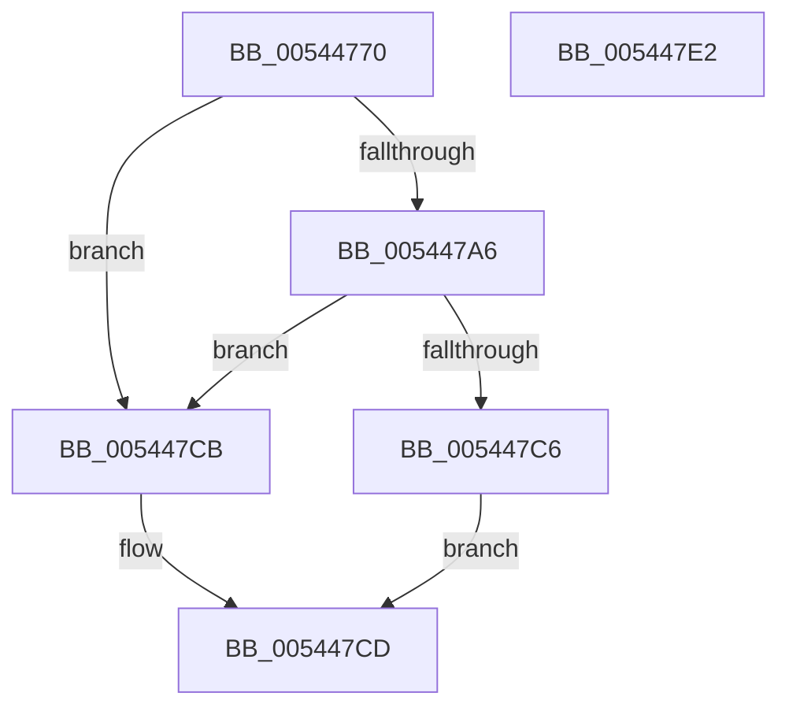

# HalpAllocateEarlyPages

- RVA: `0x00544770`–`0x005447E3` (길이 `115` bytes)
- VA: `0x0000000140544770`
- 실행 섹션: `.text`
- PDB 이름 있음: `예`; PDB Function 태그: `아니요`
- unwind 정보 RVA: `0x00066400`
- 디코드: `36`개 명령, `115/115` bytes 표시
- 미해석 바이트: `0` (있으면 어셈블리에 `.byte`로 보존)

> 이 문서는 커널 이미지의 기계어와 PDB 기호를 분석해 생성했습니다. 4번과 5번은 함수 원형과 자료형을 바이너리 사용 방식에서 추정한 C 해석이며 원본 소스 복구 결과는 아닙니다.

## 1. Dependencies

- 직접 호출 지점: **2**; 고유 호출 대상: **2**
- 직접 호출자로 확인된 함수: **0**
- RIP 상대 이미지 참조: **0**

### Outgoing calls
- `0x00544799` → [HalpAllocPhysicalMemoryEx](../../init/C7/HalpAllocPhysicalMemoryEx_function_00C771DC.md) (function, `0x00C771DC`)
- `0x005447BC` → [HalpMap](../3F/HalpMap_function_003F88F4.md) (function, `0x003F88F4`)

### Direct callers
- 이 함수 시작 RVA로 연결되는 직접 call은 확인되지 않았습니다. 간접 호출은 완전히 역산할 수 없습니다.

### Static image references
- 디코드된 RIP-relative 메모리 참조가 없습니다.

## 2. Other-region calls and transfers

- 다른 실행 섹션으로 향하는 call: **1**
  - `0x00544799` → [HalpAllocPhysicalMemoryEx](../../init/C7/HalpAllocPhysicalMemoryEx_function_00C771DC.md) (`.text` → `INIT`)
- 별도 외부 분기/꼬리 이동을 확인하지 못했습니다.

## 3. Assembly (complete function range)

```asm
00544770  48 8B C4                        mov rax, rsp
00544773  48 89 58 08                     mov qword ptr [rax + 8], rbx
00544777  48 89 68 10                     mov qword ptr [rax + 0x10], rbp
0054477B  48 89 70 18                     mov qword ptr [rax + 0x18], rsi
0054477F  57                              push rdi
00544780  48 83 EC 30                     sub rsp, 0x30
00544784  48 83 60 E8 00                  and qword ptr [rax - 0x18], 0
00544789  49 8B F8                        mov rdi, r8
0054478C  44 8B C2                        mov r8d, edx
0054478F  41 8B E9                        mov ebp, r9d
00544792  8B F2                           mov esi, edx
00544794  45 33 C9                        xor r9d, r9d
00544797  33 D2                           xor edx, edx
00544799  E8 3E 2A 73 00                  call 0x140c771dc
0054479E  48 8B D8                        mov rbx, rax
005447A1  48 85 C0                        test rax, rax
005447A4  74 25                           je 0x1405447cb
005447A6  48 83 64 24 28 00               and qword ptr [rsp + 0x28], 0
005447AC  45 33 C9                        xor r9d, r9d
005447AF  8B D6                           mov edx, esi
005447B1  89 6C 24 20                     mov dword ptr [rsp + 0x20], ebp
005447B5  48 8B C8                        mov rcx, rax
005447B8  45 8D 41 01                     lea r8d, [r9 + 1]
005447BC  E8 33 41 EB FF                  call 0x1403f88f4
005447C1  48 85 C0                        test rax, rax
005447C4  74 05                           je 0x1405447cb
005447C6  48 89 1F                        mov qword ptr [rdi], rbx
005447C9  EB 02                           jmp 0x1405447cd
005447CB  33 C0                           xor eax, eax
005447CD  48 8B 5C 24 40                  mov rbx, qword ptr [rsp + 0x40]
005447D2  48 8B 6C 24 48                  mov rbp, qword ptr [rsp + 0x48]
005447D7  48 8B 74 24 50                  mov rsi, qword ptr [rsp + 0x50]
005447DC  48 83 C4 30                     add rsp, 0x30
005447E0  5F                              pop rdi
005447E1  C3                              ret
005447E2  CC                              int3
```

## 4. C-style interpretation (structured pseudocode)

```c
__int64 __fastcall HalpAllocateEarlyPages(__int64 a1, int a2, __int64 a3, int a4)
{
    __int64 result;
    __int64 v_rsp;
    unsigned __int64 v_stack_m10;
    unsigned int v_stack_m18;
    unsigned __int64 v_stack_p10;
    unsigned __int64 v_stack_p18;
    unsigned __int64 v_stack_p8;

    *(unsigned __int64 *)(v_rsp + 8) = v_rbx;
    *(unsigned __int64 *)(v_rsp + 16) = v_rbp;
    *(unsigned __int64 *)(v_rsp + 24) = v_rsi;
    v_rsp = (v_rsp) - (48);
    a4 = 0;
    a2 = 0;
    result = HalpAllocPhysicalMemoryEx(a1, a2, (unsigned int)(a2), a4);
    if (result == 0) goto loc_005447CB;
    a4 = 0;
    v_stack_m18 = (unsigned int)((unsigned int)(a4));
    result = HalpMap(result, (unsigned int)((unsigned int)((unsigned int)(a2))), a4 + 1, a4);
    if (result == 0) goto loc_005447CB;
    *(unsigned __int64 *)(a3) = result;
    goto loc_005447CD;
loc_005447CB:
    result = 0;
loc_005447CD:
    v_rsp = (v_rsp) + (48);
    return result;
}
```

## 5. (Beta) C Style

```c
int64_t HalpAllocateEarlyPages(int64_t Arg1, int32_t Arg2, void *Arg3, int32_t Arg4)
{
    uint8_t *arg3 = (uint8_t *)Arg3;

    int64_t result;
    int64_t local_rsp;
    uint64_t v_stack_m10;
    uint32_t v_stack_m18;
    uint64_t v_stack_p10;
    uint64_t v_stack_p18;
    uint64_t v_stack_p8;

    *(uint64_t *)(local_rsp + 0x8) = local_rbx;
    *(uint64_t *)(local_rsp + 0x10) = local_rbp;
    *(uint64_t *)(local_rsp + 0x18) = local_rsi;
    local_rsp = (local_rsp) - (48);
    Arg4 = 0;
    Arg2 = 0;
    result = HalpAllocPhysicalMemoryEx(Arg1, Arg2, (uint32_t)(Arg2), Arg4);
    if (result == 0) goto loc_005447CB;
    Arg4 = 0;
    v_stack_m18 = (uint32_t)((uint32_t)(Arg4));
    result = HalpMap(result, (uint32_t)((uint32_t)((uint32_t)(Arg2))), Arg4 + 1, Arg4);
    if (result == 0) goto loc_005447CB;
    *(uint64_t *)(arg3) = result;
    goto loc_005447CD;
loc_005447CB:
    result = 0;
loc_005447CD:
    local_rsp = (local_rsp) + (48);
    return result;
}
```

### 관측된 메모리 오프셋

구조체 형식이 확인되지 않은 접근은 인자 기준의 오프셋으로만 기록했습니다.

| 기준 인자 | 오프셋 표현 | 폭 (bit) | 접근 |
|---|---:|---:|---|
| `Arg3` | `+ 0x0` | `64` | `W` |

## 6. Execution-region graph

[열기: 2D/3D 그래프와 함수 탐색 컨트롤 패널](../../../control-panel.html?section=text&rva=0x00544770&view=graph)

- 2D 그래프는 위에서 아래로 흐르고, 3D 그래프는 빈 공간을 드래그해 회전합니다. Shift+드래그는 이동, 휠은 확대·축소, 함수 노드 선택은 대상 보고서 이동입니다.

### Static fallback


