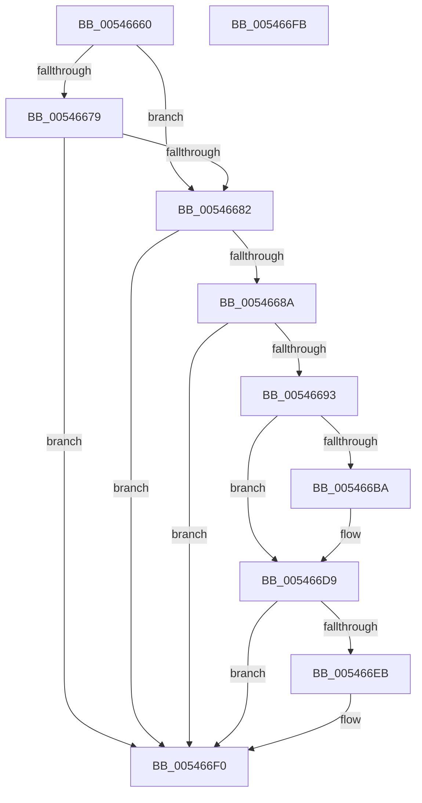

# HalpCheckPowerButton

- RVA: `0x00546660`–`0x005466FC` (길이 `156` bytes)
- VA: `0x0000000140546660`
- 실행 섹션: `.text`
- PDB 이름 있음: `예`; PDB Function 태그: `아니요`
- unwind 정보 RVA: `0x0008A658`
- 디코드: `41`개 명령, `156/156` bytes 표시
- 미해석 바이트: `0` (있으면 어셈블리에 `.byte`로 보존)

> 이 문서는 커널 이미지의 기계어와 PDB 기호를 분석해 생성했습니다. 4번과 5번은 함수 원형과 자료형을 바이너리 사용 방식에서 추정한 C 해석이며 원본 소스 복구 결과는 아닙니다.

## 1. Dependencies

- 직접 호출 지점: **4**; 고유 호출 대상: **3**
- 직접 호출자로 확인된 함수: **0**
- RIP 상대 이미지 참조: **4**

### Outgoing calls
- `0x00546679` → [InbvCheckDisplayOwnership](../59/InbvCheckDisplayOwnership_function_00590190.md) (function, `0x00590190`)
- `0x005466A7` → [HalpAcpiPmRegisterRead](../41/HalpAcpiPmRegisterRead_function_0041DB30.md) (function, `0x0041DB30`)
- `0x005466CF` → [HalpAcpiPmRegisterRead](../41/HalpAcpiPmRegisterRead_function_0041DB30.md) (function, `0x0041DB30`)
- `0x005466EB` → [HalpShutdown](HalpShutdown_function_005469AC.md) (function, `0x005469AC`)

### Direct callers
- 이 함수 시작 RVA로 연결되는 직접 call은 확인되지 않았습니다. 간접 호출은 완전히 역산할 수 없습니다.

### Static image references
- `0x0054666C` → RVA `0x00F47580` (`.data`; read)
- `0x00546682` → RVA `0x00FC2C68` (`.data`; read)
- `0x0054668A` → RVA `0x00F8FE60` (`.data`; read)
- `0x005466AC` → RVA `0x00F8FEF0` (`.data`; read)

## 2. Other-region calls and transfers

- 다른 실행 섹션으로 향하는 call: **0**
- 별도 외부 분기/꼬리 이동을 확인하지 못했습니다.

## 3. Assembly (complete function range)

```asm
00546660  48 89 5C 24 10                  mov qword ptr [rsp + 0x10], rbx
00546665  57                              push rdi
00546666  48 83 EC 30                     sub rsp, 0x30
0054666A  33 FF                           xor edi, edi
0054666C  39 3D 0E 0F A0 00               cmp dword ptr [rip + 0xa00f0e], edi
00546672  66 89 7C 24 40                  mov word ptr [rsp + 0x40], di
00546677  75 09                           jne 0x140546682
00546679  E8 12 9B 04 00                  call 0x140590190
0054667E  84 C0                           test al, al
00546680  74 6E                           je 0x1405466f0
00546682  39 3D E0 C5 A7 00               cmp dword ptr [rip + 0xa7c5e0], edi
00546688  74 66                           je 0x1405466f0
0054668A  40 38 3D CF 97 A4 00            cmp byte ptr [rip + 0xa497cf], dil
00546691  74 5D                           je 0x1405466f0
00546693  41 B9 02 00 00 00               mov r9d, 2
00546699  48 89 7C 24 20                  mov qword ptr [rsp + 0x20], rdi
0054669E  4C 8D 44 24 40                  lea r8, [rsp + 0x40]
005466A3  33 D2                           xor edx, edx
005466A5  33 C9                           xor ecx, ecx
005466A7  E8 84 74 ED FF                  call 0x14041db30
005466AC  40 38 3D 3D 98 A4 00            cmp byte ptr [rip + 0xa4983d], dil
005466B3  0F B7 5C 24 40                  movzx ebx, word ptr [rsp + 0x40]
005466B8  74 1F                           je 0x1405466d9
005466BA  33 D2                           xor edx, edx
005466BC  48 89 7C 24 20                  mov qword ptr [rsp + 0x20], rdi
005466C1  41 B9 02 00 00 00               mov r9d, 2
005466C7  4C 8D 44 24 40                  lea r8, [rsp + 0x40]
005466CC  8D 4A 03                        lea ecx, [rdx + 3]
005466CF  E8 5C 74 ED FF                  call 0x14041db30
005466D4  66 0B 5C 24 40                  or bx, word ptr [rsp + 0x40]
005466D9  B8 00 81 00 00                  mov eax, 0x8100
005466DE  66 23 D8                        and bx, ax
005466E1  B8 00 01 00 00                  mov eax, 0x100
005466E6  66 3B D8                        cmp bx, ax
005466E9  75 05                           jne 0x1405466f0
005466EB  E8 BC 02 00 00                  call 0x1405469ac
005466F0  48 8B 5C 24 48                  mov rbx, qword ptr [rsp + 0x48]
005466F5  48 83 C4 30                     add rsp, 0x30
005466F9  5F                              pop rdi
005466FA  C3                              ret
005466FB  CC                              int3
```

## 4. C-style interpretation (structured pseudocode)

```c
__int64 __fastcall HalpCheckPowerButton(int a1, int a2)
{
    __int64 result;
    __int64 v_rbx;
    __int64 v_rdi;
    __int64 v_rsp;
    unsigned __int64 v_stack_m18;
    unsigned __int64 v_stack_p10;
    unsigned __int16 v_stack_p8;

    v_stack_p10 = v_rbx;
    v_rsp = (v_rsp) - (48);
    v_rdi = 0;
    v_stack_p8 = 0;
    if ((*(unsigned int *)(v_rip + 10489614)) != 0) goto loc_00546682;
    result = InbvCheckDisplayOwnership(a1, a2, a3, a4);
    if ((unsigned __int8)(result) == 0) goto loc_005466F0;
loc_00546682:
    if ((*(unsigned int *)(v_rip + 10995168)) == 0) goto loc_005466F0;
    if ((*(unsigned __int8 *)(v_rip + 10786767)) == 0) goto loc_005466F0;
    v_stack_m18 = 0;
    a2 = 0;
    a1 = 0;
    result = HalpAcpiPmRegisterRead(a1, a2, v_stack_p8, 2);
    v_rbx = v_stack_p8;
    if ((*(unsigned __int8 *)(v_rip + 10786877)) != 0) {
        a2 = 0;
        v_stack_m18 = 0;
        a4 = 2;
        a3 = v_stack_p8;
        a1 = a2 + 3;
        result = HalpAcpiPmRegisterRead(a1, a2, a3, a4);
        v_rbx = (unsigned __int16)((v_stack_p8) | (v_stack_p8));
    }
    v_rbx = (unsigned __int16)((v_rbx) & ((unsigned __int16)((unsigned int)(0x8100ULL))));
    result = 256;
    if (((unsigned __int16)(v_rbx)) == 256) {
        result = HalpShutdown(a1, a2, a3, a4);
    }
    v_rsp = (v_rsp) + (48);
    return result;
}
```

## 5. (Beta) C Style

```c
int64_t HalpCheckPowerButton(int32_t Arg1, int32_t Arg2)
{
    int64_t result;
    int64_t local_rbx;
    int64_t local_rdi;
    int64_t local_rsp;
    uint64_t v_stack_m18;
    uint64_t v_stack_p10;
    uint16_t v_stack_p8;

    v_stack_p10 = local_rbx;
    local_rsp = (local_rsp) - (48);
    local_rdi = 0;
    v_stack_p8 = 0;
    if ((*(uint32_t *)(v_rip + 0xA00F0E)) != 0) goto loc_00546682;
    result = InbvCheckDisplayOwnership(Arg1, Arg2, a3, a4);
    if ((uint8_t)(result) == 0) goto loc_005466F0;
loc_00546682:
    if ((*(uint32_t *)(v_rip + 0xA7C5E0)) == 0) goto loc_005466F0;
    if ((*(uint8_t *)(v_rip + 0xA497CF)) == 0) goto loc_005466F0;
    v_stack_m18 = 0;
    Arg2 = 0;
    Arg1 = 0;
    result = HalpAcpiPmRegisterRead(Arg1, Arg2, v_stack_p8, 2);
    local_rbx = v_stack_p8;
    if ((*(uint8_t *)(v_rip + 0xA4983D)) != 0) {
        Arg2 = 0;
        v_stack_m18 = 0;
        a4 = 2;
        a3 = v_stack_p8;
        Arg1 = Arg2 + 3;
        result = HalpAcpiPmRegisterRead(Arg1, Arg2, a3, a4);
        local_rbx = (uint16_t)((v_stack_p8) | (v_stack_p8));
    }
    local_rbx = (uint16_t)((local_rbx) & ((uint16_t)((uint32_t)(0x8100ULL))));
    result = 256;
    if (((uint16_t)(local_rbx)) == 256) {
        result = HalpShutdown(Arg1, Arg2, a3, a4);
    }
    local_rsp = (local_rsp) + (48);
    return result;
}
```

## 6. Execution-region graph

[열기: 2D/3D 그래프와 함수 탐색 컨트롤 패널](../../../control-panel.html?section=text&rva=0x00546660&view=graph)

- 2D 그래프는 위에서 아래로 흐르고, 3D 그래프는 빈 공간을 드래그해 회전합니다. Shift+드래그는 이동, 휠은 확대·축소, 함수 노드 선택은 대상 보고서 이동입니다.

### Static fallback


