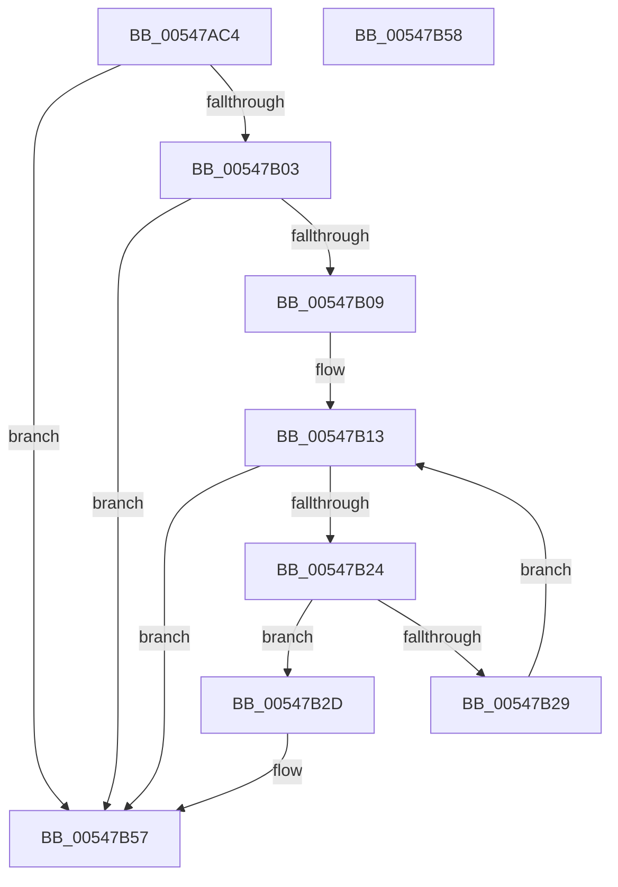

# HalpClaimDebugResource

- RVA: `0x00547AC4`–`0x00547B59` (길이 `149` bytes)
- VA: `0x0000000140547AC4`
- 실행 섹션: `.text`
- PDB 이름 있음: `예`; PDB Function 태그: `아니요`
- unwind 정보 RVA: `0x000DB714`
- 디코드: `33`개 명령, `149/149` bytes 표시
- 미해석 바이트: `0` (있으면 어셈블리에 `.byte`로 보존)

> 이 문서는 커널 이미지의 기계어와 PDB 기호를 분석해 생성했습니다. 4번과 5번은 함수 원형과 자료형을 바이너리 사용 방식에서 추정한 C 해석이며 원본 소스 복구 결과는 아닙니다.

## 1. Dependencies

- 직접 호출 지점: **0**; 고유 호출 대상: **0**
- 직접 호출자로 확인된 함수: **1**
- RIP 상대 이미지 참조: **4**

### Outgoing calls
- 직접 디코드된 call 명령이 없습니다.

### Direct callers
- [HalpReportResourceUsage](../../init/C1/HalpReportResourceUsage_function_00C1F034.md) at `0x00C1F0C0`
- [HalpReportResourceUsage](../../init/C1/HalpReportResourceUsage_function_00C1F034.md) at `0x00C1F0DD`

### Static image references
- `0x00547AC4` → RVA `0x010086A8` (`INITDATA`; read)
- `0x00547AD1` → RVA `0x00FC1998` (`.data`; read)
- `0x00547AF7` → RVA `0x010086A8` (`INITDATA`; write)
- `0x00547B0C` → RVA `0x00000000` (`image boundary/outside`; read)

## 2. Other-region calls and transfers

- 다른 실행 섹션으로 향하는 call: **0**
- 별도 외부 분기/꼬리 이동을 확인하지 못했습니다.

## 3. Assembly (complete function range)

```asm
00547AC4  48 8B 05 DD 0B AC 00            mov rax, qword ptr [rip + 0xac0bdd]
00547ACB  45 33 C9                        xor r9d, r9d
00547ACE  48 89 01                        mov qword ptr [rcx], rax
00547AD1  48 8B 05 C0 9E A7 00            mov rax, qword ptr [rip + 0xa79ec0]
00547AD8  C7 41 08 01 00 00 00            mov dword ptr [rcx + 8], 1
00547ADF  C6 41 0C 21                     mov byte ptr [rcx + 0xc], 0x21
00547AE3  48 89 51 0D                     mov qword ptr [rcx + 0xd], rdx
00547AE7  48 C7 41 15 08 00 00 00         mov qword ptr [rcx + 0x15], 8
00547AEF  4C 89 49 1D                     mov qword ptr [rcx + 0x1d], r9
00547AF3  4C 89 49 25                     mov qword ptr [rcx + 0x25], r9
00547AF7  48 89 0D AA 0B AC 00            mov qword ptr [rip + 0xac0baa], rcx
00547AFE  48 85 C0                        test rax, rax
00547B01  74 54                           je 0x140547b57
00547B03  80 78 28 01                     cmp byte ptr [rax + 0x28], 1
00547B07  75 4E                           jne 0x140547b57
00547B09  41 8B C9                        mov ecx, r9d
00547B0C  4C 8D 15 ED 84 AB FF            lea r10, [rip - 0x547b13]
00547B13  44 8B C1                        mov r8d, ecx
00547B16  43 0F B7 84 82 E8 3D 02 00      movzx eax, word ptr [r10 + r8*4 + 0x23de8]
00547B1F  66 85 C0                        test ax, ax
00547B22  74 33                           je 0x140547b57
00547B24  48 3B C2                        cmp rax, rdx
00547B27  74 04                           je 0x140547b2d
00547B29  FF C1                           inc ecx
00547B2B  EB E6                           jmp 0x140547b13
00547B2D  43 0F B7 94 82 EA 3D 02 00      movzx edx, word ptr [r10 + r8*4 + 0x23dea]
00547B36  8D 42 30                        lea eax, [rdx + 0x30]
00547B39  42 C6 84 10 D0 88 00 01 23      mov byte ptr [rax + r10 + 0x10088d0], 0x23
00547B42  48 8D 04 80                     lea rax, [rax + rax*4]
00547B46  42 C6 84 10 D0 8A 00 01 0F      mov byte ptr [rax + r10 + 0x1008ad0], 0xf
00547B4F  42 89 94 10 D1 8A 00 01         mov dword ptr [rax + r10 + 0x1008ad1], edx
00547B57  C3                              ret
00547B58  CC                              int3
```

## 4. C-style interpretation (structured pseudocode)

```c
__int64 __fastcall HalpClaimDebugResource(__int64 a1, __int64 a2, __int64 a3, int a4)
{
    a4 = 0;
    *(unsigned __int64 *)(a1) = *(unsigned __int64 *)(v_rip + 11275229);
    *(unsigned int *)(a1 + 8) = 1;
    *(unsigned __int8 *)(a1 + 12) = 33;
    *(unsigned __int64 *)(a1 + 13) = a2;
    *(unsigned __int64 *)(a1 + 21) = 8;
    *(unsigned __int64 *)(a1 + 29) = 0;
    *(unsigned __int64 *)(a1 + 37) = 0;
    *(unsigned __int64 *)(v_rip + 11275178) = a1;
    if (*(unsigned __int64 *)(v_rip + 10985152) == 0) goto loc_00547B57;
    if ((*(unsigned __int8 *)(*(unsigned __int64 *)(v_rip + 10985152) + 40)) != 1) goto loc_00547B57;
loc_00547B13:
    if ((unsigned __int16)(*(unsigned __int16 *)(v_rip - 5536531 + 0 * 4 + 146920)) == 0) goto loc_00547B57;
    if ((*(unsigned __int16 *)(v_rip - 5536531 + 0 * 4 + 146920)) == a2) goto loc_00547B2D;
    a1 = (unsigned int)((0) + 1);
    goto loc_00547B13;
loc_00547B2D:
    *(unsigned __int8 *)(*(unsigned __int16 *)(v_rip - 5536531 + 0 * 4 + 146922) + 48 + v_rip - 5536531 * 1 + 16812240) = 35;
    *(unsigned __int8 *)(*(unsigned __int16 *)(v_rip - 5536531 + 0 * 4 + 146922) + 48 + *(unsigned __int16 *)(v_rip - 5536531 + 0 * 4 + 146922) + 48 * 4 + v_rip - 5536531 * 1 + 16812752) = 15;
    *(unsigned int *)(*(unsigned __int16 *)(v_rip - 5536531 + 0 * 4 + 146922) + 48 + *(unsigned __int16 *)(v_rip - 5536531 + 0 * 4 + 146922) + 48 * 4 + v_rip - 5536531 * 1 + 16812753) = (unsigned int)(*(unsigned __int16 *)(v_rip - 5536531 + 0 * 4 + 146922));
loc_00547B57:
    return *(unsigned __int16 *)(v_rip - 5536531 + 0 * 4 + 146922) + 48 + *(unsigned __int16 *)(v_rip - 5536531 + 0 * 4 + 146922) + 48 * 4;
}
```

## 5. (Beta) C Style

```c
int64_t HalpClaimDebugResource(void *Arg1, int64_t Arg2, int64_t Arg3, int32_t Arg4)
{
    uint8_t *arg1 = (uint8_t *)Arg1;

    Arg4 = 0;
    *(uint64_t *)(arg1) = *(uint64_t *)(v_rip + 0xAC0BDD);
    *(uint32_t *)(arg1 + 0x8) = 1;
    *(uint8_t *)(arg1 + 0xC) = 33;
    *(uint64_t *)(arg1 + 0xD) = Arg2;
    *(uint64_t *)(arg1 + 0x15) = 8;
    *(uint64_t *)(arg1 + 0x1D) = 0;
    *(uint64_t *)(arg1 + 0x25) = 0;
    *(void **)(v_rip + 0xAC0BAA) = Arg1;
    if (*(uint64_t *)(v_rip + 0xA79EC0) == 0) goto loc_00547B57;
    if ((*(uint8_t *)(*(uint64_t *)(v_rip + 0xA79EC0) + 0x28)) != 1) goto loc_00547B57;
loc_00547B13:
    if ((uint16_t)(*(uint16_t *)(v_rip - 0x547B13 + 0x0 * 4 + 0x23DE8)) == 0) goto loc_00547B57;
    if ((*(uint16_t *)(v_rip - 0x547B13 + 0x0 * 4 + 0x23DE8)) == Arg2) goto loc_00547B2D;
    Arg1 = (uint32_t)((0) + 1);
    goto loc_00547B13;
loc_00547B2D:
    *(uint8_t *)(*(uint16_t *)(v_rip - 0x547B13 + 0x0 * 4 + 0x23DEA) + 0x30 + v_rip - 0x547B13 * 1 + 0x10088D0) = 35;
    *(uint8_t *)(*(uint16_t *)(v_rip - 0x547B13 + 0x0 * 4 + 0x23DEA) + 0x30 + *(uint16_t *)(v_rip - 0x547B13 + 0x0 * 4 + 0x23DEA) + 0x30 * 4 + v_rip - 0x547B13 * 1 + 0x1008AD0) = 15;
    *(uint32_t *)(*(uint16_t *)(v_rip - 0x547B13 + 0x0 * 4 + 0x23DEA) + 0x30 + *(uint16_t *)(v_rip - 0x547B13 + 0x0 * 4 + 0x23DEA) + 0x30 * 4 + v_rip - 0x547B13 * 1 + 0x1008AD1) = (uint32_t)(*(uint16_t *)(v_rip - 0x547B13 + 0x0 * 4 + 0x23DEA));
loc_00547B57:
    return *(uint16_t *)(v_rip - 0x547B13 + 0x0 * 4 + 0x23DEA) + 48 + *(uint16_t *)(v_rip - 0x547B13 + 0x0 * 4 + 0x23DEA) + 48 * 4;
}
```

### 관측된 메모리 오프셋

구조체 형식이 확인되지 않은 접근은 인자 기준의 오프셋으로만 기록했습니다.

| 기준 인자 | 오프셋 표현 | 폭 (bit) | 접근 |
|---|---:|---:|---|
| `Arg1` | `+ 0x0` | `64` | `W` |
| `Arg1` | `+ 0x8` | `32` | `W` |
| `Arg1` | `+ 0xC` | `8` | `W` |
| `Arg1` | `+ 0xD` | `64` | `W` |
| `Arg1` | `+ 0x15` | `64` | `W` |
| `Arg1` | `+ 0x1D` | `64` | `W` |
| `Arg1` | `+ 0x25` | `64` | `W` |

## 6. Execution-region graph

[열기: 2D/3D 그래프와 함수 탐색 컨트롤 패널](../../../control-panel.html?section=text&rva=0x00547AC4&view=graph)

- 2D 그래프는 위에서 아래로 흐르고, 3D 그래프는 빈 공간을 드래그해 회전합니다. Shift+드래그는 이동, 휠은 확대·축소, 함수 노드 선택은 대상 보고서 이동입니다.

### Static fallback


