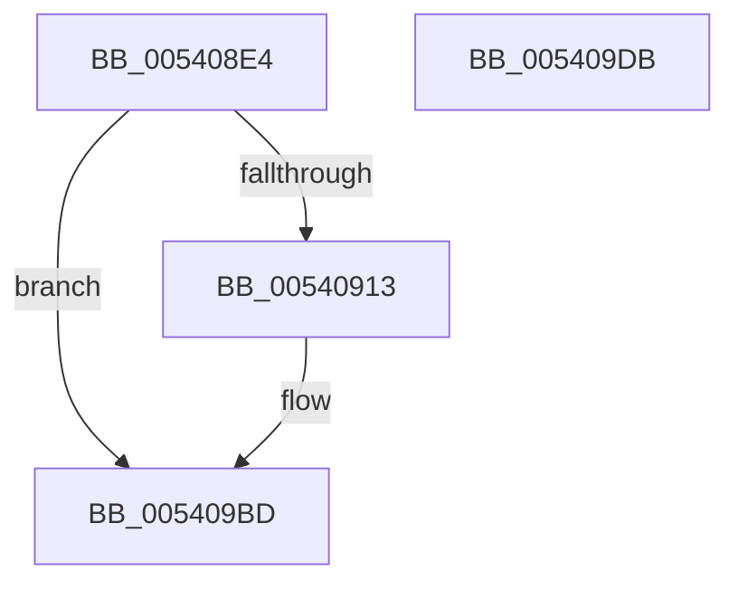

# HalpCmcInitializePolling

- RVA: `0x005408E4`–`0x005409DC` (길이 `248` bytes)
- VA: `0x00000001405408E4`
- 실행 섹션: `.text`
- PDB 이름 있음: `예`; PDB Function 태그: `아니요`
- unwind 정보 RVA: `0x00060BC4`
- 디코드: `45`개 명령, `248/248` bytes 표시
- 미해석 바이트: `0` (있으면 어셈블리에 `.byte`로 보존)

> 이 문서는 커널 이미지의 기계어와 PDB 기호를 분석해 생성했습니다. 4번과 5번은 함수 원형과 자료형을 바이너리 사용 방식에서 추정한 C 해석이며 원본 소스 복구 결과는 아닙니다.

## 1. Dependencies

- 직접 호출 지점: **3**; 고유 호출 대상: **3**
- 직접 호출자로 확인된 함수: **1**
- RIP 상대 이미지 참조: **24**

### Outgoing calls
- `0x005408FD` → [KeAcquireSpinLockRaiseToDpc](../20/KeAcquireSpinLockRaiseToDpc_function_00208470.md) (function, `0x00208470`)
- `0x00540921` → [HalpCmcInitializeErrorPacketContents](../48/HalpCmcInitializeErrorPacketContents_function_004870E8.md) (function, `0x004870E8`)
- `0x005409C6` → [KeReleaseSpinLock](../39/KeReleaseSpinLock_function_00392BA0.md) (function, `0x00392BA0`)

### Direct callers
- [HalpInitializeCmc](../../pagelk/B5/HalpInitializeCmc_function_00B5BB08.md) at `0x00B5BB5C`

### Static image references
- `0x005408F6` → RVA `0x00E0F6A8` (`.data`; read)
- `0x00540906` → RVA `0x00E0FC03` (`.data`; read)
- `0x00540913` → RVA `0x00E0F700` (`.data`; read)
- `0x0054091A` → RVA `0x00E0F6C0` (`.data`; write)
- `0x00540929` → RVA `0x004C6880` (`HalpCmcDeferredRoutine`; read)
- `0x00540930` → RVA `0x00E10150` (`.data`; write)
- `0x00540937` → RVA `0x00A637B0` (`HalpCmcWorkerRoutine`; read)
- `0x0054093E` → RVA `0x00E10188` (`.data`; write)
- `0x00540945` → RVA `0x00E10100` (`.data`; read)
- `0x0054094C` → RVA `0x00E100F0` (`.data`; write)
- `0x00540952` → RVA `0x00E100F0` (`.data`; read)
- `0x00540959` → RVA `0x00E100F8` (`.data`; write)
- `0x00540960` → RVA `0x00E10108` (`.data`; write)
- `0x00540967` → RVA `0x00E10100` (`.data`; write)
- `0x0054096E` → RVA `0x00E10138` (`.data`; write)
- `0x00540978` → RVA `0x00E10158` (`.data`; write)
- `0x0054097F` → RVA `0x00E10170` (`.data`; write)
- `0x00540986` → RVA `0x00E10148` (`.data`; write)
- `0x0054098D` → RVA `0x00E10190` (`.data`; write)
- `0x00540994` → RVA `0x00E10178` (`.data`; write)
- `0x005409A2` → RVA `0x00E10110` (`.data`; write)
- `0x005409A9` → RVA `0x00E10134` (`.data`; write)
- `0x005409AF` → RVA `0x00E10130` (`.data`; write)
- `0x005409B6` → RVA `0x00E0FC03` (`.data`; write)

## 2. Other-region calls and transfers

- 다른 실행 섹션으로 향하는 call: **0**
- 별도 외부 분기/꼬리 이동을 확인하지 못했습니다.

## 3. Assembly (complete function range)

```asm
005408E4  48 89 5C 24 08                  mov qword ptr [rsp + 8], rbx
005408E9  48 89 74 24 10                  mov qword ptr [rsp + 0x10], rsi
005408EE  57                              push rdi
005408EF  48 83 EC 20                     sub rsp, 0x20
005408F3  48 8B F9                        mov rdi, rcx
005408F6  48 8D 0D AB ED 8C 00            lea rcx, [rip + 0x8cedab]
005408FD  E8 6E 7B CC FF                  call 0x140208470
00540902  33 F6                           xor esi, esi
00540904  8A D8                           mov bl, al
00540906  40 38 35 F6 F2 8C 00            cmp byte ptr [rip + 0x8cf2f6], sil
0054090D  0F 85 AA 00 00 00               jne 0x1405409bd
00540913  48 8D 0D E6 ED 8C 00            lea rcx, [rip + 0x8cede6]
0054091A  48 89 0D 9F ED 8C 00            mov qword ptr [rip + 0x8ced9f], rcx
00540921  E8 C2 67 F4 FF                  call 0x1404870e8
00540926  8B 4F 34                        mov ecx, dword ptr [rdi + 0x34]
00540929  48 8D 05 50 5F F8 FF            lea rax, [rip - 0x7a0b0]
00540930  48 89 05 19 F8 8C 00            mov qword ptr [rip + 0x8cf819], rax
00540937  48 8D 05 72 2E 52 00            lea rax, [rip + 0x522e72]
0054093E  48 89 05 43 F8 8C 00            mov qword ptr [rip + 0x8cf843], rax
00540945  48 8D 05 B4 F7 8C 00            lea rax, [rip + 0x8cf7b4]
0054094C  89 0D 9E F7 8C 00               mov dword ptr [rip + 0x8cf79e], ecx
00540952  48 8D 0D 97 F7 8C 00            lea rcx, [rip + 0x8cf797]
00540959  48 89 35 98 F7 8C 00            mov qword ptr [rip + 0x8cf798], rsi
00540960  48 89 05 A1 F7 8C 00            mov qword ptr [rip + 0x8cf7a1], rax
00540967  48 89 05 92 F7 8C 00            mov qword ptr [rip + 0x8cf792], rax
0054096E  C7 05 C0 F7 8C 00 13 01 00 00   mov dword ptr [rip + 0x8cf7c0], 0x113
00540978  48 89 0D D9 F7 8C 00            mov qword ptr [rip + 0x8cf7d9], rcx
0054097F  48 89 35 EA F7 8C 00            mov qword ptr [rip + 0x8cf7ea], rsi
00540986  48 89 35 BB F7 8C 00            mov qword ptr [rip + 0x8cf7bb], rsi
0054098D  48 89 0D FC F7 8C 00            mov qword ptr [rip + 0x8cf7fc], rcx
00540994  48 89 35 DD F7 8C 00            mov qword ptr [rip + 0x8cf7dd], rsi
0054099B  C6 05 56 F7 8C 00 08            mov byte ptr [rip + 0x8cf756], 8
005409A2  48 89 35 67 F7 8C 00            mov qword ptr [rip + 0x8cf767], rsi
005409A9  89 35 85 F7 8C 00               mov dword ptr [rip + 0x8cf785], esi
005409AF  66 89 35 7A F7 8C 00            mov word ptr [rip + 0x8cf77a], si
005409B6  C6 05 46 F2 8C 00 01            mov byte ptr [rip + 0x8cf246], 1
005409BD  8A D3                           mov dl, bl
005409BF  48 8D 0D E2 EC 8C 00            lea rcx, [rip + 0x8cece2]
005409C6  E8 D5 21 E5 FF                  call 0x140392ba0
005409CB  48 8B 5C 24 30                  mov rbx, qword ptr [rsp + 0x30]
005409D0  48 8B 74 24 38                  mov rsi, qword ptr [rsp + 0x38]
005409D5  48 83 C4 20                     add rsp, 0x20
005409D9  5F                              pop rdi
005409DA  C3                              ret
005409DB  CC                              int3
```

## 4. C-style interpretation (structured pseudocode)

```c
__int64 __fastcall HalpCmcInitializePolling(__int64 a1)
{
    __int64 result;
    __int64 v_rsi;
    __int64 v_rsp;
    unsigned __int64 v_stack_p10;
    unsigned __int64 v_stack_p8;

    v_stack_p8 = v_rbx;
    v_stack_p10 = v_rsi;
    v_rsp = (v_rsp) - (32);
    result = KeAcquireSpinLockRaiseToDpc(v_rip + 9235883, a2, a3, a4);
    v_rsi = 0;
    if ((*(unsigned __int8 *)(v_rip + 9237238)) == 0) {
        a1 = v_rip + 9235942;
        *(unsigned __int64 *)(v_rip + 9235871) = a1;
        result = HalpCmcInitializeErrorPacketContents(a1, a2, a3, a4);
        a1 = *(unsigned int *)(a1 + 52);
        result = v_rip - 499888;
        *(unsigned __int64 *)(v_rip + 9238553) = result;
        result = v_rip + 5385842;
        *(unsigned __int64 *)(v_rip + 9238595) = result;
        result = v_rip + 9238452;
        *(unsigned int *)(v_rip + 9238430) = (unsigned int)(a1);
        a1 = v_rip + 9238423;
        *(unsigned __int64 *)(v_rip + 9238424) = 0;
        *(unsigned __int64 *)(v_rip + 9238433) = result;
        *(unsigned __int64 *)(v_rip + 9238418) = result;
        *(unsigned int *)(v_rip + 9238464) = 275;
        *(unsigned __int64 *)(v_rip + 9238489) = a1;
        *(unsigned __int64 *)(v_rip + 9238506) = 0;
        *(unsigned __int64 *)(v_rip + 9238459) = 0;
        *(unsigned __int64 *)(v_rip + 9238524) = a1;
        *(unsigned __int64 *)(v_rip + 9238493) = 0;
        *(unsigned __int8 *)(v_rip + 9238358) = 8;
        *(unsigned __int64 *)(v_rip + 9238375) = 0;
        *(unsigned int *)(v_rip + 9238405) = 0;
        *(unsigned __int16 *)(v_rip + 9238394) = 0;
        *(unsigned __int8 *)(v_rip + 9237062) = 1;
    }
    result = KeReleaseSpinLock(v_rip + 9235682, (unsigned __int8)((unsigned __int8)(result)), a3, a4);
    v_rsp = (v_rsp) + (32);
    return result;
}
```

## 5. (Beta) C Style

```c
int64_t HalpCmcInitializePolling(void *Arg1)
{
    uint8_t *arg1 = (uint8_t *)Arg1;

    int64_t result;
    int64_t local_rsi;
    int64_t local_rsp;
    uint64_t v_stack_p10;
    uint64_t v_stack_p8;

    v_stack_p8 = local_rbx;
    v_stack_p10 = local_rsi;
    local_rsp = (local_rsp) - (32);
    result = KeAcquireSpinLockRaiseToDpc(v_rip + 9235883, a2, a3, a4);
    local_rsi = 0;
    if ((*(uint8_t *)(v_rip + 0x8CF2F6)) == 0) {
        Arg1 = v_rip + 9235942;
        *(void **)(v_rip + 0x8CED9F) = Arg1;
        result = HalpCmcInitializeErrorPacketContents(Arg1, a2, a3, a4);
        Arg1 = *(uint32_t *)(arg1 + 0x34);
        result = v_rip - 499888;
        *(uint64_t *)(v_rip + 0x8CF819) = result;
        result = v_rip + 5385842;
        *(uint64_t *)(v_rip + 0x8CF843) = result;
        result = v_rip + 9238452;
        *(uint32_t *)(v_rip + 0x8CF79E) = (uint32_t)(Arg1);
        Arg1 = v_rip + 9238423;
        *(uint64_t *)(v_rip + 0x8CF798) = 0;
        *(uint64_t *)(v_rip + 0x8CF7A1) = result;
        *(uint64_t *)(v_rip + 0x8CF792) = result;
        *(uint32_t *)(v_rip + 0x8CF7C0) = 275;
        *(void **)(v_rip + 0x8CF7D9) = Arg1;
        *(uint64_t *)(v_rip + 0x8CF7EA) = 0;
        *(uint64_t *)(v_rip + 0x8CF7BB) = 0;
        *(void **)(v_rip + 0x8CF7FC) = Arg1;
        *(uint64_t *)(v_rip + 0x8CF7DD) = 0;
        *(uint8_t *)(v_rip + 0x8CF756) = 8;
        *(uint64_t *)(v_rip + 0x8CF767) = 0;
        *(uint32_t *)(v_rip + 0x8CF785) = 0;
        *(uint16_t *)(v_rip + 0x8CF77A) = 0;
        *(uint8_t *)(v_rip + 0x8CF246) = 1;
    }
    result = KeReleaseSpinLock(v_rip + 9235682, (uint8_t)((uint8_t)(result)), a3, a4);
    local_rsp = (local_rsp) + (32);
    return result;
}
```

### 관측된 메모리 오프셋

구조체 형식이 확인되지 않은 접근은 인자 기준의 오프셋으로만 기록했습니다.

| 기준 인자 | 오프셋 표현 | 폭 (bit) | 접근 |
|---|---:|---:|---|
| `Arg1` | `+ 0x34` | `32` | `R` |

## 6. Execution-region graph

[열기: 2D/3D 그래프와 함수 탐색 컨트롤 패널](../../../control-panel.html?section=text&rva=0x005408E4&view=graph)

- 2D 그래프는 위에서 아래로 흐르고, 3D 그래프는 빈 공간을 드래그해 회전합니다. Shift+드래그는 이동, 휠은 확대·축소, 함수 노드 선택은 대상 보고서 이동입니다.

### Static fallback


