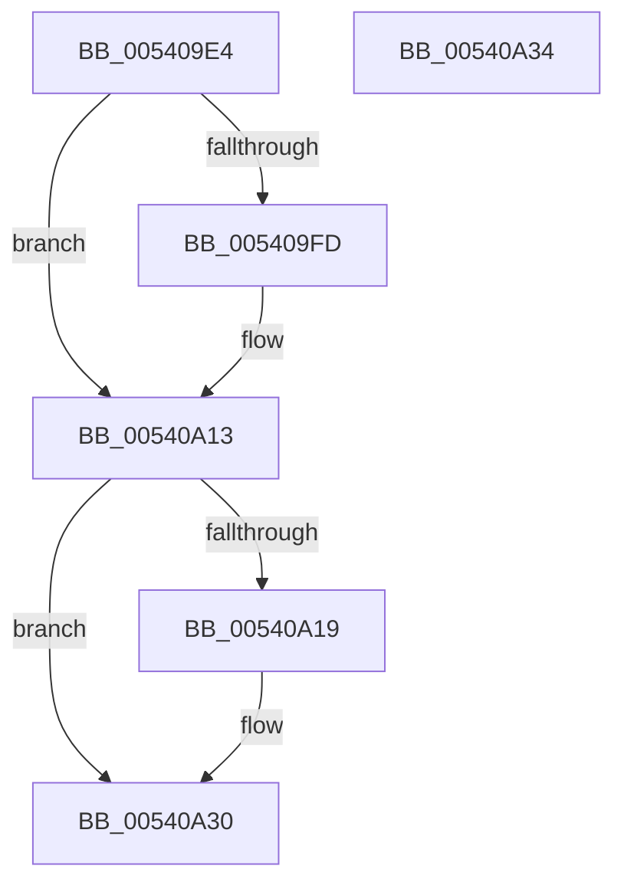

# HalpCmcIsDpcTimeRunningLow

- RVA: `0x005409E4`–`0x00540A35` (길이 `81` bytes)
- VA: `0x00000001405409E4`
- 실행 섹션: `.text`
- PDB 이름 있음: `예`; PDB Function 태그: `아니요`
- unwind 정보 RVA: `0x000DB714`
- 디코드: `27`개 명령, `81/81` bytes 표시
- 미해석 바이트: `0` (있으면 어셈블리에 `.byte`로 보존)

> 이 문서는 커널 이미지의 기계어와 PDB 기호를 분석해 생성했습니다. 4번과 5번은 함수 원형과 자료형을 바이너리 사용 방식에서 추정한 C 해석이며 원본 소스 복구 결과는 아닙니다.

## 1. Dependencies

- 직접 호출 지점: **0**; 고유 호출 대상: **0**
- 직접 호출자로 확인된 함수: **1**
- RIP 상대 이미지 참조: **0**

### Outgoing calls
- 직접 디코드된 call 명령이 없습니다.

### Direct callers
- [HalpCmcPollProcessor](../48/HalpCmcPollProcessor_function_0048772C.md) at `0x00487866`

### Static image references
- 디코드된 RIP-relative 메모리 참조가 없습니다.

## 2. Other-region calls and transfers

- 다른 실행 섹션으로 향하는 call: **0**
- 별도 외부 분기/꼬리 이동을 확인하지 못했습니다.

## 3. Assembly (complete function range)

```asm
005409E4  8B 41 08                        mov eax, dword ptr [rcx + 8]
005409E7  45 32 C0                        xor r8b, r8b
005409EA  4C 8B C9                        mov r9, rcx
005409ED  41 BA 1F 85 EB 51               mov r10d, 0x51eb851f
005409F3  41 BB 01 00 00 00               mov r11d, 1
005409F9  85 C0                           test eax, eax
005409FB  74 16                           je 0x140540a13
005409FD  6B D0 32                        imul edx, eax, 0x32
00540A00  41 8B C2                        mov eax, r10d
00540A03  45 0F B6 C0                     movzx r8d, r8b
00540A07  F7 E2                           mul edx
00540A09  C1 EA 05                        shr edx, 5
00540A0C  39 51 0C                        cmp dword ptr [rcx + 0xc], edx
00540A0F  45 0F 42 C3                     cmovb r8d, r11d
00540A13  8B 09                           mov ecx, dword ptr [rcx]
00540A15  85 C9                           test ecx, ecx
00540A17  74 17                           je 0x140540a30
00540A19  6B C9 32                        imul ecx, ecx, 0x32
00540A1C  41 8B C2                        mov eax, r10d
00540A1F  45 0F B6 C0                     movzx r8d, r8b
00540A23  F7 E1                           mul ecx
00540A25  C1 EA 05                        shr edx, 5
00540A28  41 39 51 04                     cmp dword ptr [r9 + 4], edx
00540A2C  45 0F 42 C3                     cmovb r8d, r11d
00540A30  41 8A C0                        mov al, r8b
00540A33  C3                              ret
00540A34  CC                              int3
```

## 4. C-style interpretation (structured pseudocode)

```c
__int64 __fastcall HalpCmcIsDpcTimeRunningLow(__int64 a1, __int64 a2, unsigned __int8 a3)
{
    __int64 result;

    a3 = 0;
    result = (unsigned int)(*(unsigned int *)(a1 + 8));
    if ((unsigned int)((unsigned int)(*(unsigned int *)(a1 + 8))) != 0) {
        a2 = (unsigned int)((a2) * ((unsigned int)((unsigned int)(*(unsigned int *)(a1 + 8)))));
        result = (unsigned int)((unsigned int)(0x51EB851FULL));
        a3 = 0;
        a2 = (unsigned int)((a2) >> (5));
        if ((*(unsigned int *)(a1 + 12)) < ((unsigned int)(a2))) { a3 = 1; }
    }
    if ((unsigned int)((unsigned int)(*(unsigned int *)(a1))) != 0) {
        a1 = (unsigned int)(((unsigned int)(*(unsigned int *)(a1))) * ((unsigned int)((unsigned int)(*(unsigned int *)(a1)))));
        result = (unsigned int)((unsigned int)(0x51EB851FULL));
        a3 = a3;
        a2 = (unsigned int)((a2) >> (5));
        if ((*(unsigned int *)(a1 + 4)) < ((unsigned int)(a2))) { a3 = 1; }
    }
    return a3;
}
```

## 5. (Beta) C Style

```c
int64_t HalpCmcIsDpcTimeRunningLow(void *Arg1, int64_t Arg2, uint8_t Arg3)
{
    uint8_t *arg1 = (uint8_t *)Arg1;

    int64_t result;

    Arg3 = 0;
    result = (uint32_t)(*(uint32_t *)(arg1 + 0x8));
    if ((uint32_t)((uint32_t)(*(uint32_t *)(arg1 + 0x8))) != 0) {
        Arg2 = (uint32_t)((Arg2) * ((uint32_t)((uint32_t)(*(uint32_t *)(arg1 + 0x8)))));
        result = (uint32_t)((uint32_t)(0x51EB851FULL));
        Arg3 = 0;
        Arg2 = (uint32_t)((Arg2) >> (5));
        if ((*(uint32_t *)(arg1 + 0xC)) < ((uint32_t)(Arg2))) { Arg3 = 1; }
    }
    if ((uint32_t)((uint32_t)(*(uint32_t *)(arg1))) != 0) {
        Arg1 = (uint32_t)(((uint32_t)(*(uint32_t *)(arg1))) * ((uint32_t)((uint32_t)(*(uint32_t *)(arg1)))));
        result = (uint32_t)((uint32_t)(0x51EB851FULL));
        Arg3 = Arg3;
        Arg2 = (uint32_t)((Arg2) >> (5));
        if ((*(uint32_t *)(arg1 + 0x4)) < ((uint32_t)(Arg2))) { Arg3 = 1; }
    }
    return Arg3;
}
```

### 관측된 메모리 오프셋

구조체 형식이 확인되지 않은 접근은 인자 기준의 오프셋으로만 기록했습니다.

| 기준 인자 | 오프셋 표현 | 폭 (bit) | 접근 |
|---|---:|---:|---|
| `Arg1` | `+ 0x0` | `32` | `R` |
| `Arg1` | `+ 0x4` | `32` | `R` |
| `Arg1` | `+ 0x8` | `32` | `R` |
| `Arg1` | `+ 0xC` | `32` | `R` |

## 6. Execution-region graph

[열기: 2D/3D 그래프와 함수 탐색 컨트롤 패널](../../../control-panel.html?section=text&rva=0x005409E4&view=graph)

- 2D 그래프는 위에서 아래로 흐르고, 3D 그래프는 빈 공간을 드래그해 회전합니다. Shift+드래그는 이동, 휠은 확대·축소, 함수 노드 선택은 대상 보고서 이동입니다.

### Static fallback


