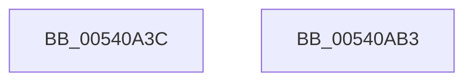

# HalpCmcLogPollingTimeoutEvent

- RVA: `0x00540A3C`–`0x00540AB4` (길이 `120` bytes)
- VA: `0x0000000140540A3C`
- 실행 섹션: `.text`
- PDB 이름 있음: `예`; PDB Function 태그: `아니요`
- unwind 정보 RVA: `0x000C3AB4`
- 디코드: `29`개 명령, `120/120` bytes 표시
- 미해석 바이트: `0` (있으면 어셈블리에 `.byte`로 보존)

> 이 문서는 커널 이미지의 기계어와 PDB 기호를 분석해 생성했습니다. 4번과 5번은 함수 원형과 자료형을 바이너리 사용 방식에서 추정한 C 해석이며 원본 소스 복구 결과는 아닙니다.

## 1. Dependencies

- 직접 호출 지점: **2**; 고유 호출 대상: **2**
- 직접 호출자로 확인된 함수: **1**
- RIP 상대 이미지 참조: **1**

### Outgoing calls
- `0x00540A9C` → [WheaLogInternalEvent](../66/WheaLogInternalEvent_function_006605B0.md) (function, `0x006605B0`)
- `0x00540AA8` → [_security_check_cookie](../6A/_security_check_cookie_function_006AC640.md) (function, `0x006AC640`)

### Direct callers
- [HalpCmcPollProcessor](../48/HalpCmcPollProcessor_function_0048772C.md) at `0x0048787B`

### Static image references
- `0x00540A45` → RVA `0x00E0A740` (`.data`; read)

## 2. Other-region calls and transfers

- 다른 실행 섹션으로 향하는 call: **0**
- 별도 외부 분기/꼬리 이동을 확인하지 못했습니다.

## 3. Assembly (complete function range)

```asm
00540A3C  40 55                           push rbp
00540A3E  48 8B EC                        mov rbp, rsp
00540A41  48 83 EC 60                     sub rsp, 0x60
00540A45  48 8B 05 F4 9C 8C 00            mov rax, qword ptr [rip + 0x8c9cf4]
00540A4C  48 33 C4                        xor rax, rsp
00540A4F  48 89 45 F8                     mov qword ptr [rbp - 8], rax
00540A53  0F 10 01                        movups xmm0, xmmword ptr [rcx]
00540A56  B8 01 00 00 00                  mov eax, 1
00540A5B  C7 45 C0 57 68 4C 67            mov dword ptr [rbp - 0x40], 0x674c6857
00540A62  89 45 C4                        mov dword ptr [rbp - 0x3c], eax
00540A65  89 45 CC                        mov dword ptr [rbp - 0x34], eax
00540A68  8B 41 10                        mov eax, dword ptr [rcx + 0x10]
00540A6B  48 8D 4D C0                     lea rcx, [rbp - 0x40]
00540A6F  C7 45 C8 38 00 00 00            mov dword ptr [rbp - 0x38], 0x38
00540A76  C7 45 D4 01 00 00 80            mov dword ptr [rbp - 0x2c], 0x80000001
00540A7D  C7 45 D0 48 41 4C 20            mov dword ptr [rbp - 0x30], 0x204c4148
00540A84  C7 45 D8 02 00 00 00            mov dword ptr [rbp - 0x28], 2
00540A8B  C7 45 DC 18 00 00 00            mov dword ptr [rbp - 0x24], 0x18
00540A92  0F 11 45 E0                     movups xmmword ptr [rbp - 0x20], xmm0
00540A96  89 45 F0                        mov dword ptr [rbp - 0x10], eax
00540A99  89 55 F4                        mov dword ptr [rbp - 0xc], edx
00540A9C  E8 0F FB 11 00                  call 0x1406605b0
00540AA1  48 8B 4D F8                     mov rcx, qword ptr [rbp - 8]
00540AA5  48 33 CC                        xor rcx, rsp
00540AA8  E8 93 BB 16 00                  call 0x1406ac640
00540AAD  48 83 C4 60                     add rsp, 0x60
00540AB1  5D                              pop rbp
00540AB2  C3                              ret
00540AB3  CC                              int3
```

## 4. C-style interpretation (structured pseudocode)

```c
__int64 __fastcall HalpCmcLogPollingTimeoutEvent(__int64 a1, int a2)
{
    __int64 result;
    __int64 v_rsp;
    unsigned __int64 v_stack_m10;
    unsigned int v_stack_m14;
    unsigned int v_stack_m18;
    unsigned __int64 v_stack_m28;
    unsigned int v_stack_m2C;
    unsigned int v_stack_m30;
    unsigned int v_stack_m34;
    unsigned int v_stack_m38;
    unsigned int v_stack_m3C;
    unsigned int v_stack_m40;
    unsigned int v_stack_m44;
    unsigned int v_stack_m48;

    v_rsp = (v_rsp) - (96);
    result = (*(unsigned __int64 *)(v_rip + 9215220)) ^ (v_rsp);
    v_stack_m10 = result;
    v_stack_m48 = 0x674C6857ULL;
    v_stack_m44 = 1;
    v_stack_m3C = 1;
    v_stack_m40 = 56;
    v_stack_m34 = 0x80000001ULL;
    v_stack_m38 = 0x204C4148ULL;
    v_stack_m30 = 2;
    v_stack_m2C = 24;
    v_stack_m28 = v_xmm0;
    v_stack_m18 = (unsigned int)((unsigned int)(*(unsigned int *)(a1 + 16)));
    v_stack_m14 = a2;
    result = WheaLogInternalEvent(v_stack_m48, a2, a3, a4);
    a1 = (v_stack_m10) ^ (v_rsp);
    result = _security_check_cookie(a1, a2, a3, a4);
    v_rsp = (v_rsp) + (96);
    return result;
}
```

## 5. (Beta) C Style

```c
int64_t HalpCmcLogPollingTimeoutEvent(void *Arg1, int32_t Arg2)
{
    uint8_t *arg1 = (uint8_t *)Arg1;

    int64_t result;
    int64_t local_rsp;
    uint64_t v_stack_m10;
    uint32_t v_stack_m14;
    uint32_t v_stack_m18;
    uint64_t v_stack_m28;
    uint32_t v_stack_m2C;
    uint32_t v_stack_m30;
    uint32_t v_stack_m34;
    uint32_t v_stack_m38;
    uint32_t v_stack_m3C;
    uint32_t v_stack_m40;
    uint32_t v_stack_m44;
    uint32_t v_stack_m48;

    local_rsp = (local_rsp) - (96);
    result = (*(uint64_t *)(v_rip + 0x8C9CF4)) ^ (local_rsp);
    v_stack_m10 = result;
    v_stack_m48 = 0x674C6857ULL;
    v_stack_m44 = 1;
    v_stack_m3C = 1;
    v_stack_m40 = 56;
    v_stack_m34 = 0x80000001ULL;
    v_stack_m38 = 0x204C4148ULL;
    v_stack_m30 = 2;
    v_stack_m2C = 24;
    v_stack_m28 = v_xmm0;
    v_stack_m18 = (uint32_t)((uint32_t)(*(uint32_t *)(arg1 + 0x10)));
    v_stack_m14 = Arg2;
    result = WheaLogInternalEvent(v_stack_m48, Arg2, a3, a4);
    Arg1 = (v_stack_m10) ^ (local_rsp);
    result = _security_check_cookie(Arg1, Arg2, a3, a4);
    local_rsp = (local_rsp) + (96);
    return result;
}
```

### 관측된 메모리 오프셋

구조체 형식이 확인되지 않은 접근은 인자 기준의 오프셋으로만 기록했습니다.

| 기준 인자 | 오프셋 표현 | 폭 (bit) | 접근 |
|---|---:|---:|---|
| `Arg1` | `+ 0x0` | `128` | `R` |
| `Arg1` | `+ 0x10` | `32` | `R` |

## 6. Execution-region graph

[열기: 2D/3D 그래프와 함수 탐색 컨트롤 패널](../../../control-panel.html?section=text&rva=0x00540A3C&view=graph)

- 2D 그래프는 위에서 아래로 흐르고, 3D 그래프는 빈 공간을 드래그해 회전합니다. Shift+드래그는 이동, 휠은 확대·축소, 함수 노드 선택은 대상 보고서 이동입니다.

### Static fallback


