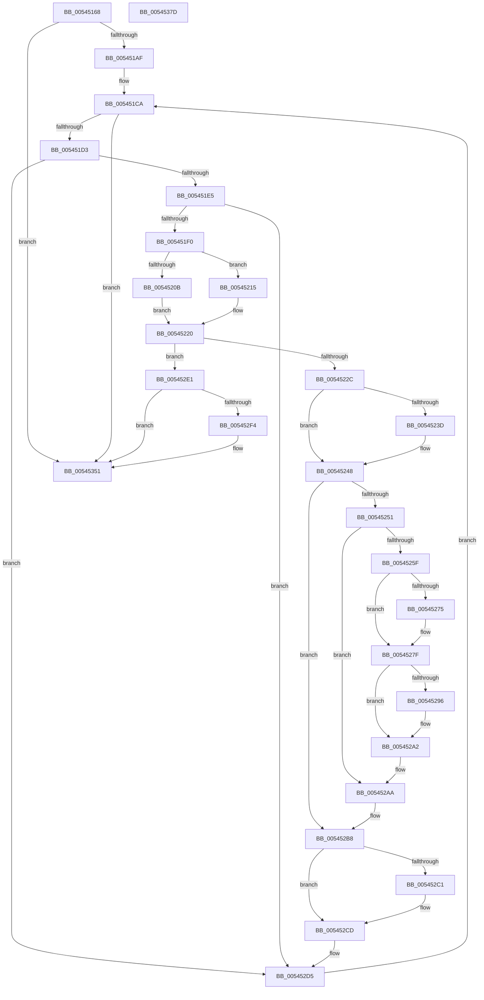

# HalpCmciHandler

- RVA: `0x00545168`–`0x0054537E` (길이 `534` bytes)
- VA: `0x0000000140545168`
- 실행 섹션: `.text`
- PDB 이름 있음: `예`; PDB Function 태그: `아니요`
- unwind 정보 RVA: `0x000C3C98`
- 디코드: `126`개 명령, `534/534` bytes 표시
- 미해석 바이트: `0` (있으면 어셈블리에 `.byte`로 보존)

> 이 문서는 커널 이미지의 기계어와 PDB 기호를 분석해 생성했습니다. 4번과 5번은 함수 원형과 자료형을 바이너리 사용 방식에서 추정한 C 해석이며 원본 소스 복구 결과는 아닙니다.

## 1. Dependencies

- 직접 호출 지점: **12**; 고유 호출 대상: **9**
- 직접 호출자로 확인된 함수: **1**
- RIP 상대 이미지 참조: **7**

### Outgoing calls
- `0x005451F2` → [KeQueryPerformanceCounter](../37/KeQueryPerformanceCounter_function_0037E7E0.md) (function, `0x0037E7E0`)
- `0x00545243` → [KiRaiseIrqlProcessIrqlFlags](../4F/KiRaiseIrqlProcessIrqlFlags_function_004F56FC.md) (function, `0x004F56FC`)
- `0x00545255` → [HalpGetCpuVendor](../48/HalpGetCpuVendor_function_004879E4.md) (function, `0x004879E4`)
- `0x0054527A` → [KiRaiseIrqlProcessIrqlFlags](../4F/KiRaiseIrqlProcessIrqlFlags_function_004F56FC.md) (function, `0x004F56FC`)
- `0x00545288` → [HalpCmciSetProcessorConfigAMD](../48/HalpCmciSetProcessorConfigAMD_function_00487BE0.md) (function, `0x00487BE0`)
- `0x0054529D` → [KiLowerIrqlProcessIrqlFlags](../4F/KiLowerIrqlProcessIrqlFlags_function_004F5698.md) (function, `0x004F5698`)
- `0x005452B3` → [KeInsertQueueDpc](../20/KeInsertQueueDpc_function_00207C50.md) (function, `0x00207C50`)
- `0x005452C8` → [KiLowerIrqlProcessIrqlFlags](../4F/KiLowerIrqlProcessIrqlFlags_function_004F5698.md) (function, `0x004F5698`)
- `0x00545330` → [WheaLogInternalEvent](../66/WheaLogInternalEvent_function_006605B0.md) (function, `0x006605B0`)
- `0x0054533E` → [KeIpiGenericCall](../47/KeIpiGenericCall_function_00471720.md) (function, `0x00471720`)
- `0x0054534C` → [KeInsertQueueDpc](../20/KeInsertQueueDpc_function_00207C50.md) (function, `0x00207C50`)
- `0x00545359` → [_security_check_cookie](../6A/_security_check_cookie_function_006AC640.md) (function, `0x006AC640`)

### Direct callers
- [HalpInterruptCmciService](../55/HalpInterruptCmciService_function_0055B810.md) at `0x0055B814`

### Static image references
- `0x00545185` → RVA `0x00E0A740` (`.data`; read)
- `0x00545194` → RVA `0x00E0FC02` (`.data`; read)
- `0x00545202` → RVA `0x00E0FBF8` (`.data`; read)
- `0x00545220` → RVA `0x00E100BC` (`.data`; read)
- `0x00545234` → RVA `0x00FC6D20` (`ALMOSTRO`; read)
- `0x005452E4` → RVA `0x00E0F6A0` (`.data`; read/write)
- `0x00545337` → RVA `0x00545390` (`HalpDisableCmciOnProcessor`; read)

## 2. Other-region calls and transfers

- 다른 실행 섹션으로 향하는 call: **0**
- 별도 외부 분기/꼬리 이동을 확인하지 못했습니다.

## 3. Assembly (complete function range)

```asm
00545168  48 8B C4                        mov rax, rsp
0054516B  48 89 58 08                     mov qword ptr [rax + 8], rbx
0054516F  48 89 68 10                     mov qword ptr [rax + 0x10], rbp
00545173  48 89 70 18                     mov qword ptr [rax + 0x18], rsi
00545177  48 89 78 20                     mov qword ptr [rax + 0x20], rdi
0054517B  41 54                           push r12
0054517D  41 55                           push r13
0054517F  41 56                           push r14
00545181  48 83 EC 50                     sub rsp, 0x50
00545185  48 8B 05 B4 55 8C 00            mov rax, qword ptr [rip + 0x8c55b4]
0054518C  48 33 C4                        xor rax, rsp
0054518F  48 89 44 24 40                  mov qword ptr [rsp + 0x40], rax
00545194  8A 05 68 AA 8C 00               mov al, byte ptr [rip + 0x8caa68]
0054519A  0F 57 C0                        xorps xmm0, xmm0
0054519D  0F 11 44 24 20                  movups xmmword ptr [rsp + 0x20], xmm0
005451A2  0F 11 44 24 30                  movups xmmword ptr [rsp + 0x30], xmm0
005451A7  84 C0                           test al, al
005451A9  0F 84 A2 01 00 00               je 0x140545351
005451AF  65 48 8B 04 25 18 00 00 00      mov rax, qword ptr gs:[0x18]
005451B8  41 BC 01 00 00 00               mov r12d, 1
005451BE  48 8B B8 D8 00 00 00            mov rdi, qword ptr [rax + 0xd8]
005451C5  45 8D 6C 24 0D                  lea r13d, [r12 + 0xd]
005451CA  48 85 FF                        test rdi, rdi
005451CD  0F 84 7E 01 00 00               je 0x140545351
005451D3  48 83 7F 10 00                  cmp qword ptr [rdi + 0x10], 0
005451D8  48 8B 9F AC 00 00 00            mov rbx, qword ptr [rdi + 0xac]
005451DF  0F 84 F0 00 00 00               je 0x1405452d5
005451E5  48 83 7F 18 00                  cmp qword ptr [rdi + 0x18], 0
005451EA  0F 84 E5 00 00 00               je 0x1405452d5
005451F0  33 C9                           xor ecx, ecx
005451F2  E8 E9 95 E3 FF                  call 0x14037e7e0
005451F7  44 01 67 7C                     add dword ptr [rdi + 0x7c], r12d
005451FB  48 8B C8                        mov rcx, rax
005451FE  48 2B 4F 70                     sub rcx, qword ptr [rdi + 0x70]
00545202  48 3B 0D EF A9 8C 00            cmp rcx, qword ptr [rip + 0x8ca9ef]
00545209  7D 0A                           jge 0x140545215
0054520B  8B 47 78                        mov eax, dword ptr [rdi + 0x78]
0054520E  FF C0                           inc eax
00545210  89 47 78                        mov dword ptr [rdi + 0x78], eax
00545213  EB 0B                           jmp 0x140545220
00545215  48 89 47 70                     mov qword ptr [rdi + 0x70], rax
00545219  41 8B C4                        mov eax, r12d
0054521C  44 89 67 78                     mov dword ptr [rdi + 0x78], r12d
00545220  3B 05 96 AE 8C 00               cmp eax, dword ptr [rip + 0x8cae96]
00545226  0F 87 B5 00 00 00               ja 0x1405452e1
0054522C  44 0F 20 C5                     mov rbp, cr8
00545230  45 0F 22 C5                     mov cr8, r13
00545234  83 3D E5 1A A8 00 00            cmp dword ptr [rip + 0xa81ae5], 0
0054523B  74 0B                           je 0x140545248
0054523D  41 8A D5                        mov dl, r13b
00545240  40 8A CD                        mov cl, bpl
00545243  E8 B4 04 FB FF                  call 0x1404f56fc
00545248  80 BF 80 00 00 00 00            cmp byte ptr [rdi + 0x80], 0
0054524F  75 67                           jne 0x1405452b8
00545251  4C 8B 77 18                     mov r14, qword ptr [rdi + 0x18]
00545255  E8 8A 27 F4 FF                  call 0x1404879e4
0054525A  41 3A C4                        cmp al, r12b
0054525D  75 4B                           jne 0x1405452aa
0054525F  44 0F 20 C6                     mov rsi, cr8
00545263  B8 0F 00 00 00                  mov eax, 0xf
00545268  44 0F 22 C0                     mov cr8, rax
0054526C  83 3D AD 1A A8 00 00            cmp dword ptr [rip + 0xa81aad], 0
00545273  74 0A                           je 0x14054527f
00545275  8A D0                           mov dl, al
00545277  40 8A CE                        mov cl, sil
0054527A  E8 7D 04 FB FF                  call 0x1404f56fc
0054527F  4C 8B C3                        mov r8, rbx
00545282  41 8A D4                        mov dl, r12b
00545285  49 8B CE                        mov rcx, r14
00545288  E8 53 29 F4 FF                  call 0x140487be0
0054528D  83 3D 8C 1A A8 00 00            cmp dword ptr [rip + 0xa81a8c], 0
00545294  74 0C                           je 0x1405452a2
00545296  44 0F 20 C1                     mov rcx, cr8
0054529A  40 8A D6                        mov dl, sil
0054529D  E8 F6 03 FB FF                  call 0x1404f5698
005452A2  40 0F B6 C6                     movzx eax, sil
005452A6  44 0F 22 C0                     mov cr8, rax
005452AA  48 8D 4F 30                     lea rcx, [rdi + 0x30]
005452AE  45 33 C0                        xor r8d, r8d
005452B1  33 D2                           xor edx, edx
005452B3  E8 98 29 CC FF                  call 0x140207c50
005452B8  83 3D 61 1A A8 00 00            cmp dword ptr [rip + 0xa81a61], 0
005452BF  74 0C                           je 0x1405452cd
005452C1  44 0F 20 C1                     mov rcx, cr8
005452C5  40 8A D5                        mov dl, bpl
005452C8  E8 CB 03 FB FF                  call 0x1404f5698
005452CD  40 0F B6 C5                     movzx eax, bpl
005452D1  44 0F 22 C0                     mov cr8, rax
005452D5  48 8B BF B8 00 00 00            mov rdi, qword ptr [rdi + 0xb8]
005452DC  E9 E9 FE FF FF                  jmp 0x1405451ca
005452E1  41 8B C4                        mov eax, r12d
005452E4  F0 0F C1 05 B4 A3 8C 00         lock xadd dword ptr [rip + 0x8ca3b4], eax
005452EC  41 03 C4                        add eax, r12d
005452EF  41 3B C4                        cmp eax, r12d
005452F2  75 5D                           jne 0x140545351
005452F4  83 64 24 3C 00                  and dword ptr [rsp + 0x3c], 0
005452F9  48 8D 4C 24 20                  lea rcx, [rsp + 0x20]
005452FE  C7 44 24 20 57 68 4C 67         mov dword ptr [rsp + 0x20], 0x674c6857
00545306  44 89 64 24 24                  mov dword ptr [rsp + 0x24], r12d
0054530B  C7 44 24 28 20 00 00 00         mov dword ptr [rsp + 0x28], 0x20
00545313  44 89 64 24 2C                  mov dword ptr [rsp + 0x2c], r12d
00545318  C7 44 24 34 03 00 00 80         mov dword ptr [rsp + 0x34], 0x80000003
00545320  C7 44 24 30 48 41 4C 20         mov dword ptr [rsp + 0x30], 0x204c4148
00545328  C7 44 24 38 02 00 00 00         mov dword ptr [rsp + 0x38], 2
00545330  E8 7B B2 11 00                  call 0x1406605b0
00545335  33 D2                           xor edx, edx
00545337  48 8D 0D 52 00 00 00            lea rcx, [rip + 0x52]
0054533E  E8 DD C3 F2 FF                  call 0x140471720
00545343  48 8D 4F 30                     lea rcx, [rdi + 0x30]
00545347  45 33 C0                        xor r8d, r8d
0054534A  33 D2                           xor edx, edx
0054534C  E8 FF 28 CC FF                  call 0x140207c50
00545351  48 8B 4C 24 40                  mov rcx, qword ptr [rsp + 0x40]
00545356  48 33 CC                        xor rcx, rsp
00545359  E8 E2 72 16 00                  call 0x1406ac640
0054535E  4C 8D 5C 24 50                  lea r11, [rsp + 0x50]
00545363  49 8B 5B 20                     mov rbx, qword ptr [r11 + 0x20]
00545367  49 8B 6B 28                     mov rbp, qword ptr [r11 + 0x28]
0054536B  49 8B 73 30                     mov rsi, qword ptr [r11 + 0x30]
0054536F  49 8B 7B 38                     mov rdi, qword ptr [r11 + 0x38]
00545373  49 8B E3                        mov rsp, r11
00545376  41 5E                           pop r14
00545378  41 5D                           pop r13
0054537A  41 5C                           pop r12
0054537C  C3                              ret
0054537D  CC                              int3
```

## 4. C-style interpretation (structured pseudocode)

```c
__int64 __fastcall HalpCmciHandler(int a1)
{
    __int64 result;
    __int64 v_rsp;
    unsigned __int64 v_stack_m18;
    unsigned __int64 v_stack_m28;
    unsigned int v_stack_m2C;
    unsigned int v_stack_m30;
    unsigned int v_stack_m34;
    unsigned __int64 v_stack_m38;
    unsigned int v_stack_m3C;
    unsigned int v_stack_m40;
    unsigned int v_stack_m44;
    unsigned __int64 v_stack_m48;

    *(unsigned __int64 *)(v_rsp + 8) = v_rbx;
    *(unsigned __int64 *)(v_rsp + 16) = v_rbp;
    *(unsigned __int64 *)(v_rsp + 24) = v_rsi;
    *(unsigned __int64 *)(v_rsp + 32) = v_rdi;
    v_rsp = (v_rsp) - (80);
    result = (*(unsigned __int64 *)(v_rip + 9196980)) ^ (v_rsp);
    v_stack_m28 = result;
    v_stack_m48 = v_xmm0;
    v_stack_m38 = v_xmm0;
    if ((unsigned __int8)(*(unsigned __int8 *)(v_rip + 9218664)) == 0) goto loc_00545351;
loc_005451CA:
    if (*(unsigned __int64 *)(*(unsigned __int64 *)(gs_base + (0 + 24)) + 216) == 0) goto loc_00545351;
    if ((*(unsigned __int64 *)(*(unsigned __int64 *)(*(unsigned __int64 *)(gs_base + (0 + 24)) + 216) + 16)) == 0) goto loc_005452D5;
    if ((*(unsigned __int64 *)(*(unsigned __int64 *)(*(unsigned __int64 *)(gs_base + (0 + 24)) + 216) + 24)) == 0) goto loc_005452D5;
    a1 = 0;
    result = KeQueryPerformanceCounter(a1, a2, a3, a4);
    a1 = (result) - (*(unsigned __int64 *)(*(unsigned __int64 *)(*(unsigned __int64 *)(gs_base + (0 + 24)) + 216) + 112));
    if (a1 >= (*(unsigned __int64 *)(v_rip + 9218543))) goto loc_00545215;
    result = (unsigned int)(((unsigned int)(*(unsigned int *)(*(unsigned __int64 *)(*(unsigned __int64 *)(gs_base + (0 + 24)) + 216) + 120))) + 1);
    *(unsigned int *)(*(unsigned __int64 *)(*(unsigned __int64 *)(gs_base + (0 + 24)) + 216) + 120) = (unsigned int)(result);
    goto loc_00545220;
loc_00545215:
    *(unsigned __int64 *)(*(unsigned __int64 *)(*(unsigned __int64 *)(gs_base + (0 + 24)) + 216) + 112) = result;
    *(unsigned int *)(*(unsigned __int64 *)(*(unsigned __int64 *)(gs_base + (0 + 24)) + 216) + 120) = 1;
loc_00545220:
    if (1 > (*(unsigned int *)(v_rip + 9219734))) goto loc_005452E1;
    result = 1;
    if ((*(unsigned int *)(v_rip + 11016933)) != 0) {
        a2 = (unsigned __int8)(1 + 13);
        a1 = (unsigned __int8)(v_cr8);
        result = KiRaiseIrqlProcessIrqlFlags(a1, a2, a3, a4);
    }
    if ((*(unsigned __int8 *)(*(unsigned __int64 *)(*(unsigned __int64 *)(gs_base + (0 + 24)) + 216) + 128)) != 0) goto loc_005452B8;
    result = HalpGetCpuVendor(a1, a2, a3, a4);
    if (((unsigned __int8)(result)) != 1) goto loc_005452AA;
    result = 15;
    if ((*(unsigned int *)(v_rip + 11016877)) != 0) {
        a2 = 15;
        a1 = (unsigned __int8)(1 + 13);
        result = KiRaiseIrqlProcessIrqlFlags(a1, a2, a3, a4);
    }
    result = HalpCmciSetProcessorConfigAMD(*(unsigned __int64 *)(*(unsigned __int64 *)(*(unsigned __int64 *)(gs_base + (0 + 24)) + 216) + 24), 1, *(unsigned __int64 *)(*(unsigned __int64 *)(*(unsigned __int64 *)(gs_base + (0 + 24)) + 216) + 172), a4);
    if ((*(unsigned int *)(v_rip + 11016844)) != 0) {
        a1 = 15;
        a2 = (unsigned __int8)(1 + 13);
        result = KiLowerIrqlProcessIrqlFlags(a1, a2, *(unsigned __int64 *)(*(unsigned __int64 *)(*(unsigned __int64 *)(gs_base + (0 + 24)) + 216) + 172), a4);
    }
loc_005452AA:
    a3 = 0;
    a2 = 0;
    result = KeInsertQueueDpc(*(unsigned __int64 *)(*(unsigned __int64 *)(gs_base + (0 + 24)) + 216) + 48, a2, a3, a4);
loc_005452B8:
    if ((*(unsigned int *)(v_rip + 11016801)) != 0) {
        a1 = (unsigned __int8)(1 + 13);
        a2 = (unsigned __int8)(v_cr8);
        result = KiLowerIrqlProcessIrqlFlags(a1, a2, a3, a4);
    }
loc_005452D5:
    goto loc_005451CA;
loc_005452E1:
    result = (unsigned int)((1) + (1));
    if (((unsigned int)(result)) == 1) {
        a1 = v_stack_m48;
        v_stack_m48 = 0x674C6857ULL;
        v_stack_m44 = 1;
        v_stack_m40 = 32;
        v_stack_m3C = 1;
        v_stack_m34 = 0x80000003ULL;
        v_stack_m38 = 0x204C4148ULL;
        v_stack_m30 = 2;
        result = WheaLogInternalEvent(a1, a2, a3, a4);
        a2 = 0;
        a1 = v_rip + 82;
        result = KeIpiGenericCall(a1, a2, a3, a4);
        a1 = *(unsigned __int64 *)(*(unsigned __int64 *)(*(unsigned __int64 *)(gs_base + (0 + 24)) + 216) + 184) + 48;
        a3 = 0;
        a2 = 0;
        result = KeInsertQueueDpc(a1, a2, a3, a4);
    }
    a1 = (v_stack_m28) ^ (v_rsp);
    result = _security_check_cookie(a1, a2, a3, a4);
    return result;
}
```

## 5. (Beta) C Style

```c
int64_t HalpCmciHandler(int32_t Arg1)
{
    int64_t result;
    int64_t local_rsp;
    uint64_t v_stack_m18;
    uint64_t v_stack_m28;
    uint32_t v_stack_m2C;
    uint32_t v_stack_m30;
    uint32_t v_stack_m34;
    uint64_t v_stack_m38;
    uint32_t v_stack_m3C;
    uint32_t v_stack_m40;
    uint32_t v_stack_m44;
    uint64_t v_stack_m48;

    *(uint64_t *)(local_rsp + 0x8) = local_rbx;
    *(uint64_t *)(local_rsp + 0x10) = local_rbp;
    *(uint64_t *)(local_rsp + 0x18) = local_rsi;
    *(uint64_t *)(local_rsp + 0x20) = local_rdi;
    local_rsp = (local_rsp) - (80);
    result = (*(uint64_t *)(v_rip + 0x8C55B4)) ^ (local_rsp);
    v_stack_m28 = result;
    v_stack_m48 = v_xmm0;
    v_stack_m38 = v_xmm0;
    if ((uint8_t)(*(uint8_t *)(v_rip + 0x8CAA68)) == 0) goto loc_00545351;
loc_005451CA:
    if (*(uint64_t *)(*(uint64_t *)(gs_base + (0 + 0x18)) + 0xD8) == 0) goto loc_00545351;
    if ((*(uint64_t *)(*(uint64_t *)(*(uint64_t *)(gs_base + (0 + 0x18)) + 0xD8) + 0x10)) == 0) goto loc_005452D5;
    if ((*(uint64_t *)(*(uint64_t *)(*(uint64_t *)(gs_base + (0 + 0x18)) + 0xD8) + 0x18)) == 0) goto loc_005452D5;
    Arg1 = 0;
    result = KeQueryPerformanceCounter(Arg1, a2, a3, a4);
    Arg1 = (result) - (*(uint64_t *)(*(uint64_t *)(*(uint64_t *)(gs_base + (0 + 0x18)) + 0xD8) + 0x70));
    if (Arg1 >= (*(uint64_t *)(v_rip + 0x8CA9EF))) goto loc_00545215;
    result = (uint32_t)(((uint32_t)(*(uint32_t *)(*(uint64_t *)(*(uint64_t *)(gs_base + (0 + 0x18)) + 0xD8) + 0x78))) + 1);
    *(uint32_t *)(*(uint64_t *)(*(uint64_t *)(gs_base + (0 + 0x18)) + 0xD8) + 0x78) = (uint32_t)(result);
    goto loc_00545220;
loc_00545215:
    *(uint64_t *)(*(uint64_t *)(*(uint64_t *)(gs_base + (0 + 0x18)) + 0xD8) + 0x70) = result;
    *(uint32_t *)(*(uint64_t *)(*(uint64_t *)(gs_base + (0 + 0x18)) + 0xD8) + 0x78) = 1;
loc_00545220:
    if (1 > (*(uint32_t *)(v_rip + 0x8CAE96))) goto loc_005452E1;
    result = 1;
    if ((*(uint32_t *)(v_rip + 0xA81AE5)) != 0) {
        a2 = (uint8_t)(1 + 13);
        Arg1 = (uint8_t)(v_cr8);
        result = KiRaiseIrqlProcessIrqlFlags(Arg1, a2, a3, a4);
    }
    if ((*(uint8_t *)(*(uint64_t *)(*(uint64_t *)(gs_base + (0 + 0x18)) + 0xD8) + 0x80)) != 0) goto loc_005452B8;
    result = HalpGetCpuVendor(Arg1, a2, a3, a4);
    if (((uint8_t)(result)) != 1) goto loc_005452AA;
    result = 15;
    if ((*(uint32_t *)(v_rip + 0xA81AAD)) != 0) {
        a2 = 15;
        Arg1 = (uint8_t)(1 + 13);
        result = KiRaiseIrqlProcessIrqlFlags(Arg1, a2, a3, a4);
    }
    result = HalpCmciSetProcessorConfigAMD(*(uint64_t *)(*(uint64_t *)(*(uint64_t *)(gs_base + (0 + 0x18)) + 0xD8) + 0x18), 1, *(uint64_t *)(*(uint64_t *)(*(uint64_t *)(gs_base + (0 + 0x18)) + 0xD8) + 0xAC), a4);
    if ((*(uint32_t *)(v_rip + 0xA81A8C)) != 0) {
        Arg1 = 15;
        a2 = (uint8_t)(1 + 13);
        result = KiLowerIrqlProcessIrqlFlags(Arg1, a2, *(uint64_t *)(*(uint64_t *)(*(uint64_t *)(gs_base + (0 + 0x18)) + 0xD8) + 0xAC), a4);
    }
loc_005452AA:
    a3 = 0;
    a2 = 0;
    result = KeInsertQueueDpc(*(uint64_t *)(*(uint64_t *)(gs_base + (0 + 0x18)) + 0xD8) + 48, a2, a3, a4);
loc_005452B8:
    if ((*(uint32_t *)(v_rip + 0xA81A61)) != 0) {
        Arg1 = (uint8_t)(1 + 13);
        a2 = (uint8_t)(v_cr8);
        result = KiLowerIrqlProcessIrqlFlags(Arg1, a2, a3, a4);
    }
loc_005452D5:
    goto loc_005451CA;
loc_005452E1:
    result = (uint32_t)((1) + (1));
    if (((uint32_t)(result)) == 1) {
        Arg1 = v_stack_m48;
        v_stack_m48 = 0x674C6857ULL;
        v_stack_m44 = 1;
        v_stack_m40 = 32;
        v_stack_m3C = 1;
        v_stack_m34 = 0x80000003ULL;
        v_stack_m38 = 0x204C4148ULL;
        v_stack_m30 = 2;
        result = WheaLogInternalEvent(Arg1, a2, a3, a4);
        a2 = 0;
        Arg1 = v_rip + 82;
        result = KeIpiGenericCall(Arg1, a2, a3, a4);
        Arg1 = *(uint64_t *)(*(uint64_t *)(*(uint64_t *)(gs_base + (0 + 0x18)) + 0xD8) + 0xB8) + 48;
        a3 = 0;
        a2 = 0;
        result = KeInsertQueueDpc(Arg1, a2, a3, a4);
    }
    Arg1 = (v_stack_m28) ^ (local_rsp);
    result = _security_check_cookie(Arg1, a2, a3, a4);
    return result;
}
```

## 6. Execution-region graph

[열기: 2D/3D 그래프와 함수 탐색 컨트롤 패널](../../../control-panel.html?section=text&rva=0x00545168&view=graph)

- 2D 그래프는 위에서 아래로 흐르고, 3D 그래프는 빈 공간을 드래그해 회전합니다. Shift+드래그는 이동, 휠은 확대·축소, 함수 노드 선택은 대상 보고서 이동입니다.

### Static fallback


