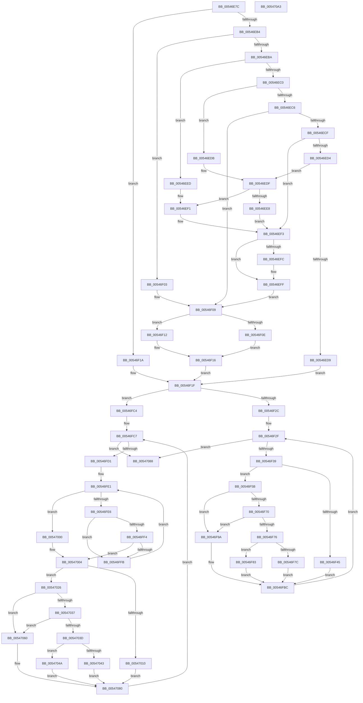

# HalpCollectProfileOwnershipStatusInternal

- RVA: `0x00546E7C`–`0x005470A4` (길이 `552` bytes)
- VA: `0x0000000140546E7C`
- 실행 섹션: `.text`
- PDB 이름 있음: `예`; PDB Function 태그: `아니요`
- unwind 정보 RVA: `0x0005D7BC`
- 디코드: `157`개 명령, `552/552` bytes 표시
- 미해석 바이트: `0` (있으면 어셈블리에 `.byte`로 보존)

> 이 문서는 커널 이미지의 기계어와 PDB 기호를 분석해 생성했습니다. 4번과 5번은 함수 원형과 자료형을 바이너리 사용 방식에서 추정한 C 해석이며 원본 소스 복구 결과는 아닙니다.

## 1. Dependencies

- 직접 호출 지점: **1**; 고유 호출 대상: **1**
- 직접 호출자로 확인된 함수: **1**
- RIP 상대 이미지 참조: **2**

### Outgoing calls
- `0x00546F1F` → [Feature_Test52061194__private_IsEnabledNoReportingNoInline](../44/Feature_Test52061194__private_IsEnabledNoReportingNoInline_function_00445C10.md) (function, `0x00445C10`)

### Direct callers
- [HalpCollectProfileOwnershipStatus](HalpCollectProfileOwnershipStatus_function_00546D34.md) at `0x00546E12`
- [HalpCollectProfileOwnershipStatus](HalpCollectProfileOwnershipStatus_function_00546D34.md) at `0x00546E25`
- [HalpCollectProfileOwnershipStatus](HalpCollectProfileOwnershipStatus_function_00546D34.md) at `0x00546E3D`
- [HalpCollectProfileOwnershipStatus](HalpCollectProfileOwnershipStatus_function_00546D34.md) at `0x00546E50`

### Static image references
- `0x00546E9B` → RVA `0x00FC8C40` (`ALMOSTRO`; read)
- `0x00546F45` → RVA `0x00E0A760` (`.data`; read)

## 2. Other-region calls and transfers

- 다른 실행 섹션으로 향하는 call: **0**
- 별도 외부 분기/꼬리 이동을 확인하지 못했습니다.

## 3. Assembly (complete function range)

```asm
00546E7C  48 8B C4                        mov rax, rsp
00546E7F  48 89 58 08                     mov qword ptr [rax + 8], rbx
00546E83  48 89 68 10                     mov qword ptr [rax + 0x10], rbp
00546E87  48 89 70 18                     mov qword ptr [rax + 0x18], rsi
00546E8B  48 89 78 20                     mov qword ptr [rax + 0x20], rdi
00546E8F  41 56                           push r14
00546E91  48 83 EC 30                     sub rsp, 0x30
00546E95  41 8B C1                        mov eax, r9d
00546E98  48 8B F2                        mov rsi, rdx
00546E9B  48 8D 15 9E 1D A8 00            lea rdx, [rip + 0xa81d9e]
00546EA2  45 8A F0                        mov r14b, r8b
00546EA5  44 8B D1                        mov r10d, ecx
00546EA8  48 8B 04 C2                     mov rax, qword ptr [rdx + rax*8]
00546EAC  4C 8B 48 58                     mov r9, qword ptr [rax + 0x58]
00546EB0  85 C9                           test ecx, ecx
00546EB2  74 66                           je 0x140546f1a
00546EB4  41 83 EA 01                     sub r10d, 1
00546EB8  74 49                           je 0x140546f03
00546EBA  41 83 EA 63                     sub r10d, 0x63
00546EBE  74 2D                           je 0x140546eed
00546EC0  41 83 FA 01                     cmp r10d, 1
00546EC4  74 15                           je 0x140546edb
00546EC6  33 FF                           xor edi, edi
00546EC8  33 DB                           xor ebx, ebx
00546ECA  83 E9 01                        sub ecx, 1
00546ECD  74 3A                           je 0x140546f09
00546ECF  83 E9 63                        sub ecx, 0x63
00546ED2  74 1F                           je 0x140546ef3
00546ED4  83 F9 01                        cmp ecx, 1
00546ED7  74 06                           je 0x140546edf
00546ED9  EB 44                           jmp 0x140546f1f
00546EDB  49 8D 59 48                     lea rbx, [r9 + 0x48]
00546EDF  49 8D 79 30                     lea rdi, [r9 + 0x30]
00546EE3  48 85 FF                        test rdi, rdi
00546EE6  74 09                           je 0x140546ef1
00546EE8  8B 7F 04                        mov edi, dword ptr [rdi + 4]
00546EEB  EB 06                           jmp 0x140546ef3
00546EED  49 8D 59 30                     lea rbx, [r9 + 0x30]
00546EF1  33 FF                           xor edi, edi
00546EF3  49 8D 41 18                     lea rax, [r9 + 0x18]
00546EF7  48 85 C0                        test rax, rax
00546EFA  74 03                           je 0x140546eff
00546EFC  8B 40 04                        mov eax, dword ptr [rax + 4]
00546EFF  03 F8                           add edi, eax
00546F01  EB 06                           jmp 0x140546f09
00546F03  49 8D 59 18                     lea rbx, [r9 + 0x18]
00546F07  33 FF                           xor edi, edi
00546F09  4D 85 C9                        test r9, r9
00546F0C  75 04                           jne 0x140546f12
00546F0E  33 C0                           xor eax, eax
00546F10  EB 04                           jmp 0x140546f16
00546F12  41 8B 41 04                     mov eax, dword ptr [r9 + 4]
00546F16  03 F8                           add edi, eax
00546F18  EB 05                           jmp 0x140546f1f
00546F1A  49 8B D9                        mov rbx, r9
00546F1D  33 FF                           xor edi, edi
00546F1F  E8 EC EC EF FF                  call 0x140445c10
00546F24  85 C0                           test eax, eax
00546F26  0F 85 98 00 00 00               jne 0x140546fc4
00546F2C  45 33 C0                        xor r8d, r8d
00546F2F  44 3B 43 04                     cmp r8d, dword ptr [rbx + 4]
00546F33  0F 83 4F 01 00 00               jae 0x140547088
00546F39  42 8D 14 07                     lea edx, [rdi + r8]
00546F3D  48 03 D2                        add rdx, rdx
00546F40  45 84 F6                        test r14b, r14b
00546F43  74 16                           je 0x140546f5b
00546F45  48 8B 05 14 38 8C 00            mov rax, qword ptr [rip + 0x8c3814]
00546F4C  48 89 44 D6 10                  mov qword ptr [rsi + rdx*8 + 0x10], rax
00546F51  C7 44 D6 08 02 00 00 00         mov dword ptr [rsi + rdx*8 + 8], 2
00546F59  EB 61                           jmp 0x140546fbc
00546F5B  48 8B 4B 10                     mov rcx, qword ptr [rbx + 0x10]
00546F5F  4F 8D 14 40                     lea r10, [r8 + r8*2]
00546F63  4D 03 D2                        add r10, r10
00546F66  46 8B 4C D1 18                  mov r9d, dword ptr [rcx + r10*8 + 0x18]
00546F6B  45 85 C9                        test r9d, r9d
00546F6E  74 2A                           je 0x140546f9a
00546F70  41 83 E9 01                     sub r9d, 1
00546F74  74 24                           je 0x140546f9a
00546F76  41 83 F9 01                     cmp r9d, 1
00546F7A  74 07                           je 0x140546f83
00546F7C  83 64 D6 08 00                  and dword ptr [rsi + rdx*8 + 8], 0
00546F81  EB 39                           jmp 0x140546fbc
00546F83  C7 44 D6 08 03 00 00 00         mov dword ptr [rsi + rdx*8 + 8], 3
00546F8B  48 8B 43 10                     mov rax, qword ptr [rbx + 0x10]
00546F8F  42 8B 4C D0 20                  mov ecx, dword ptr [rax + r10*8 + 0x20]
00546F94  89 4C D6 10                     mov dword ptr [rsi + rdx*8 + 0x10], ecx
00546F98  EB 22                           jmp 0x140546fbc
00546F9A  C7 44 D6 08 01 00 00 00         mov dword ptr [rsi + rdx*8 + 8], 1
00546FA2  48 8B 43 10                     mov rax, qword ptr [rbx + 0x10]
00546FA6  42 8B 4C D0 24                  mov ecx, dword ptr [rax + r10*8 + 0x24]
00546FAB  89 4C D6 10                     mov dword ptr [rsi + rdx*8 + 0x10], ecx
00546FAF  48 8B 43 10                     mov rax, qword ptr [rbx + 0x10]
00546FB3  42 8B 4C D0 20                  mov ecx, dword ptr [rax + r10*8 + 0x20]
00546FB8  89 4C D6 14                     mov dword ptr [rsi + rdx*8 + 0x14], ecx
00546FBC  41 FF C0                        inc r8d
00546FBF  E9 6B FF FF FF                  jmp 0x140546f2f
00546FC4  45 33 DB                        xor r11d, r11d
00546FC7  44 3B 5B 04                     cmp r11d, dword ptr [rbx + 4]
00546FCB  0F 83 B7 00 00 00               jae 0x140547088
00546FD1  44 8B 53 08                     mov r10d, dword ptr [rbx + 8]
00546FD5  4C 8D 4B 10                     lea r9, [rbx + 0x10]
00546FD9  49 8B 29                        mov rbp, qword ptr [r9]
00546FDC  33 D2                           xor edx, edx
00546FDE  45 33 C0                        xor r8d, r8d
00546FE1  45 3B C2                        cmp r8d, r10d
00546FE4  77 1A                           ja 0x140547000
00546FE6  4B 8D 0C 40                     lea rcx, [r8 + r8*2]
00546FEA  48 03 C9                        add rcx, rcx
00546FED  83 7C CD 1C 03                  cmp dword ptr [rbp + rcx*8 + 0x1c], 3
00546FF2  74 07                           je 0x140546ffb
00546FF4  FF C2                           inc edx
00546FF6  41 3B D3                        cmp edx, r11d
00546FF9  77 09                           ja 0x140547004
00546FFB  41 FF C0                        inc r8d
00546FFE  EB E1                           jmp 0x140546fe1
00547000  41 83 C8 FF                     or r8d, 0xffffffff
00547004  42 8D 14 07                     lea edx, [rdi + r8]
00547008  48 03 D2                        add rdx, rdx
0054700B  45 84 F6                        test r14b, r14b
0054700E  74 16                           je 0x140547026
00547010  48 8B 05 49 37 8C 00            mov rax, qword ptr [rip + 0x8c3749]
00547017  48 89 44 D6 10                  mov qword ptr [rsi + rdx*8 + 0x10], rax
0054701C  C7 44 D6 08 02 00 00 00         mov dword ptr [rsi + rdx*8 + 8], 2
00547024  EB 5A                           jmp 0x140547080
00547026  4F 8D 14 40                     lea r10, [r8 + r8*2]
0054702A  4D 03 D2                        add r10, r10
0054702D  46 8B 44 D5 18                  mov r8d, dword ptr [rbp + r10*8 + 0x18]
00547032  45 85 C0                        test r8d, r8d
00547035  74 29                           je 0x140547060
00547037  41 83 E8 01                     sub r8d, 1
0054703B  74 23                           je 0x140547060
0054703D  41 83 F8 01                     cmp r8d, 1
00547041  74 07                           je 0x14054704a
00547043  83 64 D6 08 00                  and dword ptr [rsi + rdx*8 + 8], 0
00547048  EB 36                           jmp 0x140547080
0054704A  C7 44 D6 08 03 00 00 00         mov dword ptr [rsi + rdx*8 + 8], 3
00547052  49 8B 01                        mov rax, qword ptr [r9]
00547055  42 8B 4C D0 20                  mov ecx, dword ptr [rax + r10*8 + 0x20]
0054705A  89 4C D6 10                     mov dword ptr [rsi + rdx*8 + 0x10], ecx
0054705E  EB 20                           jmp 0x140547080
00547060  C7 44 D6 08 01 00 00 00         mov dword ptr [rsi + rdx*8 + 8], 1
00547068  49 8B 01                        mov rax, qword ptr [r9]
0054706B  42 8B 4C D0 24                  mov ecx, dword ptr [rax + r10*8 + 0x24]
00547070  89 4C D6 10                     mov dword ptr [rsi + rdx*8 + 0x10], ecx
00547074  49 8B 01                        mov rax, qword ptr [r9]
00547077  42 8B 4C D0 20                  mov ecx, dword ptr [rax + r10*8 + 0x20]
0054707C  89 4C D6 14                     mov dword ptr [rsi + rdx*8 + 0x14], ecx
00547080  41 FF C3                        inc r11d
00547083  E9 3F FF FF FF                  jmp 0x140546fc7
00547088  48 8B 5C 24 40                  mov rbx, qword ptr [rsp + 0x40]
0054708D  48 8B 6C 24 48                  mov rbp, qword ptr [rsp + 0x48]
00547092  48 8B 74 24 50                  mov rsi, qword ptr [rsp + 0x50]
00547097  48 8B 7C 24 58                  mov rdi, qword ptr [rsp + 0x58]
0054709C  48 83 C4 30                     add rsp, 0x30
005470A0  41 5E                           pop r14
005470A2  C3                              ret
005470A3  CC                              int3
```

## 4. C-style interpretation (structured pseudocode)

```c
__int64 __fastcall HalpCollectProfileOwnershipStatusInternal(int a1, __int64 a2, int a3, int a4)
{
    __int64 result;
    __int64 v_r10;
    __int64 v_r11;
    __int64 v_rbx;
    __int64 v_rdi;
    __int64 v_rsp;
    unsigned __int64 v_stack_p10;
    unsigned __int64 v_stack_p18;
    unsigned __int64 v_stack_p20;
    unsigned __int64 v_stack_p8;

    *(unsigned __int64 *)(v_rsp + 8) = v_rbx;
    *(unsigned __int64 *)(v_rsp + 16) = v_rbp;
    *(unsigned __int64 *)(v_rsp + 24) = v_rsi;
    *(unsigned __int64 *)(v_rsp + 32) = v_rdi;
    v_rsp = (v_rsp) - (48);
    if (a1 == 0) goto loc_00546F1A;
    v_r10 = (unsigned int)(((unsigned int)(a1)) - (1));
    if (condition_is_equal) goto loc_00546F03;
    v_r10 = (unsigned int)((v_r10) - (99));
    if (condition_is_equal) goto loc_00546EED;
    if (((unsigned int)(v_r10)) == 1) goto loc_00546EDB;
    v_rdi = 0;
    v_rbx = 0;
    a1 = (unsigned int)((a1) - (1));
    if (condition_is_equal) goto loc_00546F09;
    a1 = (unsigned int)((a1) - (99));
    if (condition_is_equal) goto loc_00546EF3;
    if (a1 == 1) goto loc_00546EDF;
    goto loc_00546F1F;
loc_00546EDB:
loc_00546EDF:
    if (*(unsigned __int64 *)(*(unsigned __int64 *)(v_rip + 11017630 + (unsigned int)(a4) * 8) + 88) + 48 == 0) goto loc_00546EF1;
    goto loc_00546EF3;
loc_00546EED:
loc_00546EF1:
    v_rdi = 0;
loc_00546EF3:
    result = *(unsigned __int64 *)(*(unsigned __int64 *)(v_rip + 11017630 + (unsigned int)(a4) * 8) + 88) + 24;
    if (*(unsigned __int64 *)(*(unsigned __int64 *)(v_rip + 11017630 + (unsigned int)(a4) * 8) + 88) + 24 != 0) {
        result = *(unsigned int *)(*(unsigned __int64 *)(*(unsigned __int64 *)(v_rip + 11017630 + (unsigned int)(a4) * 8) + 88) + 24 + 4);
    }
    v_rdi = (unsigned int)((v_rdi) + ((unsigned int)(result)));
    goto loc_00546F09;
loc_00546F03:
    v_rdi = 0;
loc_00546F09:
    if (*(unsigned __int64 *)(*(unsigned __int64 *)(v_rip + 11017630 + (unsigned int)(a4) * 8) + 88) != 0) goto loc_00546F12;
    result = 0;
    goto loc_00546F16;
loc_00546F12:
loc_00546F16:
    v_rdi = (unsigned int)((v_rdi) + ((unsigned int)((unsigned int)(*(unsigned int *)(*(unsigned __int64 *)(*(unsigned __int64 *)(v_rip + 11017630 + (unsigned int)(a4) * 8) + 88) + 4)))));
    goto loc_00546F1F;
loc_00546F1A:
    v_rdi = 0;
loc_00546F1F:
    result = Feature_Test52061194__private_IsEnabledNoReportingNoInline(a1, v_rip + 11017630, a3, *(unsigned __int64 *)(*(unsigned __int64 *)(v_rip + 11017630 + (unsigned int)(a4) * 8) + 88));
    if ((unsigned int)(result) != 0) goto loc_00546FC4;
    a3 = 0;
loc_00546F2F:
    if (0 >= (*(unsigned int *)(*(unsigned __int64 *)(*(unsigned __int64 *)(v_rip + 11017630 + (unsigned int)(a4) * 8) + 88) + 4))) goto loc_00547088;
    a2 = (v_rdi + a3 * 1) + (v_rdi + a3 * 1);
    if ((unsigned __int8)((unsigned __int8)(a3)) == 0) goto loc_00546F5B;
    *(unsigned __int64 *)(a2 + a2 * 8 + 16) = *(unsigned __int64 *)(v_rip + 9189396);
    *(unsigned int *)(a2 + a2 * 8 + 8) = 2;
    goto loc_00546FBC;
loc_00546F5B:
    v_r10 = (a3 + a3 * 2) + (a3 + a3 * 2);
    if ((unsigned int)((unsigned int)(*(unsigned int *)(*(unsigned __int64 *)(*(unsigned __int64 *)(*(unsigned __int64 *)(v_rip + 11017630 + (unsigned int)(a4) * 8) + 88) + 16) + v_r10 * 8 + 24))) == 0) goto loc_00546F9A;
    a4 = (unsigned int)(((unsigned int)(*(unsigned int *)(*(unsigned __int64 *)(*(unsigned __int64 *)(*(unsigned __int64 *)(v_rip + 11017630 + (unsigned int)(a4) * 8) + 88) + 16) + v_r10 * 8 + 24))) - (1));
    if (condition_is_equal) goto loc_00546F9A;
    if (a4 == 1) goto loc_00546F83;
    goto loc_00546FBC;
loc_00546F83:
    *(unsigned int *)(a2 + a2 * 8 + 8) = 3;
    *(unsigned int *)(a2 + a2 * 8 + 16) = (unsigned int)((unsigned int)(*(unsigned int *)(*(unsigned __int64 *)(*(unsigned __int64 *)(*(unsigned __int64 *)(v_rip + 11017630 + (unsigned int)(a4) * 8) + 88) + 16) + v_r10 * 8 + 32)));
    goto loc_00546FBC;
loc_00546F9A:
    *(unsigned int *)(a2 + a2 * 8 + 8) = 1;
    *(unsigned int *)(a2 + a2 * 8 + 16) = (unsigned int)((unsigned int)(*(unsigned int *)(*(unsigned __int64 *)(*(unsigned __int64 *)(*(unsigned __int64 *)(v_rip + 11017630 + (unsigned int)(a4) * 8) + 88) + 16) + v_r10 * 8 + 36)));
    *(unsigned int *)(a2 + a2 * 8 + 20) = (unsigned int)((unsigned int)(*(unsigned int *)(*(unsigned __int64 *)(*(unsigned __int64 *)(*(unsigned __int64 *)(v_rip + 11017630 + (unsigned int)(a4) * 8) + 88) + 16) + v_r10 * 8 + 32)));
loc_00546FBC:
    a3 = (unsigned int)((a3) + 1);
    goto loc_00546F2F;
loc_00546FC4:
    v_r11 = 0;
loc_00546FC7:
    if (0 >= (*(unsigned int *)(*(unsigned __int64 *)(*(unsigned __int64 *)(v_rip + 11017630 + (unsigned int)(a4) * 8) + 88) + 4))) goto loc_00547088;
    a2 = 0;
    a3 = 0;
loc_00546FE1:
    if (0 > ((unsigned int)((unsigned int)(*(unsigned int *)(*(unsigned __int64 *)(*(unsigned __int64 *)(v_rip + 11017630 + (unsigned int)(a4) * 8) + 88) + 8))))) goto loc_00547000;
    a1 = (a3 + a3 * 2) + (a3 + a3 * 2);
    if ((*(unsigned int *)(*(unsigned __int64 *)(*(unsigned __int64 *)(*(unsigned __int64 *)(v_rip + 11017630 + (unsigned int)(a4) * 8) + 88) + 16) + a1 * 8 + 28)) == 3) goto loc_00546FFB;
    a2 = (unsigned int)((a2) + 1);
    if (((unsigned int)(a2)) > 0) goto loc_00547004;
loc_00546FFB:
    a3 = (unsigned int)((a3) + 1);
    goto loc_00546FE1;
loc_00547000:
    a3 = (unsigned int)((a3) | (0xFFFFFFFFULL));
loc_00547004:
    a2 = (v_rdi + a3 * 1) + (v_rdi + a3 * 1);
    if ((unsigned __int8)((unsigned __int8)(a3)) == 0) goto loc_00547026;
    *(unsigned __int64 *)(a2 + a2 * 8 + 16) = *(unsigned __int64 *)(v_rip + 9189193);
    *(unsigned int *)(a2 + a2 * 8 + 8) = 2;
    goto loc_00547080;
loc_00547026:
    v_r10 = (a3 + a3 * 2) + (a3 + a3 * 2);
    if ((unsigned int)((unsigned int)(*(unsigned int *)(*(unsigned __int64 *)(*(unsigned __int64 *)(*(unsigned __int64 *)(v_rip + 11017630 + (unsigned int)(a4) * 8) + 88) + 16) + v_r10 * 8 + 24))) == 0) goto loc_00547060;
    a3 = (unsigned int)(((unsigned int)(*(unsigned int *)(*(unsigned __int64 *)(*(unsigned __int64 *)(*(unsigned __int64 *)(v_rip + 11017630 + (unsigned int)(a4) * 8) + 88) + 16) + v_r10 * 8 + 24))) - (1));
    if (condition_is_equal) goto loc_00547060;
    if (a3 == 1) goto loc_0054704A;
    goto loc_00547080;
loc_0054704A:
    *(unsigned int *)(a2 + a2 * 8 + 8) = 3;
    *(unsigned int *)(a2 + a2 * 8 + 16) = (unsigned int)((unsigned int)(*(unsigned int *)(*(unsigned __int64 *)(*(unsigned __int64 *)(*(unsigned __int64 *)(v_rip + 11017630 + (unsigned int)(a4) * 8) + 88) + 16) + v_r10 * 8 + 32)));
    goto loc_00547080;
loc_00547060:
    *(unsigned int *)(a2 + a2 * 8 + 8) = 1;
    *(unsigned int *)(a2 + a2 * 8 + 16) = (unsigned int)((unsigned int)(*(unsigned int *)(*(unsigned __int64 *)(*(unsigned __int64 *)(*(unsigned __int64 *)(v_rip + 11017630 + (unsigned int)(a4) * 8) + 88) + 16) + v_r10 * 8 + 36)));
    *(unsigned int *)(a2 + a2 * 8 + 20) = (unsigned int)((unsigned int)(*(unsigned int *)(*(unsigned __int64 *)(*(unsigned __int64 *)(*(unsigned __int64 *)(v_rip + 11017630 + (unsigned int)(a4) * 8) + 88) + 16) + v_r10 * 8 + 32)));
loc_00547080:
    v_r11 = (unsigned int)((v_r11) + 1);
    goto loc_00546FC7;
loc_00547088:
    v_rsp = (v_rsp) + (48);
    return *(unsigned __int64 *)(*(unsigned __int64 *)(*(unsigned __int64 *)(v_rip + 11017630 + (unsigned int)(a4) * 8) + 88) + 16);
}
```

## 5. (Beta) C Style

```c
int64_t HalpCollectProfileOwnershipStatusInternal(int32_t Arg1, void *Arg2, int32_t Arg3, int32_t Arg4)
{
    uint8_t *arg2 = (uint8_t *)Arg2;

    int64_t result;
    int64_t local_r10;
    int64_t local_r11;
    int64_t local_rbx;
    int64_t local_rdi;
    int64_t local_rsp;
    uint64_t v_stack_p10;
    uint64_t v_stack_p18;
    uint64_t v_stack_p20;
    uint64_t v_stack_p8;

    *(uint64_t *)(local_rsp + 0x8) = local_rbx;
    *(uint64_t *)(local_rsp + 0x10) = local_rbp;
    *(uint64_t *)(local_rsp + 0x18) = local_rsi;
    *(uint64_t *)(local_rsp + 0x20) = local_rdi;
    local_rsp = (local_rsp) - (48);
    if (Arg1 == 0) goto loc_00546F1A;
    local_r10 = (uint32_t)(((uint32_t)(Arg1)) - (1));
    if (condition_is_equal) goto loc_00546F03;
    local_r10 = (uint32_t)((local_r10) - (99));
    if (condition_is_equal) goto loc_00546EED;
    if (((uint32_t)(local_r10)) == 1) goto loc_00546EDB;
    local_rdi = 0;
    local_rbx = 0;
    Arg1 = (uint32_t)((Arg1) - (1));
    if (condition_is_equal) goto loc_00546F09;
    Arg1 = (uint32_t)((Arg1) - (99));
    if (condition_is_equal) goto loc_00546EF3;
    if (Arg1 == 1) goto loc_00546EDF;
    goto loc_00546F1F;
loc_00546EDB:
loc_00546EDF:
    if (*(uint64_t *)(*(uint64_t *)(v_rip + 0xA81D9E + (uint32_t)(Arg4) * 8) + 0x58) + 48 == 0) goto loc_00546EF1;
    goto loc_00546EF3;
loc_00546EED:
loc_00546EF1:
    local_rdi = 0;
loc_00546EF3:
    result = *(uint64_t *)(*(uint64_t *)(v_rip + 0xA81D9E + (uint32_t)(Arg4) * 8) + 0x58) + 24;
    if (*(uint64_t *)(*(uint64_t *)(v_rip + 0xA81D9E + (uint32_t)(Arg4) * 8) + 0x58) + 24 != 0) {
        result = *(uint32_t *)(*(uint64_t *)(*(uint64_t *)(v_rip + 0xA81D9E + (uint32_t)(Arg4) * 8) + 0x58) + 0x18 + 0x4);
    }
    local_rdi = (uint32_t)((local_rdi) + ((uint32_t)(result)));
    goto loc_00546F09;
loc_00546F03:
    local_rdi = 0;
loc_00546F09:
    if (*(uint64_t *)(*(uint64_t *)(v_rip + 0xA81D9E + (uint32_t)(Arg4) * 8) + 0x58) != 0) goto loc_00546F12;
    result = 0;
    goto loc_00546F16;
loc_00546F12:
loc_00546F16:
    local_rdi = (uint32_t)((local_rdi) + ((uint32_t)((uint32_t)(*(uint32_t *)(*(uint64_t *)(*(uint64_t *)(v_rip + 0xA81D9E + (uint32_t)(Arg4) * 8) + 0x58) + 0x4)))));
    goto loc_00546F1F;
loc_00546F1A:
    local_rdi = 0;
loc_00546F1F:
    result = Feature_Test52061194__private_IsEnabledNoReportingNoInline(Arg1, v_rip + 11017630, Arg3, *(uint64_t *)(*(uint64_t *)(v_rip + 0xA81D9E + (uint32_t)(Arg4) * 8) + 0x58));
    if ((uint32_t)(result) != 0) goto loc_00546FC4;
    Arg3 = 0;
loc_00546F2F:
    if (0 >= (*(uint32_t *)(*(uint64_t *)(*(uint64_t *)(v_rip + 0xA81D9E + (uint32_t)(Arg4) * 8) + 0x58) + 0x4))) goto loc_00547088;
    Arg2 = (local_rdi + Arg3 * 1) + (local_rdi + Arg3 * 1);
    if ((uint8_t)((uint8_t)(Arg3)) == 0) goto loc_00546F5B;
    *(uint64_t *)(arg2 + arg2 * 8 + 0x10) = *(uint64_t *)(v_rip + 0x8C3814);
    *(uint32_t *)(arg2 + arg2 * 8 + 0x8) = 2;
    goto loc_00546FBC;
loc_00546F5B:
    local_r10 = (Arg3 + Arg3 * 2) + (Arg3 + Arg3 * 2);
    if ((uint32_t)((uint32_t)(*(uint32_t *)(*(uint64_t *)(*(uint64_t *)(*(uint64_t *)(v_rip + 0xA81D9E + (uint32_t)(Arg4) * 8) + 0x58) + 0x10) + local_r10 * 8 + 0x18))) == 0) goto loc_00546F9A;
    Arg4 = (uint32_t)(((uint32_t)(*(uint32_t *)(*(uint64_t *)(*(uint64_t *)(*(uint64_t *)(v_rip + 0xA81D9E + (uint32_t)(Arg4) * 8) + 0x58) + 0x10) + local_r10 * 8 + 0x18))) - (1));
    if (condition_is_equal) goto loc_00546F9A;
    if (Arg4 == 1) goto loc_00546F83;
    goto loc_00546FBC;
loc_00546F83:
    *(uint32_t *)(arg2 + arg2 * 8 + 0x8) = 3;
    *(uint32_t *)(arg2 + arg2 * 8 + 0x10) = (uint32_t)((uint32_t)(*(uint32_t *)(*(uint64_t *)(*(uint64_t *)(*(uint64_t *)(v_rip + 0xA81D9E + (uint32_t)(Arg4) * 8) + 0x58) + 0x10) + local_r10 * 8 + 0x20)));
    goto loc_00546FBC;
loc_00546F9A:
    *(uint32_t *)(arg2 + arg2 * 8 + 0x8) = 1;
    *(uint32_t *)(arg2 + arg2 * 8 + 0x10) = (uint32_t)((uint32_t)(*(uint32_t *)(*(uint64_t *)(*(uint64_t *)(*(uint64_t *)(v_rip + 0xA81D9E + (uint32_t)(Arg4) * 8) + 0x58) + 0x10) + local_r10 * 8 + 0x24)));
    *(uint32_t *)(arg2 + arg2 * 8 + 0x14) = (uint32_t)((uint32_t)(*(uint32_t *)(*(uint64_t *)(*(uint64_t *)(*(uint64_t *)(v_rip + 0xA81D9E + (uint32_t)(Arg4) * 8) + 0x58) + 0x10) + local_r10 * 8 + 0x20)));
loc_00546FBC:
    Arg3 = (uint32_t)((Arg3) + 1);
    goto loc_00546F2F;
loc_00546FC4:
    local_r11 = 0;
loc_00546FC7:
    if (0 >= (*(uint32_t *)(*(uint64_t *)(*(uint64_t *)(v_rip + 0xA81D9E + (uint32_t)(Arg4) * 8) + 0x58) + 0x4))) goto loc_00547088;
    Arg2 = 0;
    Arg3 = 0;
loc_00546FE1:
    if (0 > ((uint32_t)((uint32_t)(*(uint32_t *)(*(uint64_t *)(*(uint64_t *)(v_rip + 0xA81D9E + (uint32_t)(Arg4) * 8) + 0x58) + 0x8))))) goto loc_00547000;
    Arg1 = (Arg3 + Arg3 * 2) + (Arg3 + Arg3 * 2);
    if ((*(uint32_t *)(*(uint64_t *)(*(uint64_t *)(*(uint64_t *)(v_rip + 0xA81D9E + (uint32_t)(Arg4) * 8) + 0x58) + 0x10) + Arg1 * 8 + 0x1C)) == 3) goto loc_00546FFB;
    Arg2 = (uint32_t)((Arg2) + 1);
    if (((uint32_t)(Arg2)) > 0) goto loc_00547004;
loc_00546FFB:
    Arg3 = (uint32_t)((Arg3) + 1);
    goto loc_00546FE1;
loc_00547000:
    Arg3 = (uint32_t)((Arg3) | (0xFFFFFFFFULL));
loc_00547004:
    Arg2 = (local_rdi + Arg3 * 1) + (local_rdi + Arg3 * 1);
    if ((uint8_t)((uint8_t)(Arg3)) == 0) goto loc_00547026;
    *(uint64_t *)(arg2 + arg2 * 8 + 0x10) = *(uint64_t *)(v_rip + 0x8C3749);
    *(uint32_t *)(arg2 + arg2 * 8 + 0x8) = 2;
    goto loc_00547080;
loc_00547026:
    local_r10 = (Arg3 + Arg3 * 2) + (Arg3 + Arg3 * 2);
    if ((uint32_t)((uint32_t)(*(uint32_t *)(*(uint64_t *)(*(uint64_t *)(*(uint64_t *)(v_rip + 0xA81D9E + (uint32_t)(Arg4) * 8) + 0x58) + 0x10) + local_r10 * 8 + 0x18))) == 0) goto loc_00547060;
    Arg3 = (uint32_t)(((uint32_t)(*(uint32_t *)(*(uint64_t *)(*(uint64_t *)(*(uint64_t *)(v_rip + 0xA81D9E + (uint32_t)(Arg4) * 8) + 0x58) + 0x10) + local_r10 * 8 + 0x18))) - (1));
    if (condition_is_equal) goto loc_00547060;
    if (Arg3 == 1) goto loc_0054704A;
    goto loc_00547080;
loc_0054704A:
    *(uint32_t *)(arg2 + arg2 * 8 + 0x8) = 3;
    *(uint32_t *)(arg2 + arg2 * 8 + 0x10) = (uint32_t)((uint32_t)(*(uint32_t *)(*(uint64_t *)(*(uint64_t *)(*(uint64_t *)(v_rip + 0xA81D9E + (uint32_t)(Arg4) * 8) + 0x58) + 0x10) + local_r10 * 8 + 0x20)));
    goto loc_00547080;
loc_00547060:
    *(uint32_t *)(arg2 + arg2 * 8 + 0x8) = 1;
    *(uint32_t *)(arg2 + arg2 * 8 + 0x10) = (uint32_t)((uint32_t)(*(uint32_t *)(*(uint64_t *)(*(uint64_t *)(*(uint64_t *)(v_rip + 0xA81D9E + (uint32_t)(Arg4) * 8) + 0x58) + 0x10) + local_r10 * 8 + 0x24)));
    *(uint32_t *)(arg2 + arg2 * 8 + 0x14) = (uint32_t)((uint32_t)(*(uint32_t *)(*(uint64_t *)(*(uint64_t *)(*(uint64_t *)(v_rip + 0xA81D9E + (uint32_t)(Arg4) * 8) + 0x58) + 0x10) + local_r10 * 8 + 0x20)));
loc_00547080:
    local_r11 = (uint32_t)((local_r11) + 1);
    goto loc_00546FC7;
loc_00547088:
    local_rsp = (local_rsp) + (48);
    return *(uint64_t *)(*(uint64_t *)(*(uint64_t *)(v_rip + 0xA81D9E + (uint32_t)(Arg4) * 8) + 0x58) + 0x10);
}
```

### 관측된 메모리 오프셋

구조체 형식이 확인되지 않은 접근은 인자 기준의 오프셋으로만 기록했습니다.

| 기준 인자 | 오프셋 표현 | 폭 (bit) | 접근 |
|---|---:|---:|---|
| `Arg2` | `+ 0x8 + rdx*8` | `32` | `R/W` |
| `Arg2` | `+ 0x8 + rdx*8` | `32` | `W` |
| `Arg2` | `+ 0x10 + rdx*8` | `32` | `W` |
| `Arg2` | `+ 0x10 + rdx*8` | `64` | `W` |
| `Arg2` | `+ 0x14 + rdx*8` | `32` | `W` |

## 6. Execution-region graph

[열기: 2D/3D 그래프와 함수 탐색 컨트롤 패널](../../../control-panel.html?section=text&rva=0x00546E7C&view=graph)

- 2D 그래프는 위에서 아래로 흐르고, 3D 그래프는 빈 공간을 드래그해 회전합니다. Shift+드래그는 이동, 휠은 확대·축소, 함수 노드 선택은 대상 보고서 이동입니다.

### Static fallback


