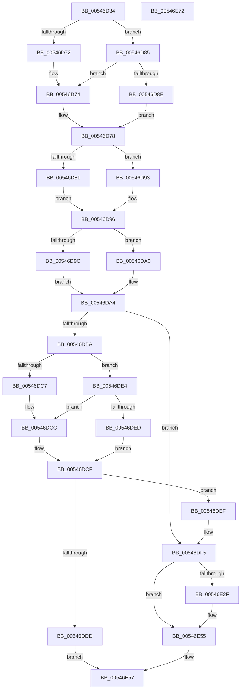

# HalpCollectProfileOwnershipStatus

- RVA: `0x00546D34`–`0x00546E73` (길이 `319` bytes)
- VA: `0x0000000140546D34`
- 실행 섹션: `.text`
- PDB 이름 있음: `예`; PDB Function 태그: `아니요`
- unwind 정보 RVA: `0x0005E6B4`
- 디코드: `101`개 명령, `319/319` bytes 표시
- 미해석 바이트: `0` (있으면 어셈블리에 `.byte`로 보존)

> 이 문서는 커널 이미지의 기계어와 PDB 기호를 분석해 생성했습니다. 4번과 5번은 함수 원형과 자료형을 바이너리 사용 방식에서 추정한 C 해석이며 원본 소스 복구 결과는 아닙니다.

## 1. Dependencies

- 직접 호출 지점: **4**; 고유 호출 대상: **1**
- 직접 호출자로 확인된 함수: **1**
- RIP 상대 이미지 참조: **1**

### Outgoing calls
- `0x00546E12` → [HalpCollectProfileOwnershipStatusInternal](HalpCollectProfileOwnershipStatusInternal_function_00546E7C.md) (function, `0x00546E7C`)
- `0x00546E25` → [HalpCollectProfileOwnershipStatusInternal](HalpCollectProfileOwnershipStatusInternal_function_00546E7C.md) (function, `0x00546E7C`)
- `0x00546E3D` → [HalpCollectProfileOwnershipStatusInternal](HalpCollectProfileOwnershipStatusInternal_function_00546E7C.md) (function, `0x00546E7C`)
- `0x00546E50` → [HalpCollectProfileOwnershipStatusInternal](HalpCollectProfileOwnershipStatusInternal_function_00546E7C.md) (function, `0x00546E7C`)

### Direct callers
- [HalpQueryProfileInformation](../../page/AD/HalpQueryProfileInformation_function_00AD621C.md) at `0x00AD6282`

### Static image references
- `0x00546D4F` → RVA `0x00FC8C40` (`ALMOSTRO`; read)

## 2. Other-region calls and transfers

- 다른 실행 섹션으로 향하는 call: **0**
- 별도 외부 분기/꼬리 이동을 확인하지 못했습니다.

## 3. Assembly (complete function range)

```asm
00546D34  48 8B C4                        mov rax, rsp
00546D37  48 89 58 08                     mov qword ptr [rax + 8], rbx
00546D3B  48 89 68 10                     mov qword ptr [rax + 0x10], rbp
00546D3F  48 89 70 18                     mov qword ptr [rax + 0x18], rsi
00546D43  48 89 78 20                     mov qword ptr [rax + 0x20], rdi
00546D47  41 56                           push r14
00546D49  48 83 EC 20                     sub rsp, 0x20
00546D4D  8B 31                           mov esi, dword ptr [rcx]
00546D4F  4C 8D 35 EA 1E A8 00            lea r14, [rip + 0xa81eea]
00546D56  40 32 ED                        xor bpl, bpl
00546D59  4D 8B D8                        mov r11, r8
00546D5C  8B DA                           mov ebx, edx
00546D5E  48 8B F9                        mov rdi, rcx
00546D61  49 8B 04 F6                     mov rax, qword ptr [r14 + rsi*8]
00546D65  4C 8B 48 58                     mov r9, qword ptr [rax + 0x58]
00546D69  49 8D 41 18                     lea rax, [r9 + 0x18]
00546D6D  4D 85 C9                        test r9, r9
00546D70  75 13                           jne 0x140546d85
00546D72  33 D2                           xor edx, edx
00546D74  44 8B 40 04                     mov r8d, dword ptr [rax + 4]
00546D78  49 8D 41 30                     lea rax, [r9 + 0x30]
00546D7C  48 85 C0                        test rax, rax
00546D7F  75 12                           jne 0x140546d93
00546D81  33 C9                           xor ecx, ecx
00546D83  EB 11                           jmp 0x140546d96
00546D85  41 8B 51 04                     mov edx, dword ptr [r9 + 4]
00546D89  48 85 C0                        test rax, rax
00546D8C  75 E6                           jne 0x140546d74
00546D8E  45 33 C0                        xor r8d, r8d
00546D91  EB E5                           jmp 0x140546d78
00546D93  8B 48 04                        mov ecx, dword ptr [rax + 4]
00546D96  49 83 C1 48                     add r9, 0x48
00546D9A  75 04                           jne 0x140546da0
00546D9C  33 C0                           xor eax, eax
00546D9E  EB 04                           jmp 0x140546da4
00546DA0  41 8B 41 04                     mov eax, dword ptr [r9 + 4]
00546DA4  03 C8                           add ecx, eax
00546DA6  41 03 C8                        add ecx, r8d
00546DA9  03 CA                           add ecx, edx
00546DAB  8B C1                           mov eax, ecx
00546DAD  C1 E0 04                        shl eax, 4
00546DB0  83 C0 08                        add eax, 8
00546DB3  41 89 03                        mov dword ptr [r11], eax
00546DB6  3B D8                           cmp ebx, eax
00546DB8  73 3B                           jae 0x140546df5
00546DBA  49 8B 04 F6                     mov rax, qword ptr [r14 + rsi*8]
00546DBE  48 8B 48 58                     mov rcx, qword ptr [rax + 0x58]
00546DC2  48 85 C9                        test rcx, rcx
00546DC5  75 1D                           jne 0x140546de4
00546DC7  33 C0                           xor eax, eax
00546DC9  8D 48 18                        lea ecx, [rax + 0x18]
00546DCC  8B 49 04                        mov ecx, dword ptr [rcx + 4]
00546DCF  03 C8                           add ecx, eax
00546DD1  8B C1                           mov eax, ecx
00546DD3  C1 E0 04                        shl eax, 4
00546DD6  83 C0 08                        add eax, 8
00546DD9  3B D8                           cmp ebx, eax
00546DDB  73 12                           jae 0x140546def
00546DDD  B8 04 00 00 C0                  mov eax, 0xc0000004
00546DE2  EB 73                           jmp 0x140546e57
00546DE4  8B 41 04                        mov eax, dword ptr [rcx + 4]
00546DE7  48 83 C1 18                     add rcx, 0x18
00546DEB  75 DF                           jne 0x140546dcc
00546DED  EB E0                           jmp 0x140546dcf
00546DEF  41 89 03                        mov dword ptr [r11], eax
00546DF2  40 B5 01                        mov bpl, 1
00546DF5  89 4F 04                        mov dword ptr [rdi + 4], ecx
00546DF8  44 8B CE                        mov r9d, esi
00546DFB  65 48 8B 04 25 20 00 00 00      mov rax, qword ptr gs:[0x20]
00546E04  48 8B D7                        mov rdx, rdi
00546E07  33 C9                           xor ecx, ecx
00546E09  8A 58 60                        mov bl, byte ptr [rax + 0x60]
00546E0C  80 E3 01                        and bl, 1
00546E0F  44 8A C3                        mov r8b, bl
00546E12  E8 65 00 00 00                  call 0x140546e7c
00546E17  44 8B CE                        mov r9d, esi
00546E1A  44 8A C3                        mov r8b, bl
00546E1D  48 8B D7                        mov rdx, rdi
00546E20  B9 01 00 00 00                  mov ecx, 1
00546E25  E8 52 00 00 00                  call 0x140546e7c
00546E2A  40 84 ED                        test bpl, bpl
00546E2D  75 26                           jne 0x140546e55
00546E2F  44 8B CE                        mov r9d, esi
00546E32  44 8A C3                        mov r8b, bl
00546E35  48 8B D7                        mov rdx, rdi
00546E38  B9 64 00 00 00                  mov ecx, 0x64
00546E3D  E8 3A 00 00 00                  call 0x140546e7c
00546E42  44 8B CE                        mov r9d, esi
00546E45  44 8A C3                        mov r8b, bl
00546E48  48 8B D7                        mov rdx, rdi
00546E4B  B9 65 00 00 00                  mov ecx, 0x65
00546E50  E8 27 00 00 00                  call 0x140546e7c
00546E55  33 C0                           xor eax, eax
00546E57  48 8B 5C 24 30                  mov rbx, qword ptr [rsp + 0x30]
00546E5C  48 8B 6C 24 38                  mov rbp, qword ptr [rsp + 0x38]
00546E61  48 8B 74 24 40                  mov rsi, qword ptr [rsp + 0x40]
00546E66  48 8B 7C 24 48                  mov rdi, qword ptr [rsp + 0x48]
00546E6B  48 83 C4 20                     add rsp, 0x20
00546E6F  41 5E                           pop r14
00546E71  C3                              ret
00546E72  CC                              int3
```

## 4. C-style interpretation (structured pseudocode)

```c
__int64 __fastcall HalpCollectProfileOwnershipStatus(__int64 a1, int a2, __int64 a3)
{
    __int64 result;
    __int64 v_rbp;
    __int64 v_rbx;
    __int64 v_rsp;
    unsigned __int64 v_stack_p10;
    unsigned __int64 v_stack_p18;
    unsigned __int64 v_stack_p20;
    unsigned __int64 v_stack_p8;

    *(unsigned __int64 *)(v_rsp + 8) = v_rbx;
    *(unsigned __int64 *)(v_rsp + 16) = v_rbp;
    *(unsigned __int64 *)(v_rsp + 24) = v_rsi;
    *(unsigned __int64 *)(v_rsp + 32) = v_rdi;
    v_rsp = (v_rsp) - (32);
    v_rbp = 0;
    if (*(unsigned __int64 *)(*(unsigned __int64 *)(v_rip + 11017962 + (unsigned int)(*(unsigned int *)(a1)) * 8) + 88) != 0) goto loc_00546D85;
    a2 = 0;
loc_00546D74:
loc_00546D78:
    if (*(unsigned __int64 *)(*(unsigned __int64 *)(v_rip + 11017962 + (unsigned int)(*(unsigned int *)(a1)) * 8) + 88) + 48 != 0) goto loc_00546D93;
    a1 = 0;
    goto loc_00546D96;
loc_00546D85:
    if (*(unsigned __int64 *)(*(unsigned __int64 *)(v_rip + 11017962 + (unsigned int)(*(unsigned int *)(a1)) * 8) + 88) + 48 != 0) goto loc_00546D74;
    a3 = 0;
    goto loc_00546D78;
loc_00546D93:
loc_00546D96:
    a4 = (*(unsigned __int64 *)(*(unsigned __int64 *)(v_rip + 11017962 + (unsigned int)(*(unsigned int *)(a1)) * 8) + 88)) + (72);
    if (condition_is_not_equal) goto loc_00546DA0;
    result = 0;
    goto loc_00546DA4;
loc_00546DA0:
loc_00546DA4:
    a1 = (unsigned int)(((unsigned int)(*(unsigned int *)(*(unsigned __int64 *)(*(unsigned __int64 *)(v_rip + 11017962 + (unsigned int)(*(unsigned int *)(a1)) * 8) + 88) + 48 + 4))) + ((unsigned int)((unsigned int)(*(unsigned int *)(a4 + 4)))));
    a1 = (unsigned int)((a1) + (0));
    a1 = (unsigned int)((a1) + ((unsigned int)((unsigned int)(*(unsigned int *)(*(unsigned __int64 *)(*(unsigned __int64 *)(v_rip + 11017962 + (unsigned int)(*(unsigned int *)(a1)) * 8) + 88) + 4)))));
    result = (unsigned int)(((unsigned int)((unsigned int)(a1))) << (4));
    result = (unsigned int)((result) + (8));
    *(unsigned int *)(a3) = (unsigned int)(result);
    if (((unsigned int)((unsigned int)(a2))) >= ((unsigned int)(result))) goto loc_00546DF5;
    if (*(unsigned __int64 *)(*(unsigned __int64 *)(v_rip + 11017962 + (unsigned int)(*(unsigned int *)(a1)) * 8) + 88) != 0) goto loc_00546DE4;
    result = 0;
loc_00546DCC:
loc_00546DCF:
    a1 = (unsigned int)(((unsigned int)(*(unsigned int *)(result + 24 + 4))) + (0));
    result = (unsigned int)(((unsigned int)((unsigned int)(a1))) << (4));
    result = (unsigned int)((result) + (8));
    if (((unsigned int)((unsigned int)(a2))) >= ((unsigned int)(result))) goto loc_00546DEF;
    goto loc_00546E57;
loc_00546DE4:
    a1 = (a1) + (24);
    if (condition_is_not_equal) goto loc_00546DCC;
    goto loc_00546DCF;
loc_00546DEF:
    *(unsigned int *)(a3) = (unsigned int)((unsigned int)(*(unsigned int *)(a1 + 4)));
loc_00546DF5:
    *(unsigned int *)(a1 + 4) = (unsigned int)(a1);
    a1 = 0;
    v_rbx = (unsigned __int8)((*(unsigned __int8 *)(*(unsigned __int64 *)(gs_base + (0 + 32)) + 96)) & (1));
    result = HalpCollectProfileOwnershipStatusInternal(a1, a1, (unsigned __int8)(v_rbx), (unsigned int)((unsigned int)((unsigned int)(*(unsigned int *)(a1)))));
    result = HalpCollectProfileOwnershipStatusInternal(1, 0, (unsigned __int8)(v_rbx), (unsigned int)((unsigned int)((unsigned int)(*(unsigned int *)(a1)))));
    if (1 == 0) {
        a4 = (unsigned int)((unsigned int)(*(unsigned int *)(a1)));
        a3 = (unsigned __int8)(v_rbx);
        a2 = 0;
        a1 = 100;
        result = HalpCollectProfileOwnershipStatusInternal(a1, a2, a3, a4);
        a4 = (unsigned int)((unsigned int)(*(unsigned int *)(a1)));
        a3 = (unsigned __int8)(v_rbx);
        a2 = a1;
        a1 = 101;
        result = HalpCollectProfileOwnershipStatusInternal(a1, a2, a3, a4);
    }
    result = 0;
loc_00546E57:
    v_rsp = (v_rsp) + (32);
    return result;
}
```

## 5. (Beta) C Style

```c
int64_t HalpCollectProfileOwnershipStatus(void *Arg1, int32_t Arg2, void *Arg3)
{
    uint8_t *arg1 = (uint8_t *)Arg1;
    uint8_t *arg3 = (uint8_t *)Arg3;

    int64_t result;
    int64_t local_rbp;
    int64_t local_rbx;
    int64_t local_rsp;
    uint64_t v_stack_p10;
    uint64_t v_stack_p18;
    uint64_t v_stack_p20;
    uint64_t v_stack_p8;

    *(uint64_t *)(local_rsp + 0x8) = local_rbx;
    *(uint64_t *)(local_rsp + 0x10) = local_rbp;
    *(uint64_t *)(local_rsp + 0x18) = local_rsi;
    *(uint64_t *)(local_rsp + 0x20) = local_rdi;
    local_rsp = (local_rsp) - (32);
    local_rbp = 0;
    if (*(uint64_t *)(*(uint64_t *)(v_rip + 0xA81EEA + (uint32_t)(*(uint32_t *)(arg1)) * 8) + 0x58) != 0) goto loc_00546D85;
    Arg2 = 0;
loc_00546D74:
loc_00546D78:
    if (*(uint64_t *)(*(uint64_t *)(v_rip + 0xA81EEA + (uint32_t)(*(uint32_t *)(arg1)) * 8) + 0x58) + 48 != 0) goto loc_00546D93;
    Arg1 = 0;
    goto loc_00546D96;
loc_00546D85:
    if (*(uint64_t *)(*(uint64_t *)(v_rip + 0xA81EEA + (uint32_t)(*(uint32_t *)(arg1)) * 8) + 0x58) + 48 != 0) goto loc_00546D74;
    Arg3 = 0;
    goto loc_00546D78;
loc_00546D93:
loc_00546D96:
    a4 = (*(uint64_t *)(*(uint64_t *)(v_rip + 0xA81EEA + (uint32_t)(*(uint32_t *)(arg1)) * 8) + 0x58)) + (72);
    if (condition_is_not_equal) goto loc_00546DA0;
    result = 0;
    goto loc_00546DA4;
loc_00546DA0:
loc_00546DA4:
    Arg1 = (uint32_t)(((uint32_t)(*(uint32_t *)(*(uint64_t *)(*(uint64_t *)(v_rip + 0xA81EEA + (uint32_t)(*(uint32_t *)(arg1)) * 8) + 0x58) + 0x30 + 0x4))) + ((uint32_t)((uint32_t)(*(uint32_t *)(a4 + 0x4)))));
    Arg1 = (uint32_t)((Arg1) + (0));
    Arg1 = (uint32_t)((Arg1) + ((uint32_t)((uint32_t)(*(uint32_t *)(*(uint64_t *)(*(uint64_t *)(v_rip + 0xA81EEA + (uint32_t)(*(uint32_t *)(arg1)) * 8) + 0x58) + 0x4)))));
    result = (uint32_t)(((uint32_t)((uint32_t)(Arg1))) << (4));
    result = (uint32_t)((result) + (8));
    *(uint32_t *)(arg3) = (uint32_t)(result);
    if (((uint32_t)((uint32_t)(Arg2))) >= ((uint32_t)(result))) goto loc_00546DF5;
    if (*(uint64_t *)(*(uint64_t *)(v_rip + 0xA81EEA + (uint32_t)(*(uint32_t *)(arg1)) * 8) + 0x58) != 0) goto loc_00546DE4;
    result = 0;
loc_00546DCC:
loc_00546DCF:
    Arg1 = (uint32_t)(((uint32_t)(*(uint32_t *)(result + 0x18 + 0x4))) + (0));
    result = (uint32_t)(((uint32_t)((uint32_t)(Arg1))) << (4));
    result = (uint32_t)((result) + (8));
    if (((uint32_t)((uint32_t)(Arg2))) >= ((uint32_t)(result))) goto loc_00546DEF;
    goto loc_00546E57;
loc_00546DE4:
    Arg1 = (Arg1) + (24);
    if (condition_is_not_equal) goto loc_00546DCC;
    goto loc_00546DCF;
loc_00546DEF:
    *(uint32_t *)(arg3) = (uint32_t)((uint32_t)(*(uint32_t *)(arg1 + 0x4)));
loc_00546DF5:
    *(uint32_t *)(arg1 + 0x4) = (uint32_t)(Arg1);
    Arg1 = 0;
    local_rbx = (uint8_t)((*(uint8_t *)(*(uint64_t *)(gs_base + (0 + 0x20)) + 0x60)) & (1));
    result = HalpCollectProfileOwnershipStatusInternal(Arg1, Arg1, (uint8_t)(local_rbx), (uint32_t)((uint32_t)((uint32_t)(*(uint32_t *)(arg1)))));
    result = HalpCollectProfileOwnershipStatusInternal(1, 0, (uint8_t)(local_rbx), (uint32_t)((uint32_t)((uint32_t)(*(uint32_t *)(arg1)))));
    if (1 == 0) {
        a4 = (uint32_t)((uint32_t)(*(uint32_t *)(arg1)));
        Arg3 = (uint8_t)(local_rbx);
        Arg2 = 0;
        Arg1 = 100;
        result = HalpCollectProfileOwnershipStatusInternal(Arg1, Arg2, Arg3, a4);
        a4 = (uint32_t)((uint32_t)(*(uint32_t *)(arg1)));
        Arg3 = (uint8_t)(local_rbx);
        Arg2 = Arg1;
        Arg1 = 101;
        result = HalpCollectProfileOwnershipStatusInternal(Arg1, Arg2, Arg3, a4);
    }
    result = 0;
loc_00546E57:
    local_rsp = (local_rsp) + (32);
    return result;
}
```

### 관측된 메모리 오프셋

구조체 형식이 확인되지 않은 접근은 인자 기준의 오프셋으로만 기록했습니다.

| 기준 인자 | 오프셋 표현 | 폭 (bit) | 접근 |
|---|---:|---:|---|
| `Arg1` | `+ 0x0` | `32` | `R` |
| `Arg1` | `+ 0x4` | `32` | `W` |
| `Arg3` | `+ 0x0` | `32` | `W` |

## 6. Execution-region graph

[열기: 2D/3D 그래프와 함수 탐색 컨트롤 패널](../../../control-panel.html?section=text&rva=0x00546D34&view=graph)

- 2D 그래프는 위에서 아래로 흐르고, 3D 그래프는 빈 공간을 드래그해 회전합니다. Shift+드래그는 이동, 휠은 확대·축소, 함수 노드 선택은 대상 보고서 이동입니다.

### Static fallback


