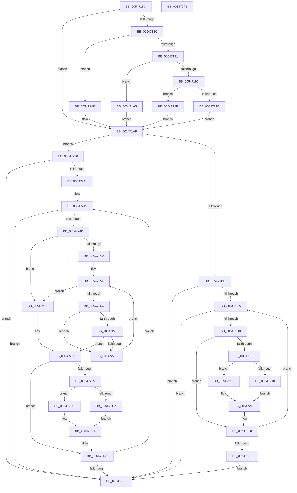

# HalpCollectSamplingProfileCorruptionStatusInternal

- RVA: `0x0054715C`–`0x005472FF` (길이 `419` bytes)
- VA: `0x000000014054715C`
- 실행 섹션: `.text`
- PDB 이름 있음: `예`; PDB Function 태그: `아니요`
- unwind 정보 RVA: `0x0005C954`
- 디코드: `123`개 명령, `419/419` bytes 표시
- 미해석 바이트: `0` (있으면 어셈블리에 `.byte`로 보존)

> 이 문서는 커널 이미지의 기계어와 PDB 기호를 분석해 생성했습니다. 4번과 5번은 함수 원형과 자료형을 바이너리 사용 방식에서 추정한 C 해석이며 원본 소스 복구 결과는 아닙니다.

## 1. Dependencies

- 직접 호출 지점: **1**; 고유 호출 대상: **1**
- 직접 호출자로 확인된 함수: **1**
- RIP 상대 이미지 참조: **1**

### Outgoing calls
- `0x005471AF` → [Feature_Test52061194__private_IsEnabledNoReportingNoInline](../44/Feature_Test52061194__private_IsEnabledNoReportingNoInline_function_00445C10.md) (function, `0x00445C10`)

### Direct callers
- [HalpCollectSamplingProfileCorruptionStatus](HalpCollectSamplingProfileCorruptionStatus_function_005470AC.md) at `0x005470FF`
- [HalpCollectSamplingProfileCorruptionStatus](HalpCollectSamplingProfileCorruptionStatus_function_005470AC.md) at `0x00547119`

### Static image references
- `0x00547176` → RVA `0x00FC8C40` (`ALMOSTRO`; read)

## 2. Other-region calls and transfers

- 다른 실행 섹션으로 향하는 call: **0**
- 별도 외부 분기/꼬리 이동을 확인하지 못했습니다.

## 3. Assembly (complete function range)

```asm
0054715C  48 89 5C 24 08                  mov qword ptr [rsp + 8], rbx
00547161  48 89 6C 24 10                  mov qword ptr [rsp + 0x10], rbp
00547166  48 89 74 24 18                  mov qword ptr [rsp + 0x18], rsi
0054716B  57                              push rdi
0054716C  48 83 EC 20                     sub rsp, 0x20
00547170  41 8B C0                        mov eax, r8d
00547173  48 8B E9                        mov rbp, rcx
00547176  48 8D 0D C3 1A A8 00            lea rcx, [rip + 0xa81ac3]
0054717D  49 8B F9                        mov rdi, r9
00547180  48 8B 04 C1                     mov rax, qword ptr [rcx + rax*8]
00547184  48 8B 58 58                     mov rbx, qword ptr [rax + 0x58]
00547188  85 D2                           test edx, edx
0054718A  74 23                           je 0x1405471af
0054718C  83 EA 01                        sub edx, 1
0054718F  74 1A                           je 0x1405471ab
00547191  83 EA 63                        sub edx, 0x63
00547194  74 0F                           je 0x1405471a5
00547196  83 FA 01                        cmp edx, 1
00547199  74 04                           je 0x14054719f
0054719B  33 DB                           xor ebx, ebx
0054719D  EB 10                           jmp 0x1405471af
0054719F  48 83 C3 48                     add rbx, 0x48
005471A3  EB 0A                           jmp 0x1405471af
005471A5  48 83 C3 30                     add rbx, 0x30
005471A9  EB 04                           jmp 0x1405471af
005471AB  48 83 C3 18                     add rbx, 0x18
005471AF  E8 5C EA EF FF                  call 0x140445c10
005471B4  45 33 C0                        xor r8d, r8d
005471B7  85 C0                           test eax, eax
005471B9  75 7B                           jne 0x140547236
005471BB  44 39 43 04                     cmp dword ptr [rbx + 4], r8d
005471BF  0F 86 24 01 00 00               jbe 0x1405472e9
005471C5  44 8B 17                        mov r10d, dword ptr [rdi]
005471C8  44 3B 54 24 50                  cmp r10d, dword ptr [rsp + 0x50]
005471CD  0F 83 16 01 00 00               jae 0x1405472e9
005471D3  48 8B 43 10                     mov rax, qword ptr [rbx + 0x10]
005471D7  4F 8D 0C 40                     lea r9, [r8 + r8*2]
005471DB  4D 03 C9                        add r9, r9
005471DE  42 83 7C C8 18 00               cmp dword ptr [rax + r9*8 + 0x18], 0
005471E4  75 42                           jne 0x140547228
005471E6  41 8B D2                        mov edx, r10d
005471E9  48 C1 E2 04                     shl rdx, 4
005471ED  48 03 D5                        add rdx, rbp
005471F0  C6 42 0D 01                     mov byte ptr [rdx + 0xd], 1
005471F4  48 8B 43 10                     mov rax, qword ptr [rbx + 0x10]
005471F8  42 8B 4C C8 24                  mov ecx, dword ptr [rax + r9*8 + 0x24]
005471FD  89 4A 08                        mov dword ptr [rdx + 8], ecx
00547200  48 8B 43 10                     mov rax, qword ptr [rbx + 0x10]
00547204  42 8A 4C C8 28                  mov cl, byte ptr [rax + r9*8 + 0x28]
00547209  88 4A 0C                        mov byte ptr [rdx + 0xc], cl
0054720C  84 C9                           test cl, cl
0054720E  74 0E                           je 0x14054721e
00547210  48 8B 43 10                     mov rax, qword ptr [rbx + 0x10]
00547214  4A 8B 4C C8 08                  mov rcx, qword ptr [rax + r9*8 + 8]
00547219  48 89 0A                        mov qword ptr [rdx], rcx
0054721C  EB 04                           jmp 0x140547222
0054721E  48 83 22 00                     and qword ptr [rdx], 0
00547222  41 8D 42 01                     lea eax, [r10 + 1]
00547226  89 07                           mov dword ptr [rdi], eax
00547228  41 FF C0                        inc r8d
0054722B  44 3B 43 04                     cmp r8d, dword ptr [rbx + 4]
0054722F  72 94                           jb 0x1405471c5
00547231  E9 B3 00 00 00                  jmp 0x1405472e9
00547236  8B 43 04                        mov eax, dword ptr [rbx + 4]
00547239  85 C0                           test eax, eax
0054723B  0F 84 A8 00 00 00               je 0x1405472e9
00547241  8B 74 24 50                     mov esi, dword ptr [rsp + 0x50]
00547245  39 37                           cmp dword ptr [rdi], esi
00547247  0F 83 9C 00 00 00               jae 0x1405472e9
0054724D  44 3B C0                        cmp r8d, eax
00547250  73 2D                           jae 0x14054727f
00547252  4C 8B 5B 10                     mov r11, qword ptr [rbx + 0x10]
00547256  45 33 C9                        xor r9d, r9d
00547259  44 8B 53 08                     mov r10d, dword ptr [rbx + 8]
0054725D  33 D2                           xor edx, edx
0054725F  41 3B D2                        cmp edx, r10d
00547262  77 1B                           ja 0x14054727f
00547264  48 8D 0C 52                     lea rcx, [rdx + rdx*2]
00547268  48 03 C9                        add rcx, rcx
0054726B  41 83 7C CB 1C 03               cmp dword ptr [r11 + rcx*8 + 0x1c], 3
00547271  74 08                           je 0x14054727b
00547273  41 FF C1                        inc r9d
00547276  45 3B C8                        cmp r9d, r8d
00547279  77 07                           ja 0x140547282
0054727B  FF C2                           inc edx
0054727D  EB E0                           jmp 0x14054725f
0054727F  83 CA FF                        or edx, 0xffffffff
00547282  48 8B 43 10                     mov rax, qword ptr [rbx + 0x10]
00547286  4C 8D 0C 52                     lea r9, [rdx + rdx*2]
0054728A  4D 03 C9                        add r9, r9
0054728D  42 83 7C C8 18 00               cmp dword ptr [rax + r9*8 + 0x18], 0
00547293  75 45                           jne 0x1405472da
00547295  44 8B 17                        mov r10d, dword ptr [rdi]
00547298  41 8B D2                        mov edx, r10d
0054729B  48 C1 E2 04                     shl rdx, 4
0054729F  48 03 D5                        add rdx, rbp
005472A2  C6 42 0D 01                     mov byte ptr [rdx + 0xd], 1
005472A6  48 8B 43 10                     mov rax, qword ptr [rbx + 0x10]
005472AA  42 8B 4C C8 24                  mov ecx, dword ptr [rax + r9*8 + 0x24]
005472AF  89 4A 08                        mov dword ptr [rdx + 8], ecx
005472B2  48 8B 43 10                     mov rax, qword ptr [rbx + 0x10]
005472B6  42 8A 4C C8 28                  mov cl, byte ptr [rax + r9*8 + 0x28]
005472BB  88 4A 0C                        mov byte ptr [rdx + 0xc], cl
005472BE  84 C9                           test cl, cl
005472C0  74 0E                           je 0x1405472d0
005472C2  48 8B 43 10                     mov rax, qword ptr [rbx + 0x10]
005472C6  4A 8B 4C C8 08                  mov rcx, qword ptr [rax + r9*8 + 8]
005472CB  48 89 0A                        mov qword ptr [rdx], rcx
005472CE  EB 04                           jmp 0x1405472d4
005472D0  48 83 22 00                     and qword ptr [rdx], 0
005472D4  41 8D 42 01                     lea eax, [r10 + 1]
005472D8  89 07                           mov dword ptr [rdi], eax
005472DA  8B 43 04                        mov eax, dword ptr [rbx + 4]
005472DD  41 FF C0                        inc r8d
005472E0  44 3B C0                        cmp r8d, eax
005472E3  0F 82 5C FF FF FF               jb 0x140547245
005472E9  48 8B 5C 24 30                  mov rbx, qword ptr [rsp + 0x30]
005472EE  48 8B 6C 24 38                  mov rbp, qword ptr [rsp + 0x38]
005472F3  48 8B 74 24 40                  mov rsi, qword ptr [rsp + 0x40]
005472F8  48 83 C4 20                     add rsp, 0x20
005472FC  5F                              pop rdi
005472FD  C3                              ret
005472FE  CC                              int3
```

## 4. C-style interpretation (structured pseudocode)

```c
__int64 __fastcall HalpCollectSamplingProfileCorruptionStatusInternal(__int64 a1, int a2, int a3, __int64 a4, unsigned int a5)
{
    __int64 result;
    __int64 v_rbx;
    __int64 v_rsp;
    unsigned __int64 v_stack_p10;
    unsigned __int64 v_stack_p18;
    unsigned __int64 v_stack_p8;

    v_stack_p8 = v_rbx;
    v_stack_p10 = v_rbp;
    v_stack_p18 = v_rsi;
    v_rsp = (v_rsp) - (32);
    if (a2 == 0) goto loc_005471AF;
    a2 = (unsigned int)((a2) - (1));
    if (condition_is_equal) goto loc_005471AB;
    a2 = (unsigned int)((a2) - (99));
    if (condition_is_equal) goto loc_005471A5;
    if (a2 == 1) goto loc_0054719F;
    v_rbx = 0;
    goto loc_005471AF;
loc_0054719F:
    v_rbx = (v_rbx) + (72);
    goto loc_005471AF;
loc_005471A5:
    v_rbx = (v_rbx) + (48);
    goto loc_005471AF;
loc_005471AB:
    v_rbx = (v_rbx) + (24);
loc_005471AF:
    result = Feature_Test52061194__private_IsEnabledNoReportingNoInline(v_rip + 11016899, a2, a3, a4);
    a3 = 0;
    if ((unsigned int)(result) != 0) goto loc_00547236;
    if ((*(unsigned int *)(v_rbx + 4)) <= 0) goto loc_005472E9;
loc_005471C5:
    if (((unsigned int)((unsigned int)(*(unsigned int *)(a4)))) >= a5) goto loc_005472E9;
    a4 = (a3 + a3 * 2) + (a3 + a3 * 2);
    if ((*(unsigned int *)(*(unsigned __int64 *)(v_rbx + 16) + a4 * 8 + 24)) != 0) goto loc_00547228;
    a2 = ((unsigned int)((unsigned int)((unsigned int)(*(unsigned int *)(a4))))) << (4);
    a2 = (a2) + (a1);
    *(unsigned __int8 *)(a2 + 13) = 1;
    *(unsigned int *)(a2 + 8) = (unsigned int)((unsigned int)(*(unsigned int *)(*(unsigned __int64 *)(v_rbx + 16) + a4 * 8 + 36)));
    *(unsigned __int8 *)(a2 + 12) = (unsigned __int8)(*(unsigned __int8 *)(*(unsigned __int64 *)(v_rbx + 16) + a4 * 8 + 40));
    if ((unsigned __int8)(*(unsigned __int8 *)(*(unsigned __int64 *)(v_rbx + 16) + a4 * 8 + 40)) == 0) goto loc_0054721E;
    *(unsigned __int64 *)(a2) = *(unsigned __int64 *)(*(unsigned __int64 *)(v_rbx + 16) + a4 * 8 + 8);
    goto loc_00547222;
loc_0054721E:
loc_00547222:
    *(unsigned int *)(a4) = (unsigned int)((unsigned int)(*(unsigned int *)(a4)) + 1);
loc_00547228:
    a3 = (unsigned int)((a3) + 1);
    if (a3 < (*(unsigned int *)(v_rbx + 4))) goto loc_005471C5;
    goto loc_005472E9;
loc_00547236:
    if ((unsigned int)((unsigned int)(*(unsigned int *)(v_rbx + 4))) == 0) goto loc_005472E9;
loc_00547245:
    if ((*(unsigned int *)(a4)) >= ((unsigned int)((unsigned int)(a5)))) goto loc_005472E9;
    if (a3 >= ((unsigned int)((unsigned int)(*(unsigned int *)(v_rbx + 4))))) goto loc_0054727F;
    a4 = 0;
    a2 = 0;
loc_0054725F:
    if (0 > ((unsigned int)((unsigned int)(*(unsigned int *)(v_rbx + 8))))) goto loc_0054727F;
    a1 = (a2 + a2 * 2) + (a2 + a2 * 2);
    if ((*(unsigned int *)(*(unsigned __int64 *)(v_rbx + 16) + a1 * 8 + 28)) == 3) goto loc_0054727B;
    a4 = (unsigned int)((a4) + 1);
    if (((unsigned int)(a4)) > a3) goto loc_00547282;
loc_0054727B:
    a2 = (unsigned int)((a2) + 1);
    goto loc_0054725F;
loc_0054727F:
    a2 = (unsigned int)((a2) | (0xFFFFFFFFULL));
loc_00547282:
    a4 = (a2 + a2 * 2) + (a2 + a2 * 2);
    if ((*(unsigned int *)(*(unsigned __int64 *)(v_rbx + 16) + a4 * 8 + 24)) != 0) goto loc_005472DA;
    a2 = ((unsigned int)((unsigned int)((unsigned int)(*(unsigned int *)(a4))))) << (4);
    a2 = (a2) + (a1);
    *(unsigned __int8 *)(a2 + 13) = 1;
    *(unsigned int *)(a2 + 8) = (unsigned int)((unsigned int)(*(unsigned int *)(*(unsigned __int64 *)(v_rbx + 16) + a4 * 8 + 36)));
    *(unsigned __int8 *)(a2 + 12) = (unsigned __int8)(*(unsigned __int8 *)(*(unsigned __int64 *)(v_rbx + 16) + a4 * 8 + 40));
    if ((unsigned __int8)(*(unsigned __int8 *)(*(unsigned __int64 *)(v_rbx + 16) + a4 * 8 + 40)) == 0) goto loc_005472D0;
    *(unsigned __int64 *)(a2) = *(unsigned __int64 *)(*(unsigned __int64 *)(v_rbx + 16) + a4 * 8 + 8);
    goto loc_005472D4;
loc_005472D0:
loc_005472D4:
    *(unsigned int *)(a4) = (unsigned int)((unsigned int)(*(unsigned int *)(a4)) + 1);
loc_005472DA:
    a3 = (unsigned int)((a3) + 1);
    if (a3 < ((unsigned int)((unsigned int)(*(unsigned int *)(v_rbx + 4))))) goto loc_00547245;
loc_005472E9:
    v_rsp = (v_rsp) + (32);
    return (unsigned int)(*(unsigned int *)(v_rbx + 4));
}
```

## 5. (Beta) C Style

```c
int64_t HalpCollectSamplingProfileCorruptionStatusInternal(int64_t Arg1, int32_t Arg2, int32_t Arg3, void *Arg4, uint32_t Arg5)
{
    uint8_t *arg4 = (uint8_t *)Arg4;

    int64_t result;
    int64_t local_rbx;
    int64_t local_rsp;
    uint64_t v_stack_p10;
    uint64_t v_stack_p18;
    uint64_t v_stack_p8;

    v_stack_p8 = local_rbx;
    v_stack_p10 = local_rbp;
    v_stack_p18 = local_rsi;
    local_rsp = (local_rsp) - (32);
    if (Arg2 == 0) goto loc_005471AF;
    Arg2 = (uint32_t)((Arg2) - (1));
    if (condition_is_equal) goto loc_005471AB;
    Arg2 = (uint32_t)((Arg2) - (99));
    if (condition_is_equal) goto loc_005471A5;
    if (Arg2 == 1) goto loc_0054719F;
    local_rbx = 0;
    goto loc_005471AF;
loc_0054719F:
    local_rbx = (local_rbx) + (72);
    goto loc_005471AF;
loc_005471A5:
    local_rbx = (local_rbx) + (48);
    goto loc_005471AF;
loc_005471AB:
    local_rbx = (local_rbx) + (24);
loc_005471AF:
    result = Feature_Test52061194__private_IsEnabledNoReportingNoInline(v_rip + 11016899, Arg2, Arg3, Arg4);
    Arg3 = 0;
    if ((uint32_t)(result) != 0) goto loc_00547236;
    if ((*(uint32_t *)(local_rbx + 0x4)) <= 0) goto loc_005472E9;
loc_005471C5:
    if (((uint32_t)((uint32_t)(*(uint32_t *)(arg4)))) >= Arg5) goto loc_005472E9;
    Arg4 = (Arg3 + Arg3 * 2) + (Arg3 + Arg3 * 2);
    if ((*(uint32_t *)(*(uint64_t *)(local_rbx + 0x10) + arg4 * 8 + 0x18)) != 0) goto loc_00547228;
    Arg2 = ((uint32_t)((uint32_t)((uint32_t)(*(uint32_t *)(arg4))))) << (4);
    Arg2 = (Arg2) + (Arg1);
    *(uint8_t *)(Arg2 + 0xD) = 1;
    *(uint32_t *)(Arg2 + 0x8) = (uint32_t)((uint32_t)(*(uint32_t *)(*(uint64_t *)(local_rbx + 0x10) + arg4 * 8 + 0x24)));
    *(uint8_t *)(Arg2 + 0xC) = (uint8_t)(*(uint8_t *)(*(uint64_t *)(local_rbx + 0x10) + arg4 * 8 + 0x28));
    if ((uint8_t)(*(uint8_t *)(*(uint64_t *)(local_rbx + 0x10) + arg4 * 8 + 0x28)) == 0) goto loc_0054721E;
    *(uint64_t *)(Arg2) = *(uint64_t *)(*(uint64_t *)(local_rbx + 0x10) + arg4 * 8 + 0x8);
    goto loc_00547222;
loc_0054721E:
loc_00547222:
    *(uint32_t *)(arg4) = (uint32_t)((uint32_t)(*(uint32_t *)(arg4)) + 1);
loc_00547228:
    Arg3 = (uint32_t)((Arg3) + 1);
    if (Arg3 < (*(uint32_t *)(local_rbx + 0x4))) goto loc_005471C5;
    goto loc_005472E9;
loc_00547236:
    if ((uint32_t)((uint32_t)(*(uint32_t *)(local_rbx + 0x4))) == 0) goto loc_005472E9;
loc_00547245:
    if ((*(uint32_t *)(arg4)) >= ((uint32_t)((uint32_t)(Arg5)))) goto loc_005472E9;
    if (Arg3 >= ((uint32_t)((uint32_t)(*(uint32_t *)(local_rbx + 0x4))))) goto loc_0054727F;
    Arg4 = 0;
    Arg2 = 0;
loc_0054725F:
    if (0 > ((uint32_t)((uint32_t)(*(uint32_t *)(local_rbx + 0x8))))) goto loc_0054727F;
    Arg1 = (Arg2 + Arg2 * 2) + (Arg2 + Arg2 * 2);
    if ((*(uint32_t *)(*(uint64_t *)(local_rbx + 0x10) + Arg1 * 8 + 0x1C)) == 3) goto loc_0054727B;
    Arg4 = (uint32_t)((Arg4) + 1);
    if (((uint32_t)(Arg4)) > Arg3) goto loc_00547282;
loc_0054727B:
    Arg2 = (uint32_t)((Arg2) + 1);
    goto loc_0054725F;
loc_0054727F:
    Arg2 = (uint32_t)((Arg2) | (0xFFFFFFFFULL));
loc_00547282:
    Arg4 = (Arg2 + Arg2 * 2) + (Arg2 + Arg2 * 2);
    if ((*(uint32_t *)(*(uint64_t *)(local_rbx + 0x10) + arg4 * 8 + 0x18)) != 0) goto loc_005472DA;
    Arg2 = ((uint32_t)((uint32_t)((uint32_t)(*(uint32_t *)(arg4))))) << (4);
    Arg2 = (Arg2) + (Arg1);
    *(uint8_t *)(Arg2 + 0xD) = 1;
    *(uint32_t *)(Arg2 + 0x8) = (uint32_t)((uint32_t)(*(uint32_t *)(*(uint64_t *)(local_rbx + 0x10) + arg4 * 8 + 0x24)));
    *(uint8_t *)(Arg2 + 0xC) = (uint8_t)(*(uint8_t *)(*(uint64_t *)(local_rbx + 0x10) + arg4 * 8 + 0x28));
    if ((uint8_t)(*(uint8_t *)(*(uint64_t *)(local_rbx + 0x10) + arg4 * 8 + 0x28)) == 0) goto loc_005472D0;
    *(uint64_t *)(Arg2) = *(uint64_t *)(*(uint64_t *)(local_rbx + 0x10) + arg4 * 8 + 0x8);
    goto loc_005472D4;
loc_005472D0:
loc_005472D4:
    *(uint32_t *)(arg4) = (uint32_t)((uint32_t)(*(uint32_t *)(arg4)) + 1);
loc_005472DA:
    Arg3 = (uint32_t)((Arg3) + 1);
    if (Arg3 < ((uint32_t)((uint32_t)(*(uint32_t *)(local_rbx + 0x4))))) goto loc_00547245;
loc_005472E9:
    local_rsp = (local_rsp) + (32);
    return (uint32_t)(*(uint32_t *)(local_rbx + 0x4));
}
```

### 관측된 메모리 오프셋

구조체 형식이 확인되지 않은 접근은 인자 기준의 오프셋으로만 기록했습니다.

| 기준 인자 | 오프셋 표현 | 폭 (bit) | 접근 |
|---|---:|---:|---|
| `Arg4` | `+ 0x0` | `32` | `R` |
| `Arg4` | `+ 0x0` | `32` | `W` |

## 6. Execution-region graph

[열기: 2D/3D 그래프와 함수 탐색 컨트롤 패널](../../../control-panel.html?section=text&rva=0x0054715C&view=graph)

- 2D 그래프는 위에서 아래로 흐르고, 3D 그래프는 빈 공간을 드래그해 회전합니다. Shift+드래그는 이동, 휠은 확대·축소, 함수 노드 선택은 대상 보고서 이동입니다.

### Static fallback


