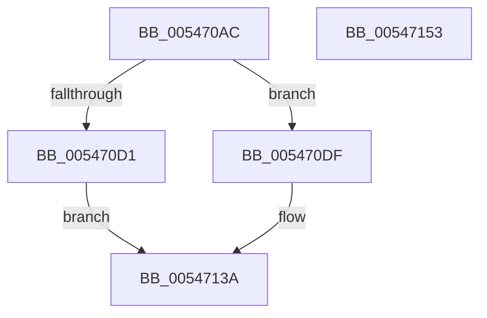

# HalpCollectSamplingProfileCorruptionStatus

- RVA: `0x005470AC`–`0x00547154` (길이 `168` bytes)
- VA: `0x00000001405470AC`
- 실행 섹션: `.text`
- PDB 이름 있음: `예`; PDB Function 태그: `아니요`
- unwind 정보 RVA: `0x000BD20C`
- 디코드: `49`개 명령, `168/168` bytes 표시
- 미해석 바이트: `0` (있으면 어셈블리에 `.byte`로 보존)

> 이 문서는 커널 이미지의 기계어와 PDB 기호를 분석해 생성했습니다. 4번과 5번은 함수 원형과 자료형을 바이너리 사용 방식에서 추정한 C 해석이며 원본 소스 복구 결과는 아닙니다.

## 1. Dependencies

- 직접 호출 지점: **2**; 고유 호출 대상: **1**
- 직접 호출자로 확인된 함수: **1**
- RIP 상대 이미지 참조: **0**

### Outgoing calls
- `0x005470FF` → [HalpCollectSamplingProfileCorruptionStatusInternal](HalpCollectSamplingProfileCorruptionStatusInternal_function_0054715C.md) (function, `0x0054715C`)
- `0x00547119` → [HalpCollectSamplingProfileCorruptionStatusInternal](HalpCollectSamplingProfileCorruptionStatusInternal_function_0054715C.md) (function, `0x0054715C`)

### Direct callers
- [HalpCollectProfileCorruptionStatus](../4C/HalpCollectProfileCorruptionStatus_function_004C9AFC.md) at `0x004C9B3E`

### Static image references
- 디코드된 RIP-relative 메모리 참조가 없습니다.

## 2. Other-region calls and transfers

- 다른 실행 섹션으로 향하는 call: **0**
- 별도 외부 분기/꼬리 이동을 확인하지 못했습니다.

## 3. Assembly (complete function range)

```asm
005470AC  48 89 5C 24 08                  mov qword ptr [rsp + 8], rbx
005470B1  48 89 6C 24 18                  mov qword ptr [rsp + 0x18], rbp
005470B6  48 89 74 24 20                  mov qword ptr [rsp + 0x20], rsi
005470BB  57                              push rdi
005470BC  41 56                           push r14
005470BE  41 57                           push r15
005470C0  48 83 EC 30                     sub rsp, 0x30
005470C4  4D 8B F0                        mov r14, r8
005470C7  8B EA                           mov ebp, edx
005470C9  4C 8B F9                        mov r15, rcx
005470CC  83 FA 10                        cmp edx, 0x10
005470CF  73 0E                           jae 0x1405470df
005470D1  41 C7 00 10 00 00 00            mov dword ptr [r8], 0x10
005470D8  B8 04 00 00 C0                  mov eax, 0xc0000004
005470DD  EB 5B                           jmp 0x14054713a
005470DF  8B 71 08                        mov esi, dword ptr [rcx + 8]
005470E2  8D 5A F0                        lea ebx, [rdx - 0x10]
005470E5  83 64 24 58 00                  and dword ptr [rsp + 0x58], 0
005470EA  4C 8D 4C 24 58                  lea r9, [rsp + 0x58]
005470EF  C1 EB 04                        shr ebx, 4
005470F2  44 8B C6                        mov r8d, esi
005470F5  33 D2                           xor edx, edx
005470F7  89 5C 24 20                     mov dword ptr [rsp + 0x20], ebx
005470FB  48 83 C1 18                     add rcx, 0x18
005470FF  E8 58 00 00 00                  call 0x14054715c
00547104  4C 8D 4C 24 58                  lea r9, [rsp + 0x58]
00547109  89 5C 24 20                     mov dword ptr [rsp + 0x20], ebx
0054710D  44 8B C6                        mov r8d, esi
00547110  49 8D 4F 18                     lea rcx, [r15 + 0x18]
00547114  BA 01 00 00 00                  mov edx, 1
00547119  E8 3E 00 00 00                  call 0x14054715c
0054711E  8B 44 24 58                     mov eax, dword ptr [rsp + 0x58]
00547122  8B C8                           mov ecx, eax
00547124  C1 E1 04                        shl ecx, 4
00547127  83 C1 18                        add ecx, 0x18
0054712A  3B E9                           cmp ebp, ecx
0054712C  41 89 0E                        mov dword ptr [r14], ecx
0054712F  41 89 47 10                     mov dword ptr [r15 + 0x10], eax
00547133  1B C0                           sbb eax, eax
00547135  25 04 00 00 C0                  and eax, 0xc0000004
0054713A  48 8B 5C 24 50                  mov rbx, qword ptr [rsp + 0x50]
0054713F  48 8B 6C 24 60                  mov rbp, qword ptr [rsp + 0x60]
00547144  48 8B 74 24 68                  mov rsi, qword ptr [rsp + 0x68]
00547149  48 83 C4 30                     add rsp, 0x30
0054714D  41 5F                           pop r15
0054714F  41 5E                           pop r14
00547151  5F                              pop rdi
00547152  C3                              ret
00547153  CC                              int3
```

## 4. C-style interpretation (structured pseudocode)

```c
__int64 __fastcall HalpCollectSamplingProfileCorruptionStatus(__int64 a1, __int64 a2, __int64 a3)
{
    __int64 result;
    __int64 v_rbx;
    __int64 v_rsp;
    unsigned int v_stack_m28;
    unsigned int v_stack_p10;
    unsigned __int64 v_stack_p18;
    unsigned __int64 v_stack_p20;
    unsigned __int64 v_stack_p8;

    v_stack_p8 = v_rbx;
    v_stack_p18 = v_rbp;
    v_stack_p20 = v_rsi;
    v_rsp = (v_rsp) - (48);
    if (((unsigned int)(a2)) >= 16) goto loc_005470DF;
    *(unsigned int *)(a3) = 16;
    goto loc_0054713A;
loc_005470DF:
    v_rbx = (unsigned int)((a2 - 16) >> (4));
    a2 = 0;
    v_stack_m28 = (unsigned int)(v_rbx);
    a1 = (a1) + (24);
    result = HalpCollectSamplingProfileCorruptionStatusInternal(a1, a2, (unsigned int)((unsigned int)((unsigned int)(*(unsigned int *)(a1 + 8)))), v_stack_p10);
    v_stack_m28 = (unsigned int)(v_rbx);
    result = HalpCollectSamplingProfileCorruptionStatusInternal(a1 + 24, 1, (unsigned int)((unsigned int)((unsigned int)(*(unsigned int *)(a1 + 8)))), v_stack_p10);
    a1 = (unsigned int)(((unsigned int)((unsigned int)((unsigned int)(v_stack_p10)))) << (4));
    a1 = (unsigned int)((a1) + (24));
    *(unsigned int *)(a3) = (unsigned int)(a1);
    *(unsigned int *)(a1 + 16) = (unsigned int)((unsigned int)(v_stack_p10));
    result = (unsigned int)(((unsigned int)(v_stack_p10)) & (0xC0000004ULL));
loc_0054713A:
    v_rsp = (v_rsp) + (48);
    return result;
}
```

## 5. (Beta) C Style

```c
int64_t HalpCollectSamplingProfileCorruptionStatus(void *Arg1, int64_t Arg2, void *Arg3)
{
    uint8_t *arg1 = (uint8_t *)Arg1;
    uint8_t *arg3 = (uint8_t *)Arg3;

    int64_t result;
    int64_t local_rbx;
    int64_t local_rsp;
    uint32_t v_stack_m28;
    uint32_t v_stack_p10;
    uint64_t v_stack_p18;
    uint64_t v_stack_p20;
    uint64_t v_stack_p8;

    v_stack_p8 = local_rbx;
    v_stack_p18 = local_rbp;
    v_stack_p20 = local_rsi;
    local_rsp = (local_rsp) - (48);
    if (((uint32_t)(Arg2)) >= 16) goto loc_005470DF;
    *(uint32_t *)(arg3) = 16;
    goto loc_0054713A;
loc_005470DF:
    local_rbx = (uint32_t)((Arg2 - 16) >> (4));
    Arg2 = 0;
    v_stack_m28 = (uint32_t)(local_rbx);
    Arg1 = (Arg1) + (24);
    result = HalpCollectSamplingProfileCorruptionStatusInternal(Arg1, Arg2, (uint32_t)((uint32_t)((uint32_t)(*(uint32_t *)(arg1 + 0x8)))), v_stack_p10);
    v_stack_m28 = (uint32_t)(local_rbx);
    result = HalpCollectSamplingProfileCorruptionStatusInternal(Arg1 + 24, 1, (uint32_t)((uint32_t)((uint32_t)(*(uint32_t *)(arg1 + 0x8)))), v_stack_p10);
    Arg1 = (uint32_t)(((uint32_t)((uint32_t)((uint32_t)(v_stack_p10)))) << (4));
    Arg1 = (uint32_t)((Arg1) + (24));
    *(uint32_t *)(arg3) = (uint32_t)(Arg1);
    *(uint32_t *)(arg1 + 0x10) = (uint32_t)((uint32_t)(v_stack_p10));
    result = (uint32_t)(((uint32_t)(v_stack_p10)) & (0xC0000004ULL));
loc_0054713A:
    local_rsp = (local_rsp) + (48);
    return result;
}
```

### 관측된 메모리 오프셋

구조체 형식이 확인되지 않은 접근은 인자 기준의 오프셋으로만 기록했습니다.

| 기준 인자 | 오프셋 표현 | 폭 (bit) | 접근 |
|---|---:|---:|---|
| `Arg1` | `+ 0x8` | `32` | `R` |
| `Arg1` | `+ 0x10` | `32` | `W` |
| `Arg1` | `+ 0x18` | `64` | `R` |
| `Arg3` | `+ 0x0` | `32` | `W` |

## 6. Execution-region graph

[열기: 2D/3D 그래프와 함수 탐색 컨트롤 패널](../../../control-panel.html?section=text&rva=0x005470AC&view=graph)

- 2D 그래프는 위에서 아래로 흐르고, 3D 그래프는 빈 공간을 드래그해 회전합니다. Shift+드래그는 이동, 휠은 확대·축소, 함수 노드 선택은 대상 보고서 이동입니다.

### Static fallback


