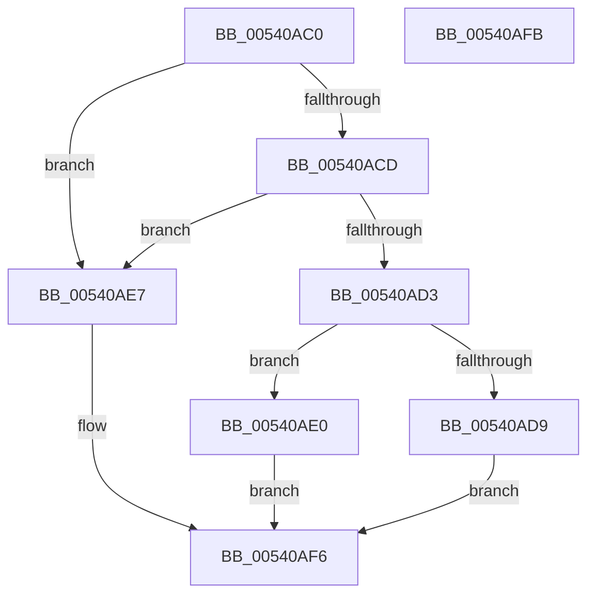

# HalpCreateErrorRecord

- RVA: `0x00540AC0`–`0x00540AFC` (길이 `60` bytes)
- VA: `0x0000000140540AC0`
- 실행 섹션: `.text`
- PDB 이름 있음: `예`; PDB Function 태그: `아니요`
- unwind 정보 RVA: `0x0005D2F4`
- 디코드: `18`개 명령, `60/60` bytes 표시
- 미해석 바이트: `0` (있으면 어셈블리에 `.byte`로 보존)

> 이 문서는 커널 이미지의 기계어와 PDB 기호를 분석해 생성했습니다. 4번과 5번은 함수 원형과 자료형을 바이너리 사용 방식에서 추정한 C 해석이며 원본 소스 복구 결과는 아닙니다.

## 1. Dependencies

- 직접 호출 지점: **2**; 고유 호출 대상: **2**
- 직접 호출자로 확인된 함수: **0**
- RIP 상대 이미지 참조: **0**

### Outgoing calls
- `0x00540AE0` → [HalpCreateNMIErrorRecord](HalpCreateNMIErrorRecord_function_005459A8.md) (function, `0x005459A8`)
- `0x00540AF1` → [HalpCreateMachineCheckErrorRecord](HalpCreateMachineCheckErrorRecord_function_00540B10.md) (function, `0x00540B10`)

### Direct callers
- 이 함수 시작 RVA로 연결되는 직접 call은 확인되지 않았습니다. 간접 호출은 완전히 역산할 수 없습니다.

### Static image references
- 디코드된 RIP-relative 메모리 참조가 없습니다.

## 2. Other-region calls and transfers

- 다른 실행 섹션으로 향하는 call: **0**
- 별도 외부 분기/꼬리 이동을 확인하지 못했습니다.

## 3. Assembly (complete function range)

```asm
00540AC0  48 83 EC 38                     sub rsp, 0x38
00540AC4  44 8B 51 08                     mov r10d, dword ptr [rcx + 8]
00540AC8  45 85 D2                        test r10d, r10d
00540ACB  74 1A                           je 0x140540ae7
00540ACD  41 83 EA 01                     sub r10d, 1
00540AD1  74 14                           je 0x140540ae7
00540AD3  41 83 FA 02                     cmp r10d, 2
00540AD7  74 07                           je 0x140540ae0
00540AD9  B8 BB 00 00 C0                  mov eax, 0xc00000bb
00540ADE  EB 16                           jmp 0x140540af6
00540AE0  E8 C3 4E 00 00                  call 0x1405459a8
00540AE5  EB 0F                           jmp 0x140540af6
00540AE7  48 8B 44 24 60                  mov rax, qword ptr [rsp + 0x60]
00540AEC  48 89 44 24 20                  mov qword ptr [rsp + 0x20], rax
00540AF1  E8 1A 00 00 00                  call 0x140540b10
00540AF6  48 83 C4 38                     add rsp, 0x38
00540AFA  C3                              ret
00540AFB  CC                              int3
```

## 4. C-style interpretation (structured pseudocode)

```c
__int64 __fastcall HalpCreateErrorRecord(__int64 a1, __int64 a2, __int64 a3, __int64 a4, __int64 a5)
{
    __int64 result;
    __int64 v_r10;
    __int64 v_rsp;
    unsigned __int64 v_stack_m18;

    v_rsp = (v_rsp) - (56);
    if ((unsigned int)((unsigned int)(*(unsigned int *)(a1 + 8))) == 0) goto loc_00540AE7;
    v_r10 = (unsigned int)(((unsigned int)(*(unsigned int *)(a1 + 8))) - (1));
    if (condition_is_equal) goto loc_00540AE7;
    if (((unsigned int)(v_r10)) == 2) goto loc_00540AE0;
    goto loc_00540AF6;
loc_00540AE0:
    result = HalpCreateNMIErrorRecord(a1, a2, a3, a4);
    goto loc_00540AF6;
loc_00540AE7:
    v_stack_m18 = a5;
    result = HalpCreateMachineCheckErrorRecord(a1, a2, a3, a4);
loc_00540AF6:
    v_rsp = (v_rsp) + (56);
    return result;
}
```

## 5. (Beta) C Style

```c
int64_t HalpCreateErrorRecord(void *Arg1, int64_t Arg2, int64_t Arg3, int64_t Arg4, int64_t Arg5)
{
    uint8_t *arg1 = (uint8_t *)Arg1;

    int64_t result;
    int64_t local_r10;
    int64_t local_rsp;
    uint64_t v_stack_m18;

    local_rsp = (local_rsp) - (56);
    if ((uint32_t)((uint32_t)(*(uint32_t *)(arg1 + 0x8))) == 0) goto loc_00540AE7;
    local_r10 = (uint32_t)(((uint32_t)(*(uint32_t *)(arg1 + 0x8))) - (1));
    if (condition_is_equal) goto loc_00540AE7;
    if (((uint32_t)(local_r10)) == 2) goto loc_00540AE0;
    goto loc_00540AF6;
loc_00540AE0:
    result = HalpCreateNMIErrorRecord(Arg1, Arg2, Arg3, Arg4);
    goto loc_00540AF6;
loc_00540AE7:
    v_stack_m18 = Arg5;
    result = HalpCreateMachineCheckErrorRecord(Arg1, Arg2, Arg3, Arg4);
loc_00540AF6:
    local_rsp = (local_rsp) + (56);
    return result;
}
```

### 관측된 메모리 오프셋

구조체 형식이 확인되지 않은 접근은 인자 기준의 오프셋으로만 기록했습니다.

| 기준 인자 | 오프셋 표현 | 폭 (bit) | 접근 |
|---|---:|---:|---|
| `Arg1` | `+ 0x8` | `32` | `R` |

## 6. Execution-region graph

[열기: 2D/3D 그래프와 함수 탐색 컨트롤 패널](../../../control-panel.html?section=text&rva=0x00540AC0&view=graph)

- 2D 그래프는 위에서 아래로 흐르고, 3D 그래프는 빈 공간을 드래그해 회전합니다. Shift+드래그는 이동, 휠은 확대·축소, 함수 노드 선택은 대상 보고서 이동입니다.

### Static fallback


