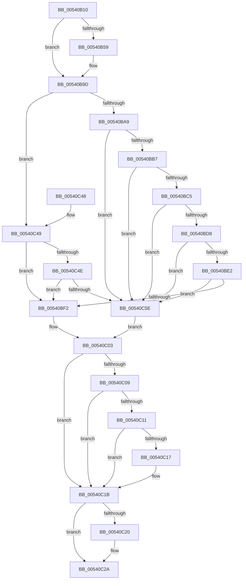

# HalpCreateMachineCheckErrorRecord

- RVA: `0x00540B10`–`0x00540C71` (길이 `353` bytes)
- VA: `0x0000000140540B10`
- 실행 섹션: `.text`
- PDB 이름 있음: `예`; PDB Function 태그: `아니요`
- unwind 정보 RVA: `0x000C3A48`
- 디코드: `107`개 명령, `353/353` bytes 표시
- 미해석 바이트: `0` (있으면 어셈블리에 `.byte`로 보존)

> 이 문서는 커널 이미지의 기계어와 PDB 기호를 분석해 생성했습니다. 4번과 5번은 함수 원형과 자료형을 바이너리 사용 방식에서 추정한 C 해석이며 원본 소스 복구 결과는 아닙니다.

## 1. Dependencies

- 직접 호출 지점: **6**; 고유 호출 대상: **6**
- 직접 호출자로 확인된 함수: **1**
- RIP 상대 이미지 참조: **2**

### Outgoing calls
- `0x00540B95` → [KeSetSystemGroupAffinityThread](../39/KeSetSystemGroupAffinityThread_function_00399140.md) (function, `0x00399140`)
- `0x00540BFE` → [HalpCreateMcaProcessorErrorRecord](HalpCreateMcaProcessorErrorRecord_function_00541038.md) (function, `0x00541038`)
- `0x00540C25` → [KeRevertToUserGroupAffinityThread](../39/KeRevertToUserGroupAffinityThread_function_00398EC0.md) (function, `0x00398EC0`)
- `0x00540C34` → [_security_check_cookie](../6A/_security_check_cookie_function_006AC640.md) (function, `0x006AC640`)
- `0x00540C55` → [HalpMcaAMDIsMemoryError](HalpMcaAMDIsMemoryError_function_00545428.md) (function, `0x00545428`)
- `0x00540C6A` → [HalpCreateMcaMemoryErrorRecord](HalpCreateMcaMemoryErrorRecord_function_00540C78.md) (function, `0x00540C78`)

### Direct callers
- [HalpCreateErrorRecord](HalpCreateErrorRecord_function_00540AC0.md) at `0x00540AF1`

### Static image references
- `0x00540B1F` → RVA `0x00E0A740` (`.data`; read)
- `0x00540B61` → RVA `0x00F231B0` (`.data`; read)

## 2. Other-region calls and transfers

- 다른 실행 섹션으로 향하는 call: **0**
- 별도 외부 분기/꼬리 이동을 확인하지 못했습니다.

## 3. Assembly (complete function range)

```asm
00540B10  40 53                           push rbx
00540B12  55                              push rbp
00540B13  56                              push rsi
00540B14  57                              push rdi
00540B15  41 54                           push r12
00540B17  41 56                           push r14
00540B19  41 57                           push r15
00540B1B  48 83 EC 60                     sub rsp, 0x60
00540B1F  48 8B 05 1A 9C 8C 00            mov rax, qword ptr [rip + 0x8c9c1a]
00540B26  48 33 C4                        xor rax, rsp
00540B29  48 89 44 24 50                  mov qword ptr [rsp + 0x50], rax
00540B2E  0F B7 5A 78                     movzx ebx, word ptr [rdx + 0x78]
00540B32  0F 57 C0                        xorps xmm0, xmm0
00540B35  0F 57 C9                        xorps xmm1, xmm1
00540B38  45 8B E1                        mov r12d, r9d
00540B3B  0F 11 44 24 30                  movups xmmword ptr [rsp + 0x30], xmm0
00540B40  49 8B F8                        mov rdi, r8
00540B43  48 8B EA                        mov rbp, rdx
00540B46  0F 11 4C 24 40                  movups xmmword ptr [rsp + 0x40], xmm1
00540B4B  4C 8B F9                        mov r15, rcx
00540B4E  45 32 F6                        xor r14b, r14b
00540B51  44 0F 20 C0                     mov rax, cr8
00540B55  3C 02                           cmp al, 2
00540B57  73 44                           jae 0x140540b9d
00540B59  8B 4A 60                        mov ecx, dword ptr [rdx + 0x60]
00540B5C  48 8D 54 24 40                  lea rdx, [rsp + 0x40]
00540B61  48 8B 05 48 26 9E 00            mov rax, qword ptr [rip + 0x9e2648]
00540B68  8B 0C 88                        mov ecx, dword ptr [rax + rcx*4]
00540B6B  33 C0                           xor eax, eax
00540B6D  89 44 24 3A                     mov dword ptr [rsp + 0x3a], eax
00540B71  66 89 44 24 3E                  mov word ptr [rsp + 0x3e], ax
00540B76  8B C1                           mov eax, ecx
00540B78  C1 E8 06                        shr eax, 6
00540B7B  83 E1 3F                        and ecx, 0x3f
00540B7E  66 89 44 24 38                  mov word ptr [rsp + 0x38], ax
00540B83  B8 01 00 00 00                  mov eax, 1
00540B88  48 D3 E0                        shl rax, cl
00540B8B  48 8D 4C 24 30                  lea rcx, [rsp + 0x30]
00540B90  48 89 44 24 30                  mov qword ptr [rsp + 0x30], rax
00540B95  E8 A6 85 E5 FF                  call 0x140399140
00540B9A  41 B6 01                        mov r14b, 1
00540B9D  8B 45 54                        mov eax, dword ptr [rbp + 0x54]
00540BA0  83 F8 01                        cmp eax, 1
00540BA3  0F 85 A0 00 00 00               jne 0x140540c49
00540BA9  B8 50 01 00 00                  mov eax, 0x150
00540BAE  66 3B D8                        cmp bx, ax
00540BB1  0F 84 A7 00 00 00               je 0x140540c5e
00540BB7  B8 34 01 00 00                  mov eax, 0x134
00540BBC  66 3B D8                        cmp bx, ax
00540BBF  0F 84 99 00 00 00               je 0x140540c5e
00540BC5  8D 48 8C                        lea ecx, [rax - 0x74]
00540BC8  0F B7 C3                        movzx eax, bx
00540BCB  66 2B C1                        sub ax, cx
00540BCE  66 83 F8 0F                     cmp ax, 0xf
00540BD2  0F 86 86 00 00 00               jbe 0x140540c5e
00540BD8  B8 7A 01 00 00                  mov eax, 0x17a
00540BDD  66 3B D8                        cmp bx, ax
00540BE0  74 7C                           je 0x140540c5e
00540BE2  B8 80 EF 00 00                  mov eax, 0xef80
00540BE7  66 23 D8                        and bx, ax
00540BEA  8D 41 C0                        lea eax, [rcx - 0x40]
00540BED  66 3B D8                        cmp bx, ax
00540BF0  74 6C                           je 0x140540c5e
00540BF2  45 8B CC                        mov r9d, r12d
00540BF5  4C 8B C7                        mov r8, rdi
00540BF8  48 8B D5                        mov rdx, rbp
00540BFB  49 8B CF                        mov rcx, r15
00540BFE  E8 35 04 00 00                  call 0x140541038
00540C03  8B D8                           mov ebx, eax
00540C05  85 C0                           test eax, eax
00540C07  78 12                           js 0x140540c1b
00540C09  48 0F BA 65 78 3D               bt qword ptr [rbp + 0x78], 0x3d
00540C0F  73 0A                           jae 0x140540c1b
00540C11  83 7F 0C 02                     cmp dword ptr [rdi + 0xc], 2
00540C15  75 04                           jne 0x140540c1b
00540C17  83 4F 68 01                     or dword ptr [rdi + 0x68], 1
00540C1B  45 84 F6                        test r14b, r14b
00540C1E  74 0A                           je 0x140540c2a
00540C20  48 8D 4C 24 40                  lea rcx, [rsp + 0x40]
00540C25  E8 96 82 E5 FF                  call 0x140398ec0
00540C2A  8B C3                           mov eax, ebx
00540C2C  48 8B 4C 24 50                  mov rcx, qword ptr [rsp + 0x50]
00540C31  48 33 CC                        xor rcx, rsp
00540C34  E8 07 BA 16 00                  call 0x1406ac640
00540C39  48 83 C4 60                     add rsp, 0x60
00540C3D  41 5F                           pop r15
00540C3F  41 5E                           pop r14
00540C41  41 5C                           pop r12
00540C43  5F                              pop rdi
00540C44  5E                              pop rsi
00540C45  5D                              pop rbp
00540C46  5B                              pop rbx
00540C47  C3                              ret
00540C48  CC                              int3
00540C49  83 F8 02                        cmp eax, 2
00540C4C  75 A4                           jne 0x140540bf2
00540C4E  0F B7 D3                        movzx edx, bx
00540C51  48 8D 4D 50                     lea rcx, [rbp + 0x50]
00540C55  E8 CE 47 00 00                  call 0x140545428
00540C5A  84 C0                           test al, al
00540C5C  74 94                           je 0x140540bf2
00540C5E  45 8B CC                        mov r9d, r12d
00540C61  4C 8B C7                        mov r8, rdi
00540C64  48 8B D5                        mov rdx, rbp
00540C67  49 8B CF                        mov rcx, r15
00540C6A  E8 09 00 00 00                  call 0x140540c78
00540C6F  EB 92                           jmp 0x140540c03
```

## 4. C-style interpretation (structured pseudocode)

```c
__int64 __fastcall HalpCreateMachineCheckErrorRecord(__int64 a1, __int64 a2, __int64 a3, int a4)
{
    __int64 result;
    __int64 v_r14;
    __int64 v_rbx;
    __int64 v_rsp;
    unsigned __int64 v_stack_m48;
    unsigned __int64 v_stack_m58;
    unsigned __int16 v_stack_m5A;
    unsigned int v_stack_m5E;
    unsigned __int16 v_stack_m60;
    unsigned __int64 v_stack_m68;

    v_rsp = (v_rsp) - (96);
    result = (*(unsigned __int64 *)(v_rip + 9215002)) ^ (v_rsp);
    v_stack_m48 = result;
    v_stack_m68 = v_xmm0;
    v_stack_m58 = v_xmm1;
    v_r14 = 0;
    result = v_cr8;
    if (((unsigned __int8)(v_cr8)) < 2) {
        a1 = *(unsigned int *)(a2 + 96);
        a2 = v_stack_m58;
        result = *(unsigned __int64 *)(v_rip + 10364488);
        a1 = *(unsigned int *)(result + a1 * 4);
        result = 0;
        v_stack_m5E = 0;
        v_stack_m5A = 0;
        result = (unsigned int)(a1);
        result = (unsigned int)((result) >> (6));
        a1 = (unsigned int)((a1) & (63));
        v_stack_m60 = (unsigned __int16)(result);
        result = 1;
        result = (result) << ((unsigned __int8)(a1));
        a1 = v_stack_m68;
        v_stack_m68 = result;
        result = KeSetSystemGroupAffinityThread(a1, a2, a3, a4);
        v_r14 = 1;
    }
    if (((unsigned int)((unsigned int)(*(unsigned int *)(a2 + 84)))) != 1) goto loc_00540C49;
    if (((unsigned __int16)(*(unsigned __int16 *)(a2 + 120))) == 336) goto loc_00540C5E;
    if (((unsigned __int16)(*(unsigned __int16 *)(a2 + 120))) == 308) goto loc_00540C5E;
    result = (unsigned __int16)(((unsigned __int16)(*(unsigned __int16 *)(a2 + 120))) - ((unsigned __int16)(308 - 116)));
    if (((unsigned __int16)(result)) <= 15) goto loc_00540C5E;
    if (((unsigned __int16)(*(unsigned __int16 *)(a2 + 120))) == 378) goto loc_00540C5E;
    v_rbx = (unsigned __int16)((*(unsigned __int16 *)(a2 + 120)) & ((unsigned __int16)((unsigned int)(0xEF80ULL))));
    if (((unsigned __int16)(v_rbx)) == ((unsigned __int16)(308 - 116 - 64))) goto loc_00540C5E;
loc_00540BF2:
    result = HalpCreateMcaProcessorErrorRecord(a1, a2, a3, (unsigned int)((unsigned int)((unsigned int)(a4))));
loc_00540C03:
    if (sign_flag) goto loc_00540C1B;
    if (condition_is_above_or_equal) goto loc_00540C1B;
    if ((*(unsigned int *)(a3 + 12)) == 2) {
    }
    if ((unsigned __int8)(v_r14) != 0) {
        a1 = v_stack_m58;
        result = KeRevertToUserGroupAffinityThread(a1, a2, a3, (unsigned int)((unsigned int)((unsigned int)(a4))));
    }
    a1 = (v_stack_m48) ^ (v_rsp);
    result = _security_check_cookie(a1, a2, a3, (unsigned int)((unsigned int)((unsigned int)(a4))));
    v_rsp = (v_rsp) + (96);
    return result;
loc_00540C49:
    if (((unsigned int)(result)) != 2) goto loc_00540BF2;
    result = HalpMcaAMDIsMemoryError(a2 + 80, (unsigned __int16)((unsigned int)((unsigned int)(result))), a3, (unsigned int)((unsigned int)((unsigned int)(a4))));
    if ((unsigned __int8)(result) == 0) goto loc_00540BF2;
loc_00540C5E:
    result = HalpCreateMcaMemoryErrorRecord(a1, a2, a3, (unsigned int)((unsigned int)((unsigned int)(a4))));
    goto loc_00540C03;
}
```

## 5. (Beta) C Style

```c
int64_t HalpCreateMachineCheckErrorRecord(int64_t Arg1, void *Arg2, void *Arg3, int32_t Arg4)
{
    uint8_t *arg2 = (uint8_t *)Arg2;
    uint8_t *arg3 = (uint8_t *)Arg3;

    int64_t result;
    int64_t local_r14;
    int64_t local_rbx;
    int64_t local_rsp;
    uint64_t v_stack_m48;
    uint64_t v_stack_m58;
    uint16_t v_stack_m5A;
    uint32_t v_stack_m5E;
    uint16_t v_stack_m60;
    uint64_t v_stack_m68;

    local_rsp = (local_rsp) - (96);
    result = (*(uint64_t *)(v_rip + 0x8C9C1A)) ^ (local_rsp);
    v_stack_m48 = result;
    v_stack_m68 = v_xmm0;
    v_stack_m58 = v_xmm1;
    local_r14 = 0;
    result = v_cr8;
    if (((uint8_t)(v_cr8)) < 2) {
        Arg1 = *(uint32_t *)(arg2 + 0x60);
        Arg2 = v_stack_m58;
        result = *(uint64_t *)(v_rip + 0x9E2648);
        Arg1 = *(uint32_t *)(result + Arg1 * 4);
        result = 0;
        v_stack_m5E = 0;
        v_stack_m5A = 0;
        result = (uint32_t)(Arg1);
        result = (uint32_t)((result) >> (6));
        Arg1 = (uint32_t)((Arg1) & (63));
        v_stack_m60 = (uint16_t)(result);
        result = 1;
        result = (result) << ((uint8_t)(Arg1));
        Arg1 = v_stack_m68;
        v_stack_m68 = result;
        result = KeSetSystemGroupAffinityThread(Arg1, Arg2, Arg3, Arg4);
        local_r14 = 1;
    }
    if (((uint32_t)((uint32_t)(*(uint32_t *)(arg2 + 0x54)))) != 1) goto loc_00540C49;
    if (((uint16_t)(*(uint16_t *)(arg2 + 0x78))) == 336) goto loc_00540C5E;
    if (((uint16_t)(*(uint16_t *)(arg2 + 0x78))) == 308) goto loc_00540C5E;
    result = (uint16_t)(((uint16_t)(*(uint16_t *)(arg2 + 0x78))) - ((uint16_t)(308 - 116)));
    if (((uint16_t)(result)) <= 15) goto loc_00540C5E;
    if (((uint16_t)(*(uint16_t *)(arg2 + 0x78))) == 378) goto loc_00540C5E;
    local_rbx = (uint16_t)((*(uint16_t *)(arg2 + 0x78)) & ((uint16_t)((uint32_t)(0xEF80ULL))));
    if (((uint16_t)(local_rbx)) == ((uint16_t)(308 - 116 - 64))) goto loc_00540C5E;
loc_00540BF2:
    result = HalpCreateMcaProcessorErrorRecord(Arg1, Arg2, Arg3, (uint32_t)((uint32_t)((uint32_t)(Arg4))));
loc_00540C03:
    if (sign_flag) goto loc_00540C1B;
    if (condition_is_above_or_equal) goto loc_00540C1B;
    if ((*(uint32_t *)(arg3 + 0xC)) == 2) {
    }
    if ((uint8_t)(local_r14) != 0) {
        Arg1 = v_stack_m58;
        result = KeRevertToUserGroupAffinityThread(Arg1, Arg2, Arg3, (uint32_t)((uint32_t)((uint32_t)(Arg4))));
    }
    Arg1 = (v_stack_m48) ^ (local_rsp);
    result = _security_check_cookie(Arg1, Arg2, Arg3, (uint32_t)((uint32_t)((uint32_t)(Arg4))));
    local_rsp = (local_rsp) + (96);
    return result;
loc_00540C49:
    if (((uint32_t)(result)) != 2) goto loc_00540BF2;
    result = HalpMcaAMDIsMemoryError(Arg2 + 80, (uint16_t)((uint32_t)((uint32_t)(result))), Arg3, (uint32_t)((uint32_t)((uint32_t)(Arg4))));
    if ((uint8_t)(result) == 0) goto loc_00540BF2;
loc_00540C5E:
    result = HalpCreateMcaMemoryErrorRecord(Arg1, Arg2, Arg3, (uint32_t)((uint32_t)((uint32_t)(Arg4))));
    goto loc_00540C03;
}
```

### 관측된 메모리 오프셋

구조체 형식이 확인되지 않은 접근은 인자 기준의 오프셋으로만 기록했습니다.

| 기준 인자 | 오프셋 표현 | 폭 (bit) | 접근 |
|---|---:|---:|---|
| `Arg2` | `+ 0x50` | `64` | `R` |
| `Arg2` | `+ 0x54` | `32` | `R` |
| `Arg2` | `+ 0x60` | `32` | `R` |
| `Arg2` | `+ 0x78` | `16` | `R` |
| `Arg2` | `+ 0x78` | `64` | `R` |
| `Arg3` | `+ 0xC` | `32` | `R` |
| `Arg3` | `+ 0x68` | `32` | `R/W` |

## 6. Execution-region graph

[열기: 2D/3D 그래프와 함수 탐색 컨트롤 패널](../../../control-panel.html?section=text&rva=0x00540B10&view=graph)

- 2D 그래프는 위에서 아래로 흐르고, 3D 그래프는 빈 공간을 드래그해 회전합니다. Shift+드래그는 이동, 휠은 확대·축소, 함수 노드 선택은 대상 보고서 이동입니다.

### Static fallback


