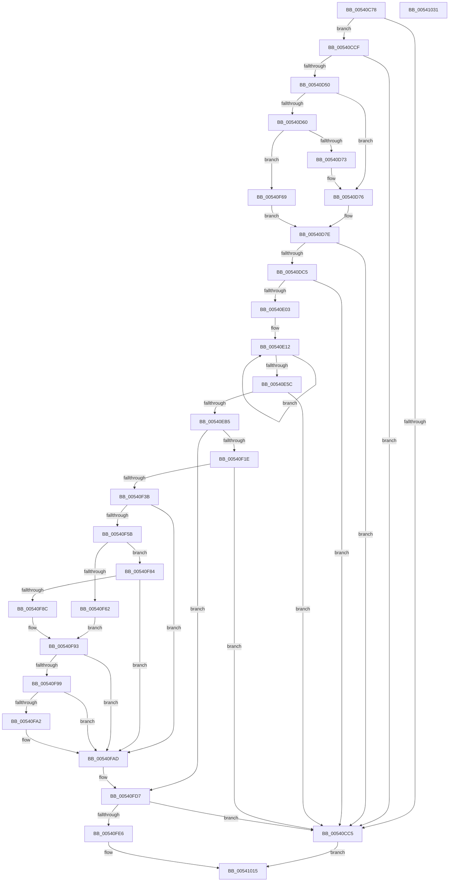

# HalpCreateMcaMemoryErrorRecord

- RVA: `0x00540C78`–`0x00541032` (길이 `954` bytes)
- VA: `0x0000000140540C78`
- 실행 섹션: `.text`
- PDB 이름 있음: `예`; PDB Function 태그: `아니요`
- unwind 정보 RVA: `0x000C3A28`
- 디코드: `241`개 명령, `954/954` bytes 표시
- 미해석 바이트: `0` (있으면 어셈블리에 `.byte`로 보존)

> 이 문서는 커널 이미지의 기계어와 PDB 기호를 분석해 생성했습니다. 4번과 5번은 함수 원형과 자료형을 바이너리 사용 방식에서 추정한 C 해석이며 원본 소스 복구 결과는 아닙니다.

## 1. Dependencies

- 직접 호출 지점: **13**; 고유 호출 대상: **11**
- 직접 호출자로 확인된 함수: **1**
- RIP 상대 이미지 참조: **8**

### Outgoing calls
- `0x00540CA7` → [memset](../6C/memset_function_006C6C40.md) (function, `0x006C6C40`)
- `0x00540CD2` → [WheaInitializeRecordHeader](../42/WheaInitializeRecordHeader_function_0042DFF0.md) (function, `0x0042DFF0`)
- `0x00540CD7` → [HalpGetMcaVendorSpecificSections](HalpGetMcaVendorSpecificSections_function_00545408.md) (function, `0x00545408`)
- `0x00540D60` → [HalpGetMcaExtendedLogStatusBlock](HalpGetMcaExtendedLogStatusBlock_function_005412EC.md) (function, `0x005412EC`)
- `0x00540D79` → [HalpAddMcaToMemoryErrorSection](HalpAddMcaToMemoryErrorSection_function_005401C4.md) (function, `0x005401C4`)
- `0x00540DD3` → [guard_dispatch_icall](../6B/guard_dispatch_icall_function_006BAAD0.md) (function, `0x006BAAD0`)
- `0x00540DE0` → [HalpAddMcaToProcessorGenericSection](HalpAddMcaToProcessorGenericSection_function_00540254.md) (function, `0x00540254`)
- `0x00540F11` → [HalpGetCpuVendor](../48/HalpGetCpuVendor_function_004879E4.md) (function, `0x004879E4`)
- `0x00540F4C` → [memset](../6C/memset_function_006C6C40.md) (function, `0x006C6C40`)
- `0x00540F72` → [HalpAddErrorEntryToPacket](../55/HalpAddErrorEntryToPacket_function_00555A0C.md) (function, `0x00555A0C`)
- `0x00540F99` → [HalpGetCpuVendor](../48/HalpGetCpuVendor_function_004879E4.md) (function, `0x004879E4`)
- `0x00540FA8` → [HalpAddPrmAddressTranslationToMemoryExtIntelSection](HalpAddPrmAddressTranslationToMemoryExtIntelSection_function_00544DC8.md) (function, `0x00544DC8`)
- `0x00540FF1` → [memcpy](../6C/memcpy_function_006C6840.md) (function, `0x006C6840`)

### Direct callers
- [HalpCreateMachineCheckErrorRecord](HalpCreateMachineCheckErrorRecord_function_00540B10.md) at `0x00540C6A`

### Static image references
- `0x00540D50` → RVA `0x00E100C0` (`.data`; read)
- `0x00540D98` → RVA `0x0001A738` (`.rdata`; read)
- `0x00540DC5` → RVA `0x00E00918` (`.data`; read)
- `0x00540E94` → RVA `0x00024DA8` (`.rdata`; read)
- `0x00540EF1` → RVA `0x00024DF8` (`.rdata`; read)
- `0x00540F1E` → RVA `0x00024D78` (`.rdata`; read)
- `0x00540F51` → RVA `0x00E100E2` (`.data`; read)
- `0x00541003` → RVA `0x0001A538` (`.rdata`; read)

## 2. Other-region calls and transfers

- 다른 실행 섹션으로 향하는 call: **0**
- 별도 외부 분기/꼬리 이동을 확인하지 못했습니다.

## 3. Assembly (complete function range)

```asm
00540C78  48 89 5C 24 10                  mov qword ptr [rsp + 0x10], rbx
00540C7D  55                              push rbp
00540C7E  56                              push rsi
00540C7F  57                              push rdi
00540C80  41 54                           push r12
00540C82  41 55                           push r13
00540C84  41 56                           push r14
00540C86  41 57                           push r15
00540C88  48 83 EC 30                     sub rsp, 0x30
00540C8C  4D 8B F0                        mov r14, r8
00540C8F  0F 29 74 24 20                  movaps xmmword ptr [rsp + 0x20], xmm6
00540C94  48 8B EA                        mov rbp, rdx
00540C97  45 8B C1                        mov r8d, r9d
00540C9A  48 8B D9                        mov rbx, rcx
00540C9D  45 8B F9                        mov r15d, r9d
00540CA0  49 8B CE                        mov rcx, r14
00540CA3  33 D2                           xor edx, edx
00540CA5  33 FF                           xor edi, edi
00540CA7  E8 94 5F 18 00                  call 0x1406c6c40
00540CAC  8B 43 18                        mov eax, dword ptr [rbx + 0x18]
00540CAF  8D 0C C0                        lea ecx, [rax + rax*8]
00540CB2  8D 34 CD 80 00 00 00            lea esi, [rcx*8 + 0x80]
00540CB9  89 B4 24 88 00 00 00            mov dword ptr [rsp + 0x88], esi
00540CC0  41 3B F7                        cmp esi, r15d
00540CC3  76 0A                           jbe 0x140540ccf
00540CC5  BF 23 00 00 C0                  mov edi, 0xc0000023
00540CCA  E9 46 03 00 00                  jmp 0x140541015
00540CCF  49 8B CE                        mov rcx, r14
00540CD2  E8 19 D3 EE FF                  call 0x14042dff0
00540CD7  E8 2C 47 00 00                  call 0x140545408
00540CDC  66 83 C0 05                     add ax, 5
00540CE0  44 8B E6                        mov r12d, esi
00540CE3  66 41 89 46 0A                  mov word ptr [r14 + 0xa], ax
00540CE8  44 8D 6E 50                     lea r13d, [rsi + 0x50]
00540CEC  8B 45 14                        mov eax, dword ptr [rbp + 0x14]
00540CEF  49 8D 9E 80 00 00 00            lea rbx, [r14 + 0x80]
00540CF6  41 89 46 0C                     mov dword ptr [r14 + 0xc], eax
00540CFA  41 8B 46 68                     mov eax, dword ptr [r14 + 0x68]
00540CFE  45 89 7E 14                     mov dword ptr [r14 + 0x14], r15d
00540D02  0F 10 45 20                     movups xmm0, xmmword ptr [rbp + 0x20]
00540D06  F3 41 0F 7F 46 50               movdqu xmmword ptr [r14 + 0x50], xmm0
00540D0C  8B 4D 0C                        mov ecx, dword ptr [rbp + 0xc]
00540D0F  03 C9                           add ecx, ecx
00540D11  33 C8                           xor ecx, eax
00540D13  83 E1 02                        and ecx, 2
00540D16  33 C8                           xor ecx, eax
00540D18  41 89 4E 68                     mov dword ptr [r14 + 0x68], ecx
00540D1C  8B 55 0C                        mov edx, dword ptr [rbp + 0xc]
00540D1F  D1 EA                           shr edx, 1
00540D21  33 D1                           xor edx, ecx
00540D23  83 E2 04                        and edx, 4
00540D26  33 D1                           xor edx, ecx
00540D28  41 89 56 68                     mov dword ptr [r14 + 0x68], edx
00540D2C  8B C2                           mov eax, edx
00540D2E  8A 4D 0C                        mov cl, byte ptr [rbp + 0xc]
00540D31  83 C8 20                        or eax, 0x20
00540D34  83 E2 DF                        and edx, 0xffffffdf
00540D37  80 E1 C0                        and cl, 0xc0
00540D3A  80 F9 40                        cmp cl, 0x40
00540D3D  0F 45 D0                        cmovne edx, eax
00540D40  4D 03 E6                        add r12, r14
00540D43  41 89 56 68                     mov dword ptr [r14 + 0x68], edx
00540D47  45 3B EF                        cmp r13d, r15d
00540D4A  0F 87 75 FF FF FF               ja 0x140540cc5
00540D50  40 38 3D 69 F3 8C 00            cmp byte ptr [rip + 0x8cf369], dil
00540D57  48 8D 75 50                     lea rsi, [rbp + 0x50]
00540D5B  48 8B CE                        mov rcx, rsi
00540D5E  74 16                           je 0x140540d76
00540D60  E8 87 05 00 00                  call 0x1405412ec
00540D65  48 89 44 24 70                  mov qword ptr [rsp + 0x70], rax
00540D6A  48 85 C0                        test rax, rax
00540D6D  0F 85 F6 01 00 00               jne 0x140540f69
00540D73  48 8B CE                        mov rcx, rsi
00540D76  49 8B D4                        mov rdx, r12
00540D79  E8 46 F4 FF FF                  call 0x1405401c4
00540D7E  83 4B 0C 01                     or dword ptr [rbx + 0xc], 1
00540D82  8B 84 24 88 00 00 00            mov eax, dword ptr [rsp + 0x88]
00540D89  89 03                           mov dword ptr [rbx], eax
00540D8B  C7 43 04 50 00 00 00            mov dword ptr [rbx + 4], 0x50
00540D92  66 C7 43 08 00 03               mov word ptr [rbx + 8], 0x300
00540D98  0F 10 05 99 99 AD FF            movups xmm0, xmmword ptr [rip - 0x526667]
00540D9F  41 8B CD                        mov ecx, r13d
00540DA2  49 03 CE                        add rcx, r14
00540DA5  F3 0F 7F 43 10                  movdqu xmmword ptr [rbx + 0x10], xmm0
00540DAA  8B 45 14                        mov eax, dword ptr [rbp + 0x14]
00540DAD  89 43 30                        mov dword ptr [rbx + 0x30], eax
00540DB0  41 8D 85 C0 00 00 00            lea eax, [r13 + 0xc0]
00540DB7  48 89 4C 24 70                  mov qword ptr [rsp + 0x70], rcx
00540DBC  41 3B C7                        cmp eax, r15d
00540DBF  0F 87 00 FF FF FF               ja 0x140540cc5
00540DC5  48 8B 05 4C FB 8B 00            mov rax, qword ptr [rip + 0x8bfb4c]
00540DCC  48 8B D1                        mov rdx, rcx
00540DCF  48 8D 4B 48                     lea rcx, [rbx + 0x48]
00540DD3  E8 F8 9C 17 00                  call 0x1406baad0
00540DD8  48 8B 54 24 70                  mov rdx, qword ptr [rsp + 0x70]
00540DDD  48 8B CE                        mov rcx, rsi
00540DE0  E8 6F F4 FF FF                  call 0x140540254
00540DE5  44 89 6B 48                     mov dword ptr [rbx + 0x48], r13d
00540DE9  44 03 6B 4C                     add r13d, dword ptr [rbx + 0x4c]
00540DED  8B 45 14                        mov eax, dword ptr [rbp + 0x14]
00540DF0  89 43 78                        mov dword ptr [rbx + 0x78], eax
00540DF3  41 8D 95 A8 04 00 00            lea edx, [r13 + 0x4a8]
00540DFA  41 3B D7                        cmp edx, r15d
00540DFD  0F 87 C2 FE FF FF               ja 0x140540cc5
00540E03  B8 09 00 00 00                  mov eax, 9
00540E08  41 8B CD                        mov ecx, r13d
00540E0B  49 03 CE                        add rcx, r14
00540E0E  44 8D 40 77                     lea r8d, [rax + 0x77]
00540E12  0F 10 06                        movups xmm0, xmmword ptr [rsi]
00540E15  0F 11 01                        movups xmmword ptr [rcx], xmm0
00540E18  0F 10 4E 10                     movups xmm1, xmmword ptr [rsi + 0x10]
00540E1C  0F 11 49 10                     movups xmmword ptr [rcx + 0x10], xmm1
00540E20  0F 10 46 20                     movups xmm0, xmmword ptr [rsi + 0x20]
00540E24  0F 11 41 20                     movups xmmword ptr [rcx + 0x20], xmm0
00540E28  0F 10 4E 30                     movups xmm1, xmmword ptr [rsi + 0x30]
00540E2C  0F 11 49 30                     movups xmmword ptr [rcx + 0x30], xmm1
00540E30  0F 10 46 40                     movups xmm0, xmmword ptr [rsi + 0x40]
00540E34  0F 11 41 40                     movups xmmword ptr [rcx + 0x40], xmm0
00540E38  0F 10 4E 50                     movups xmm1, xmmword ptr [rsi + 0x50]
00540E3C  0F 11 49 50                     movups xmmword ptr [rcx + 0x50], xmm1
00540E40  0F 10 46 60                     movups xmm0, xmmword ptr [rsi + 0x60]
00540E44  0F 11 41 60                     movups xmmword ptr [rcx + 0x60], xmm0
00540E48  49 03 C8                        add rcx, r8
00540E4B  0F 10 4E 70                     movups xmm1, xmmword ptr [rsi + 0x70]
00540E4F  49 03 F0                        add rsi, r8
00540E52  0F 11 49 F0                     movups xmmword ptr [rcx - 0x10], xmm1
00540E56  48 83 E8 01                     sub rax, 1
00540E5A  75 B6                           jne 0x140540e12
00540E5C  0F 10 06                        movups xmm0, xmmword ptr [rsi]
00540E5F  0F 11 01                        movups xmmword ptr [rcx], xmm0
00540E62  0F 10 4E 10                     movups xmm1, xmmword ptr [rsi + 0x10]
00540E66  0F 11 49 10                     movups xmmword ptr [rcx + 0x10], xmm1
00540E6A  48 8B 46 20                     mov rax, qword ptr [rsi + 0x20]
00540E6E  8D 72 27                        lea esi, [rdx + 0x27]
00540E71  48 89 41 20                     mov qword ptr [rcx + 0x20], rax
00540E75  44 89 AB 90 00 00 00            mov dword ptr [rbx + 0x90], r13d
00540E7C  41 BD 00 03 00 00               mov r13d, 0x300
00540E82  66 44 89 AB 98 00 00 00         mov word ptr [rbx + 0x98], r13w
00540E8A  C7 83 94 00 00 00 A8 04 00 00   mov dword ptr [rbx + 0x94], 0x4a8
00540E94  0F 10 05 0D 3F AE FF            movups xmm0, xmmword ptr [rip - 0x51c0f3]
00540E9B  F3 0F 7F 83 A0 00 00 00         movdqu xmmword ptr [rbx + 0xa0], xmm0
00540EA3  8B 45 14                        mov eax, dword ptr [rbp + 0x14]
00540EA6  89 83 C0 00 00 00               mov dword ptr [rbx + 0xc0], eax
00540EAC  41 3B F7                        cmp esi, r15d
00540EAF  0F 87 10 FE FF FF               ja 0x140540cc5
00540EB5  33 C9                           xor ecx, ecx
00540EB7  8B C2                           mov eax, edx
00540EB9  49 03 C6                        add rax, r14
00540EBC  0F 57 C0                        xorps xmm0, xmm0
00540EBF  0F 11 00                        movups xmmword ptr [rax], xmm0
00540EC2  0F 11 40 10                     movups xmmword ptr [rax + 0x10], xmm0
00540EC6  89 48 20                        mov dword ptr [rax + 0x20], ecx
00540EC9  66 89 48 24                     mov word ptr [rax + 0x24], cx
00540ECD  88 48 26                        mov byte ptr [rax + 0x26], cl
00540ED0  48 83 48 01 01                  or qword ptr [rax + 1], 1
00540ED5  C6 40 0D FF                     mov byte ptr [rax + 0xd], 0xff
00540ED9  89 93 D8 00 00 00               mov dword ptr [rbx + 0xd8], edx
00540EDF  C7 83 DC 00 00 00 27 00 00 00   mov dword ptr [rbx + 0xdc], 0x27
00540EE9  66 44 89 AB E0 00 00 00         mov word ptr [rbx + 0xe0], r13w
00540EF1  0F 10 05 00 3F AE FF            movups xmm0, xmmword ptr [rip - 0x51c100]
00540EF8  C7 83 08 01 00 00 03 00 00 00   mov dword ptr [rbx + 0x108], 3
00540F02  F3 0F 7F 83 E8 00 00 00         movdqu xmmword ptr [rbx + 0xe8], xmm0
00540F0A  48 81 C3 20 01 00 00            add rbx, 0x120
00540F11  E8 CE 6A F4 FF                  call 0x1404879e4
00540F16  3C 02                           cmp al, 2
00540F18  0F 85 B9 00 00 00               jne 0x140540fd7
00540F1E  0F 10 35 53 3E AE FF            movups xmm6, xmmword ptr [rip - 0x51c1ad]
00540F25  8D 86 A6 00 00 00               lea eax, [rsi + 0xa6]
00540F2B  89 84 24 88 00 00 00            mov dword ptr [rsp + 0x88], eax
00540F32  41 3B C7                        cmp eax, r15d
00540F35  0F 87 8A FD FF FF               ja 0x140540cc5
00540F3B  44 8B EE                        mov r13d, esi
00540F3E  33 D2                           xor edx, edx
00540F40  4D 03 EE                        add r13, r14
00540F43  41 B8 A6 00 00 00               mov r8d, 0xa6
00540F49  49 8B CD                        mov rcx, r13
00540F4C  E8 EF 5C 18 00                  call 0x1406c6c40
00540F51  8A 05 8B F1 8C 00               mov al, byte ptr [rip + 0x8cf18b]
00540F57  84 C0                           test al, al
00540F59  75 52                           jne 0x140540fad
00540F5B  41 F6 04 24 02                  test byte ptr [r12], 2
00540F60  74 22                           je 0x140540f84
00540F62  4D 8B 44 24 10                  mov r8, qword ptr [r12 + 0x10]
00540F67  EB 2A                           jmp 0x140540f93
00540F69  4D 8B C4                        mov r8, r12
00540F6C  48 8B D3                        mov rdx, rbx
00540F6F  48 8B C8                        mov rcx, rax
00540F72  E8 95 4A 01 00                  call 0x140555a0c
00540F77  4C 8B 44 24 70                  mov r8, qword ptr [rsp + 0x70]
00540F7C  41 89 38                        mov dword ptr [r8], edi
00540F7F  E9 FA FD FF FF                  jmp 0x140540d7e
00540F84  48 0F BA 65 78 3A               bt qword ptr [rbp + 0x78], 0x3a
00540F8A  73 21                           jae 0x140540fad
00540F8C  4C 8B 85 80 00 00 00            mov r8, qword ptr [rbp + 0x80]
00540F93  49 83 F8 FF                     cmp r8, -1
00540F97  74 14                           je 0x140540fad
00540F99  E8 46 6A F4 FF                  call 0x1404879e4
00540F9E  3C 02                           cmp al, 2
00540FA0  75 0B                           jne 0x140540fad
00540FA2  49 8B D5                        mov rdx, r13
00540FA5  49 8B C8                        mov rcx, r8
00540FA8  E8 1B 3E 00 00                  call 0x140544dc8
00540FAD  89 33                           mov dword ptr [rbx], esi
00540FAF  41 BD 00 03 00 00               mov r13d, 0x300
00540FB5  8B B4 24 88 00 00 00            mov esi, dword ptr [rsp + 0x88]
00540FBC  66 44 89 6B 08                  mov word ptr [rbx + 8], r13w
00540FC1  C7 43 04 A6 00 00 00            mov dword ptr [rbx + 4], 0xa6
00540FC8  F3 0F 7F 73 10                  movdqu xmmword ptr [rbx + 0x10], xmm6
00540FCD  8B 45 14                        mov eax, dword ptr [rbp + 0x14]
00540FD0  89 43 30                        mov dword ptr [rbx + 0x30], eax
00540FD3  48 83 C3 48                     add rbx, 0x48
00540FD7  8B 4D 08                        mov ecx, dword ptr [rbp + 8]
00540FDA  8D 04 31                        lea eax, [rcx + rsi]
00540FDD  41 3B C7                        cmp eax, r15d
00540FE0  0F 87 DF FC FF FF               ja 0x140540cc5
00540FE6  44 8B C1                        mov r8d, ecx
00540FE9  48 8B D5                        mov rdx, rbp
00540FEC  8B CE                           mov ecx, esi
00540FEE  49 03 CE                        add rcx, r14
00540FF1  E8 4A 58 18 00                  call 0x1406c6840
00540FF6  89 33                           mov dword ptr [rbx], esi
00540FF8  8B 4D 08                        mov ecx, dword ptr [rbp + 8]
00540FFB  89 4B 04                        mov dword ptr [rbx + 4], ecx
00540FFE  66 44 89 6B 08                  mov word ptr [rbx + 8], r13w
00541003  0F 10 05 2E 95 AD FF            movups xmm0, xmmword ptr [rip - 0x526ad2]
0054100A  F3 0F 7F 43 10                  movdqu xmmword ptr [rbx + 0x10], xmm0
0054100F  8B 4D 14                        mov ecx, dword ptr [rbp + 0x14]
00541012  89 4B 30                        mov dword ptr [rbx + 0x30], ecx
00541015  48 8B 5C 24 78                  mov rbx, qword ptr [rsp + 0x78]
0054101A  8B C7                           mov eax, edi
0054101C  0F 28 74 24 20                  movaps xmm6, xmmword ptr [rsp + 0x20]
00541021  48 83 C4 30                     add rsp, 0x30
00541025  41 5F                           pop r15
00541027  41 5E                           pop r14
00541029  41 5D                           pop r13
0054102B  41 5C                           pop r12
0054102D  5F                              pop rdi
0054102E  5E                              pop rsi
0054102F  5D                              pop rbp
00541030  C3                              ret
00541031  CC                              int3
```

## 4. C-style interpretation (structured pseudocode)

```c
__int64 __fastcall HalpCreateMcaMemoryErrorRecord(__int64 a1, __int64 a2, __int64 a3, int a4)
{
    __int64 result;
    __int64 v_r12;
    __int64 v_r13;
    __int64 v_rbx;
    __int64 v_rdi;
    __int64 v_rsi;
    __int64 v_rsp;
    unsigned __int64 v_stack_m48;
    unsigned __int64 v_stack_p10;
    unsigned int v_stack_p20;
    unsigned __int64 v_stack_p8;

    v_stack_p10 = v_rbx;
    v_rsp = (v_rsp) - (48);
    v_stack_m48 = v_xmm6;
    a2 = 0;
    v_rdi = 0;
    result = memset(a3, a2, (unsigned int)(a4), a4);
    v_stack_p20 = (unsigned int)((unsigned int)(*(unsigned int *)(a1 + 24)) + (unsigned int)(*(unsigned int *)(a1 + 24)) * 8 * 8 + 128);
    if (((unsigned int)((unsigned int)(*(unsigned int *)(a1 + 24)) + (unsigned int)(*(unsigned int *)(a1 + 24)) * 8 * 8 + 128)) <= ((unsigned int)((unsigned int)(a4)))) goto loc_00540CCF;
loc_00540CC5:
    goto loc_00541015;
loc_00540CCF:
    result = WheaInitializeRecordHeader(a3, a2, (unsigned int)(a4), a4);
    result = HalpGetMcaVendorSpecificSections(a3, a2, (unsigned int)(a4), a4);
    result = (unsigned __int16)((result) + (5));
    *(unsigned __int16 *)(a3 + 10) = (unsigned __int16)(result);
    *(unsigned int *)(a3 + 12) = (unsigned int)((unsigned int)(*(unsigned int *)(a2 + 20)));
    *(unsigned int *)(a3 + 20) = (unsigned int)((unsigned int)(a4));
    *(unsigned __int64 *)(a3 + 80) = v_xmm0;
    a1 = (unsigned int)(((unsigned int)(*(unsigned int *)(a2 + 12))) + ((unsigned int)((unsigned int)(*(unsigned int *)(a2 + 12)))));
    a1 = (unsigned int)((a1) ^ ((unsigned int)((unsigned int)(*(unsigned int *)(a3 + 104)))));
    a1 = (unsigned int)((a1) & (2));
    a1 = (unsigned int)((a1) ^ ((unsigned int)((unsigned int)(*(unsigned int *)(a3 + 104)))));
    *(unsigned int *)(a3 + 104) = (unsigned int)(a1);
    a2 = (unsigned int)(((unsigned int)(*(unsigned int *)(a2 + 12))) >> (1));
    a2 = (unsigned int)((a2) ^ ((unsigned int)(a1)));
    a2 = (unsigned int)((a2) & (4));
    a2 = (unsigned int)((a2) ^ ((unsigned int)(a1)));
    *(unsigned int *)(a3 + 104) = (unsigned int)(a2);
    result = (unsigned int)(((unsigned int)((unsigned int)(a2))) | (32));
    a2 = (unsigned int)((a2) & (0xFFFFFFDFULL));
    a1 = (unsigned __int8)((*(unsigned __int8 *)(a2 + 12)) & (192));
    if (((unsigned __int8)(a1)) != 64) { a2 = (unsigned int)(result); }
    v_r12 = ((unsigned int)((unsigned int)((unsigned int)(*(unsigned int *)(a1 + 24)) + (unsigned int)(*(unsigned int *)(a1 + 24)) * 8 * 8 + 128))) + (a3);
    *(unsigned int *)(a3 + 104) = (unsigned int)(a2);
    if (((unsigned int)((unsigned int)(*(unsigned int *)(a1 + 24)) + (unsigned int)(*(unsigned int *)(a1 + 24)) * 8 * 8 + 128 + 80)) > ((unsigned int)((unsigned int)(a4)))) goto loc_00540CC5;
    if ((*(unsigned __int8 *)(v_rip + 9237353)) == ((unsigned __int8)((unsigned int)(0xC0000023ULL)))) goto loc_00540D76;
    result = HalpGetMcaExtendedLogStatusBlock(a2 + 80, a2, (unsigned int)(a4), a4);
    v_stack_p8 = result;
    if (result != 0) goto loc_00540F69;
loc_00540D76:
    result = HalpAddMcaToMemoryErrorSection(a2 + 80, v_r12, (unsigned int)(a4), a4);
loc_00540D7E:
    *(unsigned int *)(a3 + 128) = (unsigned int)((unsigned int)(v_stack_p20));
    *(unsigned int *)(a3 + 128 + 4) = 80;
    *(unsigned __int16 *)(a3 + 128 + 8) = 768;
    a1 = ((unsigned int)((unsigned int)((unsigned int)(*(unsigned int *)(a1 + 24)) + (unsigned int)(*(unsigned int *)(a1 + 24)) * 8 * 8 + 128 + 80))) + (a3);
    *(unsigned __int64 *)(a3 + 128 + 16) = v_xmm0;
    *(unsigned int *)(a3 + 128 + 48) = (unsigned int)((unsigned int)(*(unsigned int *)(a2 + 20)));
    v_stack_p8 = a1;
    if (((unsigned int)((unsigned int)(*(unsigned int *)(a1 + 24)) + (unsigned int)(*(unsigned int *)(a1 + 24)) * 8 * 8 + 128 + 80 + 192)) > ((unsigned int)((unsigned int)(a4)))) goto loc_00540CC5;
    result = guard_dispatch_icall(a3 + 128 + 72, a1, (unsigned int)(a4), a4);
    result = HalpAddMcaToProcessorGenericSection(a2 + 80, v_stack_p8, (unsigned int)(a4), a4);
    *(unsigned int *)(a3 + 128 + 72) = (unsigned int)((unsigned int)(*(unsigned int *)(a1 + 24)) + (unsigned int)(*(unsigned int *)(a1 + 24)) * 8 * 8 + 128 + 80);
    v_r13 = (unsigned int)(((unsigned int)(*(unsigned int *)(a1 + 24)) + (unsigned int)(*(unsigned int *)(a1 + 24)) * 8 * 8 + 128 + 80) + (*(unsigned int *)(a3 + 128 + 76)));
    *(unsigned int *)(a3 + 128 + 120) = (unsigned int)((unsigned int)(*(unsigned int *)(a2 + 20)));
    if (((unsigned int)(v_r13 + 1192)) > ((unsigned int)((unsigned int)(a4)))) goto loc_00540CC5;
    a1 = ((unsigned int)((unsigned int)(v_r13))) + (a3);
loc_00540E12:
    *(unsigned __int64 *)(a1) = v_xmm0;
    *(unsigned __int64 *)(a1 + 16) = v_xmm1;
    *(unsigned __int64 *)(a1 + 32) = v_xmm0;
    *(unsigned __int64 *)(a1 + 48) = v_xmm1;
    *(unsigned __int64 *)(a1 + 64) = v_xmm0;
    *(unsigned __int64 *)(a1 + 80) = v_xmm1;
    *(unsigned __int64 *)(a1 + 96) = v_xmm0;
    a1 = (a1) + (9 + 119);
    v_rsi = (a2 + 80) + (9 + 119);
    *(unsigned __int64 *)(a1 - 16) = v_xmm1;
    result = (9) - (1);
    if (condition_is_not_equal) goto loc_00540E12;
    *(unsigned __int64 *)(a1) = v_xmm0;
    *(unsigned __int64 *)(a1 + 16) = v_xmm1;
    *(unsigned __int64 *)(a1 + 32) = *(unsigned __int64 *)(v_rsi + 32);
    *(unsigned int *)(a3 + 128 + 144) = (unsigned int)(v_r13);
    *(unsigned __int16 *)(a3 + 128 + 152) = 768;
    *(unsigned int *)(a3 + 128 + 148) = 0x4A8ULL;
    *(unsigned __int64 *)(a3 + 128 + 160) = v_xmm0;
    *(unsigned int *)(a3 + 128 + 192) = (unsigned int)((unsigned int)(*(unsigned int *)(a2 + 20)));
    if (((unsigned int)(v_r13 + 1192 + 39)) > ((unsigned int)((unsigned int)(a4)))) goto loc_00540CC5;
    a1 = 0;
    result = ((unsigned int)((unsigned int)(v_r13 + 1192))) + (a3);
    *(unsigned __int64 *)(result) = v_xmm0;
    *(unsigned __int64 *)(result + 16) = v_xmm0;
    *(unsigned int *)(result + 32) = 0;
    *(unsigned __int16 *)(result + 36) = 0;
    *(unsigned __int8 *)(result + 38) = 0;
    *(unsigned __int8 *)(result + 13) = 255;
    *(unsigned int *)(a3 + 128 + 216) = (unsigned int)(v_r13 + 1192);
    *(unsigned int *)(a3 + 128 + 220) = 39;
    *(unsigned __int16 *)(a3 + 128 + 224) = 768;
    *(unsigned int *)(a3 + 128 + 264) = 3;
    *(unsigned __int64 *)(a3 + 128 + 232) = v_xmm0;
    v_rbx = (a3 + 128) + (288);
    result = HalpGetCpuVendor(a1, v_r13 + 1192, 9 + 119, a4);
    if (((unsigned __int8)(result)) != 2) goto loc_00540FD7;
    v_stack_p20 = (unsigned int)(v_r13 + 1192 + 39 + 166);
    if (((unsigned int)(v_r13 + 1192 + 39 + 166)) > ((unsigned int)((unsigned int)(a4)))) goto loc_00540CC5;
    a2 = 0;
    v_r13 = ((unsigned int)((unsigned int)(v_r13 + 1192 + 39))) + (a3);
    result = memset(v_r13, a2, 166, a4);
    if ((unsigned __int8)(*(unsigned __int8 *)(v_rip + 9236875)) != 0) goto loc_00540FAD;
    if (((*(unsigned __int8 *)(v_r12)) & (2)) == 0) goto loc_00540F84;
    goto loc_00540F93;
loc_00540F69:
    result = HalpAddErrorEntryToPacket(*(unsigned __int8 *)(v_rip + 9236875), v_rbx, v_r12, a4);
    *(unsigned int *)(v_stack_p8) = (unsigned int)((unsigned int)(0xC0000023ULL));
    goto loc_00540D7E;
loc_00540F84:
    if (condition_is_above_or_equal) goto loc_00540FAD;
loc_00540F93:
    if ((*(unsigned __int64 *)(a2 + 128)) == -1) goto loc_00540FAD;
    result = HalpGetCpuVendor(*(unsigned __int8 *)(v_rip + 9236875), v_rbx, *(unsigned __int64 *)(a2 + 128), a4);
    if (((unsigned __int8)(result)) == 2) {
        a2 = v_r13;
        a1 = *(unsigned __int64 *)(a2 + 128);
        result = HalpAddPrmAddressTranslationToMemoryExtIntelSection(a1, a2, *(unsigned __int64 *)(a2 + 128), a4);
    }
    *(unsigned int *)(v_rbx) = (unsigned int)(v_r13 + 1192 + 39);
    *(unsigned __int16 *)(v_rbx + 8) = 768;
    *(unsigned int *)(v_rbx + 4) = 166;
    *(unsigned __int64 *)(v_rbx + 16) = v_xmm6;
    *(unsigned int *)(v_rbx + 48) = (unsigned int)((unsigned int)(*(unsigned int *)(a2 + 20)));
    v_rbx = (v_rbx) + (72);
loc_00540FD7:
    if (((unsigned int)((unsigned int)(*(unsigned int *)(a2 + 8)) + (unsigned int)(v_stack_p20) * 1)) > ((unsigned int)((unsigned int)(a4)))) goto loc_00540CC5;
    a1 = ((unsigned int)((unsigned int)((unsigned int)(v_stack_p20)))) + (a3);
    result = memcpy(a1, a2, (unsigned int)((unsigned int)((unsigned int)(*(unsigned int *)(a2 + 8)))), a4);
    *(unsigned int *)(v_rbx) = (unsigned int)((unsigned int)(v_stack_p20));
    *(unsigned int *)(v_rbx + 4) = (unsigned int)((unsigned int)(*(unsigned int *)(a2 + 8)));
    *(unsigned __int16 *)(v_rbx + 8) = 768;
    *(unsigned __int64 *)(v_rbx + 16) = v_xmm0;
    *(unsigned int *)(v_rbx + 48) = (unsigned int)((unsigned int)(*(unsigned int *)(a2 + 20)));
loc_00541015:
    v_rsp = (v_rsp) + (48);
    return (unsigned int)((unsigned int)((unsigned int)(0xC0000023ULL)));
}
```

## 5. (Beta) C Style

```c
int64_t HalpCreateMcaMemoryErrorRecord(void *Arg1, void *Arg2, void *Arg3, int32_t Arg4)
{
    uint8_t *arg1 = (uint8_t *)Arg1;
    uint8_t *arg2 = (uint8_t *)Arg2;
    uint8_t *arg3 = (uint8_t *)Arg3;

    int64_t result;
    int64_t local_r12;
    int64_t local_r13;
    int64_t local_rbx;
    int64_t local_rdi;
    int64_t local_rsi;
    int64_t local_rsp;
    uint64_t v_stack_m48;
    uint64_t v_stack_p10;
    uint32_t v_stack_p20;
    uint64_t v_stack_p8;

    v_stack_p10 = local_rbx;
    local_rsp = (local_rsp) - (48);
    v_stack_m48 = v_xmm6;
    Arg2 = 0;
    local_rdi = 0;
    result = memset(Arg3, Arg2, (uint32_t)(Arg4), Arg4);
    v_stack_p20 = (uint32_t)((uint32_t)(*(uint32_t *)(arg1 + 0x18)) + (uint32_t)(*(uint32_t *)(arg1 + 0x18)) * 8 * 8 + 128);
    if (((uint32_t)((uint32_t)(*(uint32_t *)(arg1 + 0x18)) + (uint32_t)(*(uint32_t *)(arg1 + 0x18)) * 8 * 8 + 128)) <= ((uint32_t)((uint32_t)(Arg4)))) goto loc_00540CCF;
loc_00540CC5:
    goto loc_00541015;
loc_00540CCF:
    result = WheaInitializeRecordHeader(Arg3, Arg2, (uint32_t)(Arg4), Arg4);
    result = HalpGetMcaVendorSpecificSections(Arg3, Arg2, (uint32_t)(Arg4), Arg4);
    result = (uint16_t)((result) + (5));
    *(uint16_t *)(arg3 + 0xA) = (uint16_t)(result);
    *(uint32_t *)(arg3 + 0xC) = (uint32_t)((uint32_t)(*(uint32_t *)(arg2 + 0x14)));
    *(uint32_t *)(arg3 + 0x14) = (uint32_t)((uint32_t)(Arg4));
    *(uint64_t *)(arg3 + 0x50) = v_xmm0;
    Arg1 = (uint32_t)(((uint32_t)(*(uint32_t *)(arg2 + 0xC))) + ((uint32_t)((uint32_t)(*(uint32_t *)(arg2 + 0xC)))));
    Arg1 = (uint32_t)((Arg1) ^ ((uint32_t)((uint32_t)(*(uint32_t *)(arg3 + 0x68)))));
    Arg1 = (uint32_t)((Arg1) & (2));
    Arg1 = (uint32_t)((Arg1) ^ ((uint32_t)((uint32_t)(*(uint32_t *)(arg3 + 0x68)))));
    *(uint32_t *)(arg3 + 0x68) = (uint32_t)(Arg1);
    Arg2 = (uint32_t)(((uint32_t)(*(uint32_t *)(arg2 + 0xC))) >> (1));
    Arg2 = (uint32_t)((Arg2) ^ ((uint32_t)(Arg1)));
    Arg2 = (uint32_t)((Arg2) & (4));
    Arg2 = (uint32_t)((Arg2) ^ ((uint32_t)(Arg1)));
    *(uint32_t *)(arg3 + 0x68) = (uint32_t)(Arg2);
    result = (uint32_t)(((uint32_t)((uint32_t)(Arg2))) | (32));
    Arg2 = (uint32_t)((Arg2) & (0xFFFFFFDFULL));
    Arg1 = (uint8_t)((*(uint8_t *)(arg2 + 0xC)) & (192));
    if (((uint8_t)(Arg1)) != 64) { Arg2 = (uint32_t)(result); }
    local_r12 = ((uint32_t)((uint32_t)((uint32_t)(*(uint32_t *)(arg1 + 0x18)) + (uint32_t)(*(uint32_t *)(arg1 + 0x18)) * 8 * 8 + 128))) + (Arg3);
    *(uint32_t *)(arg3 + 0x68) = (uint32_t)(Arg2);
    if (((uint32_t)((uint32_t)(*(uint32_t *)(arg1 + 0x18)) + (uint32_t)(*(uint32_t *)(arg1 + 0x18)) * 8 * 8 + 128 + 80)) > ((uint32_t)((uint32_t)(Arg4)))) goto loc_00540CC5;
    if ((*(uint8_t *)(v_rip + 0x8CF369)) == ((uint8_t)((uint32_t)(0xC0000023ULL)))) goto loc_00540D76;
    result = HalpGetMcaExtendedLogStatusBlock(Arg2 + 80, Arg2, (uint32_t)(Arg4), Arg4);
    v_stack_p8 = result;
    if (result != 0) goto loc_00540F69;
loc_00540D76:
    result = HalpAddMcaToMemoryErrorSection(Arg2 + 80, local_r12, (uint32_t)(Arg4), Arg4);
loc_00540D7E:
    *(uint32_t *)(arg3 + 0x80) = (uint32_t)((uint32_t)(v_stack_p20));
    *(uint32_t *)(arg3 + 0x80 + 0x4) = 80;
    *(uint16_t *)(arg3 + 0x80 + 0x8) = 768;
    Arg1 = ((uint32_t)((uint32_t)((uint32_t)(*(uint32_t *)(arg1 + 0x18)) + (uint32_t)(*(uint32_t *)(arg1 + 0x18)) * 8 * 8 + 128 + 80))) + (Arg3);
    *(uint64_t *)(arg3 + 0x80 + 0x10) = v_xmm0;
    *(uint32_t *)(arg3 + 0x80 + 0x30) = (uint32_t)((uint32_t)(*(uint32_t *)(arg2 + 0x14)));
    v_stack_p8 = Arg1;
    if (((uint32_t)((uint32_t)(*(uint32_t *)(arg1 + 0x18)) + (uint32_t)(*(uint32_t *)(arg1 + 0x18)) * 8 * 8 + 128 + 80 + 192)) > ((uint32_t)((uint32_t)(Arg4)))) goto loc_00540CC5;
    result = guard_dispatch_icall(Arg3 + 128 + 72, Arg1, (uint32_t)(Arg4), Arg4);
    result = HalpAddMcaToProcessorGenericSection(Arg2 + 80, v_stack_p8, (uint32_t)(Arg4), Arg4);
    *(uint32_t *)(arg3 + 0x80 + 0x48) = (uint32_t)((uint32_t)(*(uint32_t *)(arg1 + 0x18)) + (uint32_t)(*(uint32_t *)(arg1 + 0x18)) * 8 * 8 + 128 + 80);
    local_r13 = (uint32_t)(((uint32_t)(*(uint32_t *)(arg1 + 0x18)) + (uint32_t)(*(uint32_t *)(arg1 + 0x18)) * 8 * 8 + 128 + 80) + (*(uint32_t *)(arg3 + 0x80 + 0x4C)));
    *(uint32_t *)(arg3 + 0x80 + 0x78) = (uint32_t)((uint32_t)(*(uint32_t *)(arg2 + 0x14)));
    if (((uint32_t)(local_r13 + 1192)) > ((uint32_t)((uint32_t)(Arg4)))) goto loc_00540CC5;
    Arg1 = ((uint32_t)((uint32_t)(local_r13))) + (Arg3);
loc_00540E12:
    *(uint64_t *)(arg1) = v_xmm0;
    *(uint64_t *)(arg1 + 0x10) = v_xmm1;
    *(uint64_t *)(arg1 + 0x20) = v_xmm0;
    *(uint64_t *)(arg1 + 0x30) = v_xmm1;
    *(uint64_t *)(arg1 + 0x40) = v_xmm0;
    *(uint64_t *)(arg1 + 0x50) = v_xmm1;
    *(uint64_t *)(arg1 + 0x60) = v_xmm0;
    Arg1 = (Arg1) + (9 + 119);
    local_rsi = (Arg2 + 80) + (9 + 119);
    *(uint64_t *)(arg1 - 0x10) = v_xmm1;
    result = (9) - (1);
    if (condition_is_not_equal) goto loc_00540E12;
    *(uint64_t *)(arg1) = v_xmm0;
    *(uint64_t *)(arg1 + 0x10) = v_xmm1;
    *(uint64_t *)(arg1 + 0x20) = *(uint64_t *)(local_rsi + 0x20);
    *(uint32_t *)(arg3 + 0x80 + 0x90) = (uint32_t)(local_r13);
    *(uint16_t *)(arg3 + 0x80 + 0x98) = 768;
    *(uint32_t *)(arg3 + 0x80 + 0x94) = 0x4A8ULL;
    *(uint64_t *)(arg3 + 0x80 + 0xA0) = v_xmm0;
    *(uint32_t *)(arg3 + 0x80 + 0xC0) = (uint32_t)((uint32_t)(*(uint32_t *)(arg2 + 0x14)));
    if (((uint32_t)(local_r13 + 1192 + 39)) > ((uint32_t)((uint32_t)(Arg4)))) goto loc_00540CC5;
    Arg1 = 0;
    result = ((uint32_t)((uint32_t)(local_r13 + 1192))) + (Arg3);
    *(uint64_t *)(result) = v_xmm0;
    *(uint64_t *)(result + 0x10) = v_xmm0;
    *(uint32_t *)(result + 0x20) = 0;
    *(uint16_t *)(result + 0x24) = 0;
    *(uint8_t *)(result + 0x26) = 0;
    *(uint8_t *)(result + 0xD) = 255;
    *(uint32_t *)(arg3 + 0x80 + 0xD8) = (uint32_t)(local_r13 + 1192);
    *(uint32_t *)(arg3 + 0x80 + 0xDC) = 39;
    *(uint16_t *)(arg3 + 0x80 + 0xE0) = 768;
    *(uint32_t *)(arg3 + 0x80 + 0x108) = 3;
    *(uint64_t *)(arg3 + 0x80 + 0xE8) = v_xmm0;
    local_rbx = (Arg3 + 128) + (288);
    result = HalpGetCpuVendor(Arg1, local_r13 + 1192, 9 + 119, Arg4);
    if (((uint8_t)(result)) != 2) goto loc_00540FD7;
    v_stack_p20 = (uint32_t)(local_r13 + 1192 + 39 + 166);
    if (((uint32_t)(local_r13 + 1192 + 39 + 166)) > ((uint32_t)((uint32_t)(Arg4)))) goto loc_00540CC5;
    Arg2 = 0;
    local_r13 = ((uint32_t)((uint32_t)(local_r13 + 1192 + 39))) + (Arg3);
    result = memset(local_r13, Arg2, 166, Arg4);
    if ((uint8_t)(*(uint8_t *)(v_rip + 0x8CF18B)) != 0) goto loc_00540FAD;
    if (((*(uint8_t *)(local_r12)) & (2)) == 0) goto loc_00540F84;
    goto loc_00540F93;
loc_00540F69:
    result = HalpAddErrorEntryToPacket(*(uint8_t *)(v_rip + 0x8CF18B), local_rbx, local_r12, Arg4);
    *(uint32_t *)(v_stack_p8) = (uint32_t)((uint32_t)(0xC0000023ULL));
    goto loc_00540D7E;
loc_00540F84:
    if (condition_is_above_or_equal) goto loc_00540FAD;
loc_00540F93:
    if ((*(uint64_t *)(arg2 + 0x80)) == -1) goto loc_00540FAD;
    result = HalpGetCpuVendor(*(uint8_t *)(v_rip + 0x8CF18B), local_rbx, *(uint64_t *)(arg2 + 0x80), Arg4);
    if (((uint8_t)(result)) == 2) {
        Arg2 = local_r13;
        Arg1 = *(uint64_t *)(arg2 + 0x80);
        result = HalpAddPrmAddressTranslationToMemoryExtIntelSection(Arg1, Arg2, *(uint64_t *)(arg2 + 0x80), Arg4);
    }
    *(uint32_t *)(local_rbx) = (uint32_t)(local_r13 + 1192 + 39);
    *(uint16_t *)(local_rbx + 0x8) = 768;
    *(uint32_t *)(local_rbx + 0x4) = 166;
    *(uint64_t *)(local_rbx + 0x10) = v_xmm6;
    *(uint32_t *)(local_rbx + 0x30) = (uint32_t)((uint32_t)(*(uint32_t *)(arg2 + 0x14)));
    local_rbx = (local_rbx) + (72);
loc_00540FD7:
    if (((uint32_t)((uint32_t)(*(uint32_t *)(arg2 + 0x8)) + (uint32_t)(v_stack_p20) * 1)) > ((uint32_t)((uint32_t)(Arg4)))) goto loc_00540CC5;
    Arg1 = ((uint32_t)((uint32_t)((uint32_t)(v_stack_p20)))) + (Arg3);
    result = memcpy(Arg1, Arg2, (uint32_t)((uint32_t)((uint32_t)(*(uint32_t *)(arg2 + 0x8)))), Arg4);
    *(uint32_t *)(local_rbx) = (uint32_t)((uint32_t)(v_stack_p20));
    *(uint32_t *)(local_rbx + 0x4) = (uint32_t)((uint32_t)(*(uint32_t *)(arg2 + 0x8)));
    *(uint16_t *)(local_rbx + 0x8) = 768;
    *(uint64_t *)(local_rbx + 0x10) = v_xmm0;
    *(uint32_t *)(local_rbx + 0x30) = (uint32_t)((uint32_t)(*(uint32_t *)(arg2 + 0x14)));
loc_00541015:
    local_rsp = (local_rsp) + (48);
    return (uint32_t)((uint32_t)((uint32_t)(0xC0000023ULL)));
}
```

### 관측된 메모리 오프셋

구조체 형식이 확인되지 않은 접근은 인자 기준의 오프셋으로만 기록했습니다.

| 기준 인자 | 오프셋 표현 | 폭 (bit) | 접근 |
|---|---:|---:|---|
| `Arg1` | `+ 0x18` | `32` | `R` |
| `Arg2` | `+ 0x0` | `128` | `R` |
| `Arg2` | `+ 0x8` | `32` | `R` |
| `Arg2` | `+ 0xC` | `8` | `R` |
| `Arg2` | `+ 0xC` | `32` | `R` |
| `Arg2` | `+ 0x10` | `128` | `R` |
| `Arg2` | `+ 0x14` | `32` | `R` |
| `Arg2` | `+ 0x20` | `64` | `R` |
| `Arg2` | `+ 0x20` | `128` | `R` |
| `Arg2` | `+ 0x30` | `128` | `R` |
| `Arg2` | `+ 0x40` | `128` | `R` |
| `Arg2` | `+ 0x50` | `64` | `R` |
| `Arg2` | `+ 0x50` | `128` | `R` |
| `Arg2` | `+ 0x60` | `128` | `R` |
| `Arg2` | `+ 0x70` | `128` | `R` |
| `Arg2` | `+ 0x78` | `64` | `R` |
| `Arg2` | `+ 0x80` | `64` | `R` |
| `Arg3` | `+ 0x0` | `32` | `W` |
| `Arg3` | `+ 0x4` | `32` | `W` |
| `Arg3` | `+ 0x8` | `16` | `W` |
| `Arg3` | `+ 0xA` | `16` | `W` |
| `Arg3` | `+ 0xC` | `32` | `R/W` |
| `Arg3` | `+ 0xC` | `32` | `W` |
| `Arg3` | `+ 0x10` | `128` | `W` |
| `Arg3` | `+ 0x14` | `32` | `W` |
| `Arg3` | `+ 0x30` | `32` | `W` |
| `Arg3` | `+ 0x48` | `32` | `W` |
| `Arg3` | `+ 0x48` | `64` | `R` |
| `Arg3` | `+ 0x4C` | `32` | `R` |
| `Arg3` | `+ 0x50` | `128` | `W` |
| `Arg3` | `+ 0x68` | `32` | `R` |
| `Arg3` | `+ 0x68` | `32` | `W` |

추가 오프셋 12개는 표에서 생략했습니다.

## 6. Execution-region graph

[열기: 2D/3D 그래프와 함수 탐색 컨트롤 패널](../../../control-panel.html?section=text&rva=0x00540C78&view=graph)

- 2D 그래프는 위에서 아래로 흐르고, 3D 그래프는 빈 공간을 드래그해 회전합니다. Shift+드래그는 이동, 휠은 확대·축소, 함수 노드 선택은 대상 보고서 이동입니다.

### Static fallback


