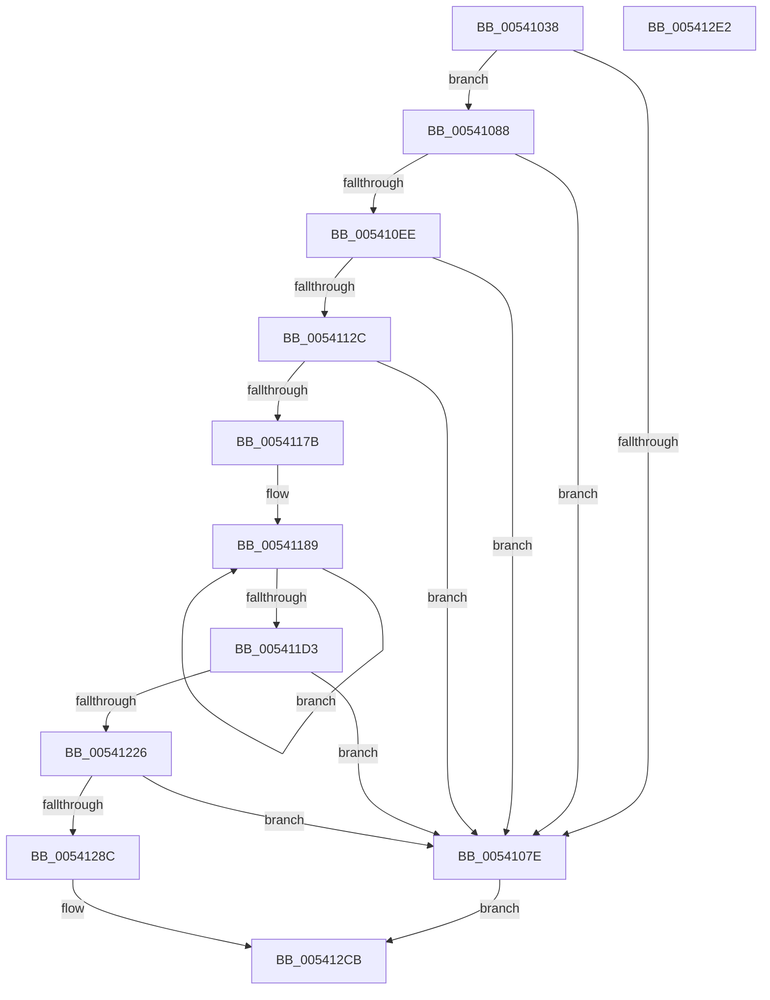

# HalpCreateMcaProcessorErrorRecord

- RVA: `0x00541038`–`0x005412E3` (길이 `683` bytes)
- VA: `0x0000000140541038`
- 실행 섹션: `.text`
- PDB 이름 있음: `예`; PDB Function 태그: `아니요`
- unwind 정보 RVA: `0x000B384C`
- 디코드: `174`개 명령, `683/683` bytes 표시
- 미해석 바이트: `0` (있으면 어셈블리에 `.byte`로 보존)

> 이 문서는 커널 이미지의 기계어와 PDB 기호를 분석해 생성했습니다. 4번과 5번은 함수 원형과 자료형을 바이너리 사용 방식에서 추정한 C 해석이며 원본 소스 복구 결과는 아닙니다.

## 1. Dependencies

- 직접 호출 지점: **6**; 고유 호출 대상: **6**
- 직접 호출자로 확인된 함수: **1**
- RIP 상대 이미지 참조: **5**

### Outgoing calls
- `0x00541066` → [memset](../6C/memset_function_006C6C40.md) (function, `0x006C6C40`)
- `0x0054108B` → [WheaInitializeRecordHeader](../42/WheaInitializeRecordHeader_function_0042DFF0.md) (function, `0x0042DFF0`)
- `0x005410FB` → [guard_dispatch_icall](../6B/guard_dispatch_icall_function_006BAAD0.md) (function, `0x006BAAD0`)
- `0x0054110A` → [HalpAddMcaToProcessorGenericSection](HalpAddMcaToProcessorGenericSection_function_00540254.md) (function, `0x00540254`)
- `0x0054113A` → [HalpAddMcaToProcessorSpecificSection](HalpAddMcaToProcessorSpecificSection_function_005403D8.md) (function, `0x005403D8`)
- `0x00541297` → [memcpy](../6C/memcpy_function_006C6840.md) (function, `0x006C6840`)

### Direct callers
- [HalpCreateMachineCheckErrorRecord](HalpCreateMachineCheckErrorRecord_function_00540B10.md) at `0x00540BFE`

### Static image references
- `0x005410EE` → RVA `0x00E00918` (`.data`; read)
- `0x00541149` → RVA `0x00024DC8` (`.rdata`; read)
- `0x00541205` → RVA `0x00024DA8` (`.rdata`; read)
- `0x00541264` → RVA `0x00024DF8` (`.rdata`; read)
- `0x005412B3` → RVA `0x0001A538` (`.rdata`; read)

## 2. Other-region calls and transfers

- 다른 실행 섹션으로 향하는 call: **0**
- 별도 외부 분기/꼬리 이동을 확인하지 못했습니다.

## 3. Assembly (complete function range)

```asm
00541038  48 89 5C 24 10                  mov qword ptr [rsp + 0x10], rbx
0054103D  55                              push rbp
0054103E  56                              push rsi
0054103F  57                              push rdi
00541040  41 54                           push r12
00541042  41 55                           push r13
00541044  41 56                           push r14
00541046  41 57                           push r15
00541048  48 83 EC 20                     sub rsp, 0x20
0054104C  4D 8B F0                        mov r14, r8
0054104F  45 8B E1                        mov r12d, r9d
00541052  48 8B EA                        mov rbp, rdx
00541055  45 8B C1                        mov r8d, r9d
00541058  48 8B D9                        mov rbx, rcx
0054105B  33 FF                           xor edi, edi
0054105D  49 8B CE                        mov rcx, r14
00541060  89 7C 24 78                     mov dword ptr [rsp + 0x78], edi
00541064  33 D2                           xor edx, edx
00541066  E8 D5 5B 18 00                  call 0x1406c6c40
0054106B  8B 43 18                        mov eax, dword ptr [rbx + 0x18]
0054106E  8D 0C C0                        lea ecx, [rax + rax*8]
00541071  44 8D 3C CD 80 00 00 00         lea r15d, [rcx*8 + 0x80]
00541079  45 3B FC                        cmp r15d, r12d
0054107C  76 0A                           jbe 0x140541088
0054107E  BF 23 00 00 C0                  mov edi, 0xc0000023
00541083  E9 43 02 00 00                  jmp 0x1405412cb
00541088  49 8B CE                        mov rcx, r14
0054108B  E8 60 CF EE FF                  call 0x14042dff0
00541090  66 41 C7 46 0A 05 00            mov word ptr [r14 + 0xa], 5
00541097  49 8D 9E 80 00 00 00            lea rbx, [r14 + 0x80]
0054109E  8B 45 14                        mov eax, dword ptr [rbp + 0x14]
005410A1  41 89 46 0C                     mov dword ptr [r14 + 0xc], eax
005410A5  41 8B 46 68                     mov eax, dword ptr [r14 + 0x68]
005410A9  45 89 66 14                     mov dword ptr [r14 + 0x14], r12d
005410AD  0F 10 45 20                     movups xmm0, xmmword ptr [rbp + 0x20]
005410B1  45 8B EF                        mov r13d, r15d
005410B4  44 89 7C 24 60                  mov dword ptr [rsp + 0x60], r15d
005410B9  4D 03 EE                        add r13, r14
005410BC  F3 41 0F 7F 46 50               movdqu xmmword ptr [r14 + 0x50], xmm0
005410C2  8B 4D 0C                        mov ecx, dword ptr [rbp + 0xc]
005410C5  41 81 C7 C0 00 00 00            add r15d, 0xc0
005410CC  03 C9                           add ecx, ecx
005410CE  33 C8                           xor ecx, eax
005410D0  83 E1 02                        and ecx, 2
005410D3  33 C8                           xor ecx, eax
005410D5  41 89 4E 68                     mov dword ptr [r14 + 0x68], ecx
005410D9  8B 45 0C                        mov eax, dword ptr [rbp + 0xc]
005410DC  D1 E8                           shr eax, 1
005410DE  33 C1                           xor eax, ecx
005410E0  83 E0 04                        and eax, 4
005410E3  33 C1                           xor eax, ecx
005410E5  41 89 46 68                     mov dword ptr [r14 + 0x68], eax
005410E9  45 3B FC                        cmp r15d, r12d
005410EC  77 90                           ja 0x14054107e
005410EE  48 8B 05 23 F8 8B 00            mov rax, qword ptr [rip + 0x8bf823]
005410F5  49 8B D5                        mov rdx, r13
005410F8  48 8B CB                        mov rcx, rbx
005410FB  E8 D0 99 17 00                  call 0x1406baad0
00541100  48 8D 75 50                     lea rsi, [rbp + 0x50]
00541104  49 8B D5                        mov rdx, r13
00541107  48 8B CE                        mov rcx, rsi
0054110A  E8 45 F1 FF FF                  call 0x140540254
0054110F  8B 44 24 60                     mov eax, dword ptr [rsp + 0x60]
00541113  83 4B 0C 01                     or dword ptr [rbx + 0xc], 1
00541117  89 03                           mov dword ptr [rbx], eax
00541119  8B 45 14                        mov eax, dword ptr [rbp + 0x14]
0054111C  89 43 30                        mov dword ptr [rbx + 0x30], eax
0054111F  41 8D 47 41                     lea eax, [r15 + 0x41]
00541123  41 3B C4                        cmp eax, r12d
00541126  0F 87 52 FF FF FF               ja 0x14054107e
0054112C  41 8B D7                        mov edx, r15d
0054112F  4C 8D 44 24 78                  lea r8, [rsp + 0x78]
00541134  49 03 D6                        add rdx, r14
00541137  48 8B CE                        mov rcx, rsi
0054113A  E8 99 F2 FF FF                  call 0x1405403d8
0054113F  8B 4C 24 78                     mov ecx, dword ptr [rsp + 0x78]
00541143  41 BD 00 03 00 00               mov r13d, 0x300
00541149  0F 10 05 78 3C AE FF            movups xmm0, xmmword ptr [rip - 0x51c388]
00541150  44 89 7B 48                     mov dword ptr [rbx + 0x48], r15d
00541154  89 4B 4C                        mov dword ptr [rbx + 0x4c], ecx
00541157  41 8D 14 0F                     lea edx, [r15 + rcx]
0054115B  66 44 89 6B 50                  mov word ptr [rbx + 0x50], r13w
00541160  44 8D 82 A8 04 00 00            lea r8d, [rdx + 0x4a8]
00541167  F3 0F 7F 43 58                  movdqu xmmword ptr [rbx + 0x58], xmm0
0054116C  8B 45 14                        mov eax, dword ptr [rbp + 0x14]
0054116F  89 43 78                        mov dword ptr [rbx + 0x78], eax
00541172  45 3B C4                        cmp r8d, r12d
00541175  0F 87 03 FF FF FF               ja 0x14054107e
0054117B  B8 09 00 00 00                  mov eax, 9
00541180  8B CA                           mov ecx, edx
00541182  49 03 CE                        add rcx, r14
00541185  44 8D 48 77                     lea r9d, [rax + 0x77]
00541189  0F 10 06                        movups xmm0, xmmword ptr [rsi]
0054118C  0F 11 01                        movups xmmword ptr [rcx], xmm0
0054118F  0F 10 4E 10                     movups xmm1, xmmword ptr [rsi + 0x10]
00541193  0F 11 49 10                     movups xmmword ptr [rcx + 0x10], xmm1
00541197  0F 10 46 20                     movups xmm0, xmmword ptr [rsi + 0x20]
0054119B  0F 11 41 20                     movups xmmword ptr [rcx + 0x20], xmm0
0054119F  0F 10 4E 30                     movups xmm1, xmmword ptr [rsi + 0x30]
005411A3  0F 11 49 30                     movups xmmword ptr [rcx + 0x30], xmm1
005411A7  0F 10 46 40                     movups xmm0, xmmword ptr [rsi + 0x40]
005411AB  0F 11 41 40                     movups xmmword ptr [rcx + 0x40], xmm0
005411AF  0F 10 4E 50                     movups xmm1, xmmword ptr [rsi + 0x50]
005411B3  0F 11 49 50                     movups xmmword ptr [rcx + 0x50], xmm1
005411B7  0F 10 46 60                     movups xmm0, xmmword ptr [rsi + 0x60]
005411BB  0F 11 41 60                     movups xmmword ptr [rcx + 0x60], xmm0
005411BF  49 03 C9                        add rcx, r9
005411C2  0F 10 4E 70                     movups xmm1, xmmword ptr [rsi + 0x70]
005411C6  49 03 F1                        add rsi, r9
005411C9  0F 11 49 F0                     movups xmmword ptr [rcx - 0x10], xmm1
005411CD  48 83 E8 01                     sub rax, 1
005411D1  75 B6                           jne 0x140541189
005411D3  0F 10 06                        movups xmm0, xmmword ptr [rsi]
005411D6  0F 11 01                        movups xmmword ptr [rcx], xmm0
005411D9  0F 10 4E 10                     movups xmm1, xmmword ptr [rsi + 0x10]
005411DD  0F 11 49 10                     movups xmmword ptr [rcx + 0x10], xmm1
005411E1  48 8B 46 20                     mov rax, qword ptr [rsi + 0x20]
005411E5  41 8D 70 27                     lea esi, [r8 + 0x27]
005411E9  48 89 41 20                     mov qword ptr [rcx + 0x20], rax
005411ED  89 93 90 00 00 00               mov dword ptr [rbx + 0x90], edx
005411F3  C7 83 94 00 00 00 A8 04 00 00   mov dword ptr [rbx + 0x94], 0x4a8
005411FD  66 44 89 AB 98 00 00 00         mov word ptr [rbx + 0x98], r13w
00541205  0F 10 05 9C 3B AE FF            movups xmm0, xmmword ptr [rip - 0x51c464]
0054120C  F3 0F 7F 83 A0 00 00 00         movdqu xmmword ptr [rbx + 0xa0], xmm0
00541214  8B 45 14                        mov eax, dword ptr [rbp + 0x14]
00541217  89 83 C0 00 00 00               mov dword ptr [rbx + 0xc0], eax
0054121D  41 3B F4                        cmp esi, r12d
00541220  0F 87 58 FE FF FF               ja 0x14054107e
00541226  33 C9                           xor ecx, ecx
00541228  41 8B C0                        mov eax, r8d
0054122B  49 03 C6                        add rax, r14
0054122E  0F 57 C0                        xorps xmm0, xmm0
00541231  0F 11 00                        movups xmmword ptr [rax], xmm0
00541234  0F 11 40 10                     movups xmmword ptr [rax + 0x10], xmm0
00541238  89 48 20                        mov dword ptr [rax + 0x20], ecx
0054123B  66 89 48 24                     mov word ptr [rax + 0x24], cx
0054123F  88 48 26                        mov byte ptr [rax + 0x26], cl
00541242  48 83 48 01 01                  or qword ptr [rax + 1], 1
00541247  C6 40 0D FF                     mov byte ptr [rax + 0xd], 0xff
0054124B  44 89 83 D8 00 00 00            mov dword ptr [rbx + 0xd8], r8d
00541252  C7 83 DC 00 00 00 27 00 00 00   mov dword ptr [rbx + 0xdc], 0x27
0054125C  66 44 89 AB E0 00 00 00         mov word ptr [rbx + 0xe0], r13w
00541264  0F 10 05 8D 3B AE FF            movups xmm0, xmmword ptr [rip - 0x51c473]
0054126B  C7 83 08 01 00 00 03 00 00 00   mov dword ptr [rbx + 0x108], 3
00541275  F3 0F 7F 83 E8 00 00 00         movdqu xmmword ptr [rbx + 0xe8], xmm0
0054127D  8B 4D 08                        mov ecx, dword ptr [rbp + 8]
00541280  8D 04 31                        lea eax, [rcx + rsi]
00541283  41 3B C4                        cmp eax, r12d
00541286  0F 87 F2 FD FF FF               ja 0x14054107e
0054128C  44 8B C1                        mov r8d, ecx
0054128F  48 8B D5                        mov rdx, rbp
00541292  8B CE                           mov ecx, esi
00541294  49 03 CE                        add rcx, r14
00541297  E8 A4 55 18 00                  call 0x1406c6840
0054129C  89 B3 20 01 00 00               mov dword ptr [rbx + 0x120], esi
005412A2  8B 4D 08                        mov ecx, dword ptr [rbp + 8]
005412A5  89 8B 24 01 00 00               mov dword ptr [rbx + 0x124], ecx
005412AB  66 44 89 AB 28 01 00 00         mov word ptr [rbx + 0x128], r13w
005412B3  0F 10 05 7E 92 AD FF            movups xmm0, xmmword ptr [rip - 0x526d82]
005412BA  F3 0F 7F 83 30 01 00 00         movdqu xmmword ptr [rbx + 0x130], xmm0
005412C2  8B 4D 14                        mov ecx, dword ptr [rbp + 0x14]
005412C5  89 8B 50 01 00 00               mov dword ptr [rbx + 0x150], ecx
005412CB  48 8B 5C 24 68                  mov rbx, qword ptr [rsp + 0x68]
005412D0  8B C7                           mov eax, edi
005412D2  48 83 C4 20                     add rsp, 0x20
005412D6  41 5F                           pop r15
005412D8  41 5E                           pop r14
005412DA  41 5D                           pop r13
005412DC  41 5C                           pop r12
005412DE  5F                              pop rdi
005412DF  5E                              pop rsi
005412E0  5D                              pop rbp
005412E1  C3                              ret
005412E2  CC                              int3
```

## 4. C-style interpretation (structured pseudocode)

```c
__int64 __fastcall HalpCreateMcaProcessorErrorRecord(__int64 a1, __int64 a2, __int64 a3, int a4)
{
    __int64 result;
    __int64 v_r13;
    __int64 v_r15;
    __int64 v_rdi;
    __int64 v_rsi;
    __int64 v_rsp;
    unsigned __int64 v_stack_p10;
    unsigned int v_stack_p20;
    unsigned int v_stack_p8;

    v_stack_p10 = v_rbx;
    v_rsp = (v_rsp) - (32);
    v_rdi = 0;
    v_stack_p20 = 0;
    a2 = 0;
    result = memset(a3, a2, (unsigned int)(a4), a4);
    if (((unsigned int)((unsigned int)(*(unsigned int *)(a1 + 24)) + (unsigned int)(*(unsigned int *)(a1 + 24)) * 8 * 8 + 128)) <= ((unsigned int)((unsigned int)(a4)))) goto loc_00541088;
loc_0054107E:
    goto loc_005412CB;
loc_00541088:
    result = WheaInitializeRecordHeader(a3, a2, (unsigned int)(a4), a4);
    *(unsigned __int16 *)(a3 + 10) = 5;
    *(unsigned int *)(a3 + 12) = (unsigned int)((unsigned int)(*(unsigned int *)(a2 + 20)));
    *(unsigned int *)(a3 + 20) = (unsigned int)((unsigned int)(a4));
    v_stack_p8 = (unsigned int)((unsigned int)(*(unsigned int *)(a1 + 24)) + (unsigned int)(*(unsigned int *)(a1 + 24)) * 8 * 8 + 128);
    v_r13 = ((unsigned int)((unsigned int)((unsigned int)(*(unsigned int *)(a1 + 24)) + (unsigned int)(*(unsigned int *)(a1 + 24)) * 8 * 8 + 128))) + (a3);
    *(unsigned __int64 *)(a3 + 80) = v_xmm0;
    v_r15 = (unsigned int)(((unsigned int)(*(unsigned int *)(a1 + 24)) + (unsigned int)(*(unsigned int *)(a1 + 24)) * 8 * 8 + 128) + (192));
    a1 = (unsigned int)(((unsigned int)(*(unsigned int *)(a2 + 12))) + ((unsigned int)((unsigned int)(*(unsigned int *)(a2 + 12)))));
    a1 = (unsigned int)((a1) ^ ((unsigned int)((unsigned int)(*(unsigned int *)(a3 + 104)))));
    a1 = (unsigned int)((a1) & (2));
    a1 = (unsigned int)((a1) ^ ((unsigned int)((unsigned int)(*(unsigned int *)(a3 + 104)))));
    *(unsigned int *)(a3 + 104) = (unsigned int)(a1);
    result = (unsigned int)(((unsigned int)(*(unsigned int *)(a2 + 12))) >> (1));
    result = (unsigned int)((result) ^ ((unsigned int)(a1)));
    result = (unsigned int)((result) & (4));
    result = (unsigned int)((result) ^ ((unsigned int)(a1)));
    *(unsigned int *)(a3 + 104) = (unsigned int)(result);
    if (((unsigned int)(v_r15)) > ((unsigned int)((unsigned int)(a4)))) goto loc_0054107E;
    result = guard_dispatch_icall(a3 + 128, v_r13, (unsigned int)(a4), a4);
    result = HalpAddMcaToProcessorGenericSection(a2 + 80, v_r13, (unsigned int)(a4), a4);
    *(unsigned int *)(a3 + 128) = (unsigned int)((unsigned int)(v_stack_p8));
    *(unsigned int *)(a3 + 128 + 48) = (unsigned int)((unsigned int)(*(unsigned int *)(a2 + 20)));
    if (((unsigned int)(v_r15 + 65)) > ((unsigned int)((unsigned int)(a4)))) goto loc_0054107E;
    a2 = ((unsigned int)((unsigned int)(v_r15))) + (a3);
    result = HalpAddMcaToProcessorSpecificSection(a2 + 80, a2, v_stack_p20, a4);
    *(unsigned int *)(a3 + 128 + 72) = (unsigned int)(v_r15);
    *(unsigned int *)(a3 + 128 + 76) = (unsigned int)((unsigned int)(v_stack_p20));
    *(unsigned __int16 *)(a3 + 128 + 80) = 768;
    *(unsigned __int64 *)(a3 + 128 + 88) = v_xmm0;
    *(unsigned int *)(a3 + 128 + 120) = (unsigned int)((unsigned int)(*(unsigned int *)(a2 + 20)));
    if (((unsigned int)(v_r15 + (unsigned int)(v_stack_p20) * 1 + 1192)) > ((unsigned int)((unsigned int)(a4)))) goto loc_0054107E;
    a1 = ((unsigned int)((unsigned int)(v_r15 + (unsigned int)(v_stack_p20) * 1))) + (a3);
loc_00541189:
    *(unsigned __int64 *)(a1) = v_xmm0;
    *(unsigned __int64 *)(a1 + 16) = v_xmm1;
    *(unsigned __int64 *)(a1 + 32) = v_xmm0;
    *(unsigned __int64 *)(a1 + 48) = v_xmm1;
    *(unsigned __int64 *)(a1 + 64) = v_xmm0;
    *(unsigned __int64 *)(a1 + 80) = v_xmm1;
    *(unsigned __int64 *)(a1 + 96) = v_xmm0;
    a1 = (a1) + (9 + 119);
    v_rsi = (a2 + 80) + (9 + 119);
    *(unsigned __int64 *)(a1 - 16) = v_xmm1;
    result = (9) - (1);
    if (condition_is_not_equal) goto loc_00541189;
    *(unsigned __int64 *)(a1) = v_xmm0;
    *(unsigned __int64 *)(a1 + 16) = v_xmm1;
    *(unsigned __int64 *)(a1 + 32) = *(unsigned __int64 *)(v_rsi + 32);
    *(unsigned int *)(a3 + 128 + 144) = (unsigned int)(v_r15 + (unsigned int)(v_stack_p20) * 1);
    *(unsigned int *)(a3 + 128 + 148) = 0x4A8ULL;
    *(unsigned __int16 *)(a3 + 128 + 152) = 768;
    *(unsigned __int64 *)(a3 + 128 + 160) = v_xmm0;
    *(unsigned int *)(a3 + 128 + 192) = (unsigned int)((unsigned int)(*(unsigned int *)(a2 + 20)));
    if (((unsigned int)(v_r15 + (unsigned int)(v_stack_p20) * 1 + 1192 + 39)) > ((unsigned int)((unsigned int)(a4)))) goto loc_0054107E;
    a1 = 0;
    result = ((unsigned int)((unsigned int)(v_r15 + (unsigned int)(v_stack_p20) * 1 + 1192))) + (a3);
    *(unsigned __int64 *)(result) = v_xmm0;
    *(unsigned __int64 *)(result + 16) = v_xmm0;
    *(unsigned int *)(result + 32) = 0;
    *(unsigned __int16 *)(result + 36) = 0;
    *(unsigned __int8 *)(result + 38) = 0;
    *(unsigned __int8 *)(result + 13) = 255;
    *(unsigned int *)(a3 + 128 + 216) = (unsigned int)(v_r15 + (unsigned int)(v_stack_p20) * 1 + 1192);
    *(unsigned int *)(a3 + 128 + 220) = 39;
    *(unsigned __int16 *)(a3 + 128 + 224) = 768;
    *(unsigned int *)(a3 + 128 + 264) = 3;
    *(unsigned __int64 *)(a3 + 128 + 232) = v_xmm0;
    if (((unsigned int)((unsigned int)(*(unsigned int *)(a2 + 8)) + v_r15 + (unsigned int)(v_stack_p20) * 1 + 1192 + 39 * 1)) > ((unsigned int)((unsigned int)(a4)))) goto loc_0054107E;
    a1 = ((unsigned int)((unsigned int)(v_r15 + (unsigned int)(v_stack_p20) * 1 + 1192 + 39))) + (a3);
    result = memcpy(a1, a2, (unsigned int)((unsigned int)((unsigned int)(*(unsigned int *)(a2 + 8)))), 9 + 119);
    *(unsigned int *)(a3 + 128 + 288) = (unsigned int)(v_r15 + (unsigned int)(v_stack_p20) * 1 + 1192 + 39);
    *(unsigned int *)(a3 + 128 + 292) = (unsigned int)((unsigned int)(*(unsigned int *)(a2 + 8)));
    *(unsigned __int16 *)(a3 + 128 + 296) = 768;
    *(unsigned __int64 *)(a3 + 128 + 304) = v_xmm0;
    *(unsigned int *)(a3 + 128 + 336) = (unsigned int)((unsigned int)(*(unsigned int *)(a2 + 20)));
loc_005412CB:
    v_rsp = (v_rsp) + (32);
    return (unsigned int)((unsigned int)((unsigned int)(0xC0000023ULL)));
}
```

## 5. (Beta) C Style

```c
int64_t HalpCreateMcaProcessorErrorRecord(void *Arg1, void *Arg2, void *Arg3, int32_t Arg4)
{
    uint8_t *arg1 = (uint8_t *)Arg1;
    uint8_t *arg2 = (uint8_t *)Arg2;
    uint8_t *arg3 = (uint8_t *)Arg3;

    int64_t result;
    int64_t local_r13;
    int64_t local_r15;
    int64_t local_rdi;
    int64_t local_rsi;
    int64_t local_rsp;
    uint64_t v_stack_p10;
    uint32_t v_stack_p20;
    uint32_t v_stack_p8;

    v_stack_p10 = local_rbx;
    local_rsp = (local_rsp) - (32);
    local_rdi = 0;
    v_stack_p20 = 0;
    Arg2 = 0;
    result = memset(Arg3, Arg2, (uint32_t)(Arg4), Arg4);
    if (((uint32_t)((uint32_t)(*(uint32_t *)(arg1 + 0x18)) + (uint32_t)(*(uint32_t *)(arg1 + 0x18)) * 8 * 8 + 128)) <= ((uint32_t)((uint32_t)(Arg4)))) goto loc_00541088;
loc_0054107E:
    goto loc_005412CB;
loc_00541088:
    result = WheaInitializeRecordHeader(Arg3, Arg2, (uint32_t)(Arg4), Arg4);
    *(uint16_t *)(arg3 + 0xA) = 5;
    *(uint32_t *)(arg3 + 0xC) = (uint32_t)((uint32_t)(*(uint32_t *)(arg2 + 0x14)));
    *(uint32_t *)(arg3 + 0x14) = (uint32_t)((uint32_t)(Arg4));
    v_stack_p8 = (uint32_t)((uint32_t)(*(uint32_t *)(arg1 + 0x18)) + (uint32_t)(*(uint32_t *)(arg1 + 0x18)) * 8 * 8 + 128);
    local_r13 = ((uint32_t)((uint32_t)((uint32_t)(*(uint32_t *)(arg1 + 0x18)) + (uint32_t)(*(uint32_t *)(arg1 + 0x18)) * 8 * 8 + 128))) + (Arg3);
    *(uint64_t *)(arg3 + 0x50) = v_xmm0;
    local_r15 = (uint32_t)(((uint32_t)(*(uint32_t *)(arg1 + 0x18)) + (uint32_t)(*(uint32_t *)(arg1 + 0x18)) * 8 * 8 + 128) + (192));
    Arg1 = (uint32_t)(((uint32_t)(*(uint32_t *)(arg2 + 0xC))) + ((uint32_t)((uint32_t)(*(uint32_t *)(arg2 + 0xC)))));
    Arg1 = (uint32_t)((Arg1) ^ ((uint32_t)((uint32_t)(*(uint32_t *)(arg3 + 0x68)))));
    Arg1 = (uint32_t)((Arg1) & (2));
    Arg1 = (uint32_t)((Arg1) ^ ((uint32_t)((uint32_t)(*(uint32_t *)(arg3 + 0x68)))));
    *(uint32_t *)(arg3 + 0x68) = (uint32_t)(Arg1);
    result = (uint32_t)(((uint32_t)(*(uint32_t *)(arg2 + 0xC))) >> (1));
    result = (uint32_t)((result) ^ ((uint32_t)(Arg1)));
    result = (uint32_t)((result) & (4));
    result = (uint32_t)((result) ^ ((uint32_t)(Arg1)));
    *(uint32_t *)(arg3 + 0x68) = (uint32_t)(result);
    if (((uint32_t)(local_r15)) > ((uint32_t)((uint32_t)(Arg4)))) goto loc_0054107E;
    result = guard_dispatch_icall(Arg3 + 128, local_r13, (uint32_t)(Arg4), Arg4);
    result = HalpAddMcaToProcessorGenericSection(Arg2 + 80, local_r13, (uint32_t)(Arg4), Arg4);
    *(uint32_t *)(arg3 + 0x80) = (uint32_t)((uint32_t)(v_stack_p8));
    *(uint32_t *)(arg3 + 0x80 + 0x30) = (uint32_t)((uint32_t)(*(uint32_t *)(arg2 + 0x14)));
    if (((uint32_t)(local_r15 + 65)) > ((uint32_t)((uint32_t)(Arg4)))) goto loc_0054107E;
    Arg2 = ((uint32_t)((uint32_t)(local_r15))) + (Arg3);
    result = HalpAddMcaToProcessorSpecificSection(Arg2 + 80, Arg2, v_stack_p20, Arg4);
    *(uint32_t *)(arg3 + 0x80 + 0x48) = (uint32_t)(local_r15);
    *(uint32_t *)(arg3 + 0x80 + 0x4C) = (uint32_t)((uint32_t)(v_stack_p20));
    *(uint16_t *)(arg3 + 0x80 + 0x50) = 768;
    *(uint64_t *)(arg3 + 0x80 + 0x58) = v_xmm0;
    *(uint32_t *)(arg3 + 0x80 + 0x78) = (uint32_t)((uint32_t)(*(uint32_t *)(arg2 + 0x14)));
    if (((uint32_t)(local_r15 + (uint32_t)(v_stack_p20) * 1 + 1192)) > ((uint32_t)((uint32_t)(Arg4)))) goto loc_0054107E;
    Arg1 = ((uint32_t)((uint32_t)(local_r15 + (uint32_t)(v_stack_p20) * 1))) + (Arg3);
loc_00541189:
    *(uint64_t *)(arg1) = v_xmm0;
    *(uint64_t *)(arg1 + 0x10) = v_xmm1;
    *(uint64_t *)(arg1 + 0x20) = v_xmm0;
    *(uint64_t *)(arg1 + 0x30) = v_xmm1;
    *(uint64_t *)(arg1 + 0x40) = v_xmm0;
    *(uint64_t *)(arg1 + 0x50) = v_xmm1;
    *(uint64_t *)(arg1 + 0x60) = v_xmm0;
    Arg1 = (Arg1) + (9 + 119);
    local_rsi = (Arg2 + 80) + (9 + 119);
    *(uint64_t *)(arg1 - 0x10) = v_xmm1;
    result = (9) - (1);
    if (condition_is_not_equal) goto loc_00541189;
    *(uint64_t *)(arg1) = v_xmm0;
    *(uint64_t *)(arg1 + 0x10) = v_xmm1;
    *(uint64_t *)(arg1 + 0x20) = *(uint64_t *)(local_rsi + 0x20);
    *(uint32_t *)(arg3 + 0x80 + 0x90) = (uint32_t)(local_r15 + (uint32_t)(v_stack_p20) * 1);
    *(uint32_t *)(arg3 + 0x80 + 0x94) = 0x4A8ULL;
    *(uint16_t *)(arg3 + 0x80 + 0x98) = 768;
    *(uint64_t *)(arg3 + 0x80 + 0xA0) = v_xmm0;
    *(uint32_t *)(arg3 + 0x80 + 0xC0) = (uint32_t)((uint32_t)(*(uint32_t *)(arg2 + 0x14)));
    if (((uint32_t)(local_r15 + (uint32_t)(v_stack_p20) * 1 + 1192 + 39)) > ((uint32_t)((uint32_t)(Arg4)))) goto loc_0054107E;
    Arg1 = 0;
    result = ((uint32_t)((uint32_t)(local_r15 + (uint32_t)(v_stack_p20) * 1 + 1192))) + (Arg3);
    *(uint64_t *)(result) = v_xmm0;
    *(uint64_t *)(result + 0x10) = v_xmm0;
    *(uint32_t *)(result + 0x20) = 0;
    *(uint16_t *)(result + 0x24) = 0;
    *(uint8_t *)(result + 0x26) = 0;
    *(uint8_t *)(result + 0xD) = 255;
    *(uint32_t *)(arg3 + 0x80 + 0xD8) = (uint32_t)(local_r15 + (uint32_t)(v_stack_p20) * 1 + 1192);
    *(uint32_t *)(arg3 + 0x80 + 0xDC) = 39;
    *(uint16_t *)(arg3 + 0x80 + 0xE0) = 768;
    *(uint32_t *)(arg3 + 0x80 + 0x108) = 3;
    *(uint64_t *)(arg3 + 0x80 + 0xE8) = v_xmm0;
    if (((uint32_t)((uint32_t)(*(uint32_t *)(arg2 + 0x8)) + local_r15 + (uint32_t)(v_stack_p20) * 1 + 1192 + 39 * 1)) > ((uint32_t)((uint32_t)(Arg4)))) goto loc_0054107E;
    Arg1 = ((uint32_t)((uint32_t)(local_r15 + (uint32_t)(v_stack_p20) * 1 + 1192 + 39))) + (Arg3);
    result = memcpy(Arg1, Arg2, (uint32_t)((uint32_t)((uint32_t)(*(uint32_t *)(arg2 + 0x8)))), 9 + 119);
    *(uint32_t *)(arg3 + 0x80 + 0x120) = (uint32_t)(local_r15 + (uint32_t)(v_stack_p20) * 1 + 1192 + 39);
    *(uint32_t *)(arg3 + 0x80 + 0x124) = (uint32_t)((uint32_t)(*(uint32_t *)(arg2 + 0x8)));
    *(uint16_t *)(arg3 + 0x80 + 0x128) = 768;
    *(uint64_t *)(arg3 + 0x80 + 0x130) = v_xmm0;
    *(uint32_t *)(arg3 + 0x80 + 0x150) = (uint32_t)((uint32_t)(*(uint32_t *)(arg2 + 0x14)));
loc_005412CB:
    local_rsp = (local_rsp) + (32);
    return (uint32_t)((uint32_t)((uint32_t)(0xC0000023ULL)));
}
```

### 관측된 메모리 오프셋

구조체 형식이 확인되지 않은 접근은 인자 기준의 오프셋으로만 기록했습니다.

| 기준 인자 | 오프셋 표현 | 폭 (bit) | 접근 |
|---|---:|---:|---|
| `Arg1` | `+ 0x18` | `32` | `R` |
| `Arg2` | `+ 0x0` | `128` | `R` |
| `Arg2` | `+ 0x8` | `32` | `R` |
| `Arg2` | `+ 0xC` | `32` | `R` |
| `Arg2` | `+ 0x10` | `128` | `R` |
| `Arg2` | `+ 0x14` | `32` | `R` |
| `Arg2` | `+ 0x20` | `64` | `R` |
| `Arg2` | `+ 0x20` | `128` | `R` |
| `Arg2` | `+ 0x30` | `128` | `R` |
| `Arg2` | `+ 0x40` | `128` | `R` |
| `Arg2` | `+ 0x50` | `64` | `R` |
| `Arg2` | `+ 0x50` | `128` | `R` |
| `Arg2` | `+ 0x60` | `128` | `R` |
| `Arg2` | `+ 0x70` | `128` | `R` |
| `Arg3` | `+ 0x0` | `32` | `W` |
| `Arg3` | `+ 0xA` | `16` | `W` |
| `Arg3` | `+ 0xC` | `32` | `R/W` |
| `Arg3` | `+ 0xC` | `32` | `W` |
| `Arg3` | `+ 0x14` | `32` | `W` |
| `Arg3` | `+ 0x30` | `32` | `W` |
| `Arg3` | `+ 0x48` | `32` | `W` |
| `Arg3` | `+ 0x4C` | `32` | `W` |
| `Arg3` | `+ 0x50` | `16` | `W` |
| `Arg3` | `+ 0x50` | `128` | `W` |
| `Arg3` | `+ 0x58` | `128` | `W` |
| `Arg3` | `+ 0x68` | `32` | `R` |
| `Arg3` | `+ 0x68` | `32` | `W` |
| `Arg3` | `+ 0x78` | `32` | `W` |
| `Arg3` | `+ 0x80` | `64` | `R` |
| `Arg3` | `+ 0x90` | `32` | `W` |
| `Arg3` | `+ 0x94` | `32` | `W` |
| `Arg3` | `+ 0x98` | `16` | `W` |

추가 오프셋 12개는 표에서 생략했습니다.

## 6. Execution-region graph

[열기: 2D/3D 그래프와 함수 탐색 컨트롤 패널](../../../control-panel.html?section=text&rva=0x00541038&view=graph)

- 2D 그래프는 위에서 아래로 흐르고, 3D 그래프는 빈 공간을 드래그해 회전합니다. Shift+드래그는 이동, 휠은 확대·축소, 함수 노드 선택은 대상 보고서 이동입니다.

### Static fallback


