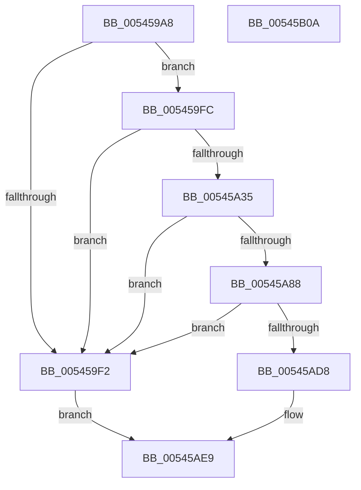

# HalpCreateNMIErrorRecord

- RVA: `0x005459A8`–`0x00545B0B` (길이 `355` bytes)
- VA: `0x00000001405459A8`
- 실행 섹션: `.text`
- PDB 이름 있음: `예`; PDB Function 태그: `아니요`
- unwind 정보 RVA: `0x0005FEF8`
- 디코드: `87`개 명령, `355/355` bytes 표시
- 미해석 바이트: `0` (있으면 어셈블리에 `.byte`로 보존)

> 이 문서는 커널 이미지의 기계어와 PDB 기호를 분석해 생성했습니다. 4번과 5번은 함수 원형과 자료형을 바이너리 사용 방식에서 추정한 C 해석이며 원본 소스 복구 결과는 아닙니다.

## 1. Dependencies

- 직접 호출 지점: **4**; 고유 호출 대상: **4**
- 직접 호출자로 확인된 함수: **1**
- RIP 상대 이미지 참조: **4**

### Outgoing calls
- `0x005459DB` → [memset](../6C/memset_function_006C6C40.md) (function, `0x006C6C40`)
- `0x005459FF` → [WheaInitializeRecordHeader](../42/WheaInitializeRecordHeader_function_0042DFF0.md) (function, `0x0042DFF0`)
- `0x00545A43` → [guard_dispatch_icall](../6B/guard_dispatch_icall_function_006BAAD0.md) (function, `0x006BAAD0`)
- `0x00545AE4` → [memcpy](../6C/memcpy_function_006C6840.md) (function, `0x006C6840`)

### Direct callers
- [HalpCreateErrorRecord](HalpCreateErrorRecord_function_00540AC0.md) at `0x00540AE0`

### Static image references
- `0x00545A04` → RVA `0x00024D88` (`.rdata`; read)
- `0x00545A35` → RVA `0x00E00918` (`.data`; read)
- `0x00545A66` → RVA `0x00024DE8` (`.rdata`; read)
- `0x00545AB2` → RVA `0x0001A538` (`.rdata`; read)

## 2. Other-region calls and transfers

- 다른 실행 섹션으로 향하는 call: **0**
- 별도 외부 분기/꼬리 이동을 확인하지 못했습니다.

## 3. Assembly (complete function range)

```asm
005459A8  48 8B C4                        mov rax, rsp
005459AB  48 89 58 08                     mov qword ptr [rax + 8], rbx
005459AF  48 89 68 10                     mov qword ptr [rax + 0x10], rbp
005459B3  48 89 70 18                     mov qword ptr [rax + 0x18], rsi
005459B7  48 89 78 20                     mov qword ptr [rax + 0x20], rdi
005459BB  41 54                           push r12
005459BD  41 56                           push r14
005459BF  41 57                           push r15
005459C1  48 83 EC 20                     sub rsp, 0x20
005459C5  49 8B F0                        mov rsi, r8
005459C8  45 8B F9                        mov r15d, r9d
005459CB  48 8B EA                        mov rbp, rdx
005459CE  45 8B C1                        mov r8d, r9d
005459D1  48 8B D9                        mov rbx, rcx
005459D4  33 D2                           xor edx, edx
005459D6  48 8B CE                        mov rcx, rsi
005459D9  33 FF                           xor edi, edi
005459DB  E8 60 12 18 00                  call 0x1406c6c40
005459E0  8B 43 18                        mov eax, dword ptr [rbx + 0x18]
005459E3  8D 0C C0                        lea ecx, [rax + rax*8]
005459E6  8D 1C CD 80 00 00 00            lea ebx, [rcx*8 + 0x80]
005459ED  41 3B DF                        cmp ebx, r15d
005459F0  76 0A                           jbe 0x1405459fc
005459F2  BF 23 00 00 C0                  mov edi, 0xc0000023
005459F7  E9 ED 00 00 00                  jmp 0x140545ae9
005459FC  48 8B CE                        mov rcx, rsi
005459FF  E8 EC 85 EE FF                  call 0x14042dff0
00545A04  0F 10 05 7D F3 AD FF            movups xmm0, xmmword ptr [rip - 0x520c83]
00545A0B  44 8B E3                        mov r12d, ebx
00545A0E  4C 8D B6 80 00 00 00            lea r14, [rsi + 0x80]
00545A15  81 C3 C0 00 00 00               add ebx, 0xc0
00545A1B  66 C7 46 0A 03 00               mov word ptr [rsi + 0xa], 3
00545A21  8B 45 14                        mov eax, dword ptr [rbp + 0x14]
00545A24  89 46 0C                        mov dword ptr [rsi + 0xc], eax
00545A27  44 89 7E 14                     mov dword ptr [rsi + 0x14], r15d
00545A2B  F3 0F 7F 46 50                  movdqu xmmword ptr [rsi + 0x50], xmm0
00545A30  41 3B DF                        cmp ebx, r15d
00545A33  77 BD                           ja 0x1405459f2
00545A35  48 8B 05 DC AE 8B 00            mov rax, qword ptr [rip + 0x8baedc]
00545A3C  4A 8D 14 26                     lea rdx, [rsi + r12]
00545A40  49 8B CE                        mov rcx, r14
00545A43  E8 88 50 17 00                  call 0x1406baad0
00545A48  41 83 4E 54 01                  or dword ptr [r14 + 0x54], 1
00545A4D  BA 00 03 00 00                  mov edx, 0x300
00545A52  45 89 26                        mov dword ptr [r14], r12d
00545A55  41 89 5E 48                     mov dword ptr [r14 + 0x48], ebx
00545A59  66 41 89 56 50                  mov word ptr [r14 + 0x50], dx
00545A5E  41 C7 46 4C 0C 00 00 00         mov dword ptr [r14 + 0x4c], 0xc
00545A66  0F 10 05 7B F3 AD FF            movups xmm0, xmmword ptr [rip - 0x520c85]
00545A6D  8B CB                           mov ecx, ebx
00545A6F  83 C3 0C                        add ebx, 0xc
00545A72  F3 41 0F 7F 46 58               movdqu xmmword ptr [r14 + 0x58], xmm0
00545A78  8B 45 14                        mov eax, dword ptr [rbp + 0x14]
00545A7B  41 89 46 78                     mov dword ptr [r14 + 0x78], eax
00545A7F  41 3B DF                        cmp ebx, r15d
00545A82  0F 87 6A FF FF FF               ja 0x1405459f2
00545A88  F2 0F 10 45 50                  movsd xmm0, qword ptr [rbp + 0x50]
00545A8D  F2 0F 11 04 31                  movsd qword ptr [rcx + rsi], xmm0
00545A92  8B 45 58                        mov eax, dword ptr [rbp + 0x58]
00545A95  89 44 31 08                     mov dword ptr [rcx + rsi + 8], eax
00545A99  41 89 9E 90 00 00 00            mov dword ptr [r14 + 0x90], ebx
00545AA0  8B 4D 08                        mov ecx, dword ptr [rbp + 8]
00545AA3  41 89 8E 94 00 00 00            mov dword ptr [r14 + 0x94], ecx
00545AAA  66 41 89 96 98 00 00 00         mov word ptr [r14 + 0x98], dx
00545AB2  0F 10 05 7F 4A AD FF            movups xmm0, xmmword ptr [rip - 0x52b581]
00545AB9  F3 41 0F 7F 86 A0 00 00 00      movdqu xmmword ptr [r14 + 0xa0], xmm0
00545AC2  8B 45 14                        mov eax, dword ptr [rbp + 0x14]
00545AC5  41 89 86 C0 00 00 00            mov dword ptr [r14 + 0xc0], eax
00545ACC  8D 04 19                        lea eax, [rcx + rbx]
00545ACF  41 3B C7                        cmp eax, r15d
00545AD2  0F 87 1A FF FF FF               ja 0x1405459f2
00545AD8  44 8B 45 08                     mov r8d, dword ptr [rbp + 8]
00545ADC  48 8B D5                        mov rdx, rbp
00545ADF  8B CB                           mov ecx, ebx
00545AE1  48 03 CE                        add rcx, rsi
00545AE4  E8 57 0D 18 00                  call 0x1406c6840
00545AE9  48 8B 5C 24 40                  mov rbx, qword ptr [rsp + 0x40]
00545AEE  8B C7                           mov eax, edi
00545AF0  48 8B 7C 24 58                  mov rdi, qword ptr [rsp + 0x58]
00545AF5  48 8B 6C 24 48                  mov rbp, qword ptr [rsp + 0x48]
00545AFA  48 8B 74 24 50                  mov rsi, qword ptr [rsp + 0x50]
00545AFF  48 83 C4 20                     add rsp, 0x20
00545B03  41 5F                           pop r15
00545B05  41 5E                           pop r14
00545B07  41 5C                           pop r12
00545B09  C3                              ret
00545B0A  CC                              int3
```

## 4. C-style interpretation (structured pseudocode)

```c
__int64 __fastcall HalpCreateNMIErrorRecord(__int64 a1, __int64 a2, __int64 a3, int a4)
{
    __int64 result;
    __int64 v_rbx;
    __int64 v_rdi;
    __int64 v_rsp;
    unsigned __int64 v_stack_p10;
    unsigned __int64 v_stack_p18;
    unsigned __int64 v_stack_p20;
    unsigned __int64 v_stack_p8;

    *(unsigned __int64 *)(v_rsp + 8) = v_rbx;
    *(unsigned __int64 *)(v_rsp + 16) = v_rbp;
    *(unsigned __int64 *)(v_rsp + 24) = v_rsi;
    *(unsigned __int64 *)(v_rsp + 32) = v_rdi;
    v_rsp = (v_rsp) - (32);
    a2 = 0;
    v_rdi = 0;
    result = memset(a3, a2, (unsigned int)(a4), a4);
    if (((unsigned int)((unsigned int)(*(unsigned int *)(a1 + 24)) + (unsigned int)(*(unsigned int *)(a1 + 24)) * 8 * 8 + 128)) <= ((unsigned int)((unsigned int)(a4)))) goto loc_005459FC;
loc_005459F2:
    goto loc_00545AE9;
loc_005459FC:
    result = WheaInitializeRecordHeader(a3, a2, (unsigned int)(a4), a4);
    v_rbx = (unsigned int)(((unsigned int)(*(unsigned int *)(a1 + 24)) + (unsigned int)(*(unsigned int *)(a1 + 24)) * 8 * 8 + 128) + (192));
    *(unsigned __int16 *)(a3 + 10) = 3;
    *(unsigned int *)(a3 + 12) = (unsigned int)((unsigned int)(*(unsigned int *)(a2 + 20)));
    *(unsigned int *)(a3 + 20) = (unsigned int)((unsigned int)(a4));
    *(unsigned __int64 *)(a3 + 80) = v_xmm0;
    if (((unsigned int)(v_rbx)) > ((unsigned int)((unsigned int)(a4)))) goto loc_005459F2;
    result = guard_dispatch_icall(a3 + 128, a3 + (unsigned int)((unsigned int)((unsigned int)(*(unsigned int *)(a1 + 24)) + (unsigned int)(*(unsigned int *)(a1 + 24)) * 8 * 8 + 128)) * 1, (unsigned int)(a4), a4);
    *(unsigned int *)(a3 + 128) = (unsigned int)((unsigned int)((unsigned int)((unsigned int)(*(unsigned int *)(a1 + 24)) + (unsigned int)(*(unsigned int *)(a1 + 24)) * 8 * 8 + 128)));
    *(unsigned int *)(a3 + 128 + 72) = (unsigned int)(v_rbx);
    *(unsigned __int16 *)(a3 + 128 + 80) = 768;
    *(unsigned int *)(a3 + 128 + 76) = 12;
    v_rbx = (unsigned int)((v_rbx) + (12));
    *(unsigned __int64 *)(a3 + 128 + 88) = v_xmm0;
    *(unsigned int *)(a3 + 128 + 120) = (unsigned int)((unsigned int)(*(unsigned int *)(a2 + 20)));
    if (((unsigned int)(v_rbx)) > ((unsigned int)((unsigned int)(a4)))) goto loc_005459F2;
    *(unsigned __int64 *)((unsigned int)((unsigned int)(v_rbx)) + a3 * 1) = v_xmm0;
    *(unsigned int *)((unsigned int)((unsigned int)(v_rbx)) + a3 * 1 + 8) = (unsigned int)((unsigned int)(*(unsigned int *)(a2 + 88)));
    *(unsigned int *)(a3 + 128 + 144) = (unsigned int)(v_rbx);
    *(unsigned int *)(a3 + 128 + 148) = (unsigned int)((unsigned int)(*(unsigned int *)(a2 + 8)));
    *(unsigned __int16 *)(a3 + 128 + 152) = 768;
    *(unsigned __int64 *)(a3 + 128 + 160) = v_xmm0;
    *(unsigned int *)(a3 + 128 + 192) = (unsigned int)((unsigned int)(*(unsigned int *)(a2 + 20)));
    if (((unsigned int)((unsigned int)(*(unsigned int *)(a2 + 8)) + v_rbx * 1)) > ((unsigned int)((unsigned int)(a4)))) goto loc_005459F2;
    a1 = ((unsigned int)((unsigned int)(v_rbx))) + (a3);
    result = memcpy(a1, 0, (unsigned int)(*(unsigned int *)(a2 + 8)), a4);
loc_00545AE9:
    v_rsp = (v_rsp) + (32);
    return (unsigned int)((unsigned int)((unsigned int)(0xC0000023ULL)));
}
```

## 5. (Beta) C Style

```c
int64_t HalpCreateNMIErrorRecord(void *Arg1, void *Arg2, void *Arg3, int32_t Arg4)
{
    uint8_t *arg1 = (uint8_t *)Arg1;
    uint8_t *arg2 = (uint8_t *)Arg2;
    uint8_t *arg3 = (uint8_t *)Arg3;

    int64_t result;
    int64_t local_rbx;
    int64_t local_rdi;
    int64_t local_rsp;
    uint64_t v_stack_p10;
    uint64_t v_stack_p18;
    uint64_t v_stack_p20;
    uint64_t v_stack_p8;

    *(uint64_t *)(local_rsp + 0x8) = local_rbx;
    *(uint64_t *)(local_rsp + 0x10) = local_rbp;
    *(uint64_t *)(local_rsp + 0x18) = local_rsi;
    *(uint64_t *)(local_rsp + 0x20) = local_rdi;
    local_rsp = (local_rsp) - (32);
    Arg2 = 0;
    local_rdi = 0;
    result = memset(Arg3, Arg2, (uint32_t)(Arg4), Arg4);
    if (((uint32_t)((uint32_t)(*(uint32_t *)(arg1 + 0x18)) + (uint32_t)(*(uint32_t *)(arg1 + 0x18)) * 8 * 8 + 128)) <= ((uint32_t)((uint32_t)(Arg4)))) goto loc_005459FC;
loc_005459F2:
    goto loc_00545AE9;
loc_005459FC:
    result = WheaInitializeRecordHeader(Arg3, Arg2, (uint32_t)(Arg4), Arg4);
    local_rbx = (uint32_t)(((uint32_t)(*(uint32_t *)(arg1 + 0x18)) + (uint32_t)(*(uint32_t *)(arg1 + 0x18)) * 8 * 8 + 128) + (192));
    *(uint16_t *)(arg3 + 0xA) = 3;
    *(uint32_t *)(arg3 + 0xC) = (uint32_t)((uint32_t)(*(uint32_t *)(arg2 + 0x14)));
    *(uint32_t *)(arg3 + 0x14) = (uint32_t)((uint32_t)(Arg4));
    *(uint64_t *)(arg3 + 0x50) = v_xmm0;
    if (((uint32_t)(local_rbx)) > ((uint32_t)((uint32_t)(Arg4)))) goto loc_005459F2;
    result = guard_dispatch_icall(Arg3 + 128, Arg3 + (uint32_t)((uint32_t)((uint32_t)(*(uint32_t *)(arg1 + 0x18)) + (uint32_t)(*(uint32_t *)(arg1 + 0x18)) * 8 * 8 + 128)) * 1, (uint32_t)(Arg4), Arg4);
    *(uint32_t *)(arg3 + 0x80) = (uint32_t)((uint32_t)((uint32_t)((uint32_t)(*(uint32_t *)(arg1 + 0x18)) + (uint32_t)(*(uint32_t *)(arg1 + 0x18)) * 8 * 8 + 128)));
    *(uint32_t *)(arg3 + 0x80 + 0x48) = (uint32_t)(local_rbx);
    *(uint16_t *)(arg3 + 0x80 + 0x50) = 768;
    *(uint32_t *)(arg3 + 0x80 + 0x4C) = 12;
    local_rbx = (uint32_t)((local_rbx) + (12));
    *(uint64_t *)(arg3 + 0x80 + 0x58) = v_xmm0;
    *(uint32_t *)(arg3 + 0x80 + 0x78) = (uint32_t)((uint32_t)(*(uint32_t *)(arg2 + 0x14)));
    if (((uint32_t)(local_rbx)) > ((uint32_t)((uint32_t)(Arg4)))) goto loc_005459F2;
    *(uint64_t *)((uint32_t)((uint32_t)(local_rbx)) + arg3 * 1) = v_xmm0;
    *(uint32_t *)((uint32_t)((uint32_t)(local_rbx)) + arg3 * 1 + 0x8) = (uint32_t)((uint32_t)(*(uint32_t *)(arg2 + 0x58)));
    *(uint32_t *)(arg3 + 0x80 + 0x90) = (uint32_t)(local_rbx);
    *(uint32_t *)(arg3 + 0x80 + 0x94) = (uint32_t)((uint32_t)(*(uint32_t *)(arg2 + 0x8)));
    *(uint16_t *)(arg3 + 0x80 + 0x98) = 768;
    *(uint64_t *)(arg3 + 0x80 + 0xA0) = v_xmm0;
    *(uint32_t *)(arg3 + 0x80 + 0xC0) = (uint32_t)((uint32_t)(*(uint32_t *)(arg2 + 0x14)));
    if (((uint32_t)((uint32_t)(*(uint32_t *)(arg2 + 0x8)) + local_rbx * 1)) > ((uint32_t)((uint32_t)(Arg4)))) goto loc_005459F2;
    Arg1 = ((uint32_t)((uint32_t)(local_rbx))) + (Arg3);
    result = memcpy(Arg1, 0, (uint32_t)(*(uint32_t *)(arg2 + 0x8)), Arg4);
loc_00545AE9:
    local_rsp = (local_rsp) + (32);
    return (uint32_t)((uint32_t)((uint32_t)(0xC0000023ULL)));
}
```

### 관측된 메모리 오프셋

구조체 형식이 확인되지 않은 접근은 인자 기준의 오프셋으로만 기록했습니다.

| 기준 인자 | 오프셋 표현 | 폭 (bit) | 접근 |
|---|---:|---:|---|
| `Arg1` | `+ 0x18` | `32` | `R` |
| `Arg2` | `+ 0x8` | `32` | `R` |
| `Arg2` | `+ 0x14` | `32` | `R` |
| `Arg2` | `+ 0x50` | `64` | `R` |
| `Arg2` | `+ 0x58` | `32` | `R` |
| `Arg3` | `+ 0x0` | `32` | `W` |
| `Arg3` | `+ 0x0 + r12*1` | `64` | `R` |
| `Arg3` | `+ 0xA` | `16` | `W` |
| `Arg3` | `+ 0xC` | `32` | `W` |
| `Arg3` | `+ 0x14` | `32` | `W` |
| `Arg3` | `+ 0x48` | `32` | `W` |
| `Arg3` | `+ 0x4C` | `32` | `W` |
| `Arg3` | `+ 0x50` | `16` | `W` |
| `Arg3` | `+ 0x50` | `128` | `W` |
| `Arg3` | `+ 0x54` | `32` | `R/W` |
| `Arg3` | `+ 0x58` | `128` | `W` |
| `Arg3` | `+ 0x78` | `32` | `W` |
| `Arg3` | `+ 0x80` | `64` | `R` |
| `Arg3` | `+ 0x90` | `32` | `W` |
| `Arg3` | `+ 0x94` | `32` | `W` |
| `Arg3` | `+ 0x98` | `16` | `W` |
| `Arg3` | `+ 0xA0` | `128` | `W` |
| `Arg3` | `+ 0xC0` | `32` | `W` |

## 6. Execution-region graph

[열기: 2D/3D 그래프와 함수 탐색 컨트롤 패널](../../../control-panel.html?section=text&rva=0x005459A8&view=graph)

- 2D 그래프는 위에서 아래로 흐르고, 3D 그래프는 빈 공간을 드래그해 회전합니다. Shift+드래그는 이동, 휠은 확대·축소, 함수 노드 선택은 대상 보고서 이동입니다.

### Static fallback


