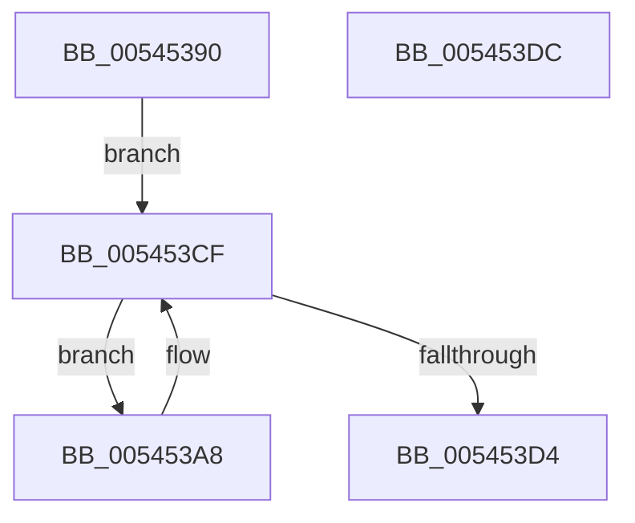

# HalpDisableCmciOnProcessor

- RVA: `0x00545390`–`0x005453DD` (길이 `77` bytes)
- VA: `0x0000000140545390`
- 실행 섹션: `.text`
- PDB 이름 있음: `예`; PDB Function 태그: `아니요`
- unwind 정보 RVA: `0x0005CF00`
- 디코드: `19`개 명령, `77/77` bytes 표시
- 미해석 바이트: `0` (있으면 어셈블리에 `.byte`로 보존)

> 이 문서는 커널 이미지의 기계어와 PDB 기호를 분석해 생성했습니다. 4번과 5번은 함수 원형과 자료형을 바이너리 사용 방식에서 추정한 C 해석이며 원본 소스 복구 결과는 아닙니다.

## 1. Dependencies

- 직접 호출 지점: **1**; 고유 호출 대상: **1**
- 직접 호출자로 확인된 함수: **0**
- RIP 상대 이미지 참조: **1**

### Outgoing calls
- `0x005453C3` → [HalpCmciSetProcessorConfig](../48/HalpCmciSetProcessorConfig_function_00487A04.md) (function, `0x00487A04`)

### Direct callers
- 이 함수 시작 RVA로 연결되는 직접 call은 확인되지 않았습니다. 간접 호출은 완전히 역산할 수 없습니다.

### Static image references
- `0x005453A8` → RVA `0x00E0F6C8` (`.data`; read)

## 2. Other-region calls and transfers

- 다른 실행 섹션으로 향하는 call: **0**
- 별도 외부 분기/꼬리 이동을 확인하지 못했습니다.

## 3. Assembly (complete function range)

```asm
00545390  40 53                           push rbx
00545392  48 83 EC 20                     sub rsp, 0x20
00545396  65 48 8B 04 25 18 00 00 00      mov rax, qword ptr gs:[0x18]
0054539F  48 8B 98 D8 00 00 00            mov rbx, qword ptr [rax + 0xd8]
005453A6  EB 27                           jmp 0x1405453cf
005453A8  48 8B 0D 19 A3 8C 00            mov rcx, qword ptr [rip + 0x8ca319]
005453AF  33 D2                           xor edx, edx
005453B1  4C 8B 83 AC 00 00 00            mov r8, qword ptr [rbx + 0xac]
005453B8  C6 83 80 00 00 00 01            mov byte ptr [rbx + 0x80], 1
005453BF  C6 41 30 00                     mov byte ptr [rcx + 0x30], 0
005453C3  E8 3C 26 F4 FF                  call 0x140487a04
005453C8  48 8B 9B B8 00 00 00            mov rbx, qword ptr [rbx + 0xb8]
005453CF  48 85 DB                        test rbx, rbx
005453D2  75 D4                           jne 0x1405453a8
005453D4  33 C0                           xor eax, eax
005453D6  48 83 C4 20                     add rsp, 0x20
005453DA  5B                              pop rbx
005453DB  C3                              ret
005453DC  CC                              int3
```

## 4. C-style interpretation (structured pseudocode)

```c
__int64 __fastcall HalpDisableCmciOnProcessor(__int64 a1, int a2)
{
    __int64 result;
    __int64 v_rsp;

    v_rsp = (v_rsp) - (32);
    goto loc_005453CF;
loc_005453A8:
    a2 = 0;
    *(unsigned __int8 *)(*(unsigned __int64 *)(*(unsigned __int64 *)(gs_base + (0 + 24)) + 216) + 128) = 1;
    *(unsigned __int8 *)(*(unsigned __int64 *)(v_rip + 9216793) + 48) = 0;
    result = HalpCmciSetProcessorConfig(*(unsigned __int64 *)(v_rip + 9216793), a2, *(unsigned __int64 *)(*(unsigned __int64 *)(*(unsigned __int64 *)(gs_base + (0 + 24)) + 216) + 172), a4);
loc_005453CF:
    if (*(unsigned __int64 *)(*(unsigned __int64 *)(*(unsigned __int64 *)(gs_base + (0 + 24)) + 216) + 184) != 0) goto loc_005453A8;
    result = 0;
    v_rsp = (v_rsp) + (32);
    return result;
}
```

## 5. (Beta) C Style

```c
int64_t HalpDisableCmciOnProcessor(int64_t Arg1, int32_t Arg2)
{
    int64_t result;
    int64_t local_rsp;

    local_rsp = (local_rsp) - (32);
    goto loc_005453CF;
loc_005453A8:
    Arg2 = 0;
    *(uint8_t *)(*(uint64_t *)(*(uint64_t *)(gs_base + (0 + 0x18)) + 0xD8) + 0x80) = 1;
    *(uint8_t *)(*(uint64_t *)(v_rip + 0x8CA319) + 0x30) = 0;
    result = HalpCmciSetProcessorConfig(*(uint64_t *)(v_rip + 0x8CA319), Arg2, *(uint64_t *)(*(uint64_t *)(*(uint64_t *)(gs_base + (0 + 0x18)) + 0xD8) + 0xAC), a4);
loc_005453CF:
    if (*(uint64_t *)(*(uint64_t *)(*(uint64_t *)(gs_base + (0 + 0x18)) + 0xD8) + 0xB8) != 0) goto loc_005453A8;
    result = 0;
    local_rsp = (local_rsp) + (32);
    return result;
}
```

## 6. Execution-region graph

[열기: 2D/3D 그래프와 함수 탐색 컨트롤 패널](../../../control-panel.html?section=text&rva=0x00545390&view=graph)

- 2D 그래프는 위에서 아래로 흐르고, 3D 그래프는 빈 공간을 드래그해 회전합니다. Shift+드래그는 이동, 휠은 확대·축소, 함수 노드 선택은 대상 보고서 이동입니다.

### Static fallback


