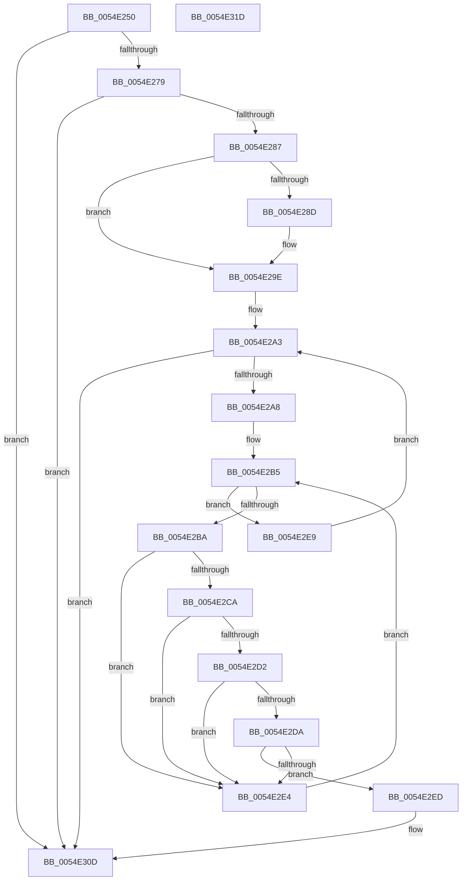

# HalpEfiBugCheckAddPagesCallback

- RVA: `0x0054E250`–`0x0054E31E` (길이 `206` bytes)
- VA: `0x000000014054E250`
- 실행 섹션: `.text`
- PDB 이름 있음: `예`; PDB Function 태그: `아니요`
- unwind 정보 RVA: `0x00060BC4`
- 디코드: `53`개 명령, `206/206` bytes 표시
- 미해석 바이트: `0` (있으면 어셈블리에 `.byte`로 보존)

> 이 문서는 커널 이미지의 기계어와 PDB 기호를 분석해 생성했습니다. 4번과 5번은 함수 원형과 자료형을 바이너리 사용 방식에서 추정한 C 해석이며 원본 소스 복구 결과는 아닙니다.

## 1. Dependencies

- 직접 호출 지점: **1**; 고유 호출 대상: **1**
- 직접 호출자로 확인된 함수: **0**
- RIP 상대 이미지 참조: **5**

### Outgoing calls
- `0x0054E2AA` → [HalQueryMaximumProcessorCount](../4A/HalQueryMaximumProcessorCount_function_004AC9A0.md) (function, `0x004AC9A0`)

### Direct callers
- 이 함수 시작 RVA로 연결되는 직접 call은 확인되지 않았습니다. 간접 호출은 완전히 역산할 수 없습니다.

### Static image references
- `0x0054E26C` → RVA `0x00FC1A28` (`.data`; read)
- `0x0054E279` → RVA `0x00FC19B0` (`.data`; read)
- `0x0054E28D` → RVA `0x00FC1A2C` (`.data`; read)
- `0x0054E297` → RVA `0x00FC1A2C` (`.data`; read/write)
- `0x0054E2DA` → RVA `0x01201870` (`CFGRO`; read)

## 2. Other-region calls and transfers

- 다른 실행 섹션으로 향하는 call: **0**
- 별도 외부 분기/꼬리 이동을 확인하지 못했습니다.

## 3. Assembly (complete function range)

```asm
0054E250  48 89 5C 24 08                  mov qword ptr [rsp + 8], rbx
0054E255  48 89 74 24 10                  mov qword ptr [rsp + 0x10], rsi
0054E25A  57                              push rdi
0054E25B  48 83 EC 20                     sub rsp, 0x20
0054E25F  49 83 60 18 00                  and qword ptr [r8 + 0x18], 0
0054E264  49 8B D8                        mov rbx, r8
0054E267  41 83 60 08 00                  and dword ptr [r8 + 8], 0
0054E26C  80 3D B5 37 A7 00 00            cmp byte ptr [rip + 0xa737b5], 0
0054E273  0F 84 94 00 00 00               je 0x14054e30d
0054E279  48 83 3D 2F 37 A7 00 00         cmp qword ptr [rip + 0xa7372f], 0
0054E281  0F 84 86 00 00 00               je 0x14054e30d
0054E287  49 83 38 00                     cmp qword ptr [r8], 0
0054E28B  75 11                           jne 0x14054e29e
0054E28D  48 8D 05 98 37 A7 00            lea rax, [rip + 0xa73798]
0054E294  49 89 00                        mov qword ptr [r8], rax
0054E297  83 25 8E 37 A7 00 00            and dword ptr [rip + 0xa7378e], 0
0054E29E  49 8B 30                        mov rsi, qword ptr [r8]
0054E2A1  8B 3E                           mov edi, dword ptr [rsi]
0054E2A3  83 FF 09                        cmp edi, 9
0054E2A6  73 65                           jae 0x14054e30d
0054E2A8  FF 06                           inc dword ptr [rsi]
0054E2AA  E8 F1 E6 F5 FF                  call 0x1404ac9a0
0054E2AF  44 8B C8                        mov r9d, eax
0054E2B2  45 33 C0                        xor r8d, r8d
0054E2B5  45 3B C1                        cmp r8d, r9d
0054E2B8  73 2F                           jae 0x14054e2e9
0054E2BA  48 8B 0D EF 36 A7 00            mov rcx, qword ptr [rip + 0xa736ef]
0054E2C1  4A 8B 04 C1                     mov rax, qword ptr [rcx + r8*8]
0054E2C5  48 85 C0                        test rax, rax
0054E2C8  74 1A                           je 0x14054e2e4
0054E2CA  48 05 C0 00 00 00               add rax, 0xc0
0054E2D0  74 12                           je 0x14054e2e4
0054E2D2  8B 40 20                        mov eax, dword ptr [rax + 0x20]
0054E2D5  0F A3 F8                        bt eax, edi
0054E2D8  73 0A                           jae 0x14054e2e4
0054E2DA  48 83 3D 8E 35 CB 00 00         cmp qword ptr [rip + 0xcb358e], 0
0054E2E2  75 09                           jne 0x14054e2ed
0054E2E4  41 FF C0                        inc r8d
0054E2E7  EB CC                           jmp 0x14054e2b5
0054E2E9  FF C7                           inc edi
0054E2EB  EB B6                           jmp 0x14054e2a3
0054E2ED  8B C7                           mov eax, edi
0054E2EF  48 8D 0D 7A 35 CB 00            lea rcx, [rip + 0xcb357a]
0054E2F6  C7 43 08 01 00 00 80            mov dword ptr [rbx + 8], 0x80000001
0054E2FD  48 8B 04 C1                     mov rax, qword ptr [rcx + rax*8]
0054E301  48 89 43 10                     mov qword ptr [rbx + 0x10], rax
0054E305  48 C7 43 18 01 00 00 00         mov qword ptr [rbx + 0x18], 1
0054E30D  48 8B 5C 24 30                  mov rbx, qword ptr [rsp + 0x30]
0054E312  48 8B 74 24 38                  mov rsi, qword ptr [rsp + 0x38]
0054E317  48 83 C4 20                     add rsp, 0x20
0054E31B  5F                              pop rdi
0054E31C  C3                              ret
0054E31D  CC                              int3
```

## 4. C-style interpretation (structured pseudocode)

```c
__int64 __fastcall HalpEfiBugCheckAddPagesCallback(__int64 a1, __int64 a2, __int64 a3)
{
    __int64 result;
    __int64 v_rdi;
    __int64 v_rsp;
    unsigned __int64 v_stack_p10;
    unsigned __int64 v_stack_p8;

    v_stack_p8 = v_rbx;
    v_stack_p10 = v_rsi;
    v_rsp = (v_rsp) - (32);
    if ((*(unsigned __int8 *)(v_rip + 10958773)) == 0) goto loc_0054E30D;
    if ((*(unsigned __int64 *)(v_rip + 10958639)) == 0) goto loc_0054E30D;
    if ((*(unsigned __int64 *)(a3)) == 0) {
        result = v_rip + 10958744;
        *(unsigned __int64 *)(a3) = result;
    }
loc_0054E2A3:
    if (((unsigned int)((unsigned int)(*(unsigned int *)(*(unsigned __int64 *)(a3))))) >= 9) goto loc_0054E30D;
    result = HalQueryMaximumProcessorCount(a1, a2, a3, a4);
    a3 = 0;
loc_0054E2B5:
    if (0 >= ((unsigned int)((unsigned int)((unsigned int)(result))))) goto loc_0054E2E9;
    if (*(unsigned __int64 *)(*(unsigned __int64 *)(v_rip + 10958575) + a3 * 8) == 0) goto loc_0054E2E4;
    result = (*(unsigned __int64 *)(*(unsigned __int64 *)(v_rip + 10958575) + a3 * 8)) + (192);
    if (condition_is_equal) goto loc_0054E2E4;
    if (condition_is_above_or_equal) goto loc_0054E2E4;
    if ((*(unsigned __int64 *)(v_rip + 13317518)) != 0) goto loc_0054E2ED;
loc_0054E2E4:
    a3 = (unsigned int)((a3) + 1);
    goto loc_0054E2B5;
loc_0054E2E9:
    v_rdi = (unsigned int)(((unsigned int)(*(unsigned int *)(*(unsigned __int64 *)(a3)))) + 1);
    goto loc_0054E2A3;
loc_0054E2ED:
    *(unsigned int *)(a3 + 8) = 0x80000001ULL;
    *(unsigned __int64 *)(a3 + 16) = *(unsigned __int64 *)(v_rip + 13317498 + (unsigned int)((unsigned int)(v_rdi)) * 8);
    *(unsigned __int64 *)(a3 + 24) = 1;
loc_0054E30D:
    v_rsp = (v_rsp) + (32);
    return *(unsigned __int64 *)(v_rip + 13317498 + (unsigned int)((unsigned int)(v_rdi)) * 8);
}
```

## 5. (Beta) C Style

```c
int64_t HalpEfiBugCheckAddPagesCallback(int64_t Arg1, int64_t Arg2, void *Arg3)
{
    uint8_t *arg3 = (uint8_t *)Arg3;

    int64_t result;
    int64_t local_rdi;
    int64_t local_rsp;
    uint64_t v_stack_p10;
    uint64_t v_stack_p8;

    v_stack_p8 = local_rbx;
    v_stack_p10 = local_rsi;
    local_rsp = (local_rsp) - (32);
    if ((*(uint8_t *)(v_rip + 0xA737B5)) == 0) goto loc_0054E30D;
    if ((*(uint64_t *)(v_rip + 0xA7372F)) == 0) goto loc_0054E30D;
    if ((*(uint64_t *)(arg3)) == 0) {
        result = v_rip + 10958744;
        *(uint64_t *)(arg3) = result;
    }
loc_0054E2A3:
    if (((uint32_t)((uint32_t)(*(uint32_t *)(*(uint64_t *)(arg3))))) >= 9) goto loc_0054E30D;
    result = HalQueryMaximumProcessorCount(Arg1, Arg2, Arg3, a4);
    Arg3 = 0;
loc_0054E2B5:
    if (0 >= ((uint32_t)((uint32_t)((uint32_t)(result))))) goto loc_0054E2E9;
    if (*(uint64_t *)(*(uint64_t *)(v_rip + 0xA736EF) + arg3 * 8) == 0) goto loc_0054E2E4;
    result = (*(uint64_t *)(*(uint64_t *)(v_rip + 0xA736EF) + arg3 * 8)) + (192);
    if (condition_is_equal) goto loc_0054E2E4;
    if (condition_is_above_or_equal) goto loc_0054E2E4;
    if ((*(uint64_t *)(v_rip + 0xCB358E)) != 0) goto loc_0054E2ED;
loc_0054E2E4:
    Arg3 = (uint32_t)((Arg3) + 1);
    goto loc_0054E2B5;
loc_0054E2E9:
    local_rdi = (uint32_t)(((uint32_t)(*(uint32_t *)(*(uint64_t *)(arg3)))) + 1);
    goto loc_0054E2A3;
loc_0054E2ED:
    *(uint32_t *)(arg3 + 0x8) = 0x80000001ULL;
    *(uint64_t *)(arg3 + 0x10) = *(uint64_t *)(v_rip + 0xCB357A + (uint32_t)((uint32_t)(local_rdi)) * 8);
    *(uint64_t *)(arg3 + 0x18) = 1;
loc_0054E30D:
    local_rsp = (local_rsp) + (32);
    return *(uint64_t *)(v_rip + 0xCB357A + (uint32_t)((uint32_t)(local_rdi)) * 8);
}
```

### 관측된 메모리 오프셋

구조체 형식이 확인되지 않은 접근은 인자 기준의 오프셋으로만 기록했습니다.

| 기준 인자 | 오프셋 표현 | 폭 (bit) | 접근 |
|---|---:|---:|---|
| `Arg3` | `+ 0x0` | `64` | `R` |
| `Arg3` | `+ 0x0` | `64` | `W` |
| `Arg3` | `+ 0x8` | `32` | `R/W` |
| `Arg3` | `+ 0x8` | `32` | `W` |
| `Arg3` | `+ 0x10` | `64` | `W` |
| `Arg3` | `+ 0x18` | `64` | `R/W` |
| `Arg3` | `+ 0x18` | `64` | `W` |

## 6. Execution-region graph

[열기: 2D/3D 그래프와 함수 탐색 컨트롤 패널](../../../control-panel.html?section=text&rva=0x0054E250&view=graph)

- 2D 그래프는 위에서 아래로 흐르고, 3D 그래프는 빈 공간을 드래그해 회전합니다. Shift+드래그는 이동, 휠은 확대·축소, 함수 노드 선택은 대상 보고서 이동입니다.

### Static fallback


