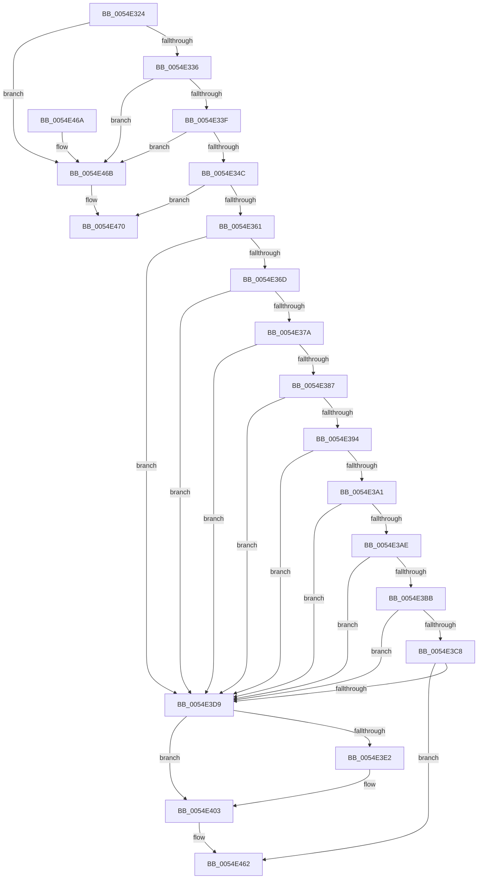

# HalpEfiInitializeOnResume

- RVA: `0x0054E324`–`0x0054E48D` (길이 `361` bytes)
- VA: `0x000000014054E324`
- 실행 섹션: `.text`
- PDB 이름 있음: `예`; PDB Function 태그: `아니요`
- unwind 정보 RVA: `0x00092370`
- 디코드: `81`개 명령, `361/361` bytes 표시
- 미해석 바이트: `0` (있으면 어셈블리에 `.byte`로 보존)

> 이 문서는 커널 이미지의 기계어와 PDB 기호를 분석해 생성했습니다. 4번과 5번은 함수 원형과 자료형을 바이너리 사용 방식에서 추정한 C 해석이며 원본 소스 복구 결과는 아닙니다.

## 1. Dependencies

- 직접 호출 지점: **3**; 고유 호출 대상: **2**
- 직접 호출자로 확인된 함수: **1**
- RIP 상대 이미지 참조: **19**

### Outgoing calls
- `0x0054E351` → [HalpSetResumeTime](../55/HalpSetResumeTime_function_0055BC08.md) (function, `0x0055BC08`)
- `0x0054E3FD` → [KeBugCheckEx](../4F/KeBugCheckEx_function_004FD660.md) (function, `0x004FD660`)
- `0x0054E487` → [KeBugCheckEx](../4F/KeBugCheckEx_function_004FD660.md) (function, `0x004FD660`)

### Direct callers
- [HalInitializeOnResume](../4F/HalInitializeOnResume_function_004F8220.md) at `0x004F822E`

### Static image references
- `0x0054E364` → RVA `0x01201870` (`CFGRO`; read)
- `0x0054E371` → RVA `0x01201878` (`CFGRO`; read)
- `0x0054E37E` → RVA `0x01201880` (`CFGRO`; read)
- `0x0054E38B` → RVA `0x01201888` (`CFGRO`; read)
- `0x0054E398` → RVA `0x01201898` (`CFGRO`; read)
- `0x0054E3A5` → RVA `0x01201890` (`CFGRO`; read)
- `0x0054E3B2` → RVA `0x012018A0` (`CFGRO`; read)
- `0x0054E3BF` → RVA `0x012018A8` (`CFGRO`; read)
- `0x0054E3CC` → RVA `0x012018B0` (`CFGRO`; read)
- `0x0054E3D9` → RVA `0x00F8FB90` (`.data`; read)
- `0x0054E403` → RVA `0x01201870` (`CFGRO`; write)
- `0x0054E40E` → RVA `0x01201878` (`CFGRO`; write)
- `0x0054E419` → RVA `0x01201880` (`CFGRO`; write)
- `0x0054E424` → RVA `0x01201888` (`CFGRO`; write)
- `0x0054E42F` → RVA `0x01201898` (`CFGRO`; write)
- `0x0054E43A` → RVA `0x01201890` (`CFGRO`; write)
- `0x0054E445` → RVA `0x012018A0` (`CFGRO`; write)
- `0x0054E450` → RVA `0x012018A8` (`CFGRO`; write)
- `0x0054E45B` → RVA `0x012018B0` (`CFGRO`; write)

## 2. Other-region calls and transfers

- 다른 실행 섹션으로 향하는 call: **0**
- 별도 외부 분기/꼬리 이동을 확인하지 못했습니다.

## 3. Assembly (complete function range)

```asm
0054E324  40 53                           push rbx
0054E326  48 83 EC 30                     sub rsp, 0x30
0054E32A  48 8B DA                        mov rbx, rdx
0054E32D  48 85 C9                        test rcx, rcx
0054E330  0F 84 35 01 00 00               je 0x14054e46b
0054E336  48 85 D2                        test rdx, rdx
0054E339  0F 84 2C 01 00 00               je 0x14054e46b
0054E33F  81 79 28 90 00 00 00            cmp dword ptr [rcx + 0x28], 0x90
0054E346  0F 82 1F 01 00 00               jb 0x14054e46b
0054E34C  33 D2                           xor edx, edx
0054E34E  48 8B CB                        mov rcx, rbx
0054E351  E8 B2 D8 00 00                  call 0x14055bc08
0054E356  8B 53 70                        mov edx, dword ptr [rbx + 0x70]
0054E359  85 D2                           test edx, edx
0054E35B  0F 88 0F 01 00 00               js 0x14054e470
0054E361  48 8B 0B                        mov rcx, qword ptr [rbx]
0054E364  48 39 0D 05 35 CB 00            cmp qword ptr [rip + 0xcb3505], rcx
0054E36B  75 6C                           jne 0x14054e3d9
0054E36D  48 8B 43 08                     mov rax, qword ptr [rbx + 8]
0054E371  48 39 05 00 35 CB 00            cmp qword ptr [rip + 0xcb3500], rax
0054E378  75 5F                           jne 0x14054e3d9
0054E37A  48 8B 43 50                     mov rax, qword ptr [rbx + 0x50]
0054E37E  48 39 05 FB 34 CB 00            cmp qword ptr [rip + 0xcb34fb], rax
0054E385  75 52                           jne 0x14054e3d9
0054E387  48 8B 43 30                     mov rax, qword ptr [rbx + 0x30]
0054E38B  48 39 05 F6 34 CB 00            cmp qword ptr [rip + 0xcb34f6], rax
0054E392  75 45                           jne 0x14054e3d9
0054E394  48 8B 43 40                     mov rax, qword ptr [rbx + 0x40]
0054E398  48 39 05 F9 34 CB 00            cmp qword ptr [rip + 0xcb34f9], rax
0054E39F  75 38                           jne 0x14054e3d9
0054E3A1  48 8B 43 38                     mov rax, qword ptr [rbx + 0x38]
0054E3A5  48 39 05 E4 34 CB 00            cmp qword ptr [rip + 0xcb34e4], rax
0054E3AC  75 2B                           jne 0x14054e3d9
0054E3AE  48 8B 43 58                     mov rax, qword ptr [rbx + 0x58]
0054E3B2  48 39 05 E7 34 CB 00            cmp qword ptr [rip + 0xcb34e7], rax
0054E3B9  75 1E                           jne 0x14054e3d9
0054E3BB  48 8B 43 60                     mov rax, qword ptr [rbx + 0x60]
0054E3BF  48 39 05 E2 34 CB 00            cmp qword ptr [rip + 0xcb34e2], rax
0054E3C6  75 11                           jne 0x14054e3d9
0054E3C8  48 8B 43 68                     mov rax, qword ptr [rbx + 0x68]
0054E3CC  48 39 05 DD 34 CB 00            cmp qword ptr [rip + 0xcb34dd], rax
0054E3D3  0F 84 89 00 00 00               je 0x14054e462
0054E3D9  80 3D B0 17 A4 00 00            cmp byte ptr [rip + 0xa417b0], 0
0054E3E0  74 21                           je 0x14054e403
0054E3E2  48 83 64 24 20 00               and qword ptr [rsp + 0x20], 0
0054E3E8  B9 5C 00 00 00                  mov ecx, 0x5c
0054E3ED  BA 01 50 00 00                  mov edx, 0x5001
0054E3F2  49 C7 C0 18 00 00 C0            mov r8, 0xffffffffc0000018
0054E3F9  44 8D 49 A5                     lea r9d, [rcx - 0x5b]
0054E3FD  E8 5E F2 FA FF                  call 0x1404fd660
0054E402  CC                              int3
0054E403  48 89 0D 66 34 CB 00            mov qword ptr [rip + 0xcb3466], rcx
0054E40A  48 8B 43 08                     mov rax, qword ptr [rbx + 8]
0054E40E  48 89 05 63 34 CB 00            mov qword ptr [rip + 0xcb3463], rax
0054E415  48 8B 43 50                     mov rax, qword ptr [rbx + 0x50]
0054E419  48 89 05 60 34 CB 00            mov qword ptr [rip + 0xcb3460], rax
0054E420  48 8B 4B 30                     mov rcx, qword ptr [rbx + 0x30]
0054E424  48 89 0D 5D 34 CB 00            mov qword ptr [rip + 0xcb345d], rcx
0054E42B  48 8B 4B 40                     mov rcx, qword ptr [rbx + 0x40]
0054E42F  48 89 0D 62 34 CB 00            mov qword ptr [rip + 0xcb3462], rcx
0054E436  48 8B 4B 38                     mov rcx, qword ptr [rbx + 0x38]
0054E43A  48 89 0D 4F 34 CB 00            mov qword ptr [rip + 0xcb344f], rcx
0054E441  48 8B 4B 58                     mov rcx, qword ptr [rbx + 0x58]
0054E445  48 89 0D 54 34 CB 00            mov qword ptr [rip + 0xcb3454], rcx
0054E44C  48 8B 4B 60                     mov rcx, qword ptr [rbx + 0x60]
0054E450  48 89 0D 51 34 CB 00            mov qword ptr [rip + 0xcb3451], rcx
0054E457  48 8B 4B 68                     mov rcx, qword ptr [rbx + 0x68]
0054E45B  48 89 0D 4E 34 CB 00            mov qword ptr [rip + 0xcb344e], rcx
0054E462  8B C2                           mov eax, edx
0054E464  48 83 C4 30                     add rsp, 0x30
0054E468  5B                              pop rbx
0054E469  C3                              ret
0054E46A  CC                              int3
0054E46B  BA 0D 00 00 C0                  mov edx, 0xc000000d
0054E470  48 83 64 24 20 00               and qword ptr [rsp + 0x20], 0
0054E476  B9 5C 00 00 00                  mov ecx, 0x5c
0054E47B  4C 63 C2                        movsxd r8, edx
0054E47E  BA 00 50 00 00                  mov edx, 0x5000
0054E483  44 8D 49 A5                     lea r9d, [rcx - 0x5b]
0054E487  E8 D4 F1 FA FF                  call 0x1404fd660
0054E48C  CC                              int3
```

## 4. C-style interpretation (structured pseudocode)

```c
__int64 __fastcall HalpEfiInitializeOnResume(__int64 a1, __int64 a2)
{
    __int64 result;
    __int64 v_rsp;
    unsigned __int64 v_stack_m18;
    unsigned __int64 v_stack_p20;

    v_rsp = (v_rsp) - (48);
    if (a1 == 0) goto loc_0054E46B;
    if (a2 == 0) goto loc_0054E46B;
    if ((*(unsigned int *)(a1 + 40)) < 144) goto loc_0054E46B;
    a2 = 0;
    result = HalpSetResumeTime(0, a2, a3, a4);
    if (sign_flag) goto loc_0054E470;
    if ((*(unsigned __int64 *)(v_rip + 13317381)) != (*(unsigned __int64 *)(a2))) goto loc_0054E3D9;
    if ((*(unsigned __int64 *)(v_rip + 13317376)) != (*(unsigned __int64 *)(a2 + 8))) goto loc_0054E3D9;
    if ((*(unsigned __int64 *)(v_rip + 13317371)) != (*(unsigned __int64 *)(a2 + 80))) goto loc_0054E3D9;
    if ((*(unsigned __int64 *)(v_rip + 13317366)) != (*(unsigned __int64 *)(a2 + 48))) goto loc_0054E3D9;
    if ((*(unsigned __int64 *)(v_rip + 13317369)) != (*(unsigned __int64 *)(a2 + 64))) goto loc_0054E3D9;
    if ((*(unsigned __int64 *)(v_rip + 13317348)) != (*(unsigned __int64 *)(a2 + 56))) goto loc_0054E3D9;
    if ((*(unsigned __int64 *)(v_rip + 13317351)) != (*(unsigned __int64 *)(a2 + 88))) goto loc_0054E3D9;
    if ((*(unsigned __int64 *)(v_rip + 13317346)) != (*(unsigned __int64 *)(a2 + 96))) goto loc_0054E3D9;
    if ((*(unsigned __int64 *)(v_rip + 13317341)) == (*(unsigned __int64 *)(a2 + 104))) goto loc_0054E462;
loc_0054E3D9:
    result = *(unsigned __int64 *)(a2 + 104);
    if ((*(unsigned __int8 *)(v_rip + 10753968)) != 0) {
        a1 = 92;
        a2 = 0x5001ULL;
        a3 = 0xFFFFFFFFC0000018ULL;
        a4 = a1 - 91;
        result = KeBugCheckEx(a1, a2, a3, a4);
    }
    *(unsigned __int64 *)(v_rip + 13317222) = a1;
    *(unsigned __int64 *)(v_rip + 13317219) = *(unsigned __int64 *)(a2 + 8);
    *(unsigned __int64 *)(v_rip + 13317216) = *(unsigned __int64 *)(a2 + 80);
    *(unsigned __int64 *)(v_rip + 13317213) = *(unsigned __int64 *)(a2 + 48);
    *(unsigned __int64 *)(v_rip + 13317218) = *(unsigned __int64 *)(a2 + 64);
    *(unsigned __int64 *)(v_rip + 13317199) = *(unsigned __int64 *)(a2 + 56);
    *(unsigned __int64 *)(v_rip + 13317204) = *(unsigned __int64 *)(a2 + 88);
    *(unsigned __int64 *)(v_rip + 13317201) = *(unsigned __int64 *)(a2 + 96);
    *(unsigned __int64 *)(v_rip + 13317198) = *(unsigned __int64 *)(a2 + 104);
loc_0054E462:
    v_rsp = (v_rsp) + (48);
    return (unsigned int)((unsigned int)(a2));
loc_0054E46B:
loc_0054E470:
    result = KeBugCheckEx(92, (unsigned int)(0x5000ULL), (int)((unsigned int)((unsigned int)(0xC000000DULL))), 92 - 91);
    return result;
}
```

## 5. (Beta) C Style

```c
int64_t HalpEfiInitializeOnResume(int64_t Arg1, void *Arg2)
{
    uint8_t *arg2 = (uint8_t *)Arg2;

    int64_t result;
    int64_t local_rsp;
    uint64_t v_stack_m18;
    uint64_t v_stack_p20;

    local_rsp = (local_rsp) - (48);
    if (Arg1 == 0) goto loc_0054E46B;
    if (Arg2 == NULL) goto loc_0054E46B;
    if ((*(uint32_t *)(Arg1 + 0x28)) < 144) goto loc_0054E46B;
    Arg2 = 0;
    result = HalpSetResumeTime(0, Arg2, a3, a4);
    if (sign_flag) goto loc_0054E470;
    if ((*(uint64_t *)(v_rip + 0xCB3505)) != (*(uint64_t *)(arg2))) goto loc_0054E3D9;
    if ((*(uint64_t *)(v_rip + 0xCB3500)) != (*(uint64_t *)(arg2 + 0x8))) goto loc_0054E3D9;
    if ((*(uint64_t *)(v_rip + 0xCB34FB)) != (*(uint64_t *)(arg2 + 0x50))) goto loc_0054E3D9;
    if ((*(uint64_t *)(v_rip + 0xCB34F6)) != (*(uint64_t *)(arg2 + 0x30))) goto loc_0054E3D9;
    if ((*(uint64_t *)(v_rip + 0xCB34F9)) != (*(uint64_t *)(arg2 + 0x40))) goto loc_0054E3D9;
    if ((*(uint64_t *)(v_rip + 0xCB34E4)) != (*(uint64_t *)(arg2 + 0x38))) goto loc_0054E3D9;
    if ((*(uint64_t *)(v_rip + 0xCB34E7)) != (*(uint64_t *)(arg2 + 0x58))) goto loc_0054E3D9;
    if ((*(uint64_t *)(v_rip + 0xCB34E2)) != (*(uint64_t *)(arg2 + 0x60))) goto loc_0054E3D9;
    if ((*(uint64_t *)(v_rip + 0xCB34DD)) == (*(uint64_t *)(arg2 + 0x68))) goto loc_0054E462;
loc_0054E3D9:
    result = *(uint64_t *)(arg2 + 0x68);
    if ((*(uint8_t *)(v_rip + 0xA417B0)) != 0) {
        Arg1 = 92;
        Arg2 = 0x5001ULL;
        a3 = 0xFFFFFFFFC0000018ULL;
        a4 = Arg1 - 91;
        result = KeBugCheckEx(Arg1, Arg2, a3, a4);
    }
    *(uint64_t *)(v_rip + 0xCB3466) = Arg1;
    *(uint64_t *)(v_rip + 0xCB3463) = *(uint64_t *)(arg2 + 0x8);
    *(uint64_t *)(v_rip + 0xCB3460) = *(uint64_t *)(arg2 + 0x50);
    *(uint64_t *)(v_rip + 0xCB345D) = *(uint64_t *)(arg2 + 0x30);
    *(uint64_t *)(v_rip + 0xCB3462) = *(uint64_t *)(arg2 + 0x40);
    *(uint64_t *)(v_rip + 0xCB344F) = *(uint64_t *)(arg2 + 0x38);
    *(uint64_t *)(v_rip + 0xCB3454) = *(uint64_t *)(arg2 + 0x58);
    *(uint64_t *)(v_rip + 0xCB3451) = *(uint64_t *)(arg2 + 0x60);
    *(uint64_t *)(v_rip + 0xCB344E) = *(uint64_t *)(arg2 + 0x68);
loc_0054E462:
    local_rsp = (local_rsp) + (48);
    return (uint32_t)((uint32_t)(Arg2));
loc_0054E46B:
loc_0054E470:
    result = KeBugCheckEx(92, (uint32_t)(0x5000ULL), (int32_t)((uint32_t)((uint32_t)(0xC000000DULL))), 92 - 91);
    return result;
}
```

### 관측된 메모리 오프셋

구조체 형식이 확인되지 않은 접근은 인자 기준의 오프셋으로만 기록했습니다.

| 기준 인자 | 오프셋 표현 | 폭 (bit) | 접근 |
|---|---:|---:|---|
| `Arg2` | `+ 0x0` | `64` | `R` |
| `Arg2` | `+ 0x8` | `64` | `R` |
| `Arg2` | `+ 0x30` | `64` | `R` |
| `Arg2` | `+ 0x38` | `64` | `R` |
| `Arg2` | `+ 0x40` | `64` | `R` |
| `Arg2` | `+ 0x50` | `64` | `R` |
| `Arg2` | `+ 0x58` | `64` | `R` |
| `Arg2` | `+ 0x60` | `64` | `R` |
| `Arg2` | `+ 0x68` | `64` | `R` |
| `Arg2` | `+ 0x70` | `32` | `R` |

## 6. Execution-region graph

[열기: 2D/3D 그래프와 함수 탐색 컨트롤 패널](../../../control-panel.html?section=text&rva=0x0054E324&view=graph)

- 2D 그래프는 위에서 아래로 흐르고, 3D 그래프는 빈 공간을 드래그해 회전합니다. Shift+드래그는 이동, 휠은 확대·축소, 함수 노드 선택은 대상 보고서 이동입니다.

### Static fallback


