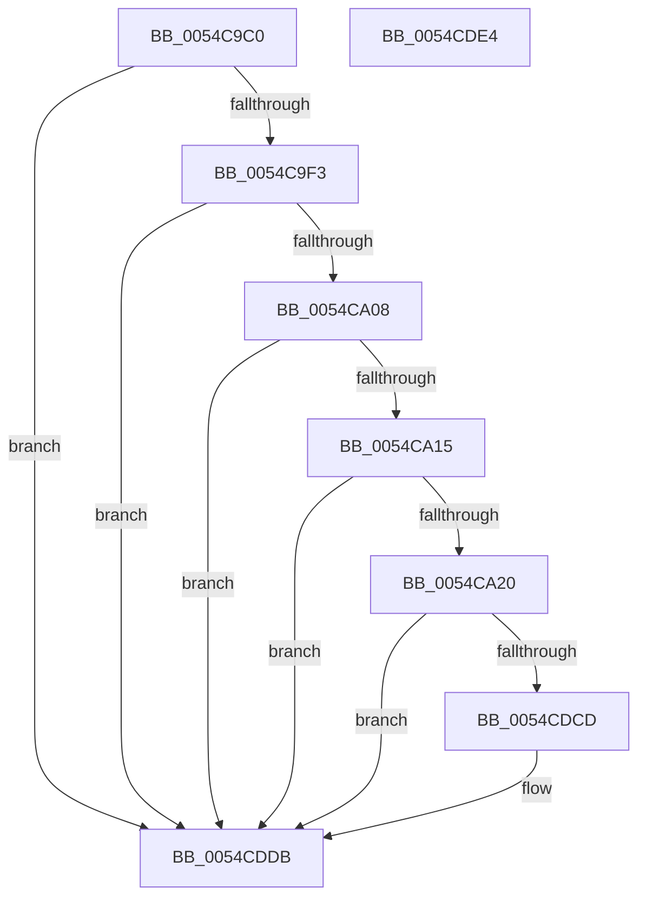

# HalpEnlightenmentInitialize

- RVA: `0x0054C9C0`–`0x0054CDE5` (길이 `1,061` bytes)
- VA: `0x000000014054C9C0`
- 실행 섹션: `.text`
- PDB 이름 있음: `예`; PDB Function 태그: `아니요`
- unwind 정보 RVA: `0x000C4034`
- 디코드: `180`개 명령, `1,061/1,061` bytes 표시
- 미해석 바이트: `0` (있으면 어셈블리에 `.byte`로 보존)

> 이 문서는 커널 이미지의 기계어와 PDB 기호를 분석해 생성했습니다. 4번과 5번은 함수 원형과 자료형을 바이너리 사용 방식에서 추정한 C 해석이며 원본 소스 복구 결과는 아닙니다.

## 1. Dependencies

- 직접 호출 지점: **3**; 고유 호출 대상: **3**
- 직접 호출자로 확인된 함수: **1**
- RIP 상대 이미지 참조: **78**

### Outgoing calls
- `0x0054C9DE` → [memset](../6C/memset_function_006C6C40.md) (function, `0x006C6C40`)
- `0x0054C9F8` → [guard_dispatch_icall](../6B/guard_dispatch_icall_function_006BAAD0.md) (function, `0x006BAAD0`)
- `0x0054CDC4` → [Feature_CvmDmaBouncing__private_IsEnabledDeviceUsageNoInline](Feature_CvmDmaBouncing__private_IsEnabledDeviceUsageNoInline_function_0054C96C.md) (function, `0x0054C96C`)

### Direct callers
- [HalpHvInitDiscard](../../init/C1/HalpHvInitDiscard_function_00C1FAFC.md) at `0x00C1FB05`

### Static image references
- `0x0054C9E3` → RVA `0x00E00970` (`.data`; read)
- `0x0054CA24` → RVA `0x00FC1C60` (`.data`; write)
- `0x0054CA2E` → RVA `0x00FC1C64` (`.data`; write)
- `0x0054CA39` → RVA `0x00FC1C7C` (`.data`; write)
- `0x0054CA3F` → RVA `0x00FC1C80` (`.data`; write)
- `0x0054CA4B` → RVA `0x00FC1C88` (`.data`; write)
- `0x0054CA57` → RVA `0x00FC1CA8` (`.data`; write)
- `0x0054CA63` → RVA `0x00FC1CB0` (`.data`; write)
- `0x0054CA6F` → RVA `0x00FC1CB8` (`.data`; write)
- `0x0054CA7B` → RVA `0x00FC1C90` (`.data`; write)
- `0x0054CA87` → RVA `0x00FC1C98` (`.data`; write)
- `0x0054CA93` → RVA `0x00FC1CA0` (`.data`; write)
- `0x0054CA9E` → RVA `0x00FC1CD0` (`.data`; write)
- `0x0054CAA9` → RVA `0x00FC1CF8` (`.data`; write)
- `0x0054CAB4` → RVA `0x00FC1D00` (`.data`; write)
- `0x0054CABF` → RVA `0x00FC1D08` (`.data`; write)
- `0x0054CACA` → RVA `0x00FC1D10` (`.data`; write)
- `0x0054CAD5` → RVA `0x00FC1D18` (`.data`; write)
- `0x0054CAE0` → RVA `0x00FC1D20` (`.data`; write)
- `0x0054CAEB` → RVA `0x00FC1D28` (`.data`; write)
- `0x0054CAF9` → RVA `0x00FC1DE8` (`.data`; write)
- `0x0054CB07` → RVA `0x00FC1DF0` (`.data`; write)
- `0x0054CB12` → RVA `0x00FC1D30` (`.data`; write)
- `0x0054CB1D` → RVA `0x00FC1D38` (`.data`; write)
- `0x0054CB28` → RVA `0x00FC1D40` (`.data`; write)
- `0x0054CB33` → RVA `0x00FC1D60` (`.data`; write)
- `0x0054CB3E` → RVA `0x00FC1D48` (`.data`; write)
- `0x0054CB49` → RVA `0x00FC1D50` (`.data`; write)
- `0x0054CB55` → RVA `0x00FC1C68` (`.data`; write)
- `0x0054CB61` → RVA `0x00FC1C70` (`.data`; write)
- `0x0054CB6C` → RVA `0x00FC1CC0` (`.data`; write)
- `0x0054CB77` → RVA `0x00FC1CC8` (`.data`; write)
- `0x0054CB82` → RVA `0x00FC1CD8` (`.data`; write)
- `0x0054CB8D` → RVA `0x00FC1CE0` (`.data`; write)
- `0x0054CB98` → RVA `0x00FC1CE8` (`.data`; write)
- `0x0054CBA3` → RVA `0x00FC1CF0` (`.data`; write)
- `0x0054CBAE` → RVA `0x00FC1D58` (`.data`; write)
- `0x0054CBB9` → RVA `0x00FC1D68` (`.data`; write)
- `0x0054CBC4` → RVA `0x00FC1D70` (`.data`; write)
- `0x0054CBCF` → RVA `0x00FC1D78` (`.data`; write)
- `0x0054CBDA` → RVA `0x00FC1D80` (`.data`; write)
- `0x0054CBE5` → RVA `0x00FC1D88` (`.data`; write)
- `0x0054CBF0` → RVA `0x00FC1D90` (`.data`; write)
- `0x0054CBFB` → RVA `0x00FC1D98` (`.data`; write)
- `0x0054CC06` → RVA `0x00FC1DA0` (`.data`; write)
- `0x0054CC11` → RVA `0x00FC1DA8` (`.data`; write)
- `0x0054CC1C` → RVA `0x00FC1DB0` (`.data`; write)
- `0x0054CC27` → RVA `0x00FC1DB8` (`.data`; write)
- `0x0054CC35` → RVA `0x00FC1DC0` (`.data`; write)
- `0x0054CC43` → RVA `0x00FC1DC8` (`.data`; write)
- `0x0054CC51` → RVA `0x00FC1DD0` (`.data`; write)
- `0x0054CC5F` → RVA `0x00FC1DD8` (`.data`; write)
- `0x0054CC6D` → RVA `0x00FC1DE0` (`.data`; write)
- `0x0054CC7B` → RVA `0x00FC1DF8` (`.data`; write)
- `0x0054CC89` → RVA `0x00FC1E00` (`.data`; write)
- `0x0054CC97` → RVA `0x00FC1E08` (`.data`; write)
- `0x0054CCA5` → RVA `0x00FC1E10` (`.data`; write)
- `0x0054CCB3` → RVA `0x00FC1E18` (`.data`; write)
- `0x0054CCC1` → RVA `0x00FC1E20` (`.data`; write)
- `0x0054CCCF` → RVA `0x00FC1E50` (`.data`; write)
- `0x0054CCDD` → RVA `0x00FC1E58` (`.data`; write)
- `0x0054CCEB` → RVA `0x00FC1E70` (`.data`; write)
- `0x0054CCF9` → RVA `0x00FC1E78` (`.data`; write)
- `0x0054CD07` → RVA `0x00FC1E28` (`.data`; write)
- `0x0054CD15` → RVA `0x00FC1E30` (`.data`; write)
- `0x0054CD23` → RVA `0x00FC1E38` (`.data`; write)
- `0x0054CD31` → RVA `0x00FC1E40` (`.data`; write)
- `0x0054CD3F` → RVA `0x00FC1E48` (`.data`; write)
- `0x0054CD4D` → RVA `0x00FC1E88` (`.data`; write)
- `0x0054CD5B` → RVA `0x00FC1E98` (`.data`; write)
- `0x0054CD69` → RVA `0x00FC1E90` (`.data`; write)
- `0x0054CD77` → RVA `0x00FC1EA0` (`.data`; write)
- `0x0054CD85` → RVA `0x00FC1EA8` (`.data`; write)
- `0x0054CD93` → RVA `0x00FC1EB0` (`.data`; write)
- `0x0054CDA1` → RVA `0x00FC1E68` (`.data`; write)
- `0x0054CDAF` → RVA `0x00FC1EB8` (`.data`; write)
- `0x0054CDBD` → RVA `0x00FC1EC0` (`.data`; write)
- `0x0054CDD4` → RVA `0x00FC1EC8` (`.data`; write)

## 2. Other-region calls and transfers

- 다른 실행 섹션으로 향하는 call: **0**
- 별도 외부 분기/꼬리 이동을 확인하지 못했습니다.

## 3. Assembly (complete function range)

```asm
0054C9C0  40 55                           push rbp
0054C9C2  48 8D AC 24 70 FE FF FF         lea rbp, [rsp - 0x190]
0054C9CA  48 81 EC 90 02 00 00            sub rsp, 0x290
0054C9D1  33 D2                           xor edx, edx
0054C9D3  48 8D 4C 24 20                  lea rcx, [rsp + 0x20]
0054C9D8  41 B8 70 02 00 00               mov r8d, 0x270
0054C9DE  E8 5D A2 17 00                  call 0x1406c6c40
0054C9E3  48 8B 05 86 3F 8B 00            mov rax, qword ptr [rip + 0x8b3f86]
0054C9EA  48 85 C0                        test rax, rax
0054C9ED  0F 84 E8 03 00 00               je 0x14054cddb
0054C9F3  48 8D 4C 24 20                  lea rcx, [rsp + 0x20]
0054C9F8  E8 D3 E0 16 00                  call 0x1406baad0
0054C9FD  83 7C 24 38 00                  cmp dword ptr [rsp + 0x38], 0
0054CA02  0F 85 D3 03 00 00               jne 0x14054cddb
0054CA08  48 8B 4C 24 3C                  mov rcx, qword ptr [rsp + 0x3c]
0054CA0D  85 C9                           test ecx, ecx
0054CA0F  0F 84 C6 03 00 00               je 0x14054cddb
0054CA15  8D 41 01                        lea eax, [rcx + 1]
0054CA18  85 C1                           test ecx, eax
0054CA1A  0F 85 BB 03 00 00               jne 0x14054cddb
0054CA20  8B 44 24 20                     mov eax, dword ptr [rsp + 0x20]
0054CA24  89 05 36 52 A7 00               mov dword ptr [rip + 0xa75236], eax
0054CA2A  8B 44 24 24                     mov eax, dword ptr [rsp + 0x24]
0054CA2E  89 05 30 52 A7 00               mov dword ptr [rip + 0xa75230], eax
0054CA34  48 8B 44 24 40                  mov rax, qword ptr [rsp + 0x40]
0054CA39  89 0D 3D 52 A7 00               mov dword ptr [rip + 0xa7523d], ecx
0054CA3F  48 89 05 3A 52 A7 00            mov qword ptr [rip + 0xa7523a], rax
0054CA46  48 8B 44 24 48                  mov rax, qword ptr [rsp + 0x48]
0054CA4B  48 89 05 36 52 A7 00            mov qword ptr [rip + 0xa75236], rax
0054CA52  48 8B 44 24 68                  mov rax, qword ptr [rsp + 0x68]
0054CA57  48 89 05 4A 52 A7 00            mov qword ptr [rip + 0xa7524a], rax
0054CA5E  48 8B 44 24 70                  mov rax, qword ptr [rsp + 0x70]
0054CA63  48 89 05 46 52 A7 00            mov qword ptr [rip + 0xa75246], rax
0054CA6A  48 8B 44 24 78                  mov rax, qword ptr [rsp + 0x78]
0054CA6F  48 89 05 42 52 A7 00            mov qword ptr [rip + 0xa75242], rax
0054CA76  48 8B 44 24 50                  mov rax, qword ptr [rsp + 0x50]
0054CA7B  48 89 05 0E 52 A7 00            mov qword ptr [rip + 0xa7520e], rax
0054CA82  48 8B 44 24 58                  mov rax, qword ptr [rsp + 0x58]
0054CA87  48 89 05 0A 52 A7 00            mov qword ptr [rip + 0xa7520a], rax
0054CA8E  48 8B 44 24 60                  mov rax, qword ptr [rsp + 0x60]
0054CA93  48 89 05 06 52 A7 00            mov qword ptr [rip + 0xa75206], rax
0054CA9A  48 8B 45 90                     mov rax, qword ptr [rbp - 0x70]
0054CA9E  48 89 05 2B 52 A7 00            mov qword ptr [rip + 0xa7522b], rax
0054CAA5  48 8B 45 B8                     mov rax, qword ptr [rbp - 0x48]
0054CAA9  48 89 05 48 52 A7 00            mov qword ptr [rip + 0xa75248], rax
0054CAB0  48 8B 45 C0                     mov rax, qword ptr [rbp - 0x40]
0054CAB4  48 89 05 45 52 A7 00            mov qword ptr [rip + 0xa75245], rax
0054CABB  48 8B 45 C8                     mov rax, qword ptr [rbp - 0x38]
0054CABF  48 89 05 42 52 A7 00            mov qword ptr [rip + 0xa75242], rax
0054CAC6  48 8B 45 D0                     mov rax, qword ptr [rbp - 0x30]
0054CACA  48 89 05 3F 52 A7 00            mov qword ptr [rip + 0xa7523f], rax
0054CAD1  48 8B 45 D8                     mov rax, qword ptr [rbp - 0x28]
0054CAD5  48 89 05 3C 52 A7 00            mov qword ptr [rip + 0xa7523c], rax
0054CADC  48 8B 45 E0                     mov rax, qword ptr [rbp - 0x20]
0054CAE0  48 89 05 39 52 A7 00            mov qword ptr [rip + 0xa75239], rax
0054CAE7  48 8B 45 E8                     mov rax, qword ptr [rbp - 0x18]
0054CAEB  48 89 05 36 52 A7 00            mov qword ptr [rip + 0xa75236], rax
0054CAF2  48 8B 85 A8 00 00 00            mov rax, qword ptr [rbp + 0xa8]
0054CAF9  48 89 05 E8 52 A7 00            mov qword ptr [rip + 0xa752e8], rax
0054CB00  48 8B 85 B0 00 00 00            mov rax, qword ptr [rbp + 0xb0]
0054CB07  48 89 05 E2 52 A7 00            mov qword ptr [rip + 0xa752e2], rax
0054CB0E  48 8B 45 F0                     mov rax, qword ptr [rbp - 0x10]
0054CB12  48 89 05 17 52 A7 00            mov qword ptr [rip + 0xa75217], rax
0054CB19  48 8B 45 F8                     mov rax, qword ptr [rbp - 8]
0054CB1D  48 89 05 14 52 A7 00            mov qword ptr [rip + 0xa75214], rax
0054CB24  48 8B 45 00                     mov rax, qword ptr [rbp]
0054CB28  48 89 05 11 52 A7 00            mov qword ptr [rip + 0xa75211], rax
0054CB2F  48 8B 45 20                     mov rax, qword ptr [rbp + 0x20]
0054CB33  48 89 05 26 52 A7 00            mov qword ptr [rip + 0xa75226], rax
0054CB3A  48 8B 45 08                     mov rax, qword ptr [rbp + 8]
0054CB3E  48 89 05 03 52 A7 00            mov qword ptr [rip + 0xa75203], rax
0054CB45  48 8B 45 10                     mov rax, qword ptr [rbp + 0x10]
0054CB49  48 89 05 00 52 A7 00            mov qword ptr [rip + 0xa75200], rax
0054CB50  48 8B 44 24 28                  mov rax, qword ptr [rsp + 0x28]
0054CB55  48 89 05 0C 51 A7 00            mov qword ptr [rip + 0xa7510c], rax
0054CB5C  48 8B 44 24 30                  mov rax, qword ptr [rsp + 0x30]
0054CB61  48 89 05 08 51 A7 00            mov qword ptr [rip + 0xa75108], rax
0054CB68  48 8B 45 80                     mov rax, qword ptr [rbp - 0x80]
0054CB6C  48 89 05 4D 51 A7 00            mov qword ptr [rip + 0xa7514d], rax
0054CB73  48 8B 45 88                     mov rax, qword ptr [rbp - 0x78]
0054CB77  48 89 05 4A 51 A7 00            mov qword ptr [rip + 0xa7514a], rax
0054CB7E  48 8B 45 98                     mov rax, qword ptr [rbp - 0x68]
0054CB82  48 89 05 4F 51 A7 00            mov qword ptr [rip + 0xa7514f], rax
0054CB89  48 8B 45 A0                     mov rax, qword ptr [rbp - 0x60]
0054CB8D  48 89 05 4C 51 A7 00            mov qword ptr [rip + 0xa7514c], rax
0054CB94  48 8B 45 A8                     mov rax, qword ptr [rbp - 0x58]
0054CB98  48 89 05 49 51 A7 00            mov qword ptr [rip + 0xa75149], rax
0054CB9F  48 8B 45 B0                     mov rax, qword ptr [rbp - 0x50]
0054CBA3  48 89 05 46 51 A7 00            mov qword ptr [rip + 0xa75146], rax
0054CBAA  48 8B 45 18                     mov rax, qword ptr [rbp + 0x18]
0054CBAE  48 89 05 A3 51 A7 00            mov qword ptr [rip + 0xa751a3], rax
0054CBB5  48 8B 45 28                     mov rax, qword ptr [rbp + 0x28]
0054CBB9  48 89 05 A8 51 A7 00            mov qword ptr [rip + 0xa751a8], rax
0054CBC0  48 8B 45 30                     mov rax, qword ptr [rbp + 0x30]
0054CBC4  48 89 05 A5 51 A7 00            mov qword ptr [rip + 0xa751a5], rax
0054CBCB  48 8B 45 38                     mov rax, qword ptr [rbp + 0x38]
0054CBCF  48 89 05 A2 51 A7 00            mov qword ptr [rip + 0xa751a2], rax
0054CBD6  48 8B 45 40                     mov rax, qword ptr [rbp + 0x40]
0054CBDA  48 89 05 9F 51 A7 00            mov qword ptr [rip + 0xa7519f], rax
0054CBE1  48 8B 45 48                     mov rax, qword ptr [rbp + 0x48]
0054CBE5  48 89 05 9C 51 A7 00            mov qword ptr [rip + 0xa7519c], rax
0054CBEC  48 8B 45 50                     mov rax, qword ptr [rbp + 0x50]
0054CBF0  48 89 05 99 51 A7 00            mov qword ptr [rip + 0xa75199], rax
0054CBF7  48 8B 45 58                     mov rax, qword ptr [rbp + 0x58]
0054CBFB  48 89 05 96 51 A7 00            mov qword ptr [rip + 0xa75196], rax
0054CC02  48 8B 45 60                     mov rax, qword ptr [rbp + 0x60]
0054CC06  48 89 05 93 51 A7 00            mov qword ptr [rip + 0xa75193], rax
0054CC0D  48 8B 45 68                     mov rax, qword ptr [rbp + 0x68]
0054CC11  48 89 05 90 51 A7 00            mov qword ptr [rip + 0xa75190], rax
0054CC18  48 8B 45 70                     mov rax, qword ptr [rbp + 0x70]
0054CC1C  48 89 05 8D 51 A7 00            mov qword ptr [rip + 0xa7518d], rax
0054CC23  48 8B 45 78                     mov rax, qword ptr [rbp + 0x78]
0054CC27  48 89 05 8A 51 A7 00            mov qword ptr [rip + 0xa7518a], rax
0054CC2E  48 8B 85 80 00 00 00            mov rax, qword ptr [rbp + 0x80]
0054CC35  48 89 05 84 51 A7 00            mov qword ptr [rip + 0xa75184], rax
0054CC3C  48 8B 85 88 00 00 00            mov rax, qword ptr [rbp + 0x88]
0054CC43  48 89 05 7E 51 A7 00            mov qword ptr [rip + 0xa7517e], rax
0054CC4A  48 8B 85 90 00 00 00            mov rax, qword ptr [rbp + 0x90]
0054CC51  48 89 05 78 51 A7 00            mov qword ptr [rip + 0xa75178], rax
0054CC58  48 8B 85 98 00 00 00            mov rax, qword ptr [rbp + 0x98]
0054CC5F  48 89 05 72 51 A7 00            mov qword ptr [rip + 0xa75172], rax
0054CC66  48 8B 85 A0 00 00 00            mov rax, qword ptr [rbp + 0xa0]
0054CC6D  48 89 05 6C 51 A7 00            mov qword ptr [rip + 0xa7516c], rax
0054CC74  48 8B 85 B8 00 00 00            mov rax, qword ptr [rbp + 0xb8]
0054CC7B  48 89 05 76 51 A7 00            mov qword ptr [rip + 0xa75176], rax
0054CC82  48 8B 85 C0 00 00 00            mov rax, qword ptr [rbp + 0xc0]
0054CC89  48 89 05 70 51 A7 00            mov qword ptr [rip + 0xa75170], rax
0054CC90  48 8B 85 C8 00 00 00            mov rax, qword ptr [rbp + 0xc8]
0054CC97  48 89 05 6A 51 A7 00            mov qword ptr [rip + 0xa7516a], rax
0054CC9E  48 8B 85 D0 00 00 00            mov rax, qword ptr [rbp + 0xd0]
0054CCA5  48 89 05 64 51 A7 00            mov qword ptr [rip + 0xa75164], rax
0054CCAC  48 8B 85 D8 00 00 00            mov rax, qword ptr [rbp + 0xd8]
0054CCB3  48 89 05 5E 51 A7 00            mov qword ptr [rip + 0xa7515e], rax
0054CCBA  48 8B 85 E0 00 00 00            mov rax, qword ptr [rbp + 0xe0]
0054CCC1  48 89 05 58 51 A7 00            mov qword ptr [rip + 0xa75158], rax
0054CCC8  48 8B 85 10 01 00 00            mov rax, qword ptr [rbp + 0x110]
0054CCCF  48 89 05 7A 51 A7 00            mov qword ptr [rip + 0xa7517a], rax
0054CCD6  48 8B 85 18 01 00 00            mov rax, qword ptr [rbp + 0x118]
0054CCDD  48 89 05 74 51 A7 00            mov qword ptr [rip + 0xa75174], rax
0054CCE4  48 8B 85 30 01 00 00            mov rax, qword ptr [rbp + 0x130]
0054CCEB  48 89 05 7E 51 A7 00            mov qword ptr [rip + 0xa7517e], rax
0054CCF2  48 8B 85 38 01 00 00            mov rax, qword ptr [rbp + 0x138]
0054CCF9  48 89 05 78 51 A7 00            mov qword ptr [rip + 0xa75178], rax
0054CD00  48 8B 85 E8 00 00 00            mov rax, qword ptr [rbp + 0xe8]
0054CD07  48 89 05 1A 51 A7 00            mov qword ptr [rip + 0xa7511a], rax
0054CD0E  48 8B 85 F0 00 00 00            mov rax, qword ptr [rbp + 0xf0]
0054CD15  48 89 05 14 51 A7 00            mov qword ptr [rip + 0xa75114], rax
0054CD1C  48 8B 85 F8 00 00 00            mov rax, qword ptr [rbp + 0xf8]
0054CD23  48 89 05 0E 51 A7 00            mov qword ptr [rip + 0xa7510e], rax
0054CD2A  48 8B 85 00 01 00 00            mov rax, qword ptr [rbp + 0x100]
0054CD31  48 89 05 08 51 A7 00            mov qword ptr [rip + 0xa75108], rax
0054CD38  48 8B 85 08 01 00 00            mov rax, qword ptr [rbp + 0x108]
0054CD3F  48 89 05 02 51 A7 00            mov qword ptr [rip + 0xa75102], rax
0054CD46  48 8B 85 48 01 00 00            mov rax, qword ptr [rbp + 0x148]
0054CD4D  48 89 05 34 51 A7 00            mov qword ptr [rip + 0xa75134], rax
0054CD54  48 8B 85 58 01 00 00            mov rax, qword ptr [rbp + 0x158]
0054CD5B  48 89 05 36 51 A7 00            mov qword ptr [rip + 0xa75136], rax
0054CD62  48 8B 85 50 01 00 00            mov rax, qword ptr [rbp + 0x150]
0054CD69  48 89 05 20 51 A7 00            mov qword ptr [rip + 0xa75120], rax
0054CD70  48 8B 85 60 01 00 00            mov rax, qword ptr [rbp + 0x160]
0054CD77  48 89 05 22 51 A7 00            mov qword ptr [rip + 0xa75122], rax
0054CD7E  48 8B 85 68 01 00 00            mov rax, qword ptr [rbp + 0x168]
0054CD85  48 89 05 1C 51 A7 00            mov qword ptr [rip + 0xa7511c], rax
0054CD8C  48 8B 85 70 01 00 00            mov rax, qword ptr [rbp + 0x170]
0054CD93  48 89 05 16 51 A7 00            mov qword ptr [rip + 0xa75116], rax
0054CD9A  48 8B 85 28 01 00 00            mov rax, qword ptr [rbp + 0x128]
0054CDA1  48 89 05 C0 50 A7 00            mov qword ptr [rip + 0xa750c0], rax
0054CDA8  48 8B 85 78 01 00 00            mov rax, qword ptr [rbp + 0x178]
0054CDAF  48 89 05 02 51 A7 00            mov qword ptr [rip + 0xa75102], rax
0054CDB6  48 8B 85 80 01 00 00            mov rax, qword ptr [rbp + 0x180]
0054CDBD  48 89 05 FC 50 A7 00            mov qword ptr [rip + 0xa750fc], rax
0054CDC4  E8 A3 FB FF FF                  call 0x14054c96c
0054CDC9  85 C0                           test eax, eax
0054CDCB  74 0E                           je 0x14054cddb
0054CDCD  48 8B 85 88 01 00 00            mov rax, qword ptr [rbp + 0x188]
0054CDD4  48 89 05 ED 50 A7 00            mov qword ptr [rip + 0xa750ed], rax
0054CDDB  48 81 C4 90 02 00 00            add rsp, 0x290
0054CDE2  5D                              pop rbp
0054CDE3  C3                              ret
0054CDE4  CC                              int3
```

## 4. C-style interpretation (structured pseudocode)

```c
__int64 __fastcall HalpEnlightenmentInitialize(__int64 a1, int a2)
{
    __int64 result;
    __int64 v_rsp;
    unsigned __int64 v_stack_m10;
    unsigned __int64 v_stack_m100;
    unsigned __int64 v_stack_m108;
    unsigned __int64 v_stack_m110;
    unsigned __int64 v_stack_m118;
    unsigned __int64 v_stack_m120;
    unsigned __int64 v_stack_m128;
    unsigned __int64 v_stack_m130;
    unsigned __int64 v_stack_m138;
    unsigned __int64 v_stack_m140;
    unsigned __int64 v_stack_m148;
    unsigned __int64 v_stack_m150;
    unsigned __int64 v_stack_m158;
    unsigned __int64 v_stack_m160;
    unsigned __int64 v_stack_m168;
    unsigned __int64 v_stack_m170;
    unsigned __int64 v_stack_m178;
    unsigned __int64 v_stack_m18;
    unsigned __int64 v_stack_m180;
    unsigned __int64 v_stack_m188;
    unsigned __int64 v_stack_m190;
    unsigned __int64 v_stack_m198;
    unsigned __int64 v_stack_m1A0;
    unsigned __int64 v_stack_m1A8;
    unsigned __int64 v_stack_m1B0;
    unsigned __int64 v_stack_m1B8;
    unsigned __int64 v_stack_m1C0;
    unsigned __int64 v_stack_m1C8;
    unsigned __int64 v_stack_m1D0;
    unsigned __int64 v_stack_m1D8;
    unsigned __int64 v_stack_m1E0;
    unsigned __int64 v_stack_m1E8;
    unsigned __int64 v_stack_m1F0;
    unsigned __int64 v_stack_m1F8;
    unsigned __int64 v_stack_m20;
    unsigned __int64 v_stack_m200;
    unsigned __int64 v_stack_m208;
    unsigned __int64 v_stack_m210;
    unsigned __int64 v_stack_m218;
    unsigned __int64 v_stack_m220;
    unsigned __int64 v_stack_m228;
    unsigned __int64 v_stack_m230;
    unsigned __int64 v_stack_m238;
    unsigned __int64 v_stack_m240;
    unsigned __int64 v_stack_m248;
    unsigned __int64 v_stack_m250;
    unsigned __int64 v_stack_m258;
    unsigned __int64 v_stack_m25C;
    unsigned int v_stack_m260;
    unsigned __int64 v_stack_m268;
    unsigned __int64 v_stack_m270;
    unsigned int v_stack_m274;
    unsigned __int64 v_stack_m278;
    unsigned __int64 v_stack_m28;
    unsigned __int64 v_stack_m30;
    unsigned __int64 v_stack_m38;
    unsigned __int64 v_stack_m40;
    unsigned __int64 v_stack_m48;
    unsigned __int64 v_stack_m50;
    unsigned __int64 v_stack_m60;
    unsigned __int64 v_stack_m68;
    unsigned __int64 v_stack_m70;
    unsigned __int64 v_stack_m80;
    unsigned __int64 v_stack_m88;
    unsigned __int64 v_stack_m90;
    unsigned __int64 v_stack_m98;
    unsigned __int64 v_stack_mA0;
    unsigned __int64 v_stack_mA8;
    unsigned __int64 v_stack_mB0;
    unsigned __int64 v_stack_mB8;
    unsigned __int64 v_stack_mC0;
    unsigned __int64 v_stack_mC8;
    unsigned __int64 v_stack_mD0;
    unsigned __int64 v_stack_mD8;
    unsigned __int64 v_stack_mE0;
    unsigned __int64 v_stack_mE8;
    unsigned __int64 v_stack_mF0;
    unsigned __int64 v_stack_mF8;

    v_rsp = (v_rsp) - (656);
    a2 = 0;
    result = memset(v_stack_m278, a2, 624, a4);
    if (*(unsigned __int64 *)(v_rip + 9125766) == 0) goto loc_0054CDDB;
    result = guard_dispatch_icall(v_stack_m278, a2, 624, a4);
    if (v_stack_m260 != 0) goto loc_0054CDDB;
    if ((unsigned int)(v_stack_m25C) == 0) goto loc_0054CDDB;
    if ((((unsigned int)(v_stack_m25C)) & ((unsigned int)(v_stack_m25C + 1))) != 0) goto loc_0054CDDB;
    *(unsigned int *)(v_rip + 10965558) = (unsigned int)((unsigned int)(v_stack_m278));
    *(unsigned int *)(v_rip + 10965552) = (unsigned int)((unsigned int)(v_stack_m274));
    *(unsigned int *)(v_rip + 10965565) = (unsigned int)(v_stack_m25C);
    *(unsigned __int64 *)(v_rip + 10965562) = v_stack_m258;
    *(unsigned __int64 *)(v_rip + 10965558) = v_stack_m250;
    *(unsigned __int64 *)(v_rip + 10965578) = v_stack_m230;
    *(unsigned __int64 *)(v_rip + 10965574) = v_stack_m228;
    *(unsigned __int64 *)(v_rip + 10965570) = v_stack_m220;
    *(unsigned __int64 *)(v_rip + 10965518) = v_stack_m248;
    *(unsigned __int64 *)(v_rip + 10965514) = v_stack_m240;
    *(unsigned __int64 *)(v_rip + 10965510) = v_stack_m238;
    *(unsigned __int64 *)(v_rip + 10965547) = v_stack_m208;
    *(unsigned __int64 *)(v_rip + 10965576) = v_stack_m1E0;
    *(unsigned __int64 *)(v_rip + 10965573) = v_stack_m1D8;
    *(unsigned __int64 *)(v_rip + 10965570) = v_stack_m1D0;
    *(unsigned __int64 *)(v_rip + 10965567) = v_stack_m1C8;
    *(unsigned __int64 *)(v_rip + 10965564) = v_stack_m1C0;
    *(unsigned __int64 *)(v_rip + 10965561) = v_stack_m1B8;
    *(unsigned __int64 *)(v_rip + 10965558) = v_stack_m1B0;
    *(unsigned __int64 *)(v_rip + 10965736) = v_stack_mF0;
    *(unsigned __int64 *)(v_rip + 10965730) = v_stack_mE8;
    *(unsigned __int64 *)(v_rip + 10965527) = v_stack_m1A8;
    *(unsigned __int64 *)(v_rip + 10965524) = v_stack_m1A0;
    *(unsigned __int64 *)(v_rip + 10965521) = v_stack_m198;
    *(unsigned __int64 *)(v_rip + 10965542) = v_stack_m178;
    *(unsigned __int64 *)(v_rip + 10965507) = v_stack_m190;
    *(unsigned __int64 *)(v_rip + 10965504) = v_stack_m188;
    *(unsigned __int64 *)(v_rip + 10965260) = v_stack_m270;
    *(unsigned __int64 *)(v_rip + 10965256) = v_stack_m268;
    *(unsigned __int64 *)(v_rip + 10965325) = v_stack_m218;
    *(unsigned __int64 *)(v_rip + 10965322) = v_stack_m210;
    *(unsigned __int64 *)(v_rip + 10965327) = v_stack_m200;
    *(unsigned __int64 *)(v_rip + 10965324) = v_stack_m1F8;
    *(unsigned __int64 *)(v_rip + 10965321) = v_stack_m1F0;
    *(unsigned __int64 *)(v_rip + 10965318) = v_stack_m1E8;
    *(unsigned __int64 *)(v_rip + 10965411) = v_stack_m180;
    *(unsigned __int64 *)(v_rip + 10965416) = v_stack_m170;
    *(unsigned __int64 *)(v_rip + 10965413) = v_stack_m168;
    *(unsigned __int64 *)(v_rip + 10965410) = v_stack_m160;
    *(unsigned __int64 *)(v_rip + 10965407) = v_stack_m158;
    *(unsigned __int64 *)(v_rip + 10965404) = v_stack_m150;
    *(unsigned __int64 *)(v_rip + 10965401) = v_stack_m148;
    *(unsigned __int64 *)(v_rip + 10965398) = v_stack_m140;
    *(unsigned __int64 *)(v_rip + 10965395) = v_stack_m138;
    *(unsigned __int64 *)(v_rip + 10965392) = v_stack_m130;
    *(unsigned __int64 *)(v_rip + 10965389) = v_stack_m128;
    *(unsigned __int64 *)(v_rip + 10965386) = v_stack_m120;
    *(unsigned __int64 *)(v_rip + 10965380) = v_stack_m118;
    *(unsigned __int64 *)(v_rip + 10965374) = v_stack_m110;
    *(unsigned __int64 *)(v_rip + 10965368) = v_stack_m108;
    *(unsigned __int64 *)(v_rip + 10965362) = v_stack_m100;
    *(unsigned __int64 *)(v_rip + 10965356) = v_stack_mF8;
    *(unsigned __int64 *)(v_rip + 10965366) = v_stack_mE0;
    *(unsigned __int64 *)(v_rip + 10965360) = v_stack_mD8;
    *(unsigned __int64 *)(v_rip + 10965354) = v_stack_mD0;
    *(unsigned __int64 *)(v_rip + 10965348) = v_stack_mC8;
    *(unsigned __int64 *)(v_rip + 10965342) = v_stack_mC0;
    *(unsigned __int64 *)(v_rip + 10965336) = v_stack_mB8;
    *(unsigned __int64 *)(v_rip + 10965370) = v_stack_m88;
    *(unsigned __int64 *)(v_rip + 10965364) = v_stack_m80;
    *(unsigned __int64 *)(v_rip + 10965374) = v_stack_m68;
    *(unsigned __int64 *)(v_rip + 10965368) = v_stack_m60;
    *(unsigned __int64 *)(v_rip + 10965274) = v_stack_mB0;
    *(unsigned __int64 *)(v_rip + 10965268) = v_stack_mA8;
    *(unsigned __int64 *)(v_rip + 10965262) = v_stack_mA0;
    *(unsigned __int64 *)(v_rip + 10965256) = v_stack_m98;
    *(unsigned __int64 *)(v_rip + 10965250) = v_stack_m90;
    *(unsigned __int64 *)(v_rip + 10965300) = v_stack_m50;
    *(unsigned __int64 *)(v_rip + 10965302) = v_stack_m40;
    *(unsigned __int64 *)(v_rip + 10965280) = v_stack_m48;
    *(unsigned __int64 *)(v_rip + 10965282) = v_stack_m38;
    *(unsigned __int64 *)(v_rip + 10965276) = v_stack_m30;
    *(unsigned __int64 *)(v_rip + 10965270) = v_stack_m28;
    *(unsigned __int64 *)(v_rip + 10965184) = v_stack_m70;
    *(unsigned __int64 *)(v_rip + 10965250) = v_stack_m20;
    *(unsigned __int64 *)(v_rip + 10965244) = v_stack_m18;
    result = Feature_CvmDmaBouncing__private_IsEnabledDeviceUsageNoInline(v_stack_m25C, a2, 624, a4);
    if ((unsigned int)(result) != 0) {
        result = v_stack_m10;
        *(unsigned __int64 *)(v_rip + 10965229) = result;
    }
    v_rsp = (v_rsp) + (656);
    return result;
}
```

## 5. (Beta) C Style

```c
int64_t HalpEnlightenmentInitialize(int64_t Arg1, int32_t Arg2)
{
    int64_t result;
    int64_t local_rsp;
    uint64_t v_stack_m10;
    uint64_t v_stack_m100;
    uint64_t v_stack_m108;
    uint64_t v_stack_m110;
    uint64_t v_stack_m118;
    uint64_t v_stack_m120;
    uint64_t v_stack_m128;
    uint64_t v_stack_m130;
    uint64_t v_stack_m138;
    uint64_t v_stack_m140;
    uint64_t v_stack_m148;
    uint64_t v_stack_m150;
    uint64_t v_stack_m158;
    uint64_t v_stack_m160;
    uint64_t v_stack_m168;
    uint64_t v_stack_m170;
    uint64_t v_stack_m178;
    uint64_t v_stack_m18;
    uint64_t v_stack_m180;
    uint64_t v_stack_m188;
    uint64_t v_stack_m190;
    uint64_t v_stack_m198;
    uint64_t v_stack_m1A0;
    uint64_t v_stack_m1A8;
    uint64_t v_stack_m1B0;
    uint64_t v_stack_m1B8;
    uint64_t v_stack_m1C0;
    uint64_t v_stack_m1C8;
    uint64_t v_stack_m1D0;
    uint64_t v_stack_m1D8;
    uint64_t v_stack_m1E0;
    uint64_t v_stack_m1E8;
    uint64_t v_stack_m1F0;
    uint64_t v_stack_m1F8;
    uint64_t v_stack_m20;
    uint64_t v_stack_m200;
    uint64_t v_stack_m208;
    uint64_t v_stack_m210;
    uint64_t v_stack_m218;
    uint64_t v_stack_m220;
    uint64_t v_stack_m228;
    uint64_t v_stack_m230;
    uint64_t v_stack_m238;
    uint64_t v_stack_m240;
    uint64_t v_stack_m248;
    uint64_t v_stack_m250;
    uint64_t v_stack_m258;
    uint64_t v_stack_m25C;
    uint32_t v_stack_m260;
    uint64_t v_stack_m268;
    uint64_t v_stack_m270;
    uint32_t v_stack_m274;
    uint64_t v_stack_m278;
    uint64_t v_stack_m28;
    uint64_t v_stack_m30;
    uint64_t v_stack_m38;
    uint64_t v_stack_m40;
    uint64_t v_stack_m48;
    uint64_t v_stack_m50;
    uint64_t v_stack_m60;
    uint64_t v_stack_m68;
    uint64_t v_stack_m70;
    uint64_t v_stack_m80;
    uint64_t v_stack_m88;
    uint64_t v_stack_m90;
    uint64_t v_stack_m98;
    uint64_t v_stack_mA0;
    uint64_t v_stack_mA8;
    uint64_t v_stack_mB0;
    uint64_t v_stack_mB8;
    uint64_t v_stack_mC0;
    uint64_t v_stack_mC8;
    uint64_t v_stack_mD0;
    uint64_t v_stack_mD8;
    uint64_t v_stack_mE0;
    uint64_t v_stack_mE8;
    uint64_t v_stack_mF0;
    uint64_t v_stack_mF8;

    local_rsp = (local_rsp) - (656);
    Arg2 = 0;
    result = memset(v_stack_m278, Arg2, 624, a4);
    if (*(uint64_t *)(v_rip + 0x8B3F86) == 0) goto loc_0054CDDB;
    result = guard_dispatch_icall(v_stack_m278, Arg2, 624, a4);
    if (v_stack_m260 != 0) goto loc_0054CDDB;
    if ((uint32_t)(v_stack_m25C) == 0) goto loc_0054CDDB;
    if ((((uint32_t)(v_stack_m25C)) & ((uint32_t)(v_stack_m25C + 1))) != 0) goto loc_0054CDDB;
    *(uint32_t *)(v_rip + 0xA75236) = (uint32_t)((uint32_t)(v_stack_m278));
    *(uint32_t *)(v_rip + 0xA75230) = (uint32_t)((uint32_t)(v_stack_m274));
    *(uint32_t *)(v_rip + 0xA7523D) = (uint32_t)(v_stack_m25C);
    *(uint64_t *)(v_rip + 0xA7523A) = v_stack_m258;
    *(uint64_t *)(v_rip + 0xA75236) = v_stack_m250;
    *(uint64_t *)(v_rip + 0xA7524A) = v_stack_m230;
    *(uint64_t *)(v_rip + 0xA75246) = v_stack_m228;
    *(uint64_t *)(v_rip + 0xA75242) = v_stack_m220;
    *(uint64_t *)(v_rip + 0xA7520E) = v_stack_m248;
    *(uint64_t *)(v_rip + 0xA7520A) = v_stack_m240;
    *(uint64_t *)(v_rip + 0xA75206) = v_stack_m238;
    *(uint64_t *)(v_rip + 0xA7522B) = v_stack_m208;
    *(uint64_t *)(v_rip + 0xA75248) = v_stack_m1E0;
    *(uint64_t *)(v_rip + 0xA75245) = v_stack_m1D8;
    *(uint64_t *)(v_rip + 0xA75242) = v_stack_m1D0;
    *(uint64_t *)(v_rip + 0xA7523F) = v_stack_m1C8;
    *(uint64_t *)(v_rip + 0xA7523C) = v_stack_m1C0;
    *(uint64_t *)(v_rip + 0xA75239) = v_stack_m1B8;
    *(uint64_t *)(v_rip + 0xA75236) = v_stack_m1B0;
    *(uint64_t *)(v_rip + 0xA752E8) = v_stack_mF0;
    *(uint64_t *)(v_rip + 0xA752E2) = v_stack_mE8;
    *(uint64_t *)(v_rip + 0xA75217) = v_stack_m1A8;
    *(uint64_t *)(v_rip + 0xA75214) = v_stack_m1A0;
    *(uint64_t *)(v_rip + 0xA75211) = v_stack_m198;
    *(uint64_t *)(v_rip + 0xA75226) = v_stack_m178;
    *(uint64_t *)(v_rip + 0xA75203) = v_stack_m190;
    *(uint64_t *)(v_rip + 0xA75200) = v_stack_m188;
    *(uint64_t *)(v_rip + 0xA7510C) = v_stack_m270;
    *(uint64_t *)(v_rip + 0xA75108) = v_stack_m268;
    *(uint64_t *)(v_rip + 0xA7514D) = v_stack_m218;
    *(uint64_t *)(v_rip + 0xA7514A) = v_stack_m210;
    *(uint64_t *)(v_rip + 0xA7514F) = v_stack_m200;
    *(uint64_t *)(v_rip + 0xA7514C) = v_stack_m1F8;
    *(uint64_t *)(v_rip + 0xA75149) = v_stack_m1F0;
    *(uint64_t *)(v_rip + 0xA75146) = v_stack_m1E8;
    *(uint64_t *)(v_rip + 0xA751A3) = v_stack_m180;
    *(uint64_t *)(v_rip + 0xA751A8) = v_stack_m170;
    *(uint64_t *)(v_rip + 0xA751A5) = v_stack_m168;
    *(uint64_t *)(v_rip + 0xA751A2) = v_stack_m160;
    *(uint64_t *)(v_rip + 0xA7519F) = v_stack_m158;
    *(uint64_t *)(v_rip + 0xA7519C) = v_stack_m150;
    *(uint64_t *)(v_rip + 0xA75199) = v_stack_m148;
    *(uint64_t *)(v_rip + 0xA75196) = v_stack_m140;
    *(uint64_t *)(v_rip + 0xA75193) = v_stack_m138;
    *(uint64_t *)(v_rip + 0xA75190) = v_stack_m130;
    *(uint64_t *)(v_rip + 0xA7518D) = v_stack_m128;
    *(uint64_t *)(v_rip + 0xA7518A) = v_stack_m120;
    *(uint64_t *)(v_rip + 0xA75184) = v_stack_m118;
    *(uint64_t *)(v_rip + 0xA7517E) = v_stack_m110;
    *(uint64_t *)(v_rip + 0xA75178) = v_stack_m108;
    *(uint64_t *)(v_rip + 0xA75172) = v_stack_m100;
    *(uint64_t *)(v_rip + 0xA7516C) = v_stack_mF8;
    *(uint64_t *)(v_rip + 0xA75176) = v_stack_mE0;
    *(uint64_t *)(v_rip + 0xA75170) = v_stack_mD8;
    *(uint64_t *)(v_rip + 0xA7516A) = v_stack_mD0;
    *(uint64_t *)(v_rip + 0xA75164) = v_stack_mC8;
    *(uint64_t *)(v_rip + 0xA7515E) = v_stack_mC0;
    *(uint64_t *)(v_rip + 0xA75158) = v_stack_mB8;
    *(uint64_t *)(v_rip + 0xA7517A) = v_stack_m88;
    *(uint64_t *)(v_rip + 0xA75174) = v_stack_m80;
    *(uint64_t *)(v_rip + 0xA7517E) = v_stack_m68;
    *(uint64_t *)(v_rip + 0xA75178) = v_stack_m60;
    *(uint64_t *)(v_rip + 0xA7511A) = v_stack_mB0;
    *(uint64_t *)(v_rip + 0xA75114) = v_stack_mA8;
    *(uint64_t *)(v_rip + 0xA7510E) = v_stack_mA0;
    *(uint64_t *)(v_rip + 0xA75108) = v_stack_m98;
    *(uint64_t *)(v_rip + 0xA75102) = v_stack_m90;
    *(uint64_t *)(v_rip + 0xA75134) = v_stack_m50;
    *(uint64_t *)(v_rip + 0xA75136) = v_stack_m40;
    *(uint64_t *)(v_rip + 0xA75120) = v_stack_m48;
    *(uint64_t *)(v_rip + 0xA75122) = v_stack_m38;
    *(uint64_t *)(v_rip + 0xA7511C) = v_stack_m30;
    *(uint64_t *)(v_rip + 0xA75116) = v_stack_m28;
    *(uint64_t *)(v_rip + 0xA750C0) = v_stack_m70;
    *(uint64_t *)(v_rip + 0xA75102) = v_stack_m20;
    *(uint64_t *)(v_rip + 0xA750FC) = v_stack_m18;
    result = Feature_CvmDmaBouncing__private_IsEnabledDeviceUsageNoInline(v_stack_m25C, Arg2, 624, a4);
    if ((uint32_t)(result) != 0) {
        result = v_stack_m10;
        *(uint64_t *)(v_rip + 0xA750ED) = result;
    }
    local_rsp = (local_rsp) + (656);
    return result;
}
```

## 6. Execution-region graph

[열기: 2D/3D 그래프와 함수 탐색 컨트롤 패널](../../../control-panel.html?section=text&rva=0x0054C9C0&view=graph)

- 2D 그래프는 위에서 아래로 흐르고, 3D 그래프는 빈 공간을 드래그해 회전합니다. Shift+드래그는 이동, 휠은 확대·축소, 함수 노드 선택은 대상 보고서 이동입니다.

### Static fallback


