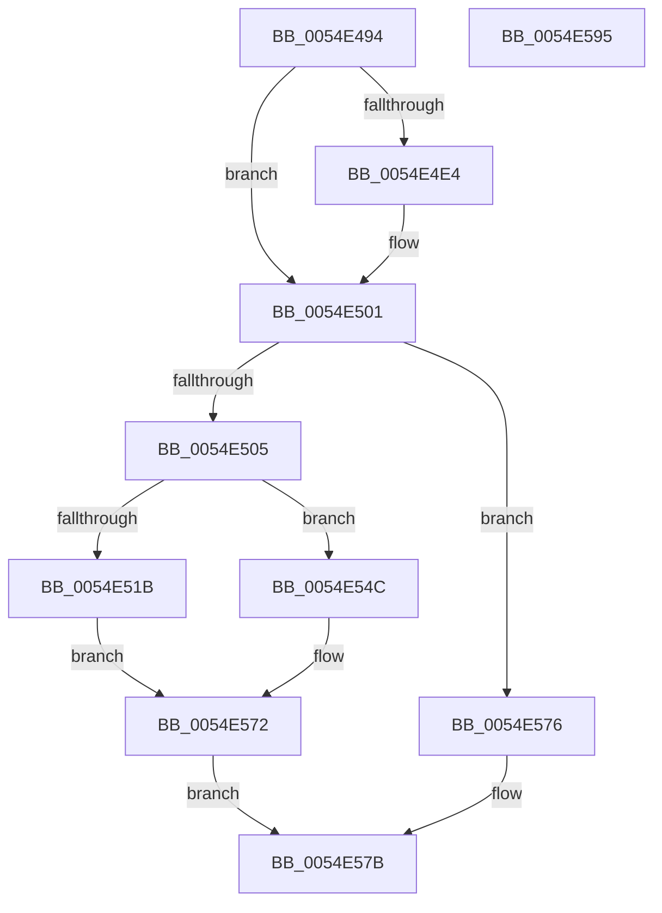

# HalpExtBuildResourceIdString

- RVA: `0x0054E494`–`0x0054E596` (길이 `258` bytes)
- VA: `0x000000014054E494`
- 실행 섹션: `.text`
- PDB 이름 있음: `예`; PDB Function 태그: `아니요`
- unwind 정보 RVA: `0x000C4110`
- 디코드: `74`개 명령, `258/258` bytes 표시
- 미해석 바이트: `0` (있으면 어셈블리에 `.byte`로 보존)

> 이 문서는 커널 이미지의 기계어와 PDB 기호를 분석해 생성했습니다. 4번과 5번은 함수 원형과 자료형을 바이너리 사용 방식에서 추정한 C 해석이며 원본 소스 복구 결과는 아닙니다.

## 1. Dependencies

- 직접 호출 지점: **4**; 고유 호출 대상: **2**
- 직접 호출자로 확인된 함수: **5**
- RIP 상대 이미지 참조: **4**

### Outgoing calls
- `0x0054E4F6` → [swprintf_s](../50/swprintf_s_function_00504B20.md) (function, `0x00504B20`)
- `0x0054E545` → [swprintf_s](../50/swprintf_s_function_00504B20.md) (function, `0x00504B20`)
- `0x0054E56D` → [swprintf_s](../50/swprintf_s_function_00504B20.md) (function, `0x00504B20`)
- `0x0054E582` → [_security_check_cookie](../6A/_security_check_cookie_function_006AC640.md) (function, `0x006AC640`)

### Direct callers
- [HalpTimerBuildKnownResourceIdString](HalpTimerBuildKnownResourceIdString_function_00548A10.md) at `0x00548A4F`
- [HalpExtRegisterResourceDescriptor](HalpExtRegisterResourceDescriptor_function_0054E640.md) at `0x0054E7E9`
- [HalpRegisterDmaController](../55/HalpRegisterDmaController_function_00554638.md) at `0x005546BF`
- [HalpInterruptRegisterController](../56/HalpInterruptRegisterController_function_005640F0.md) at `0x0056432E`
- [ExtEnvRegisterIommu](../../init/C2/ExtEnvRegisterIommu_function_00C213EC.md) at `0x00C21558`

### Static image references
- `0x0054E4A5` → RVA `0x00E0A740` (`.data`; read)
- `0x0054E4E7` → RVA `0x00024268` (`.rdata`; read)
- `0x0054E531` → RVA `0x000241E0` (`.rdata`; read)
- `0x0054E55E` → RVA `0x000242B0` (`.rdata`; read)

## 2. Other-region calls and transfers

- 다른 실행 섹션으로 향하는 call: **0**
- 별도 외부 분기/꼬리 이동을 확인하지 못했습니다.

## 3. Assembly (complete function range)

```asm
0054E494  40 55                           push rbp
0054E496  53                              push rbx
0054E497  56                              push rsi
0054E498  57                              push rdi
0054E499  41 56                           push r14
0054E49B  48 8B EC                        mov rbp, rsp
0054E49E  48 81 EC 80 00 00 00            sub rsp, 0x80
0054E4A5  48 8B 05 94 C2 8B 00            mov rax, qword ptr [rip + 0x8bc294]
0054E4AC  48 33 C4                        xor rax, rsp
0054E4AF  48 89 45 F8                     mov qword ptr [rbp - 8], rax
0054E4B3  48 8B 5D 70                     mov rbx, qword ptr [rbp + 0x70]
0054E4B7  8B C2                           mov eax, edx
0054E4B9  89 55 D8                        mov dword ptr [rbp - 0x28], edx
0054E4BC  45 33 F6                        xor r14d, r14d
0054E4BF  33 D2                           xor edx, edx
0054E4C1  41 0F B7 F1                     movzx esi, r9w
0054E4C5  89 55 F2                        mov dword ptr [rbp - 0xe], edx
0054E4C8  0F 57 C0                        xorps xmm0, xmm0
0054E4CB  0F B7 55 58                     movzx edx, word ptr [rbp + 0x58]
0054E4CF  41 0F B7 F8                     movzx edi, r8w
0054E4D3  89 4D D0                        mov dword ptr [rbp - 0x30], ecx
0054E4D6  66 44 89 75 E0                  mov word ptr [rbp - 0x20], r14w
0054E4DB  0F 11 45 E2                     movups xmmword ptr [rbp - 0x1e], xmm0
0054E4DF  66 85 D2                        test dx, dx
0054E4E2  74 1D                           je 0x14054e501
0054E4E4  44 8B CA                        mov r9d, edx
0054E4E7  4C 8D 05 7A 5D AD FF            lea r8, [rip - 0x52a286]
0054E4EE  41 8D 56 0B                     lea edx, [r14 + 0xb]
0054E4F2  48 8D 4D E0                     lea rcx, [rbp - 0x20]
0054E4F6  E8 25 66 FB FF                  call 0x140504b20
0054E4FB  8B 4D D0                        mov ecx, dword ptr [rbp - 0x30]
0054E4FE  8B 45 D8                        mov eax, dword ptr [rbp - 0x28]
0054E501  85 C9                           test ecx, ecx
0054E503  74 71                           je 0x14054e576
0054E505  44 0F B7 45 50                  movzx r8d, word ptr [rbp + 0x50]
0054E50A  4C 8D 4D D0                     lea r9, [rbp - 0x30]
0054E50E  8B 55 68                        mov edx, dword ptr [rbp + 0x68]
0054E511  85 C0                           test eax, eax
0054E513  8B 45 60                        mov eax, dword ptr [rbp + 0x60]
0054E516  48 8B CB                        mov rcx, rbx
0054E519  74 31                           je 0x14054e54c
0054E51B  89 44 24 48                     mov dword ptr [rsp + 0x48], eax
0054E51F  48 8D 45 E0                     lea rax, [rbp - 0x20]
0054E523  48 89 44 24 40                  mov qword ptr [rsp + 0x40], rax
0054E528  48 8D 45 D8                     lea rax, [rbp - 0x28]
0054E52C  44 89 44 24 38                  mov dword ptr [rsp + 0x38], r8d
0054E531  4C 8D 05 A8 5C AD FF            lea r8, [rip - 0x52a358]
0054E538  89 74 24 30                     mov dword ptr [rsp + 0x30], esi
0054E53C  48 89 44 24 28                  mov qword ptr [rsp + 0x28], rax
0054E541  89 7C 24 20                     mov dword ptr [rsp + 0x20], edi
0054E545  E8 D6 65 FB FF                  call 0x140504b20
0054E54A  EB 26                           jmp 0x14054e572
0054E54C  89 44 24 40                     mov dword ptr [rsp + 0x40], eax
0054E550  48 8D 45 E0                     lea rax, [rbp - 0x20]
0054E554  48 89 44 24 38                  mov qword ptr [rsp + 0x38], rax
0054E559  44 89 44 24 30                  mov dword ptr [rsp + 0x30], r8d
0054E55E  4C 8D 05 4B 5D AD FF            lea r8, [rip - 0x52a2b5]
0054E565  89 74 24 28                     mov dword ptr [rsp + 0x28], esi
0054E569  89 7C 24 20                     mov dword ptr [rsp + 0x20], edi
0054E56D  E8 AE 65 FB FF                  call 0x140504b20
0054E572  33 C0                           xor eax, eax
0054E574  EB 05                           jmp 0x14054e57b
0054E576  B8 01 00 00 C0                  mov eax, 0xc0000001
0054E57B  48 8B 4D F8                     mov rcx, qword ptr [rbp - 8]
0054E57F  48 33 CC                        xor rcx, rsp
0054E582  E8 B9 E0 15 00                  call 0x1406ac640
0054E587  48 81 C4 80 00 00 00            add rsp, 0x80
0054E58E  41 5E                           pop r14
0054E590  5F                              pop rdi
0054E591  5E                              pop rsi
0054E592  5B                              pop rbx
0054E593  5D                              pop rbp
0054E594  C3                              ret
0054E595  CC                              int3
```

## 4. C-style interpretation (structured pseudocode)

```c
__int64 __fastcall HalpExtBuildResourceIdString(int a1, int a2, unsigned __int16 a3, unsigned __int16 a4, unsigned __int16 a5, unsigned __int16 a6, unsigned int a7, unsigned int a8, __int64 a9)
{
    __int64 result;
    __int64 v_r14;
    __int64 v_rsp;
    unsigned __int64 v_stack_m30;
    unsigned int v_stack_m36;
    unsigned __int64 v_stack_m46;
    unsigned __int16 v_stack_m48;
    unsigned int v_stack_m50;
    unsigned int v_stack_m58;
    unsigned int v_stack_m60;
    unsigned __int64 v_stack_m68;
    unsigned int v_stack_m70;
    unsigned int v_stack_m78;
    unsigned __int64 v_stack_m80;
    unsigned int v_stack_m88;

    v_rsp = (v_rsp) - (128);
    result = (*(unsigned __int64 *)(v_rip + 9159316)) ^ (v_rsp);
    v_stack_m30 = result;
    v_stack_m50 = a2;
    v_r14 = 0;
    a2 = 0;
    v_stack_m36 = 0;
    v_stack_m58 = a1;
    v_stack_m48 = 0;
    v_stack_m46 = v_xmm0;
    result = (unsigned int)(a2);
    if (a6 != 0) {
        a4 = a6;
        a3 = v_rip - 5415558;
        a2 = v_r14 + 11;
        a1 = v_stack_m48;
        result = swprintf_s(a1, a2, a3, a4);
        a1 = v_stack_m58;
        result = v_stack_m50;
    }
    if (a1 == 0) goto loc_0054E576;
    if ((unsigned int)(result) == 0) goto loc_0054E54C;
    v_stack_m60 = (unsigned int)((unsigned int)(a7));
    v_stack_m68 = v_stack_m48;
    v_stack_m70 = a5;
    v_stack_m78 = a4;
    v_stack_m80 = v_stack_m50;
    v_stack_m88 = a3;
    result = swprintf_s(a9, (unsigned int)(a8), v_rip - 5415768, v_stack_m58);
    goto loc_0054E572;
loc_0054E54C:
    v_stack_m68 = (unsigned int)(result);
    v_stack_m70 = v_stack_m48;
    v_stack_m78 = (unsigned int)(v_rip - 5415768);
    v_stack_m80 = a4;
    v_stack_m88 = a3;
    result = swprintf_s(a9, (unsigned int)(a8), v_rip - 5415605, v_stack_m58);
loc_0054E572:
    result = 0;
    goto loc_0054E57B;
loc_0054E576:
loc_0054E57B:
    a1 = (v_stack_m30) ^ (v_rsp);
    result = _security_check_cookie(a1, (unsigned int)(a8), v_rip - 5415605, v_stack_m58);
    v_rsp = (v_rsp) + (128);
    return result;
}
```

## 5. (Beta) C Style

```c
int64_t HalpExtBuildResourceIdString(int32_t Arg1, int32_t Arg2, uint16_t Arg3, uint16_t Arg4, uint16_t Arg5, uint16_t Arg6, uint32_t Arg7, uint32_t Arg8, int64_t Arg9)
{
    int64_t result;
    int64_t local_r14;
    int64_t local_rsp;
    uint64_t v_stack_m30;
    uint32_t v_stack_m36;
    uint64_t v_stack_m46;
    uint16_t v_stack_m48;
    uint32_t v_stack_m50;
    uint32_t v_stack_m58;
    uint32_t v_stack_m60;
    uint64_t v_stack_m68;
    uint32_t v_stack_m70;
    uint32_t v_stack_m78;
    uint64_t v_stack_m80;
    uint32_t v_stack_m88;

    local_rsp = (local_rsp) - (128);
    result = (*(uint64_t *)(v_rip + 0x8BC294)) ^ (local_rsp);
    v_stack_m30 = result;
    v_stack_m50 = Arg2;
    local_r14 = 0;
    Arg2 = 0;
    v_stack_m36 = 0;
    v_stack_m58 = Arg1;
    v_stack_m48 = 0;
    v_stack_m46 = v_xmm0;
    result = (uint32_t)(Arg2);
    if (Arg6 != 0) {
        Arg4 = Arg6;
        Arg3 = v_rip - 5415558;
        Arg2 = local_r14 + 11;
        Arg1 = v_stack_m48;
        result = swprintf_s(Arg1, Arg2, Arg3, Arg4);
        Arg1 = v_stack_m58;
        result = v_stack_m50;
    }
    if (Arg1 == 0) goto loc_0054E576;
    if ((uint32_t)(result) == 0) goto loc_0054E54C;
    v_stack_m60 = (uint32_t)((uint32_t)(Arg7));
    v_stack_m68 = v_stack_m48;
    v_stack_m70 = Arg5;
    v_stack_m78 = Arg4;
    v_stack_m80 = v_stack_m50;
    v_stack_m88 = Arg3;
    result = swprintf_s(Arg9, (uint32_t)(Arg8), v_rip - 5415768, v_stack_m58);
    goto loc_0054E572;
loc_0054E54C:
    v_stack_m68 = (uint32_t)(result);
    v_stack_m70 = v_stack_m48;
    v_stack_m78 = (uint32_t)(v_rip - 5415768);
    v_stack_m80 = Arg4;
    v_stack_m88 = Arg3;
    result = swprintf_s(Arg9, (uint32_t)(Arg8), v_rip - 5415605, v_stack_m58);
loc_0054E572:
    result = 0;
    goto loc_0054E57B;
loc_0054E576:
loc_0054E57B:
    Arg1 = (v_stack_m30) ^ (local_rsp);
    result = _security_check_cookie(Arg1, (uint32_t)(Arg8), v_rip - 5415605, v_stack_m58);
    local_rsp = (local_rsp) + (128);
    return result;
}
```

## 6. Execution-region graph

[열기: 2D/3D 그래프와 함수 탐색 컨트롤 패널](../../../control-panel.html?section=text&rva=0x0054E494&view=graph)

- 2D 그래프는 위에서 아래로 흐르고, 3D 그래프는 빈 공간을 드래그해 회전합니다. Shift+드래그는 이동, 휠은 확대·축소, 함수 노드 선택은 대상 보고서 이동입니다.

### Static fallback


