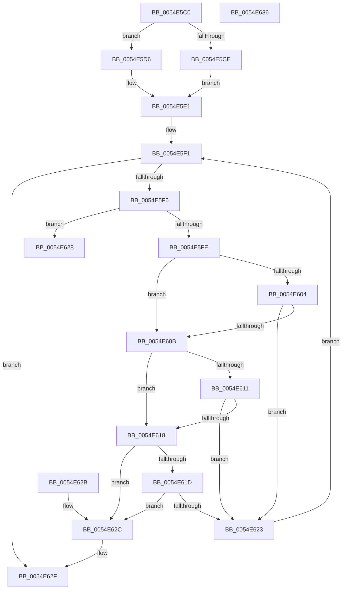

# HalpExtGetNextResourceDescriptor

- RVA: `0x0054E5C0`–`0x0054E637` (길이 `119` bytes)
- VA: `0x000000014054E5C0`
- 실행 섹션: `.text`
- PDB 이름 있음: `예`; PDB Function 태그: `아니요`
- unwind 정보 RVA: `0x000DB714`
- 디코드: `41`개 명령, `119/119` bytes 표시
- 미해석 바이트: `0` (있으면 어셈블리에 `.byte`로 보존)

> 이 문서는 커널 이미지의 기계어와 PDB 기호를 분석해 생성했습니다. 4번과 5번은 함수 원형과 자료형을 바이너리 사용 방식에서 추정한 C 해석이며 원본 소스 복구 결과는 아닙니다.

## 1. Dependencies

- 직접 호출 지점: **0**; 고유 호출 대상: **0**
- 직접 호출자로 확인된 함수: **0**
- RIP 상대 이미지 참조: **0**

### Outgoing calls
- 직접 디코드된 call 명령이 없습니다.

### Direct callers
- 이 함수 시작 RVA로 연결되는 직접 call은 확인되지 않았습니다. 간접 호출은 완전히 역산할 수 없습니다.

### Static image references
- 디코드된 RIP-relative 메모리 참조가 없습니다.

## 2. Other-region calls and transfers

- 다른 실행 섹션으로 향하는 call: **0**
- 별도 외부 분기/꼬리 이동을 확인하지 못했습니다.

## 3. Assembly (complete function range)

```asm
0054E5C0  8B 0A                           mov ecx, dword ptr [rdx]
0054E5C2  45 0F B7 D1                     movzx r10d, r9w
0054E5C6  48 03 CA                        add rcx, rdx
0054E5C9  4D 85 C0                        test r8, r8
0054E5CC  74 08                           je 0x14054e5d6
0054E5CE  41 8B 00                        mov eax, dword ptr [r8]
0054E5D1  4C 03 C0                        add r8, rax
0054E5D4  EB 0B                           jmp 0x14054e5e1
0054E5D6  44 8B 42 14                     mov r8d, dword ptr [rdx + 0x14]
0054E5DA  49 83 C0 18                     add r8, 0x18
0054E5DE  4C 03 C2                        add r8, rdx
0054E5E1  8B 54 24 30                     mov edx, dword ptr [rsp + 0x30]
0054E5E5  41 BB FF FF 00 00               mov r11d, 0xffff
0054E5EB  44 0F B7 4C 24 28               movzx r9d, word ptr [rsp + 0x28]
0054E5F1  4C 3B C1                        cmp r8, rcx
0054E5F4  73 39                           jae 0x14054e62f
0054E5F6  41 8B 00                        mov eax, dword ptr [r8]
0054E5F9  83 F8 0C                        cmp eax, 0xc
0054E5FC  72 2A                           jb 0x14054e628
0054E5FE  66 45 3B D3                     cmp r10w, r11w
0054E602  74 07                           je 0x14054e60b
0054E604  66 45 3B 50 04                  cmp r10w, word ptr [r8 + 4]
0054E609  75 18                           jne 0x14054e623
0054E60B  66 45 3B CB                     cmp r9w, r11w
0054E60F  74 07                           je 0x14054e618
0054E611  66 45 3B 48 06                  cmp r9w, word ptr [r8 + 6]
0054E616  75 0B                           jne 0x14054e623
0054E618  41 3B D3                        cmp edx, r11d
0054E61B  74 0F                           je 0x14054e62c
0054E61D  41 3B 50 08                     cmp edx, dword ptr [r8 + 8]
0054E621  74 09                           je 0x14054e62c
0054E623  4C 03 C0                        add r8, rax
0054E626  EB C9                           jmp 0x14054e5f1
0054E628  33 C0                           xor eax, eax
0054E62A  C3                              ret
0054E62B  CC                              int3
0054E62C  4C 3B C1                        cmp r8, rcx
0054E62F  48 1B C0                        sbb rax, rax
0054E632  49 23 C0                        and rax, r8
0054E635  C3                              ret
0054E636  CC                              int3
```

## 4. C-style interpretation (structured pseudocode)

```c
__int64 __fastcall HalpExtGetNextResourceDescriptor(__int64 a1, __int64 a2, __int64 a3, unsigned __int16 a4, unsigned __int16 a5, unsigned int a6)
{
    __int64 result;

    a1 = ((unsigned int)(*(unsigned int *)(a2))) + (a2);
    if (a3 == 0) goto loc_0054E5D6;
    a3 = (a3) + ((unsigned int)(*(unsigned int *)(a3)));
    goto loc_0054E5E1;
loc_0054E5D6:
    a3 = ((unsigned int)(*(unsigned int *)(a2 + 20))) + (24);
    a3 = (a3) + (a2);
loc_0054E5E1:
loc_0054E5F1:
    if (a3 >= a1) goto loc_0054E62F;
    if (((unsigned int)((unsigned int)(*(unsigned int *)(a3)))) < 12) goto loc_0054E628;
    if (a4 == ((unsigned __int16)((unsigned int)(0xFFFFULL)))) goto loc_0054E60B;
    if (a4 != (*(unsigned __int16 *)(a3 + 4))) goto loc_0054E623;
loc_0054E60B:
    if (a5 == ((unsigned __int16)((unsigned int)(0xFFFFULL)))) goto loc_0054E618;
    if (a5 != (*(unsigned __int16 *)(a3 + 6))) goto loc_0054E623;
loc_0054E618:
    if (((unsigned int)((unsigned int)(a6))) == ((unsigned int)((unsigned int)(0xFFFFULL)))) goto loc_0054E62C;
    if (((unsigned int)((unsigned int)(a6))) == (*(unsigned int *)(a3 + 8))) goto loc_0054E62C;
loc_0054E623:
    a3 = (a3) + ((unsigned int)(*(unsigned int *)(a3)));
    goto loc_0054E5F1;
loc_0054E628:
    result = 0;
    return result;
loc_0054E62C:
loc_0054E62F:
    result = (result) & (a3);
    return result;
}
```

## 5. (Beta) C Style

```c
int64_t HalpExtGetNextResourceDescriptor(int64_t Arg1, void *Arg2, int64_t Arg3, uint16_t Arg4, uint16_t Arg5, uint32_t Arg6)
{
    uint8_t *arg2 = (uint8_t *)Arg2;

    int64_t result;

    Arg1 = ((uint32_t)(*(uint32_t *)(arg2))) + (Arg2);
    if (Arg3 == 0) goto loc_0054E5D6;
    Arg3 = (Arg3) + ((uint32_t)(*(uint32_t *)(Arg3)));
    goto loc_0054E5E1;
loc_0054E5D6:
    Arg3 = ((uint32_t)(*(uint32_t *)(arg2 + 0x14))) + (24);
    Arg3 = (Arg3) + (Arg2);
loc_0054E5E1:
loc_0054E5F1:
    if (Arg3 >= Arg1) goto loc_0054E62F;
    if (((uint32_t)((uint32_t)(*(uint32_t *)(Arg3)))) < 12) goto loc_0054E628;
    if (Arg4 == ((uint16_t)((uint32_t)(0xFFFFULL)))) goto loc_0054E60B;
    if (Arg4 != (*(uint16_t *)(Arg3 + 0x4))) goto loc_0054E623;
loc_0054E60B:
    if (Arg5 == ((uint16_t)((uint32_t)(0xFFFFULL)))) goto loc_0054E618;
    if (Arg5 != (*(uint16_t *)(Arg3 + 0x6))) goto loc_0054E623;
loc_0054E618:
    if (((uint32_t)((uint32_t)(Arg6))) == ((uint32_t)((uint32_t)(0xFFFFULL)))) goto loc_0054E62C;
    if (((uint32_t)((uint32_t)(Arg6))) == (*(uint32_t *)(Arg3 + 0x8))) goto loc_0054E62C;
loc_0054E623:
    Arg3 = (Arg3) + ((uint32_t)(*(uint32_t *)(Arg3)));
    goto loc_0054E5F1;
loc_0054E628:
    result = 0;
    return result;
loc_0054E62C:
loc_0054E62F:
    result = (result) & (Arg3);
    return result;
}
```

### 관측된 메모리 오프셋

구조체 형식이 확인되지 않은 접근은 인자 기준의 오프셋으로만 기록했습니다.

| 기준 인자 | 오프셋 표현 | 폭 (bit) | 접근 |
|---|---:|---:|---|
| `Arg2` | `+ 0x0` | `32` | `R` |
| `Arg2` | `+ 0x14` | `32` | `R` |

## 6. Execution-region graph

[열기: 2D/3D 그래프와 함수 탐색 컨트롤 패널](../../../control-panel.html?section=text&rva=0x0054E5C0&view=graph)

- 2D 그래프는 위에서 아래로 흐르고, 3D 그래프는 빈 공간을 드래그해 회전합니다. Shift+드래그는 이동, 휠은 확대·축소, 함수 노드 선택은 대상 보고서 이동입니다.

### Static fallback


