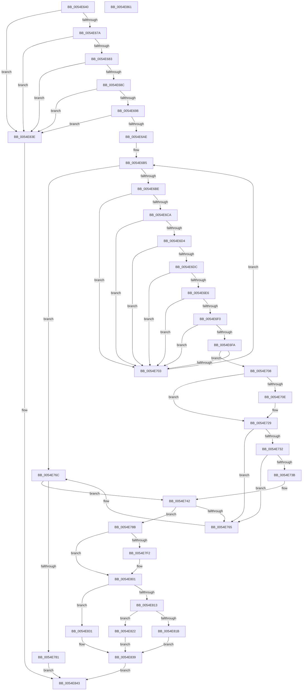

# HalpExtRegisterResourceDescriptor

- RVA: `0x0054E640`–`0x0054E862` (길이 `546` bytes)
- VA: `0x000000014054E640`
- 실행 섹션: `.text`
- PDB 이름 있음: `예`; PDB Function 태그: `아니요`
- unwind 정보 RVA: `0x000C40F0`
- 디코드: `149`개 명령, `546/546` bytes 표시
- 미해석 바이트: `0` (있으면 어셈블리에 `.byte`로 보존)

> 이 문서는 커널 이미지의 기계어와 PDB 기호를 분석해 생성했습니다. 4번과 5번은 함수 원형과 자료형을 바이너리 사용 방식에서 추정한 C 해석이며 원본 소스 복구 결과는 아닙니다.

## 1. Dependencies

- 직접 호출 지점: **8**; 고유 호출 대상: **7**
- 직접 호출자로 확인된 함수: **0**
- RIP 상대 이미지 참조: **4**

### Outgoing calls
- `0x0054E723` → [KeBugCheckEx](../4F/KeBugCheckEx_function_004FD660.md) (function, `0x004FD660`)
- `0x0054E774` → [HalpMmAllocateMemoryInternal](HalpMmAllocateMemoryInternal_function_00544990.md) (function, `0x00544990`)
- `0x0054E7A5` → [RtlInitUnicodeString](../42/RtlInitUnicodeString_function_0042A780.md) (function, `0x0042A780`)
- `0x0054E7E9` → [HalpExtBuildResourceIdString](HalpExtBuildResourceIdString_function_0054E494.md) (function, `0x0054E494`)
- `0x0054E7FC` → [RtlInitUnicodeString](../42/RtlInitUnicodeString_function_0042A780.md) (function, `0x0042A780`)
- `0x0054E82A` → [HalpRegisterDmaController](../55/HalpRegisterDmaController_function_00554638.md) (function, `0x00554638`)
- `0x0054E834` → [HalpRegisterDmaChannel](../55/HalpRegisterDmaChannel_function_00554540.md) (function, `0x00554540`)
- `0x0054E84E` → [_security_check_cookie](../6A/_security_check_cookie_function_006AC640.md) (function, `0x006AC640`)

### Direct callers
- 이 함수 시작 RVA로 연결되는 직접 call은 확인되지 않았습니다. 간접 호출은 완전히 역산할 수 없습니다.

### Static image references
- `0x0054E64E` → RVA `0x00E0A740` (`.data`; read)
- `0x0054E68C` → RVA `0x00FC1A10` (`.data`; read)
- `0x0054E69E` → RVA `0x00FC1A08` (`.data`; read)
- `0x0054E78E` → RVA `0x00024280` (`.rdata`; read)

## 2. Other-region calls and transfers

- 다른 실행 섹션으로 향하는 call: **0**
- 별도 외부 분기/꼬리 이동을 확인하지 못했습니다.

## 3. Assembly (complete function range)

```asm
0054E640  40 53                           push rbx
0054E642  55                              push rbp
0054E643  56                              push rsi
0054E644  57                              push rdi
0054E645  41 56                           push r14
0054E647  48 81 EC 10 01 00 00            sub rsp, 0x110
0054E64E  48 8B 05 EB C0 8B 00            mov rax, qword ptr [rip + 0x8bc0eb]
0054E655  48 33 C4                        xor rax, rsp
0054E658  48 89 84 24 00 01 00 00         mov qword ptr [rsp + 0x100], rax
0054E660  0F 57 C0                        xorps xmm0, xmm0
0054E663  49 8B E9                        mov rbp, r9
0054E666  49 8B F0                        mov rsi, r8
0054E669  48 8B FA                        mov rdi, rdx
0054E66C  0F 11 44 24 50                  movups xmmword ptr [rsp + 0x50], xmm0
0054E671  4D 85 C0                        test r8, r8
0054E674  0F 84 C4 01 00 00               je 0x14054e83e
0054E67A  4D 85 C9                        test r9, r9
0054E67D  0F 84 BB 01 00 00               je 0x14054e83e
0054E683  48 85 D2                        test rdx, rdx
0054E686  0F 84 B2 01 00 00               je 0x14054e83e
0054E68C  3B 0D 7E 33 A7 00               cmp ecx, dword ptr [rip + 0xa7337e]
0054E692  0F 83 A6 01 00 00               jae 0x14054e83e
0054E698  8B C1                           mov eax, ecx
0054E69A  48 C1 E0 06                     shl rax, 6
0054E69E  48 03 05 63 33 A7 00            add rax, qword ptr [rip + 0xa73363]
0054E6A5  80 38 00                        cmp byte ptr [rax], 0
0054E6A8  0F 84 90 01 00 00               je 0x14054e83e
0054E6AE  4C 8D 70 20                     lea r14, [rax + 0x20]
0054E6B2  49 8B 1E                        mov rbx, qword ptr [r14]
0054E6B5  49 3B DE                        cmp rbx, r14
0054E6B8  0F 84 AE 00 00 00               je 0x14054e76c
0054E6BE  48 8B 4B 18                     mov rcx, qword ptr [rbx + 0x18]
0054E6C2  8B 42 04                        mov eax, dword ptr [rdx + 4]
0054E6C5  39 41 04                        cmp dword ptr [rcx + 4], eax
0054E6C8  75 39                           jne 0x14054e703
0054E6CA  0F B7 42 0C                     movzx eax, word ptr [rdx + 0xc]
0054E6CE  66 39 41 0C                     cmp word ptr [rcx + 0xc], ax
0054E6D2  75 2F                           jne 0x14054e703
0054E6D4  8B 42 08                        mov eax, dword ptr [rdx + 8]
0054E6D7  39 41 08                        cmp dword ptr [rcx + 8], eax
0054E6DA  75 27                           jne 0x14054e703
0054E6DC  0F B7 42 0E                     movzx eax, word ptr [rdx + 0xe]
0054E6E0  66 39 41 0E                     cmp word ptr [rcx + 0xe], ax
0054E6E4  75 1D                           jne 0x14054e703
0054E6E6  0F B7 42 10                     movzx eax, word ptr [rdx + 0x10]
0054E6EA  66 39 41 10                     cmp word ptr [rcx + 0x10], ax
0054E6EE  75 13                           jne 0x14054e703
0054E6F0  0F B7 42 12                     movzx eax, word ptr [rdx + 0x12]
0054E6F4  66 39 41 12                     cmp word ptr [rcx + 0x12], ax
0054E6F8  75 09                           jne 0x14054e703
0054E6FA  41 8B 40 08                     mov eax, dword ptr [r8 + 8]
0054E6FE  39 43 24                        cmp dword ptr [rbx + 0x24], eax
0054E701  74 05                           je 0x14054e708
0054E703  48 8B 1B                        mov rbx, qword ptr [rbx]
0054E706  EB AD                           jmp 0x14054e6b5
0054E708  83 7B 10 00                     cmp dword ptr [rbx + 0x10], 0
0054E70C  7C 1B                           jl 0x14054e729
0054E70E  4C 8B CF                        mov r9, rdi
0054E711  48 89 44 24 20                  mov qword ptr [rsp + 0x20], rax
0054E716  4C 8B C3                        mov r8, rbx
0054E719  BA 00 03 00 00                  mov edx, 0x300
0054E71E  B9 5C 00 00 00                  mov ecx, 0x5c
0054E723  E8 38 EF FA FF                  call 0x1404fd660
0054E728  CC                              int3
0054E729  48 8B 0B                        mov rcx, qword ptr [rbx]
0054E72C  48 39 59 08                     cmp qword ptr [rcx + 8], rbx
0054E730  75 33                           jne 0x14054e765
0054E732  48 8B 43 08                     mov rax, qword ptr [rbx + 8]
0054E736  48 39 18                        cmp qword ptr [rax], rbx
0054E739  75 2A                           jne 0x14054e765
0054E73B  48 89 08                        mov qword ptr [rax], rcx
0054E73E  48 89 41 08                     mov qword ptr [rcx + 8], rax
0054E742  48 89 7B 18                     mov qword ptr [rbx + 0x18], rdi
0054E746  0F B7 46 04                     movzx eax, word ptr [rsi + 4]
0054E74A  66 89 43 20                     mov word ptr [rbx + 0x20], ax
0054E74E  0F B7 46 06                     movzx eax, word ptr [rsi + 6]
0054E752  66 89 43 22                     mov word ptr [rbx + 0x22], ax
0054E756  8B 46 08                        mov eax, dword ptr [rsi + 8]
0054E759  89 43 24                        mov dword ptr [rbx + 0x24], eax
0054E75C  49 8B 46 08                     mov rax, qword ptr [r14 + 8]
0054E760  4C 39 30                        cmp qword ptr [rax], r14
0054E763  74 26                           je 0x14054e78b
0054E765  B9 03 00 00 00                  mov ecx, 3
0054E76A  CD 29                           int 0x29
0054E76C  BA 01 00 00 00                  mov edx, 1
0054E771  8D 4A 27                        lea ecx, [rdx + 0x27]
0054E774  E8 17 62 FF FF                  call 0x140544990
0054E779  48 8B D8                        mov rbx, rax
0054E77C  48 85 C0                        test rax, rax
0054E77F  75 C1                           jne 0x14054e742
0054E781  B8 17 00 00 C0                  mov eax, 0xc0000017
0054E786  E9 B8 00 00 00                  jmp 0x14054e843
0054E78B  4C 89 33                        mov qword ptr [rbx], r14
0054E78E  48 8D 15 EB 5A AD FF            lea rdx, [rip - 0x52a515]
0054E795  48 89 43 08                     mov qword ptr [rbx + 8], rax
0054E799  48 8D 4C 24 50                  lea rcx, [rsp + 0x50]
0054E79E  48 89 18                        mov qword ptr [rax], rbx
0054E7A1  49 89 5E 08                     mov qword ptr [r14 + 8], rbx
0054E7A5  E8 D6 BF ED FF                  call 0x14042a780
0054E7AA  48 8B 4B 18                     mov rcx, qword ptr [rbx + 0x18]
0054E7AE  48 8D 44 24 60                  lea rax, [rsp + 0x60]
0054E7B3  48 89 44 24 40                  mov qword ptr [rsp + 0x40], rax
0054E7B8  8B 43 24                        mov eax, dword ptr [rbx + 0x24]
0054E7BB  C7 44 24 38 4B 00 00 00         mov dword ptr [rsp + 0x38], 0x4b
0054E7C3  44 0F B7 49 0E                  movzx r9d, word ptr [rcx + 0xe]
0054E7C8  44 0F B7 41 0C                  movzx r8d, word ptr [rcx + 0xc]
0054E7CD  8B 51 08                        mov edx, dword ptr [rcx + 8]
0054E7D0  89 44 24 30                     mov dword ptr [rsp + 0x30], eax
0054E7D4  0F B7 41 12                     movzx eax, word ptr [rcx + 0x12]
0054E7D8  66 89 44 24 28                  mov word ptr [rsp + 0x28], ax
0054E7DD  0F B7 41 10                     movzx eax, word ptr [rcx + 0x10]
0054E7E1  8B 49 04                        mov ecx, dword ptr [rcx + 4]
0054E7E4  66 89 44 24 20                  mov word ptr [rsp + 0x20], ax
0054E7E9  E8 A6 FC FF FF                  call 0x14054e494
0054E7EE  85 C0                           test eax, eax
0054E7F0  78 0F                           js 0x14054e801
0054E7F2  48 8D 54 24 60                  lea rdx, [rsp + 0x60]
0054E7F7  48 8D 4C 24 50                  lea rcx, [rsp + 0x50]
0054E7FC  E8 7F BF ED FF                  call 0x14042a780
0054E801  0F B7 4E 06                     movzx ecx, word ptr [rsi + 6]
0054E805  0F B7 46 04                     movzx eax, word ptr [rsi + 4]
0054E809  C1 E1 10                        shl ecx, 0x10
0054E80C  0B C8                           or ecx, eax
0054E80E  83 F9 03                        cmp ecx, 3
0054E811  74 1E                           je 0x14054e831
0054E813  81 F9 03 00 01 00               cmp ecx, 0x10003
0054E819  74 07                           je 0x14054e822
0054E81B  B8 02 00 00 C0                  mov eax, 0xc0000002
0054E820  EB 17                           jmp 0x14054e839
0054E822  48 8D 54 24 50                  lea rdx, [rsp + 0x50]
0054E827  48 8B CD                        mov rcx, rbp
0054E82A  E8 09 5E 00 00                  call 0x140554638
0054E82F  EB 08                           jmp 0x14054e839
0054E831  48 8B CD                        mov rcx, rbp
0054E834  E8 07 5D 00 00                  call 0x140554540
0054E839  89 43 10                        mov dword ptr [rbx + 0x10], eax
0054E83C  EB 05                           jmp 0x14054e843
0054E83E  B8 0D 00 00 C0                  mov eax, 0xc000000d
0054E843  48 8B 8C 24 00 01 00 00         mov rcx, qword ptr [rsp + 0x100]
0054E84B  48 33 CC                        xor rcx, rsp
0054E84E  E8 ED DD 15 00                  call 0x1406ac640
0054E853  48 81 C4 10 01 00 00            add rsp, 0x110
0054E85A  41 5E                           pop r14
0054E85C  5F                              pop rdi
0054E85D  5E                              pop rsi
0054E85E  5D                              pop rbp
0054E85F  5B                              pop rbx
0054E860  C3                              ret
0054E861  CC                              int3
```

## 4. C-style interpretation (structured pseudocode)

```c
__int64 __fastcall HalpExtRegisterResourceDescriptor(int a1, __int64 a2, __int64 a3, __int64 a4)
{
    __int64 result;
    __int64 v_rsp;
    unsigned int v_stack_m100;
    unsigned int v_stack_m108;
    unsigned __int16 v_stack_m110;
    unsigned __int64 v_stack_m118;
    unsigned __int64 v_stack_m38;
    unsigned __int64 v_stack_mD8;
    unsigned __int64 v_stack_mE8;
    unsigned __int64 v_stack_mF8;

    v_rsp = (v_rsp) - (272);
    result = (*(unsigned __int64 *)(v_rip + 9158891)) ^ (v_rsp);
    v_stack_m38 = result;
    v_stack_mE8 = v_xmm0;
    if (a3 == 0) goto loc_0054E83E;
    if (a4 == 0) goto loc_0054E83E;
    if (a2 == 0) goto loc_0054E83E;
    if (a1 >= (*(unsigned int *)(v_rip + 10957694))) goto loc_0054E83E;
    result = ((unsigned int)(a1)) << (6);
    result = (result) + (*(unsigned __int64 *)(v_rip + 10957667));
    if ((*(unsigned __int8 *)(result)) == 0) goto loc_0054E83E;
loc_0054E6B5:
    if ((*(unsigned __int64 *)(result + 32)) == (result + 32)) goto loc_0054E76C;
    if ((*(unsigned int *)(*(unsigned __int64 *)(*(unsigned __int64 *)(result + 32) + 24) + 4)) != ((unsigned int)((unsigned int)(*(unsigned int *)(a2 + 4))))) goto loc_0054E703;
    if ((*(unsigned __int16 *)(*(unsigned __int64 *)(*(unsigned __int64 *)(result + 32) + 24) + 12)) != ((unsigned __int16)(*(unsigned __int16 *)(a2 + 12)))) goto loc_0054E703;
    if ((*(unsigned int *)(*(unsigned __int64 *)(*(unsigned __int64 *)(result + 32) + 24) + 8)) != ((unsigned int)((unsigned int)(*(unsigned int *)(a2 + 8))))) goto loc_0054E703;
    if ((*(unsigned __int16 *)(*(unsigned __int64 *)(*(unsigned __int64 *)(result + 32) + 24) + 14)) != ((unsigned __int16)(*(unsigned __int16 *)(a2 + 14)))) goto loc_0054E703;
    if ((*(unsigned __int16 *)(*(unsigned __int64 *)(*(unsigned __int64 *)(result + 32) + 24) + 16)) != ((unsigned __int16)(*(unsigned __int16 *)(a2 + 16)))) goto loc_0054E703;
    if ((*(unsigned __int16 *)(*(unsigned __int64 *)(*(unsigned __int64 *)(result + 32) + 24) + 18)) != ((unsigned __int16)(*(unsigned __int16 *)(a2 + 18)))) goto loc_0054E703;
    if ((*(unsigned int *)(*(unsigned __int64 *)(result + 32) + 36)) == ((unsigned int)((unsigned int)(*(unsigned int *)(a3 + 8))))) goto loc_0054E708;
loc_0054E703:
    goto loc_0054E6B5;
loc_0054E708:
    result = (unsigned int)(*(unsigned int *)(a3 + 8));
    if ((*(unsigned int *)(*(unsigned __int64 *)(*(unsigned __int64 *)(result + 32)) + 16)) >= 0) {
        a4 = a2;
        v_stack_m118 = (unsigned int)(*(unsigned int *)(a3 + 8));
        a3 = *(unsigned __int64 *)(*(unsigned __int64 *)(result + 32));
        a2 = 768;
        a1 = 92;
        result = KeBugCheckEx(a1, a2, a3, a4);
    }
    if ((*(unsigned __int64 *)(*(unsigned __int64 *)(*(unsigned __int64 *)(*(unsigned __int64 *)(result + 32))) + 8)) != (*(unsigned __int64 *)(*(unsigned __int64 *)(result + 32)))) goto loc_0054E765;
    if ((*(unsigned __int64 *)(*(unsigned __int64 *)(*(unsigned __int64 *)(*(unsigned __int64 *)(result + 32)) + 8))) != (*(unsigned __int64 *)(*(unsigned __int64 *)(result + 32)))) goto loc_0054E765;
    *(unsigned __int64 *)(*(unsigned __int64 *)(*(unsigned __int64 *)(*(unsigned __int64 *)(result + 32)) + 8)) = *(unsigned __int64 *)(*(unsigned __int64 *)(*(unsigned __int64 *)(result + 32)));
    *(unsigned __int64 *)(*(unsigned __int64 *)(*(unsigned __int64 *)(*(unsigned __int64 *)(result + 32))) + 8) = *(unsigned __int64 *)(*(unsigned __int64 *)(*(unsigned __int64 *)(result + 32)) + 8);
loc_0054E742:
    *(unsigned __int64 *)(*(unsigned __int64 *)(*(unsigned __int64 *)(result + 32)) + 24) = a2;
    *(unsigned __int16 *)(*(unsigned __int64 *)(*(unsigned __int64 *)(result + 32)) + 32) = (unsigned __int16)(*(unsigned __int16 *)(a3 + 4));
    *(unsigned __int16 *)(*(unsigned __int64 *)(*(unsigned __int64 *)(result + 32)) + 34) = (unsigned __int16)(*(unsigned __int16 *)(a3 + 6));
    *(unsigned int *)(*(unsigned __int64 *)(*(unsigned __int64 *)(result + 32)) + 36) = (unsigned int)((unsigned int)(*(unsigned int *)(a3 + 8)));
    if ((*(unsigned __int64 *)(*(unsigned __int64 *)(result + 32 + 8))) == (result + 32)) goto loc_0054E78B;
loc_0054E765:
loc_0054E76C:
    result = HalpMmAllocateMemoryInternal(1 + 39, 1, a3, a4);
    if (result != 0) goto loc_0054E742;
    goto loc_0054E843;
loc_0054E78B:
    *(unsigned __int64 *)(result) = result + 32;
    *(unsigned __int64 *)(result + 8) = (unsigned int)(0xC0000017ULL);
    *(unsigned __int64 *)((unsigned int)(0xC0000017ULL)) = result;
    *(unsigned __int64 *)(result + 32 + 8) = result;
    result = RtlInitUnicodeString(v_stack_mE8, v_rip - 5416213, a3, a4);
    v_stack_mF8 = v_stack_mD8;
    v_stack_m100 = 75;
    v_stack_m108 = (unsigned int)((unsigned int)(*(unsigned int *)(result + 36)));
    v_stack_m110 = (unsigned __int16)(*(unsigned __int16 *)(*(unsigned __int64 *)(result + 24) + 18));
    v_stack_m118 = (unsigned __int16)(*(unsigned __int16 *)(*(unsigned __int64 *)(result + 24) + 16));
    result = HalpExtBuildResourceIdString((unsigned int)(*(unsigned int *)(*(unsigned __int64 *)(result + 24) + 4)), (unsigned int)(*(unsigned int *)(*(unsigned __int64 *)(result + 24) + 8)), *(unsigned __int16 *)(*(unsigned __int64 *)(result + 24) + 12), *(unsigned __int16 *)(*(unsigned __int64 *)(result + 24) + 14));
    if (!(sign_flag)) {
        a2 = v_stack_mD8;
        a1 = v_stack_mE8;
        result = RtlInitUnicodeString(a1, a2, *(unsigned __int16 *)(*(unsigned __int64 *)(result + 24) + 12), *(unsigned __int16 *)(*(unsigned __int64 *)(result + 24) + 14));
    }
    a1 = (unsigned int)((*(unsigned __int16 *)(a3 + 6)) << (16));
    a1 = (unsigned int)((a1) | ((unsigned int)(*(unsigned __int16 *)(a3 + 4))));
    if (a1 == 3) goto loc_0054E831;
    if (a1 == 0x10003ULL) goto loc_0054E822;
    goto loc_0054E839;
loc_0054E822:
    result = HalpRegisterDmaController(a4, v_stack_mE8, *(unsigned __int16 *)(*(unsigned __int64 *)(result + 24) + 12), *(unsigned __int16 *)(*(unsigned __int64 *)(result + 24) + 14));
    goto loc_0054E839;
loc_0054E831:
    result = HalpRegisterDmaChannel(a4, v_stack_mE8, *(unsigned __int16 *)(*(unsigned __int64 *)(result + 24) + 12), *(unsigned __int16 *)(*(unsigned __int64 *)(result + 24) + 14));
loc_0054E839:
    *(unsigned int *)(result + 16) = (unsigned int)(result);
    goto loc_0054E843;
loc_0054E83E:
loc_0054E843:
    a1 = (v_stack_m38) ^ (v_rsp);
    result = _security_check_cookie(a1, v_stack_mE8, *(unsigned __int16 *)(*(unsigned __int64 *)(result + 24) + 12), *(unsigned __int16 *)(*(unsigned __int64 *)(result + 24) + 14));
    v_rsp = (v_rsp) + (272);
    return result;
}
```

## 5. (Beta) C Style

```c
int64_t HalpExtRegisterResourceDescriptor(int32_t Arg1, int64_t Arg2, void *Arg3, int64_t Arg4)
{
    uint8_t *arg3 = (uint8_t *)Arg3;

    int64_t result;
    int64_t local_rsp;
    uint32_t v_stack_m100;
    uint32_t v_stack_m108;
    uint16_t v_stack_m110;
    uint64_t v_stack_m118;
    uint64_t v_stack_m38;
    uint64_t v_stack_mD8;
    uint64_t v_stack_mE8;
    uint64_t v_stack_mF8;

    local_rsp = (local_rsp) - (272);
    result = (*(uint64_t *)(v_rip + 0x8BC0EB)) ^ (local_rsp);
    v_stack_m38 = result;
    v_stack_mE8 = v_xmm0;
    if (Arg3 == NULL) goto loc_0054E83E;
    if (Arg4 == 0) goto loc_0054E83E;
    if (Arg2 == 0) goto loc_0054E83E;
    if (Arg1 >= (*(uint32_t *)(v_rip + 0xA7337E))) goto loc_0054E83E;
    result = ((uint32_t)(Arg1)) << (6);
    result = (result) + (*(uint64_t *)(v_rip + 0xA73363));
    if ((*(uint8_t *)(result)) == 0) goto loc_0054E83E;
loc_0054E6B5:
    if ((*(uint64_t *)(result + 0x20)) == (result + 32)) goto loc_0054E76C;
    if ((*(uint32_t *)(*(uint64_t *)(*(uint64_t *)(result + 0x20) + 0x18) + 0x4)) != ((uint32_t)((uint32_t)(*(uint32_t *)(Arg2 + 0x4))))) goto loc_0054E703;
    if ((*(uint16_t *)(*(uint64_t *)(*(uint64_t *)(result + 0x20) + 0x18) + 0xC)) != ((uint16_t)(*(uint16_t *)(Arg2 + 0xC)))) goto loc_0054E703;
    if ((*(uint32_t *)(*(uint64_t *)(*(uint64_t *)(result + 0x20) + 0x18) + 0x8)) != ((uint32_t)((uint32_t)(*(uint32_t *)(Arg2 + 0x8))))) goto loc_0054E703;
    if ((*(uint16_t *)(*(uint64_t *)(*(uint64_t *)(result + 0x20) + 0x18) + 0xE)) != ((uint16_t)(*(uint16_t *)(Arg2 + 0xE)))) goto loc_0054E703;
    if ((*(uint16_t *)(*(uint64_t *)(*(uint64_t *)(result + 0x20) + 0x18) + 0x10)) != ((uint16_t)(*(uint16_t *)(Arg2 + 0x10)))) goto loc_0054E703;
    if ((*(uint16_t *)(*(uint64_t *)(*(uint64_t *)(result + 0x20) + 0x18) + 0x12)) != ((uint16_t)(*(uint16_t *)(Arg2 + 0x12)))) goto loc_0054E703;
    if ((*(uint32_t *)(*(uint64_t *)(result + 0x20) + 0x24)) == ((uint32_t)((uint32_t)(*(uint32_t *)(arg3 + 0x8))))) goto loc_0054E708;
loc_0054E703:
    goto loc_0054E6B5;
loc_0054E708:
    result = (uint32_t)(*(uint32_t *)(arg3 + 0x8));
    if ((*(uint32_t *)(*(uint64_t *)(*(uint64_t *)(result + 0x20)) + 0x10)) >= 0) {
        Arg4 = Arg2;
        v_stack_m118 = (uint32_t)(*(uint32_t *)(arg3 + 0x8));
        Arg3 = *(uint64_t *)(*(uint64_t *)(result + 0x20));
        Arg2 = 768;
        Arg1 = 92;
        result = KeBugCheckEx(Arg1, Arg2, Arg3, Arg4);
    }
    if ((*(uint64_t *)(*(uint64_t *)(*(uint64_t *)(*(uint64_t *)(result + 0x20))) + 0x8)) != (*(uint64_t *)(*(uint64_t *)(result + 0x20)))) goto loc_0054E765;
    if ((*(uint64_t *)(*(uint64_t *)(*(uint64_t *)(*(uint64_t *)(result + 0x20)) + 0x8))) != (*(uint64_t *)(*(uint64_t *)(result + 0x20)))) goto loc_0054E765;
    *(uint64_t *)(*(uint64_t *)(*(uint64_t *)(*(uint64_t *)(result + 0x20)) + 0x8)) = *(uint64_t *)(*(uint64_t *)(*(uint64_t *)(result + 0x20)));
    *(uint64_t *)(*(uint64_t *)(*(uint64_t *)(*(uint64_t *)(result + 0x20))) + 0x8) = *(uint64_t *)(*(uint64_t *)(*(uint64_t *)(result + 0x20)) + 0x8);
loc_0054E742:
    *(uint64_t *)(*(uint64_t *)(*(uint64_t *)(result + 0x20)) + 0x18) = Arg2;
    *(uint16_t *)(*(uint64_t *)(*(uint64_t *)(result + 0x20)) + 0x20) = (uint16_t)(*(uint16_t *)(arg3 + 0x4));
    *(uint16_t *)(*(uint64_t *)(*(uint64_t *)(result + 0x20)) + 0x22) = (uint16_t)(*(uint16_t *)(arg3 + 0x6));
    *(uint32_t *)(*(uint64_t *)(*(uint64_t *)(result + 0x20)) + 0x24) = (uint32_t)((uint32_t)(*(uint32_t *)(arg3 + 0x8)));
    if ((*(uint64_t *)(*(uint64_t *)(result + 0x20 + 0x8))) == (result + 32)) goto loc_0054E78B;
loc_0054E765:
loc_0054E76C:
    result = HalpMmAllocateMemoryInternal(1 + 39, 1, Arg3, Arg4);
    if (result != 0) goto loc_0054E742;
    goto loc_0054E843;
loc_0054E78B:
    *(uint64_t *)(result) = result + 32;
    *(uint64_t *)(result + 0x8) = (uint32_t)(0xC0000017ULL);
    *(uint64_t *)((uint32_t)(0xC0000017ULL)) = result;
    *(uint64_t *)(result + 0x20 + 0x8) = result;
    result = RtlInitUnicodeString(v_stack_mE8, v_rip - 5416213, Arg3, Arg4);
    v_stack_mF8 = v_stack_mD8;
    v_stack_m100 = 75;
    v_stack_m108 = (uint32_t)((uint32_t)(*(uint32_t *)(result + 0x24)));
    v_stack_m110 = (uint16_t)(*(uint16_t *)(*(uint64_t *)(result + 0x18) + 0x12));
    v_stack_m118 = (uint16_t)(*(uint16_t *)(*(uint64_t *)(result + 0x18) + 0x10));
    result = HalpExtBuildResourceIdString((uint32_t)(*(uint32_t *)(*(uint64_t *)(result + 0x18) + 0x4)), (uint32_t)(*(uint32_t *)(*(uint64_t *)(result + 0x18) + 0x8)), *(uint16_t *)(*(uint64_t *)(result + 0x18) + 0xC), *(uint16_t *)(*(uint64_t *)(result + 0x18) + 0xE));
    if (!(sign_flag)) {
        Arg2 = v_stack_mD8;
        Arg1 = v_stack_mE8;
        result = RtlInitUnicodeString(Arg1, Arg2, *(uint16_t *)(*(uint64_t *)(result + 0x18) + 0xC), *(uint16_t *)(*(uint64_t *)(result + 0x18) + 0xE));
    }
    Arg1 = (uint32_t)((*(uint16_t *)(arg3 + 0x6)) << (16));
    Arg1 = (uint32_t)((Arg1) | ((uint32_t)(*(uint16_t *)(arg3 + 0x4))));
    if (Arg1 == 3) goto loc_0054E831;
    if (Arg1 == 0x10003ULL) goto loc_0054E822;
    goto loc_0054E839;
loc_0054E822:
    result = HalpRegisterDmaController(Arg4, v_stack_mE8, *(uint16_t *)(*(uint64_t *)(result + 0x18) + 0xC), *(uint16_t *)(*(uint64_t *)(result + 0x18) + 0xE));
    goto loc_0054E839;
loc_0054E831:
    result = HalpRegisterDmaChannel(Arg4, v_stack_mE8, *(uint16_t *)(*(uint64_t *)(result + 0x18) + 0xC), *(uint16_t *)(*(uint64_t *)(result + 0x18) + 0xE));
loc_0054E839:
    *(uint32_t *)(result + 0x10) = (uint32_t)(result);
    goto loc_0054E843;
loc_0054E83E:
loc_0054E843:
    Arg1 = (v_stack_m38) ^ (local_rsp);
    result = _security_check_cookie(Arg1, v_stack_mE8, *(uint16_t *)(*(uint64_t *)(result + 0x18) + 0xC), *(uint16_t *)(*(uint64_t *)(result + 0x18) + 0xE));
    local_rsp = (local_rsp) + (272);
    return result;
}
```

### 관측된 메모리 오프셋

구조체 형식이 확인되지 않은 접근은 인자 기준의 오프셋으로만 기록했습니다.

| 기준 인자 | 오프셋 표현 | 폭 (bit) | 접근 |
|---|---:|---:|---|
| `Arg3` | `+ 0x4` | `16` | `R` |
| `Arg3` | `+ 0x6` | `16` | `R` |
| `Arg3` | `+ 0x8` | `32` | `R` |

## 6. Execution-region graph

[열기: 2D/3D 그래프와 함수 탐색 컨트롤 패널](../../../control-panel.html?section=text&rva=0x0054E640&view=graph)

- 2D 그래프는 위에서 아래로 흐르고, 3D 그래프는 빈 공간을 드래그해 회전합니다. Shift+드래그는 이동, 휠은 확대·축소, 함수 노드 선택은 대상 보고서 이동입니다.

### Static fallback


