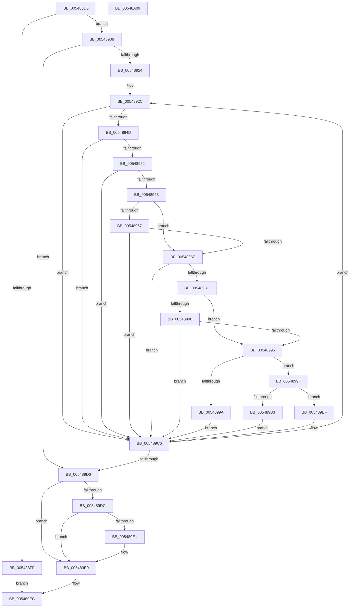

# HalpFindTimer

- RVA: `0x005488D0`–`0x00548A0A` (길이 `314` bytes)
- VA: `0x00000001405488D0`
- 실행 섹션: `.text`
- PDB 이름 있음: `예`; PDB Function 태그: `아니요`
- unwind 정보 RVA: `0x000C3E7C`
- 디코드: `93`개 명령, `314/314` bytes 표시
- 미해석 바이트: `0` (있으면 어셈블리에 `.byte`로 보존)

> 이 문서는 커널 이미지의 기계어와 PDB 기호를 분석해 생성했습니다. 4번과 5번은 함수 원형과 자료형을 바이너리 사용 방식에서 추정한 C 해석이며 원본 소스 복구 결과는 아닙니다.

## 1. Dependencies

- 직접 호출 지점: **0**; 고유 호출 대상: **0**
- 직접 호출자로 확인된 함수: **15**
- RIP 상대 이미지 참조: **2**

### Outgoing calls
- 직접 디코드된 call 명령이 없습니다.

### Direct callers
- [HalpInitializeTimers](../53/HalpInitializeTimers_function_0053C1E0.md) at `0x0053C2A8`
- [HalpTimerFindIdealClockSource](../53/HalpTimerFindIdealClockSource_function_0053C61C.md) at `0x0053C669`
- [HalpTimerFindIdealClockSource](../53/HalpTimerFindIdealClockSource_function_0053C61C.md) at `0x0053C698`
- [HalpTimerFindIdealClockSource](../53/HalpTimerFindIdealClockSource_function_0053C61C.md) at `0x0053C6BC`
- [HalpTimerFindIdealClockSource](../53/HalpTimerFindIdealClockSource_function_0053C61C.md) at `0x0053C6F8`
- [HalpTimerFindIdealClockSource](../53/HalpTimerFindIdealClockSource_function_0053C61C.md) at `0x0053C71B`
- [HalpTimerFindIdealClockSource](../53/HalpTimerFindIdealClockSource_function_0053C61C.md) at `0x0053C73B`
- [HalpTimerFindIdealClockSource](../53/HalpTimerFindIdealClockSource_function_0053C61C.md) at `0x0053C758`
- [HalpTimerFindIdealClockSource](../53/HalpTimerFindIdealClockSource_function_0053C61C.md) at `0x0053C775`
- [HalpTimerFindIdealClockSource](../53/HalpTimerFindIdealClockSource_function_0053C61C.md) at `0x0053C797`
- [HalpTimerFindIdealClockSource](../53/HalpTimerFindIdealClockSource_function_0053C61C.md) at `0x0053C7C7`
- [HalpTimerFindIdealClockSource](../53/HalpTimerFindIdealClockSource_function_0053C61C.md) at `0x0053C7F0`
- [HalpTimerFindIdealClockSource](../53/HalpTimerFindIdealClockSource_function_0053C61C.md) at `0x0053C814`
- [HalpTimerFindIdealClockSource](../53/HalpTimerFindIdealClockSource_function_0053C61C.md) at `0x0053C838`
- [HalpTimerFindIdealPerformanceCounterSource](../53/HalpTimerFindIdealPerformanceCounterSource_function_0053C880.md) at `0x0053C8CF`
- [HalpTimerFindIdealPerformanceCounterSource](../53/HalpTimerFindIdealPerformanceCounterSource_function_0053C880.md) at `0x0053C8ED`
- [HalpTimerFindIdealPerformanceCounterSource](../53/HalpTimerFindIdealPerformanceCounterSource_function_0053C880.md) at `0x0053C91F`
- [HalpTimerFindIdealPerformanceCounterSource](../53/HalpTimerFindIdealPerformanceCounterSource_function_0053C880.md) at `0x0053C93E`
- [HalpTimerFindIdealPerformanceCounterSource](../53/HalpTimerFindIdealPerformanceCounterSource_function_0053C880.md) at `0x0053C959`
- [HalpTimerFindIdealPerformanceCounterSource](../53/HalpTimerFindIdealPerformanceCounterSource_function_0053C880.md) at `0x0053C972`
- [HalpTimerFindIdealPerformanceCounterSource](../53/HalpTimerFindIdealPerformanceCounterSource_function_0053C880.md) at `0x0053C98B`
- [HalpTimerFindIdealPerformanceCounterSource](../53/HalpTimerFindIdealPerformanceCounterSource_function_0053C880.md) at `0x0053C9AD`
- [HalpTimerFindIdealScalingSource](../53/HalpTimerFindIdealScalingSource_function_0053C9D0.md) at `0x0053C9F1`
- [HalpTimerFindIdealScalingSource](../53/HalpTimerFindIdealScalingSource_function_0053C9D0.md) at `0x0053CA15`
- [HalpTimerFindIdealWatchdog](../53/HalpTimerFindIdealWatchdog_function_0053CAB0.md) at `0x0053CADA`
- [HalpTimerInitializeEarlyStallSource](../53/HalpTimerInitializeEarlyStallSource_function_0053CFDC.md) at `0x0053D05B`
- [HalpTimerQueryCycleCounter](../53/HalpTimerQueryCycleCounter_function_0053D1D0.md) at `0x0053D1EC`
- [HalpTimerSelectRoles](../53/HalpTimerSelectRoles_function_0053D4B0.md) at `0x0053D5F7`
- [HalpTimerSelectRoles](../53/HalpTimerSelectRoles_function_0053D4B0.md) at `0x0053D6A7`
- [HalpTimerSelectRoles](../53/HalpTimerSelectRoles_function_0053D4B0.md) at `0x0053D720`
- [HalpTimerSelectRoles](../53/HalpTimerSelectRoles_function_0053D4B0.md) at `0x0053D7C4`
- [HalpTimerSelectRoles](../53/HalpTimerSelectRoles_function_0053D4B0.md) at `0x0053D7F1`
- [HalpTimerFindBestAlwaysOnTimer](HalpTimerFindBestAlwaysOnTimer_function_005491F8.md) at `0x00549215`
- [HalpTimerFindBestAlwaysOnTimer](HalpTimerFindBestAlwaysOnTimer_function_005491F8.md) at `0x00549244`
- [HalpTimerFindBestAlwaysOnTimer](HalpTimerFindBestAlwaysOnTimer_function_005491F8.md) at `0x00549265`
- [HalpTimerFindBestAlwaysOnTimer](HalpTimerFindBestAlwaysOnTimer_function_005491F8.md) at `0x00549286`
- [HalpTscAdvSynchLeader](HalpTscAdvSynchLeader_function_0054A690.md) at `0x0054A7EE`
- [HalpTscSynchronization](HalpTscSynchronization_function_0054AFC0.md) at `0x0054B04C`
- [HalpTimerInitializeHypervisorTimer](HalpTimerInitializeHypervisorTimer_function_0054B8F4.md) at `0x0054B980`
- [HalpTimerConfigureQpcBypass](HalpTimerConfigureQpcBypass_function_0054BDAC.md) at `0x0054BDF7`
- [HalpTimerSaveProcessorFrequency](HalpTimerSaveProcessorFrequency_function_0054BECC.md) at `0x0054BF01`
- [HalpTimerSaveProcessorFrequency](HalpTimerSaveProcessorFrequency_function_0054BECC.md) at `0x0054BF93`
- [HalpTimerMeasureProcessorsWorker](HalpTimerMeasureProcessorsWorker_function_0054D910.md) at `0x0054D979`

### Static image references
- `0x005488EB` → RVA `0x00FC413C` (`.data`; read)
- `0x00548906` → RVA `0x00FC4120` (`.data`; read)

## 2. Other-region calls and transfers

- 다른 실행 섹션으로 향하는 call: **0**
- 별도 외부 분기/꼬리 이동을 확인하지 못했습니다.

## 3. Assembly (complete function range)

```asm
005488D0  48 8B C4                        mov rax, rsp
005488D3  48 89 58 08                     mov qword ptr [rax + 8], rbx
005488D7  48 89 68 10                     mov qword ptr [rax + 0x10], rbp
005488DB  48 89 70 18                     mov qword ptr [rax + 0x18], rsi
005488DF  48 89 78 20                     mov qword ptr [rax + 0x20], rdi
005488E3  41 54                           push r12
005488E5  41 55                           push r13
005488E7  41 56                           push r14
005488E9  41 57                           push r15
005488EB  83 3D 4A B8 A7 00 00            cmp dword ptr [rip + 0xa7b84a], 0
005488F2  41 8B F9                        mov edi, r9d
005488F5  45 8B E8                        mov r13d, r8d
005488F8  44 8B FA                        mov r15d, edx
005488FB  8B D9                           mov ebx, ecx
005488FD  75 07                           jne 0x140548906
005488FF  33 C0                           xor eax, eax
00548901  E9 E6 00 00 00                  jmp 0x1405489ec
00548906  4C 8B 05 13 B8 A7 00            mov r8, qword ptr [rip + 0xa7b813]
0054890D  48 8D 05 0C B8 A7 00            lea rax, [rip + 0xa7b80c]
00548914  44 8B 4C 24 48                  mov r9d, dword ptr [rsp + 0x48]
00548919  33 D2                           xor edx, edx
0054891B  4C 3B C0                        cmp r8, rax
0054891E  0F 84 B2 00 00 00               je 0x1405489d6
00548924  41 F6 C1 04                     test r9b, 4
00548928  41 0F 95 C4                     setne r12b
0054892C  49 8B F0                        mov rsi, r8
0054892F  49 8B E8                        mov rbp, r8
00548932  4D 8B D0                        mov r10, r8
00548935  4C 8B F2                        mov r14, rdx
00548938  4D 8B 00                        mov r8, qword ptr [r8]
0054893B  8B 8E B8 00 00 00               mov ecx, dword ptr [rsi + 0xb8]
00548941  0F BA E1 08                     bt ecx, 8
00548945  0F 92 C0                        setb al
00548948  41 84 C4                        test r12b, al
0054894B  75 79                           jne 0x1405489c6
0054894D  F6 C1 01                        test cl, 1
00548950  75 74                           jne 0x1405489c6
00548952  F6 C1 04                        test cl, 4
00548955  0F 95 C1                        setne cl
00548958  41 F6 C1 01                     test r9b, 1
0054895C  0F 94 C0                        sete al
0054895F  84 C8                           test al, cl
00548961  75 63                           jne 0x1405489c6
00548963  85 DB                           test ebx, ebx
00548965  74 08                           je 0x14054896f
00548967  3B 9E E4 00 00 00               cmp ebx, dword ptr [rsi + 0xe4]
0054896D  75 57                           jne 0x1405489c6
0054896F  45 8B 9A E0 00 00 00            mov r11d, dword ptr [r10 + 0xe0]
00548976  41 8B C3                        mov eax, r11d
00548979  41 23 C7                        and eax, r15d
0054897C  41 3B C7                        cmp eax, r15d
0054897F  0F 94 C1                        sete cl
00548982  45 85 DD                        test r13d, r11d
00548985  0F 94 C0                        sete al
00548988  84 C8                           test al, cl
0054898A  74 3A                           je 0x1405489c6
0054898C  85 FF                           test edi, edi
0054898E  74 05                           je 0x140548995
00548990  44 85 DF                        test edi, r11d
00548993  74 31                           je 0x1405489c6
00548995  48 85 D2                        test rdx, rdx
00548998  75 05                           jne 0x14054899f
0054899A  49 8B D2                        mov rdx, r10
0054899D  EB 27                           jmp 0x1405489c6
0054899F  48 8B 86 C0 00 00 00            mov rax, qword ptr [rsi + 0xc0]
005489A6  48 8B 8A C0 00 00 00            mov rcx, qword ptr [rdx + 0xc0]
005489AD  41 F6 C1 02                     test r9b, 2
005489B1  74 0C                           je 0x1405489bf
005489B3  48 3B C1                        cmp rax, rcx
005489B6  48 8B D5                        mov rdx, rbp
005489B9  49 0F 43 D6                     cmovae rdx, r14
005489BD  EB 07                           jmp 0x1405489c6
005489BF  48 3B C1                        cmp rax, rcx
005489C2  49 0F 47 D2                     cmova rdx, r10
005489C6  48 8D 05 53 B7 A7 00            lea rax, [rip + 0xa7b753]
005489CD  4C 3B C0                        cmp r8, rax
005489D0  0F 85 56 FF FF FF               jne 0x14054892c
005489D6  41 F6 C1 04                     test r9b, 4
005489DA  74 0D                           je 0x1405489e9
005489DC  48 85 D2                        test rdx, rdx
005489DF  74 08                           je 0x1405489e9
005489E1  0F BA AA B8 00 00 00 08         bts dword ptr [rdx + 0xb8], 8
005489E9  48 8B C2                        mov rax, rdx
005489EC  48 8B 5C 24 28                  mov rbx, qword ptr [rsp + 0x28]
005489F1  48 8B 6C 24 30                  mov rbp, qword ptr [rsp + 0x30]
005489F6  48 8B 74 24 38                  mov rsi, qword ptr [rsp + 0x38]
005489FB  48 8B 7C 24 40                  mov rdi, qword ptr [rsp + 0x40]
00548A00  41 5F                           pop r15
00548A02  41 5E                           pop r14
00548A04  41 5D                           pop r13
00548A06  41 5C                           pop r12
00548A08  C3                              ret
00548A09  CC                              int3
```

## 4. C-style interpretation (structured pseudocode)

```c
__int64 __fastcall HalpFindTimer(int a1, int a2, int a3, int a4, unsigned int a5)
{
    __int64 result;
    __int64 v_r12;
    unsigned __int64 v_stack_p10;
    unsigned __int64 v_stack_p18;
    unsigned __int64 v_stack_p20;
    unsigned __int64 v_stack_p8;

    *(unsigned __int64 *)(v_rsp + 8) = v_rbx;
    *(unsigned __int64 *)(v_rsp + 16) = v_rbp;
    *(unsigned __int64 *)(v_rsp + 24) = v_rsi;
    *(unsigned __int64 *)(v_rsp + 32) = v_rdi;
    if ((*(unsigned int *)(v_rip + 10991690)) != 0) goto loc_00548906;
    result = 0;
    goto loc_005489EC;
loc_00548906:
    a2 = 0;
    if ((*(unsigned __int64 *)(v_rip + 10991635)) == (v_rip + 10991628)) goto loc_005489D6;
    v_r12 = ((((unsigned __int8)((unsigned int)(a5))) & (4)) != 0) ? 1 : 0;
loc_0054892C:
    result = (condition_is_below) ? 1 : 0;
    if ((((unsigned __int8)(v_r12)) & ((unsigned __int8)(result))) != 0) goto loc_005489C6;
    if ((((unsigned __int8)((unsigned int)(*(unsigned int *)(*(unsigned __int64 *)(v_rip + 10991635) + 184)))) & (1)) != 0) goto loc_005489C6;
    a1 = ((((unsigned __int8)((unsigned int)(*(unsigned int *)(*(unsigned __int64 *)(v_rip + 10991635) + 184)))) & (4)) != 0) ? 1 : 0;
    result = ((((unsigned __int8)((unsigned int)(a5))) & (1)) == 0) ? 1 : 0;
    if ((((unsigned __int8)(result)) & ((unsigned __int8)(a1))) != 0) goto loc_005489C6;
    if ((unsigned int)((unsigned int)(a1)) == 0) goto loc_0054896F;
    if (((unsigned int)((unsigned int)(a1))) != (*(unsigned int *)(*(unsigned __int64 *)(v_rip + 10991635) + 228))) goto loc_005489C6;
loc_0054896F:
    result = (unsigned int)(((unsigned int)((unsigned int)((unsigned int)(*(unsigned int *)(*(unsigned __int64 *)(v_rip + 10991635) + 224))))) & ((unsigned int)((unsigned int)(a2))));
    a1 = (((unsigned int)(result)) == ((unsigned int)((unsigned int)(a2)))) ? 1 : 0;
    result = ((((unsigned int)((unsigned int)(a3))) & ((unsigned int)((unsigned int)(*(unsigned int *)(*(unsigned __int64 *)(v_rip + 10991635) + 224))))) == 0) ? 1 : 0;
    if ((((unsigned __int8)(result)) & ((unsigned __int8)(a1))) == 0) goto loc_005489C6;
    if ((unsigned int)((unsigned int)(a4)) == 0) goto loc_00548995;
    if ((((unsigned int)((unsigned int)(a4))) & ((unsigned int)((unsigned int)(*(unsigned int *)(*(unsigned __int64 *)(v_rip + 10991635) + 224))))) == 0) goto loc_005489C6;
loc_00548995:
    if (0 != 0) goto loc_0054899F;
    goto loc_005489C6;
loc_0054899F:
    if ((((unsigned __int8)((unsigned int)(a5))) & (2)) == 0) goto loc_005489BF;
    a2 = *(unsigned __int64 *)(v_rip + 10991635);
    if ((*(unsigned __int64 *)(*(unsigned __int64 *)(v_rip + 10991635) + 192)) >= (*(unsigned __int64 *)(*(unsigned __int64 *)(v_rip + 10991635) + 192))) { a2 = 0; }
    goto loc_005489C6;
loc_005489BF:
    if ((*(unsigned __int64 *)(*(unsigned __int64 *)(v_rip + 10991635) + 192)) > (*(unsigned __int64 *)(*(unsigned __int64 *)(v_rip + 10991635) + 192))) { a2 = *(unsigned __int64 *)(v_rip + 10991635); }
loc_005489C6:
    if ((*(unsigned __int64 *)(*(unsigned __int64 *)(v_rip + 10991635))) != (v_rip + 10991443)) goto loc_0054892C;
loc_005489D6:
    if ((((unsigned __int8)((unsigned int)(a5))) & (4)) == 0) goto loc_005489E9;
    if (a2 != 0) {
    }
loc_005489EC:
    return a2;
}
```

## 5. (Beta) C Style

```c
int64_t HalpFindTimer(int32_t Arg1, int32_t Arg2, int32_t Arg3, int32_t Arg4, uint32_t Arg5)
{
    int64_t result;
    int64_t local_r12;
    uint64_t v_stack_p10;
    uint64_t v_stack_p18;
    uint64_t v_stack_p20;
    uint64_t v_stack_p8;

    *(uint64_t *)(local_rsp + 0x8) = local_rbx;
    *(uint64_t *)(local_rsp + 0x10) = local_rbp;
    *(uint64_t *)(local_rsp + 0x18) = local_rsi;
    *(uint64_t *)(local_rsp + 0x20) = local_rdi;
    if ((*(uint32_t *)(v_rip + 0xA7B84A)) != 0) goto loc_00548906;
    result = 0;
    goto loc_005489EC;
loc_00548906:
    Arg2 = 0;
    if ((*(uint64_t *)(v_rip + 0xA7B813)) == (v_rip + 10991628)) goto loc_005489D6;
    local_r12 = ((((uint8_t)((uint32_t)(Arg5))) & (4)) != 0) ? 1 : 0;
loc_0054892C:
    result = (condition_is_below) ? 1 : 0;
    if ((((uint8_t)(local_r12)) & ((uint8_t)(result))) != 0) goto loc_005489C6;
    if ((((uint8_t)((uint32_t)(*(uint32_t *)(*(uint64_t *)(v_rip + 0xA7B813) + 0xB8)))) & (1)) != 0) goto loc_005489C6;
    Arg1 = ((((uint8_t)((uint32_t)(*(uint32_t *)(*(uint64_t *)(v_rip + 0xA7B813) + 0xB8)))) & (4)) != 0) ? 1 : 0;
    result = ((((uint8_t)((uint32_t)(Arg5))) & (1)) == 0) ? 1 : 0;
    if ((((uint8_t)(result)) & ((uint8_t)(Arg1))) != 0) goto loc_005489C6;
    if ((uint32_t)((uint32_t)(Arg1)) == 0) goto loc_0054896F;
    if (((uint32_t)((uint32_t)(Arg1))) != (*(uint32_t *)(*(uint64_t *)(v_rip + 0xA7B813) + 0xE4))) goto loc_005489C6;
loc_0054896F:
    result = (uint32_t)(((uint32_t)((uint32_t)((uint32_t)(*(uint32_t *)(*(uint64_t *)(v_rip + 0xA7B813) + 0xE0))))) & ((uint32_t)((uint32_t)(Arg2))));
    Arg1 = (((uint32_t)(result)) == ((uint32_t)((uint32_t)(Arg2)))) ? 1 : 0;
    result = ((((uint32_t)((uint32_t)(Arg3))) & ((uint32_t)((uint32_t)(*(uint32_t *)(*(uint64_t *)(v_rip + 0xA7B813) + 0xE0))))) == 0) ? 1 : 0;
    if ((((uint8_t)(result)) & ((uint8_t)(Arg1))) == 0) goto loc_005489C6;
    if ((uint32_t)((uint32_t)(Arg4)) == 0) goto loc_00548995;
    if ((((uint32_t)((uint32_t)(Arg4))) & ((uint32_t)((uint32_t)(*(uint32_t *)(*(uint64_t *)(v_rip + 0xA7B813) + 0xE0))))) == 0) goto loc_005489C6;
loc_00548995:
    if (0 != 0) goto loc_0054899F;
    goto loc_005489C6;
loc_0054899F:
    if ((((uint8_t)((uint32_t)(Arg5))) & (2)) == 0) goto loc_005489BF;
    Arg2 = *(uint64_t *)(v_rip + 0xA7B813);
    if ((*(uint64_t *)(*(uint64_t *)(v_rip + 0xA7B813) + 0xC0)) >= (*(uint64_t *)(*(uint64_t *)(v_rip + 0xA7B813) + 0xC0))) { Arg2 = 0; }
    goto loc_005489C6;
loc_005489BF:
    if ((*(uint64_t *)(*(uint64_t *)(v_rip + 0xA7B813) + 0xC0)) > (*(uint64_t *)(*(uint64_t *)(v_rip + 0xA7B813) + 0xC0))) { Arg2 = *(uint64_t *)(v_rip + 0xA7B813); }
loc_005489C6:
    if ((*(uint64_t *)(*(uint64_t *)(v_rip + 0xA7B813))) != (v_rip + 10991443)) goto loc_0054892C;
loc_005489D6:
    if ((((uint8_t)((uint32_t)(Arg5))) & (4)) == 0) goto loc_005489E9;
    if (Arg2 != 0) {
    }
loc_005489EC:
    return Arg2;
}
```

## 6. Execution-region graph

[열기: 2D/3D 그래프와 함수 탐색 컨트롤 패널](../../../control-panel.html?section=text&rva=0x005488D0&view=graph)

- 2D 그래프는 위에서 아래로 흐르고, 3D 그래프는 빈 공간을 드래그해 회전합니다. Shift+드래그는 이동, 휠은 확대·축소, 함수 노드 선택은 대상 보고서 이동입니다.

### Static fallback


