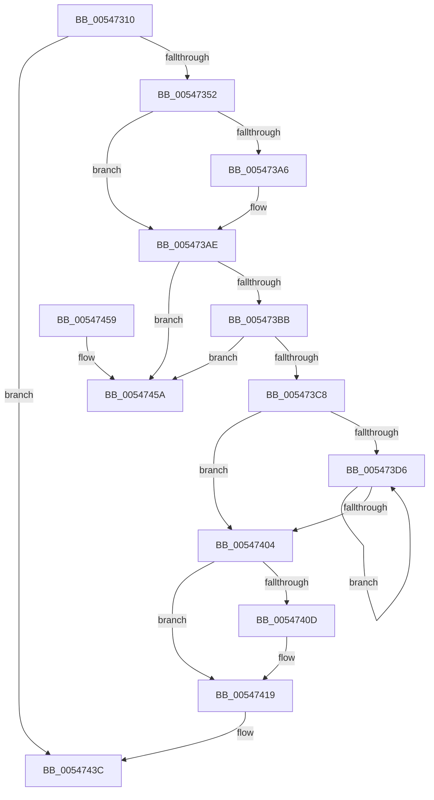

# HalpFreePmcCounterSet

- RVA: `0x00547310`–`0x00547461` (길이 `337` bytes)
- VA: `0x0000000140547310`
- 실행 섹션: `.text`
- PDB 이름 있음: `예`; PDB Function 태그: `아니요`
- unwind 정보 RVA: `0x000C3D80`
- 디코드: `86`개 명령, `337/337` bytes 표시
- 미해석 바이트: `0` (있으면 어셈블리에 `.byte`로 보존)

> 이 문서는 커널 이미지의 기계어와 PDB 기호를 분석해 생성했습니다. 4번과 5번은 함수 원형과 자료형을 바이너리 사용 방식에서 추정한 C 해석이며 원본 소스 복구 결과는 아닙니다.

## 1. Dependencies

- 직접 호출 지점: **8**; 고유 호출 대상: **8**
- 직접 호출자로 확인된 함수: **0**
- RIP 상대 이미지 참조: **6**

### Outgoing calls
- `0x0054738B` → [KeSetSystemGroupAffinityThread](../39/KeSetSystemGroupAffinityThread_function_00399140.md) (function, `0x00399140`)
- `0x005473A9` → [KiRaiseIrqlProcessIrqlFlags](../4F/KiRaiseIrqlProcessIrqlFlags_function_004F56FC.md) (function, `0x004F56FC`)
- `0x005473F1` → [guard_dispatch_icall](../6B/guard_dispatch_icall_function_006BAAD0.md) (function, `0x006BAAD0`)
- `0x00547414` → [KiLowerIrqlProcessIrqlFlags](../4F/KiLowerIrqlProcessIrqlFlags_function_004F5698.md) (function, `0x004F5698`)
- `0x00547426` → [KeRevertToUserGroupAffinityThread](../39/KeRevertToUserGroupAffinityThread_function_00398EC0.md) (function, `0x00398EC0`)
- `0x0054742E` → [HalpMmAllocCtxFree](../3E/HalpMmAllocCtxFree_function_003E1904.md) (function, `0x003E1904`)
- `0x00547437` → [HalpNotifyActorIfPmuAvailable](../../page/70/HalpNotifyActorIfPmuAvailable_function_00707880.md) (function, `0x00707880`)
- `0x00547444` → [_security_check_cookie](../6A/_security_check_cookie_function_006AC640.md) (function, `0x006AC640`)

### Direct callers
- 이 함수 시작 RVA로 연결되는 직접 call은 확인되지 않았습니다. 간접 호출은 완전히 역산할 수 없습니다.

### Static image references
- `0x00547320` → RVA `0x00E0A740` (`.data`; read)
- `0x0054732F` → RVA `0x00FC2BE0` (`.data`; read)
- `0x00547359` → RVA `0x00F231B0` (`.data`; read)
- `0x0054739D` → RVA `0x00FC6D20` (`ALMOSTRO`; read)
- `0x005473D6` → RVA `0x00E03B20` (`.data`; read)
- `0x005473F6` → RVA `0x00FC2B4C` (`.data`; read/write)

## 2. Other-region calls and transfers

- 다른 실행 섹션으로 향하는 call: **1**
  - `0x00547437` → [HalpNotifyActorIfPmuAvailable](../../page/70/HalpNotifyActorIfPmuAvailable_function_00707880.md) (`.text` → `PAGE`)
- 별도 외부 분기/꼬리 이동을 확인하지 못했습니다.

## 3. Assembly (complete function range)

```asm
00547310  4C 8B DC                        mov r11, rsp
00547313  49 89 5B 10                     mov qword ptr [r11 + 0x10], rbx
00547317  49 89 73 18                     mov qword ptr [r11 + 0x18], rsi
0054731B  57                              push rdi
0054731C  48 83 EC 50                     sub rsp, 0x50
00547320  48 8B 05 19 34 8C 00            mov rax, qword ptr [rip + 0x8c3419]
00547327  48 33 C4                        xor rax, rsp
0054732A  48 89 44 24 40                  mov qword ptr [rsp + 0x40], rax
0054732F  48 8D 05 AA B8 A7 00            lea rax, [rip + 0xa7b8aa]
00547336  0F 57 C0                        xorps xmm0, xmm0
00547339  0F 57 C9                        xorps xmm1, xmm1
0054733C  48 8B D9                        mov rbx, rcx
0054733F  0F 11 44 24 20                  movups xmmword ptr [rsp + 0x20], xmm0
00547344  0F 11 4C 24 30                  movups xmmword ptr [rsp + 0x30], xmm1
00547349  48 3B C8                        cmp rcx, rax
0054734C  0F 84 EA 00 00 00               je 0x14054743c
00547352  8B 49 10                        mov ecx, dword ptr [rcx + 0x10]
00547355  49 8D 53 D8                     lea rdx, [r11 - 0x28]
00547359  48 8B 05 50 BE 9D 00            mov rax, qword ptr [rip + 0x9dbe50]
00547360  8B 0C 88                        mov ecx, dword ptr [rax + rcx*4]
00547363  33 C0                           xor eax, eax
00547365  89 44 24 2A                     mov dword ptr [rsp + 0x2a], eax
00547369  66 89 44 24 2E                  mov word ptr [rsp + 0x2e], ax
0054736E  8B C1                           mov eax, ecx
00547370  C1 E8 06                        shr eax, 6
00547373  83 E1 3F                        and ecx, 0x3f
00547376  66 89 44 24 28                  mov word ptr [rsp + 0x28], ax
0054737B  B8 01 00 00 00                  mov eax, 1
00547380  48 D3 E0                        shl rax, cl
00547383  49 8D 4B C8                     lea rcx, [r11 - 0x38]
00547387  49 89 43 C8                     mov qword ptr [r11 - 0x38], rax
0054738B  E8 B0 1D E5 FF                  call 0x140399140
00547390  44 0F 20 C7                     mov rdi, cr8
00547394  BA 0F 00 00 00                  mov edx, 0xf
00547399  44 0F 22 C2                     mov cr8, rdx
0054739D  83 3D 7C F9 A7 00 00            cmp dword ptr [rip + 0xa7f97c], 0
005473A4  74 08                           je 0x1405473ae
005473A6  40 8A CF                        mov cl, dil
005473A9  E8 4E E3 FA FF                  call 0x1404f56fc
005473AE  48 8B 0B                        mov rcx, qword ptr [rbx]
005473B1  48 39 59 08                     cmp qword ptr [rcx + 8], rbx
005473B5  0F 85 9F 00 00 00               jne 0x14054745a
005473BB  48 8B 43 08                     mov rax, qword ptr [rbx + 8]
005473BF  48 39 18                        cmp qword ptr [rax], rbx
005473C2  0F 85 92 00 00 00               jne 0x14054745a
005473C8  48 89 08                        mov qword ptr [rax], rcx
005473CB  33 F6                           xor esi, esi
005473CD  48 89 41 08                     mov qword ptr [rcx + 8], rax
005473D1  39 73 14                        cmp dword ptr [rbx + 0x14], esi
005473D4  76 2E                           jbe 0x140547404
005473D6  48 8B 05 43 C7 8B 00            mov rax, qword ptr [rip + 0x8bc743]
005473DD  48 8D 0C B6                     lea rcx, [rsi + rsi*4]
005473E1  48 8D 53 30                     lea rdx, [rbx + 0x30]
005473E5  48 8D 14 CA                     lea rdx, [rdx + rcx*8]
005473E9  8B 4C CB 28                     mov ecx, dword ptr [rbx + rcx*8 + 0x28]
005473ED  48 8B 40 10                     mov rax, qword ptr [rax + 0x10]
005473F1  E8 DA 36 17 00                  call 0x1406baad0
005473F6  F0 FF 0D 4F B7 A7 00            lock dec dword ptr [rip + 0xa7b74f]
005473FD  FF C6                           inc esi
005473FF  3B 73 14                        cmp esi, dword ptr [rbx + 0x14]
00547402  72 D2                           jb 0x1405473d6
00547404  83 3D 15 F9 A7 00 00            cmp dword ptr [rip + 0xa7f915], 0
0054740B  74 0C                           je 0x140547419
0054740D  44 0F 20 C1                     mov rcx, cr8
00547411  40 8A D7                        mov dl, dil
00547414  E8 7F E2 FA FF                  call 0x1404f5698
00547419  40 0F B6 C7                     movzx eax, dil
0054741D  44 0F 22 C0                     mov cr8, rax
00547421  48 8D 4C 24 30                  lea rcx, [rsp + 0x30]
00547426  E8 95 1A E5 FF                  call 0x140398ec0
0054742B  48 8B D3                        mov rdx, rbx
0054742E  E8 D1 A4 E9 FF                  call 0x1403e1904
00547433  33 D2                           xor edx, edx
00547435  33 C9                           xor ecx, ecx
00547437  E8 44 04 1C 00                  call 0x140707880
0054743C  48 8B 4C 24 40                  mov rcx, qword ptr [rsp + 0x40]
00547441  48 33 CC                        xor rcx, rsp
00547444  E8 F7 51 16 00                  call 0x1406ac640
00547449  48 8B 5C 24 68                  mov rbx, qword ptr [rsp + 0x68]
0054744E  48 8B 74 24 70                  mov rsi, qword ptr [rsp + 0x70]
00547453  48 83 C4 50                     add rsp, 0x50
00547457  5F                              pop rdi
00547458  C3                              ret
00547459  CC                              int3
0054745A  B9 03 00 00 00                  mov ecx, 3
0054745F  CD 29                           int 0x29
```

## 4. C-style interpretation (structured pseudocode)

```c
__int64 __fastcall HalpFreePmcCounterSet(__int64 a1)
{
    __int64 result;
    __int64 v_rsi;
    __int64 v_rsp;
    unsigned __int64 v_stack_m18;
    unsigned __int64 v_stack_m28;
    unsigned __int16 v_stack_m2A;
    unsigned int v_stack_m2E;
    unsigned __int16 v_stack_m30;
    unsigned __int64 v_stack_m38;
    unsigned __int64 v_stack_p10;
    unsigned __int64 v_stack_p18;

    *(unsigned __int64 *)(v_rsp + 16) = v_rbx;
    *(unsigned __int64 *)(v_rsp + 24) = v_rsi;
    v_rsp = (v_rsp) - (80);
    result = (*(unsigned __int64 *)(v_rip + 9188377)) ^ (v_rsp);
    v_stack_m18 = result;
    v_stack_m38 = v_xmm0;
    v_stack_m28 = v_xmm1;
    if (a1 == (v_rip + 10991786)) goto loc_0054743C;
    result = 0;
    v_stack_m2E = 0;
    v_stack_m2A = 0;
    result = (unsigned int)(((unsigned int)((unsigned int)((unsigned int)(*(unsigned int *)(*(unsigned __int64 *)(v_rip + 10337872) + (unsigned int)(*(unsigned int *)(a1 + 16)) * 4))))) >> (6));
    a1 = (unsigned int)(((unsigned int)(*(unsigned int *)(*(unsigned __int64 *)(v_rip + 10337872) + (unsigned int)(*(unsigned int *)(a1 + 16)) * 4))) & (63));
    v_stack_m30 = (unsigned __int16)(result);
    result = (1) << ((unsigned __int8)(a1));
    *(unsigned __int64 *)(v_rsp - 56) = result;
    result = KeSetSystemGroupAffinityThread(v_rsp - 56, v_rsp - 40, a3, a4);
    if ((*(unsigned int *)(v_rip + 11008380)) != 0) {
        a1 = (unsigned __int8)(v_cr8);
        result = KiRaiseIrqlProcessIrqlFlags(a1, 15, a3, a4);
    }
    if ((*(unsigned __int64 *)(*(unsigned __int64 *)(a1) + 8)) != a1) goto loc_0054745A;
    if ((*(unsigned __int64 *)(*(unsigned __int64 *)(a1 + 8))) != a1) goto loc_0054745A;
    *(unsigned __int64 *)(*(unsigned __int64 *)(a1 + 8)) = *(unsigned __int64 *)(a1);
    v_rsi = 0;
    *(unsigned __int64 *)(*(unsigned __int64 *)(a1) + 8) = *(unsigned __int64 *)(a1 + 8);
    if ((*(unsigned int *)(a1 + 20)) <= 0) goto loc_00547404;
loc_005473D6:
    result = guard_dispatch_icall((unsigned int)(*(unsigned int *)(a1 + v_rsi + v_rsi * 4 * 8 + 40)), a1 + 48 + v_rsi + v_rsi * 4 * 8, a3, a4);
    v_rsi = (unsigned int)((v_rsi) + 1);
    if (((unsigned int)(v_rsi)) < (*(unsigned int *)(a1 + 20))) goto loc_005473D6;
loc_00547404:
    if ((*(unsigned int *)(v_rip + 11008277)) != 0) {
        a1 = 15;
        a2 = (unsigned __int8)(v_cr8);
        result = KiLowerIrqlProcessIrqlFlags(a1, a2, a3, a4);
    }
    result = KeRevertToUserGroupAffinityThread(v_stack_m28, a2, a3, a4);
    result = HalpMmAllocCtxFree(v_stack_m28, a1, a3, a4);
    a2 = 0;
    a1 = 0;
    result = HalpNotifyActorIfPmuAvailable(a1, a2, a3, a4);
loc_0054743C:
    a1 = (v_stack_m18) ^ (v_rsp);
    result = _security_check_cookie(a1, a2, a3, a4);
    v_rsp = (v_rsp) + (80);
    return result;
loc_0054745A:
    return result;
}
```

## 5. (Beta) C Style

```c
int64_t HalpFreePmcCounterSet(void *Arg1)
{
    uint8_t *arg1 = (uint8_t *)Arg1;

    int64_t result;
    int64_t local_rsi;
    int64_t local_rsp;
    uint64_t v_stack_m18;
    uint64_t v_stack_m28;
    uint16_t v_stack_m2A;
    uint32_t v_stack_m2E;
    uint16_t v_stack_m30;
    uint64_t v_stack_m38;
    uint64_t v_stack_p10;
    uint64_t v_stack_p18;

    *(uint64_t *)(local_rsp + 0x10) = local_rbx;
    *(uint64_t *)(local_rsp + 0x18) = local_rsi;
    local_rsp = (local_rsp) - (80);
    result = (*(uint64_t *)(v_rip + 0x8C3419)) ^ (local_rsp);
    v_stack_m18 = result;
    v_stack_m38 = v_xmm0;
    v_stack_m28 = v_xmm1;
    if (Arg1 == (v_rip + 10991786)) goto loc_0054743C;
    result = 0;
    v_stack_m2E = 0;
    v_stack_m2A = 0;
    result = (uint32_t)(((uint32_t)((uint32_t)((uint32_t)(*(uint32_t *)(*(uint64_t *)(v_rip + 0x9DBE50) + (uint32_t)(*(uint32_t *)(arg1 + 0x10)) * 4))))) >> (6));
    Arg1 = (uint32_t)(((uint32_t)(*(uint32_t *)(*(uint64_t *)(v_rip + 0x9DBE50) + (uint32_t)(*(uint32_t *)(arg1 + 0x10)) * 4))) & (63));
    v_stack_m30 = (uint16_t)(result);
    result = (1) << ((uint8_t)(Arg1));
    *(uint64_t *)(local_rsp - 0x38) = result;
    result = KeSetSystemGroupAffinityThread(local_rsp - 56, local_rsp - 40, a3, a4);
    if ((*(uint32_t *)(v_rip + 0xA7F97C)) != 0) {
        Arg1 = (uint8_t)(v_cr8);
        result = KiRaiseIrqlProcessIrqlFlags(Arg1, 15, a3, a4);
    }
    if ((*(uint64_t *)(*(uint64_t *)(arg1) + 0x8)) != Arg1) goto loc_0054745A;
    if ((*(uint64_t *)(*(uint64_t *)(arg1 + 0x8))) != Arg1) goto loc_0054745A;
    *(uint64_t *)(*(uint64_t *)(arg1 + 0x8)) = *(uint64_t *)(arg1);
    local_rsi = 0;
    *(uint64_t *)(*(uint64_t *)(arg1) + 0x8) = *(uint64_t *)(arg1 + 0x8);
    if ((*(uint32_t *)(arg1 + 0x14)) <= 0) goto loc_00547404;
loc_005473D6:
    result = guard_dispatch_icall((uint32_t)(*(uint32_t *)(arg1 + local_rsi + local_rsi * 4 * 8 + 0x28)), Arg1 + 48 + local_rsi + local_rsi * 4 * 8, a3, a4);
    local_rsi = (uint32_t)((local_rsi) + 1);
    if (((uint32_t)(local_rsi)) < (*(uint32_t *)(arg1 + 0x14))) goto loc_005473D6;
loc_00547404:
    if ((*(uint32_t *)(v_rip + 0xA7F915)) != 0) {
        Arg1 = 15;
        a2 = (uint8_t)(v_cr8);
        result = KiLowerIrqlProcessIrqlFlags(Arg1, a2, a3, a4);
    }
    result = KeRevertToUserGroupAffinityThread(v_stack_m28, a2, a3, a4);
    result = HalpMmAllocCtxFree(v_stack_m28, Arg1, a3, a4);
    a2 = 0;
    Arg1 = 0;
    result = HalpNotifyActorIfPmuAvailable(Arg1, a2, a3, a4);
loc_0054743C:
    Arg1 = (v_stack_m18) ^ (local_rsp);
    result = _security_check_cookie(Arg1, a2, a3, a4);
    local_rsp = (local_rsp) + (80);
    return result;
loc_0054745A:
    return result;
}
```

### 관측된 메모리 오프셋

구조체 형식이 확인되지 않은 접근은 인자 기준의 오프셋으로만 기록했습니다.

| 기준 인자 | 오프셋 표현 | 폭 (bit) | 접근 |
|---|---:|---:|---|
| `Arg1` | `+ 0x0` | `64` | `R` |
| `Arg1` | `+ 0x0 + rcx*8` | `64` | `R` |
| `Arg1` | `+ 0x8` | `64` | `R` |
| `Arg1` | `+ 0x14` | `32` | `R` |
| `Arg1` | `+ 0x28 + rcx*8` | `32` | `R` |
| `Arg1` | `+ 0x30` | `64` | `R` |

## 6. Execution-region graph

[열기: 2D/3D 그래프와 함수 탐색 컨트롤 패널](../../../control-panel.html?section=text&rva=0x00547310&view=graph)

- 2D 그래프는 위에서 아래로 흐르고, 3D 그래프는 빈 공간을 드래그해 회전합니다. Shift+드래그는 이동, 휠은 확대·축소, 함수 노드 선택은 대상 보고서 이동입니다.

### Static fallback


