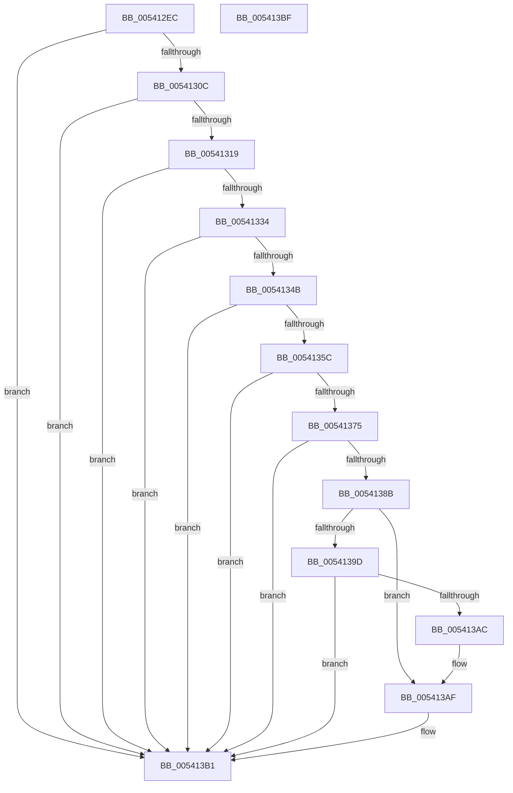

# HalpGetMcaExtendedLogStatusBlock

- RVA: `0x005412EC`–`0x005413C0` (길이 `212` bytes)
- VA: `0x00000001405412EC`
- 실행 섹션: `.text`
- PDB 이름 있음: `예`; PDB Function 태그: `아니요`
- unwind 정보 RVA: `0x0005CAAC`
- 디코드: `54`개 명령, `212/212` bytes 표시
- 미해석 바이트: `0` (있으면 어셈블리에 `.byte`로 보존)

> 이 문서는 커널 이미지의 기계어와 PDB 기호를 분석해 생성했습니다. 4번과 5번은 함수 원형과 자료형을 바이너리 사용 방식에서 추정한 C 해석이며 원본 소스 복구 결과는 아닙니다.

## 1. Dependencies

- 직접 호출 지점: **2**; 고유 호출 대상: **2**
- 직접 호출자로 확인된 함수: **1**
- RIP 상대 이미지 참조: **8**

### Outgoing calls
- `0x0054132B` → [guard_dispatch_icall](../6B/guard_dispatch_icall_function_006BAAD0.md) (function, `0x006BAAD0`)
- `0x005413A3` → [HalpVerifyGenericError](HalpVerifyGenericError_function_005423F0.md) (function, `0x005423F0`)

### Direct callers
- [HalpCreateMcaMemoryErrorRecord](HalpCreateMcaMemoryErrorRecord_function_00540C78.md) at `0x00540D60`

### Static image references
- `0x005412FD` → RVA `0x00E100C0` (`.data`; read)
- `0x0054130C` → RVA `0x00E3EBF0` (`.data`; read)
- `0x00541319` → RVA `0x00E00A28` (`.data`; read)
- `0x00541334` → RVA `0x00E3EC00` (`.data`; read)
- `0x00541342` → RVA `0x00E3EBF8` (`.data`; read)
- `0x0054135C` → RVA `0x00E3EC08` (`.data`; read)
- `0x00541375` → RVA `0x00E3EC18` (`.data`; read)
- `0x00541391` → RVA `0x00E3EC10` (`.data`; read)

## 2. Other-region calls and transfers

- 다른 실행 섹션으로 향하는 call: **0**
- 별도 외부 분기/꼬리 이동을 확인하지 못했습니다.

## 3. Assembly (complete function range)

```asm
005412EC  48 89 5C 24 08                  mov qword ptr [rsp + 8], rbx
005412F1  57                              push rdi
005412F2  48 83 EC 20                     sub rsp, 0x20
005412F6  83 64 24 38 00                  and dword ptr [rsp + 0x38], 0
005412FB  33 DB                           xor ebx, ebx
005412FD  38 1D BD ED 8C 00               cmp byte ptr [rip + 0x8cedbd], bl
00541303  48 8B F9                        mov rdi, rcx
00541306  0F 84 A5 00 00 00               je 0x1405413b1
0054130C  48 39 1D DD D8 8F 00            cmp qword ptr [rip + 0x8fd8dd], rbx
00541313  0F 84 98 00 00 00               je 0x1405413b1
00541319  48 8B 05 08 F7 8B 00            mov rax, qword ptr [rip + 0x8bf708]
00541320  48 8D 54 24 38                  lea rdx, [rsp + 0x38]
00541325  8B 49 10                        mov ecx, dword ptr [rcx + 0x10]
00541328  45 33 C0                        xor r8d, r8d
0054132B  E8 A0 97 17 00                  call 0x1406baad0
00541330  85 C0                           test eax, eax
00541332  78 7D                           js 0x1405413b1
00541334  8B 15 C6 D8 8F 00               mov edx, dword ptr [rip + 0x8fd8c6]
0054133A  0F AF 54 24 38                  imul edx, dword ptr [rsp + 0x38]
0054133F  03 57 24                        add edx, dword ptr [rdi + 0x24]
00541342  48 3B 15 AF D8 8F 00            cmp rdx, qword ptr [rip + 0x8fd8af]
00541349  73 66                           jae 0x1405413b1
0054134B  48 8B 05 9E D8 8F 00            mov rax, qword ptr [rip + 0x8fd89e]
00541352  48 8B 54 D0 40                  mov rdx, qword ptr [rax + rdx*8 + 0x40]
00541357  48 85 D2                        test rdx, rdx
0054135A  79 55                           jns 0x1405413b1
0054135C  4C 8B 05 A5 D8 8F 00            mov r8, qword ptr [rip + 0x8fd8a5]
00541363  48 B8 FF FF FF FF FF FF FF 7F   movabs rax, 0x7fffffffffffffff
0054136D  48 23 D0                        and rdx, rax
00541370  49 3B D0                        cmp rdx, r8
00541373  72 3C                           jb 0x1405413b1
00541375  48 8B 0D 9C D8 8F 00            mov rcx, qword ptr [rip + 0x8fd89c]
0054137C  48 8D 82 00 10 00 00            lea rax, [rdx + 0x1000]
00541383  49 03 C8                        add rcx, r8
00541386  48 3B C1                        cmp rax, rcx
00541389  77 26                           ja 0x1405413b1
0054138B  48 8B DA                        mov rbx, rdx
0054138E  49 2B D8                        sub rbx, r8
00541391  48 03 1D 78 D8 8F 00            add rbx, qword ptr [rip + 0x8fd878]
00541398  83 3B 00                        cmp dword ptr [rbx], 0
0054139B  74 12                           je 0x1405413af
0054139D  48 8B D3                        mov rdx, rbx
005413A0  48 8B CF                        mov rcx, rdi
005413A3  E8 48 10 00 00                  call 0x1405423f0
005413A8  85 C0                           test eax, eax
005413AA  79 05                           jns 0x1405413b1
005413AC  83 23 00                        and dword ptr [rbx], 0
005413AF  33 DB                           xor ebx, ebx
005413B1  48 8B C3                        mov rax, rbx
005413B4  48 8B 5C 24 30                  mov rbx, qword ptr [rsp + 0x30]
005413B9  48 83 C4 20                     add rsp, 0x20
005413BD  5F                              pop rdi
005413BE  C3                              ret
005413BF  CC                              int3
```

## 4. C-style interpretation (structured pseudocode)

```c
__int64 __fastcall HalpGetMcaExtendedLogStatusBlock(__int64 a1, __int64 a2, int a3)
{
    __int64 result;
    __int64 v_rbx;
    __int64 v_rsp;
    unsigned int v_stack_p10;
    unsigned __int64 v_stack_p8;

    v_stack_p8 = v_rbx;
    v_rsp = (v_rsp) - (32);
    v_rbx = 0;
    if ((*(unsigned __int8 *)(v_rip + 9235901)) == 0) goto loc_005413B1;
    if ((*(unsigned __int64 *)(v_rip + 9427165)) == 0) goto loc_005413B1;
    a3 = 0;
    result = guard_dispatch_icall((unsigned int)(*(unsigned int *)(a1 + 16)), v_stack_p10, a3, a4);
    if (sign_flag) goto loc_005413B1;
    a2 = (unsigned int)(((unsigned int)(*(unsigned int *)(v_rip + 9427142))) * (v_stack_p10));
    a2 = (unsigned int)((a2) + (*(unsigned int *)(a1 + 36)));
    if (a2 >= (*(unsigned __int64 *)(v_rip + 9427119))) goto loc_005413B1;
    if (!sign_flag) goto loc_005413B1;
    a2 = (*(unsigned __int64 *)(*(unsigned __int64 *)(v_rip + 9427102) + a2 * 8 + 64)) & (*(unsigned __int64 *)(v_rip + 9427102));
    if (a2 < (*(unsigned __int64 *)(v_rip + 9427109))) goto loc_005413B1;
    a1 = (*(unsigned __int64 *)(v_rip + 9427100)) + (*(unsigned __int64 *)(v_rip + 9427109));
    if ((a2 + 4096) > a1) goto loc_005413B1;
    v_rbx = (a2) - (*(unsigned __int64 *)(v_rip + 9427109));
    v_rbx = (v_rbx) + (*(unsigned __int64 *)(v_rip + 9427064));
    if ((*(unsigned int *)(v_rbx)) == 0) goto loc_005413AF;
    result = HalpVerifyGenericError(a1, v_rbx, *(unsigned __int64 *)(v_rip + 9427109), a4);
    if (!sign_flag) goto loc_005413B1;
loc_005413AF:
    v_rbx = 0;
loc_005413B1:
    v_rsp = (v_rsp) + (32);
    return 0;
}
```

## 5. (Beta) C Style

```c
int64_t HalpGetMcaExtendedLogStatusBlock(void *Arg1, int64_t Arg2, int32_t Arg3)
{
    uint8_t *arg1 = (uint8_t *)Arg1;

    int64_t result;
    int64_t local_rbx;
    int64_t local_rsp;
    uint32_t v_stack_p10;
    uint64_t v_stack_p8;

    v_stack_p8 = local_rbx;
    local_rsp = (local_rsp) - (32);
    local_rbx = 0;
    if ((*(uint8_t *)(v_rip + 0x8CEDBD)) == 0) goto loc_005413B1;
    if ((*(uint64_t *)(v_rip + 0x8FD8DD)) == 0) goto loc_005413B1;
    Arg3 = 0;
    result = guard_dispatch_icall((uint32_t)(*(uint32_t *)(arg1 + 0x10)), v_stack_p10, Arg3, a4);
    if (sign_flag) goto loc_005413B1;
    Arg2 = (uint32_t)(((uint32_t)(*(uint32_t *)(v_rip + 0x8FD8C6))) * (v_stack_p10));
    Arg2 = (uint32_t)((Arg2) + (*(uint32_t *)(arg1 + 0x24)));
    if (Arg2 >= (*(uint64_t *)(v_rip + 0x8FD8AF))) goto loc_005413B1;
    if (!sign_flag) goto loc_005413B1;
    Arg2 = (*(uint64_t *)(*(uint64_t *)(v_rip + 0x8FD89E) + Arg2 * 8 + 0x40)) & (*(uint64_t *)(v_rip + 0x8FD89E));
    if (Arg2 < (*(uint64_t *)(v_rip + 0x8FD8A5))) goto loc_005413B1;
    Arg1 = (*(uint64_t *)(v_rip + 0x8FD89C)) + (*(uint64_t *)(v_rip + 0x8FD8A5));
    if ((Arg2 + 4096) > Arg1) goto loc_005413B1;
    local_rbx = (Arg2) - (*(uint64_t *)(v_rip + 0x8FD8A5));
    local_rbx = (local_rbx) + (*(uint64_t *)(v_rip + 0x8FD878));
    if ((*(uint32_t *)(local_rbx)) == 0) goto loc_005413AF;
    result = HalpVerifyGenericError(Arg1, local_rbx, *(uint64_t *)(v_rip + 0x8FD8A5), a4);
    if (!sign_flag) goto loc_005413B1;
loc_005413AF:
    local_rbx = 0;
loc_005413B1:
    local_rsp = (local_rsp) + (32);
    return 0;
}
```

### 관측된 메모리 오프셋

구조체 형식이 확인되지 않은 접근은 인자 기준의 오프셋으로만 기록했습니다.

| 기준 인자 | 오프셋 표현 | 폭 (bit) | 접근 |
|---|---:|---:|---|
| `Arg1` | `+ 0x10` | `32` | `R` |
| `Arg1` | `+ 0x24` | `32` | `R` |

## 6. Execution-region graph

[열기: 2D/3D 그래프와 함수 탐색 컨트롤 패널](../../../control-panel.html?section=text&rva=0x005412EC&view=graph)

- 2D 그래프는 위에서 아래로 흐르고, 3D 그래프는 빈 공간을 드래그해 회전합니다. Shift+드래그는 이동, 휠은 확대·축소, 함수 노드 선택은 대상 보고서 이동입니다.

### Static fallback


