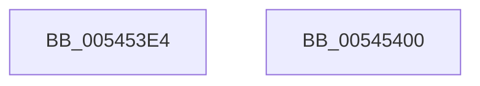

# HalpGetMcaMaxVendorSpecificSectionLength

- RVA: `0x005453E4`–`0x00545401` (길이 `29` bytes)
- VA: `0x00000001405453E4`
- 실행 섹션: `.text`
- PDB 이름 있음: `예`; PDB Function 태그: `아니요`
- unwind 정보 RVA: `0x0005C788`
- 디코드: `10`개 명령, `29/29` bytes 표시
- 미해석 바이트: `0` (있으면 어셈블리에 `.byte`로 보존)

> 이 문서는 커널 이미지의 기계어와 PDB 기호를 분석해 생성했습니다. 4번과 5번은 함수 원형과 자료형을 바이너리 사용 방식에서 추정한 C 해석이며 원본 소스 복구 결과는 아닙니다.

## 1. Dependencies

- 직접 호출 지점: **1**; 고유 호출 대상: **1**
- 직접 호출자로 확인된 함수: **1**
- RIP 상대 이미지 참조: **0**

### Outgoing calls
- `0x005453E8` → [HalpGetCpuVendor](../48/HalpGetCpuVendor_function_004879E4.md) (function, `0x004879E4`)

### Direct callers
- [HalpCorrectErrSrc](../../pagelk/B5/HalpCorrectErrSrc_function_00B5B820.md) at `0x00B5B8B2`

### Static image references
- 디코드된 RIP-relative 메모리 참조가 없습니다.

## 2. Other-region calls and transfers

- 다른 실행 섹션으로 향하는 call: **0**
- 별도 외부 분기/꼬리 이동을 확인하지 못했습니다.

## 3. Assembly (complete function range)

```asm
005453E4  48 83 EC 28                     sub rsp, 0x28
005453E8  E8 F7 25 F4 FF                  call 0x1404879e4
005453ED  33 D2                           xor edx, edx
005453EF  B9 A6 00 00 00                  mov ecx, 0xa6
005453F4  3C 02                           cmp al, 2
005453F6  0F 45 CA                        cmovne ecx, edx
005453F9  8B C1                           mov eax, ecx
005453FB  48 83 C4 28                     add rsp, 0x28
005453FF  C3                              ret
00545400  CC                              int3
```

## 4. C-style interpretation (structured pseudocode)

```c
__int64 __fastcall HalpGetMcaMaxVendorSpecificSectionLength(__int64 a1, int a2)
{
    __int64 result;
    __int64 v_rsp;

    v_rsp = (v_rsp) - (40);
    result = HalpGetCpuVendor(a1, a2, a3, a4);
    a2 = 0;
    a1 = 166;
    if (((unsigned __int8)(result)) != 2) { a1 = 0; }
    v_rsp = (v_rsp) + (40);
    return (unsigned int)((unsigned int)(a1));
}
```

## 5. (Beta) C Style

```c
int64_t HalpGetMcaMaxVendorSpecificSectionLength(int64_t Arg1, int32_t Arg2)
{
    int64_t result;
    int64_t local_rsp;

    local_rsp = (local_rsp) - (40);
    result = HalpGetCpuVendor(Arg1, Arg2, a3, a4);
    Arg2 = 0;
    Arg1 = 166;
    if (((uint8_t)(result)) != 2) { Arg1 = 0; }
    local_rsp = (local_rsp) + (40);
    return (uint32_t)((uint32_t)(Arg1));
}
```

## 6. Execution-region graph

[열기: 2D/3D 그래프와 함수 탐색 컨트롤 패널](../../../control-panel.html?section=text&rva=0x005453E4&view=graph)

- 2D 그래프는 위에서 아래로 흐르고, 3D 그래프는 빈 공간을 드래그해 회전합니다. Shift+드래그는 이동, 휠은 확대·축소, 함수 노드 선택은 대상 보고서 이동입니다.

### Static fallback


