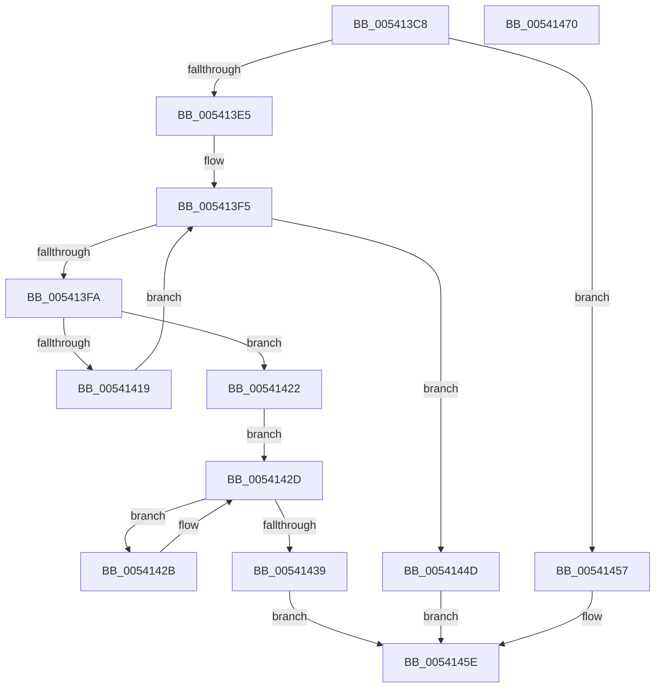

# HalpHandleMachineCheck

- RVA: `0x005413C8`–`0x00541471` (길이 `169` bytes)
- VA: `0x00000001405413C8`
- 실행 섹션: `.text`
- PDB 이름 있음: `예`; PDB Function 태그: `아니요`
- unwind 정보 RVA: `0x0005CAAC`
- 디코드: `44`개 명령, `169/169` bytes 표시
- 미해석 바이트: `0` (있으면 어셈블리에 `.byte`로 보존)

> 이 문서는 커널 이미지의 기계어와 PDB 기호를 분석해 생성했습니다. 4번과 5번은 함수 원형과 자료형을 바이너리 사용 방식에서 추정한 C 해석이며 원본 소스 복구 결과는 아닙니다.

## 1. Dependencies

- 직접 호출 지점: **6**; 고유 호출 대상: **5**
- 직접 호출자로 확인된 함수: **1**
- RIP 상대 이미지 참조: **4**

### Outgoing calls
- `0x00541410` → [guard_dispatch_icall](../6B/guard_dispatch_icall_function_006BAAD0.md) (function, `0x006BAAD0`)
- `0x00541430` → [KxTryToAcquireSpinLock](../46/KxTryToAcquireSpinLock_function_0046BE18.md) (function, `0x0046BE18`)
- `0x0054143E` → [HalpMceHandler](HalpMceHandler_function_00541F24.md) (function, `0x00541F24`)
- `0x00541446` → [KxReleaseSpinLock](../20/KxReleaseSpinLock_function_00206670.md) (function, `0x00206670`)
- `0x00541450` → [HalpMceHandlerWithRendezvous](HalpMceHandlerWithRendezvous_function_005421E0.md) (function, `0x005421E0`)
- `0x00541459` → [HalpMceHandler](HalpMceHandler_function_00541F24.md) (function, `0x00541F24`)

### Direct callers
- [HalHandleMcheck](HalHandleMcheck_function_00544D40.md) at `0x00544DA6`

### Static image references
- `0x005413D5` → RVA `0x00EEF050` (`.data`; read/write)
- `0x005413DC` → RVA `0x00E100B9` (`.data`; read)
- `0x005413FA` → RVA `0x00FC1990` (`.data`; read)
- `0x00541422` → RVA `0x00E0F6E0` (`.data`; read)

## 2. Other-region calls and transfers

- 다른 실행 섹션으로 향하는 call: **0**
- 별도 외부 분기/꼬리 이동을 확인하지 못했습니다.

## 3. Assembly (complete function range)

```asm
005413C8  48 89 5C 24 08                  mov qword ptr [rsp + 8], rbx
005413CD  57                              push rdi
005413CE  48 83 EC 20                     sub rsp, 0x20
005413D2  48 8B F9                        mov rdi, rcx
005413D5  F0 FF 05 74 DC 9A 00            lock inc dword ptr [rip + 0x9adc74]
005413DC  80 3D D6 EC 8C 00 00            cmp byte ptr [rip + 0x8cecd6], 0
005413E3  74 72                           je 0x140541457
005413E5  65 48 8B 04 25 18 00 00 00      mov rax, qword ptr gs:[0x18]
005413EE  48 8B 98 D8 00 00 00            mov rbx, qword ptr [rax + 0xd8]
005413F5  48 85 DB                        test rbx, rbx
005413F8  74 53                           je 0x14054144d
005413FA  48 8B 05 8F 05 A8 00            mov rax, qword ptr [rip + 0xa8058f]
00541401  45 33 C0                        xor r8d, r8d
00541404  48 8B 8B AC 00 00 00            mov rcx, qword ptr [rbx + 0xac]
0054140B  BA 7A 01 00 00                  mov edx, 0x17a
00541410  E8 BB 96 17 00                  call 0x1406baad0
00541415  A8 08                           test al, 8
00541417  75 09                           jne 0x140541422
00541419  48 8B 9B B8 00 00 00            mov rbx, qword ptr [rbx + 0xb8]
00541420  EB D3                           jmp 0x1405413f5
00541422  48 8D 1D B7 E2 8C 00            lea rbx, [rip + 0x8ce2b7]
00541429  EB 02                           jmp 0x14054142d
0054142B  F3 90                           pause
0054142D  48 8B CB                        mov rcx, rbx
00541430  E8 E3 A9 F2 FF                  call 0x14046be18
00541435  84 C0                           test al, al
00541437  74 F2                           je 0x14054142b
00541439  B2 01                           mov dl, 1
0054143B  48 8B CF                        mov rcx, rdi
0054143E  E8 E1 0A 00 00                  call 0x140541f24
00541443  48 8B CB                        mov rcx, rbx
00541446  E8 25 52 CC FF                  call 0x140206670
0054144B  EB 11                           jmp 0x14054145e
0054144D  48 8B CF                        mov rcx, rdi
00541450  E8 8B 0D 00 00                  call 0x1405421e0
00541455  EB 07                           jmp 0x14054145e
00541457  33 D2                           xor edx, edx
00541459  E8 C6 0A 00 00                  call 0x140541f24
0054145E  F0 FF 0D EB DB 9A 00            lock dec dword ptr [rip + 0x9adbeb]
00541465  48 8B 5C 24 30                  mov rbx, qword ptr [rsp + 0x30]
0054146A  48 83 C4 20                     add rsp, 0x20
0054146E  5F                              pop rdi
0054146F  C3                              ret
00541470  CC                              int3
```

## 4. C-style interpretation (structured pseudocode)

```c
__int64 __fastcall HalpHandleMachineCheck(__int64 a1, __int64 a2, int a3)
{
    __int64 result;
    __int64 v_rsp;
    unsigned __int64 v_stack_p8;

    v_stack_p8 = v_rbx;
    v_rsp = (v_rsp) - (32);
    if ((*(unsigned __int8 *)(v_rip + 9235670)) == 0) goto loc_00541457;
loc_005413F5:
    if (*(unsigned __int64 *)(*(unsigned __int64 *)(gs_base + (0 + 24)) + 216) == 0) goto loc_0054144D;
    a3 = 0;
    result = guard_dispatch_icall(*(unsigned __int64 *)(*(unsigned __int64 *)(*(unsigned __int64 *)(gs_base + (0 + 24)) + 216) + 172), 378, a3, a4);
    if ((((unsigned __int8)(result)) & (8)) != 0) goto loc_00541422;
    goto loc_005413F5;
loc_00541422:
    goto loc_0054142D;
loc_0054142B:
loc_0054142D:
    result = KxTryToAcquireSpinLock(v_rip + 9233079, 378, a3, a4);
    if ((unsigned __int8)(result) == 0) goto loc_0054142B;
    result = HalpMceHandler(a1, 1, a3, a4);
    result = KxReleaseSpinLock(v_rip + 9233079, 1, a3, a4);
    goto loc_0054145E;
loc_0054144D:
    result = HalpMceHandlerWithRendezvous(a1, 1, a3, a4);
    goto loc_0054145E;
loc_00541457:
    a2 = 0;
    result = HalpMceHandler(a1, a2, a3, a4);
loc_0054145E:
    v_rsp = (v_rsp) + (32);
    return result;
}
```

## 5. (Beta) C Style

```c
int64_t HalpHandleMachineCheck(int64_t Arg1, int64_t Arg2, int32_t Arg3)
{
    int64_t result;
    int64_t local_rsp;
    uint64_t v_stack_p8;

    v_stack_p8 = local_rbx;
    local_rsp = (local_rsp) - (32);
    if ((*(uint8_t *)(v_rip + 0x8CECD6)) == 0) goto loc_00541457;
loc_005413F5:
    if (*(uint64_t *)(*(uint64_t *)(gs_base + (0 + 0x18)) + 0xD8) == 0) goto loc_0054144D;
    Arg3 = 0;
    result = guard_dispatch_icall(*(uint64_t *)(*(uint64_t *)(*(uint64_t *)(gs_base + (0 + 0x18)) + 0xD8) + 0xAC), 378, Arg3, a4);
    if ((((uint8_t)(result)) & (8)) != 0) goto loc_00541422;
    goto loc_005413F5;
loc_00541422:
    goto loc_0054142D;
loc_0054142B:
loc_0054142D:
    result = KxTryToAcquireSpinLock(v_rip + 9233079, 378, Arg3, a4);
    if ((uint8_t)(result) == 0) goto loc_0054142B;
    result = HalpMceHandler(Arg1, 1, Arg3, a4);
    result = KxReleaseSpinLock(v_rip + 9233079, 1, Arg3, a4);
    goto loc_0054145E;
loc_0054144D:
    result = HalpMceHandlerWithRendezvous(Arg1, 1, Arg3, a4);
    goto loc_0054145E;
loc_00541457:
    Arg2 = 0;
    result = HalpMceHandler(Arg1, Arg2, Arg3, a4);
loc_0054145E:
    local_rsp = (local_rsp) + (32);
    return result;
}
```

## 6. Execution-region graph

[열기: 2D/3D 그래프와 함수 탐색 컨트롤 패널](../../../control-panel.html?section=text&rva=0x005413C8&view=graph)

- 2D 그래프는 위에서 아래로 흐르고, 3D 그래프는 빈 공간을 드래그해 회전합니다. Shift+드래그는 이동, 휠은 확대·축소, 함수 노드 선택은 대상 보고서 이동입니다.

### Static fallback


