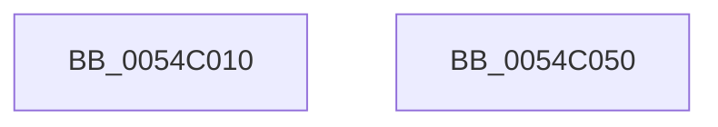

# HalpHvCpuid

- RVA: `0x0054C010`–`0x0054C051` (길이 `65` bytes)
- VA: `0x000000014054C010`
- 실행 섹션: `.text`
- PDB 이름 있음: `예`; PDB Function 태그: `아니요`
- unwind 정보 RVA: `0x000B64AC`
- 디코드: `20`개 명령, `65/65` bytes 표시
- 미해석 바이트: `0` (있으면 어셈블리에 `.byte`로 보존)

> 이 문서는 커널 이미지의 기계어와 PDB 기호를 분석해 생성했습니다. 4번과 5번은 함수 원형과 자료형을 바이너리 사용 방식에서 추정한 C 해석이며 원본 소스 복구 결과는 아닙니다.

## 1. Dependencies

- 직접 호출 지점: **1**; 고유 호출 대상: **1**
- 직접 호출자로 확인된 함수: **2**
- RIP 상대 이미지 참조: **1**

### Outgoing calls
- `0x0054C045` → [_security_check_cookie](../6A/_security_check_cookie_function_006AC640.md) (function, `0x006AC640`)

### Direct callers
- [HalpInterruptGetIrtInfo](../../page/70/HalpInterruptGetIrtInfo_function_00707784.md) at `0x007077D0`
- [HalpInterruptGetIrtInfo](../../page/70/HalpInterruptGetIrtInfo_function_00707784.md) at `0x007077E5`
- [HalpInterruptGetIrtInfo](../../page/70/HalpInterruptGetIrtInfo_function_00707784.md) at `0x007077FB`
- [HalpInitializeProfiling](../../pagelk/B5/HalpInitializeProfiling_function_00B5EF00.md) at `0x00B5F056`

### Static image references
- `0x0054C016` → RVA `0x00E0A740` (`.data`; read)

## 2. Other-region calls and transfers

- 다른 실행 섹션으로 향하는 call: **0**
- 별도 외부 분기/꼬리 이동을 확인하지 못했습니다.

## 3. Assembly (complete function range)

```asm
0054C010  40 53                           push rbx
0054C012  48 83 EC 20                     sub rsp, 0x20
0054C016  48 8B 05 23 E7 8B 00            mov rax, qword ptr [rip + 0x8be723]
0054C01D  48 33 C4                        xor rax, rsp
0054C020  48 89 44 24 10                  mov qword ptr [rsp + 0x10], rax
0054C025  4C 8B C2                        mov r8, rdx
0054C028  8B C1                           mov eax, ecx
0054C02A  33 C9                           xor ecx, ecx
0054C02C  0F A2                           cpuid
0054C02E  41 89 00                        mov dword ptr [r8], eax
0054C031  41 89 58 04                     mov dword ptr [r8 + 4], ebx
0054C035  41 89 48 08                     mov dword ptr [r8 + 8], ecx
0054C039  41 89 50 0C                     mov dword ptr [r8 + 0xc], edx
0054C03D  48 8B 4C 24 10                  mov rcx, qword ptr [rsp + 0x10]
0054C042  48 33 CC                        xor rcx, rsp
0054C045  E8 F6 05 16 00                  call 0x1406ac640
0054C04A  48 83 C4 20                     add rsp, 0x20
0054C04E  5B                              pop rbx
0054C04F  C3                              ret
0054C050  CC                              int3
```

## 4. C-style interpretation (structured pseudocode)

```c
__int64 __fastcall HalpHvCpuid(int a1, __int64 a2)
{
    __int64 result;
    __int64 v_rsp;
    unsigned __int64 v_stack_m18;

    v_rsp = (v_rsp) - (32);
    result = (*(unsigned __int64 *)(v_rip + 9168675)) ^ (v_rsp);
    v_stack_m18 = result;
    a1 = 0;
    *(unsigned int *)(a2) = (unsigned int)((unsigned int)(a1));
    *(unsigned int *)(a2 + 4) = (unsigned int)(v_rbx);
    *(unsigned int *)(a2 + 8) = 0;
    *(unsigned int *)(a2 + 12) = (unsigned int)(a2);
    a1 = (v_stack_m18) ^ (v_rsp);
    result = _security_check_cookie(a1, a2, a2, a4);
    v_rsp = (v_rsp) + (32);
    return result;
}
```

## 5. (Beta) C Style

```c
int64_t HalpHvCpuid(int32_t Arg1, void *Arg2)
{
    uint8_t *arg2 = (uint8_t *)Arg2;

    int64_t result;
    int64_t local_rsp;
    uint64_t v_stack_m18;

    local_rsp = (local_rsp) - (32);
    result = (*(uint64_t *)(v_rip + 0x8BE723)) ^ (local_rsp);
    v_stack_m18 = result;
    Arg1 = 0;
    *(uint32_t *)(arg2) = (uint32_t)((uint32_t)(Arg1));
    *(uint32_t *)(arg2 + 0x4) = (uint32_t)(local_rbx);
    *(uint32_t *)(arg2 + 0x8) = 0;
    *(uint32_t *)(arg2 + 0xC) = (uint32_t)(Arg2);
    Arg1 = (v_stack_m18) ^ (local_rsp);
    result = _security_check_cookie(Arg1, Arg2, Arg2, a4);
    local_rsp = (local_rsp) + (32);
    return result;
}
```

### 관측된 메모리 오프셋

구조체 형식이 확인되지 않은 접근은 인자 기준의 오프셋으로만 기록했습니다.

| 기준 인자 | 오프셋 표현 | 폭 (bit) | 접근 |
|---|---:|---:|---|
| `Arg2` | `+ 0x0` | `32` | `W` |
| `Arg2` | `+ 0x4` | `32` | `W` |
| `Arg2` | `+ 0x8` | `32` | `W` |
| `Arg2` | `+ 0xC` | `32` | `W` |

## 6. Execution-region graph

[열기: 2D/3D 그래프와 함수 탐색 컨트롤 패널](../../../control-panel.html?section=text&rva=0x0054C010&view=graph)

- 2D 그래프는 위에서 아래로 흐르고, 3D 그래프는 빈 공간을 드래그해 회전합니다. Shift+드래그는 이동, 휠은 확대·축소, 함수 노드 선택은 대상 보고서 이동입니다.

### Static fallback


