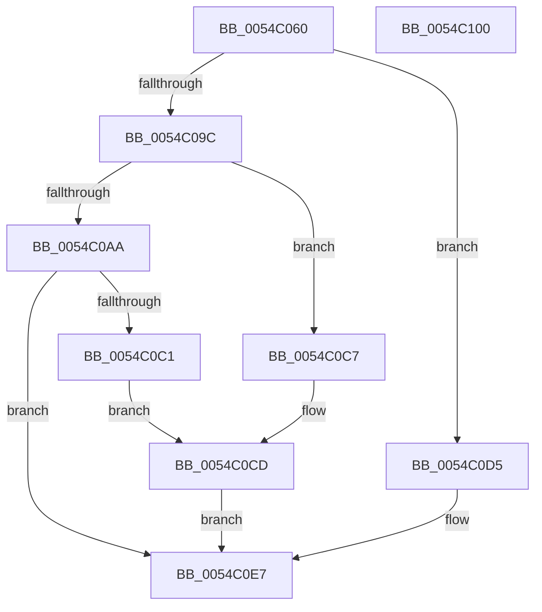

# HalpHvEpCpuid

- RVA: `0x0054C060`–`0x0054C101` (길이 `161` bytes)
- VA: `0x000000014054C060`
- 실행 섹션: `.text`
- PDB 이름 있음: `예`; PDB Function 태그: `아니요`
- unwind 정보 RVA: `0x000C3FD4`
- 디코드: `53`개 명령, `161/161` bytes 표시
- 미해석 바이트: `0` (있으면 어셈블리에 `.byte`로 보존)

> 이 문서는 커널 이미지의 기계어와 PDB 기호를 분석해 생성했습니다. 4번과 5번은 함수 원형과 자료형을 바이너리 사용 방식에서 추정한 C 해석이며 원본 소스 복구 결과는 아닙니다.

## 1. Dependencies

- 직접 호출 지점: **2**; 고유 호출 대상: **2**
- 직접 호출자로 확인된 함수: **0**
- RIP 상대 이미지 참조: **2**

### Outgoing calls
- `0x0054C0B8` → [guard_dispatch_icall](../6B/guard_dispatch_icall_function_006BAAD0.md) (function, `0x006BAAD0`)
- `0x0054C0EF` → [_security_check_cookie](../6A/_security_check_cookie_function_006AC640.md) (function, `0x006AC640`)

### Direct callers
- 이 함수 시작 RVA로 연결되는 직접 call은 확인되지 않았습니다. 간접 호출은 완전히 역산할 수 없습니다.

### Static image references
- `0x0054C06C` → RVA `0x00E0A740` (`.data`; read)
- `0x0054C09C` → RVA `0x00FC1CE8` (`.data`; read)

## 2. Other-region calls and transfers

- 다른 실행 섹션으로 향하는 call: **0**
- 별도 외부 분기/꼬리 이동을 확인하지 못했습니다.

## 3. Assembly (complete function range)

```asm
0054C060  40 53                           push rbx
0054C062  56                              push rsi
0054C063  57                              push rdi
0054C064  41 56                           push r14
0054C066  41 57                           push r15
0054C068  48 83 EC 60                     sub rsp, 0x60
0054C06C  48 8B 05 CD E6 8B 00            mov rax, qword ptr [rip + 0x8be6cd]
0054C073  48 33 C4                        xor rax, rsp
0054C076  48 89 44 24 50                  mov qword ptr [rsp + 0x50], rax
0054C07B  4C 8B B4 24 B0 00 00 00         mov r14, qword ptr [rsp + 0xb0]
0054C083  48 8B C1                        mov rax, rcx
0054C086  4C 8B BC 24 B8 00 00 00         mov r15, qword ptr [rsp + 0xb8]
0054C08E  49 8B F1                        mov rsi, r9
0054C091  48 C1 E8 20                     shr rax, 0x20
0054C095  49 8B F8                        mov rdi, r8
0054C098  A8 01                           test al, 1
0054C09A  75 39                           jne 0x14054c0d5
0054C09C  48 8B 05 45 5C A7 00            mov rax, qword ptr [rip + 0xa75c45]
0054C0A3  33 DB                           xor ebx, ebx
0054C0A5  48 85 C0                        test rax, rax
0054C0A8  74 1D                           je 0x14054c0c7
0054C0AA  0F BA F1 1F                     btr ecx, 0x1f
0054C0AE  4C 89 7C 24 28                  mov qword ptr [rsp + 0x28], r15
0054C0B3  4C 89 74 24 20                  mov qword ptr [rsp + 0x20], r14
0054C0B8  E8 13 EA 16 00                  call 0x1406baad0
0054C0BD  85 C0                           test eax, eax
0054C0BF  79 26                           jns 0x14054c0e7
0054C0C1  89 1F                           mov dword ptr [rdi], ebx
0054C0C3  89 1E                           mov dword ptr [rsi], ebx
0054C0C5  EB 06                           jmp 0x14054c0cd
0054C0C7  41 89 18                        mov dword ptr [r8], ebx
0054C0CA  41 89 19                        mov dword ptr [r9], ebx
0054C0CD  41 89 1E                        mov dword ptr [r14], ebx
0054C0D0  41 89 1F                        mov dword ptr [r15], ebx
0054C0D3  EB 12                           jmp 0x14054c0e7
0054C0D5  8B C2                           mov eax, edx
0054C0D7  33 C9                           xor ecx, ecx
0054C0D9  0F A2                           cpuid
0054C0DB  41 89 00                        mov dword ptr [r8], eax
0054C0DE  41 89 19                        mov dword ptr [r9], ebx
0054C0E1  41 89 0E                        mov dword ptr [r14], ecx
0054C0E4  41 89 17                        mov dword ptr [r15], edx
0054C0E7  48 8B 4C 24 50                  mov rcx, qword ptr [rsp + 0x50]
0054C0EC  48 33 CC                        xor rcx, rsp
0054C0EF  E8 4C 05 16 00                  call 0x1406ac640
0054C0F4  48 83 C4 60                     add rsp, 0x60
0054C0F8  41 5F                           pop r15
0054C0FA  41 5E                           pop r14
0054C0FC  5F                              pop rdi
0054C0FD  5E                              pop rsi
0054C0FE  5B                              pop rbx
0054C0FF  C3                              ret
0054C100  CC                              int3
```

## 4. C-style interpretation (structured pseudocode)

```c
__int64 __fastcall HalpHvEpCpuid(__int64 a1, int a2, __int64 a3, __int64 a4, __int64 a5, __int64 a6)
{
    __int64 result;
    __int64 v_rbx;
    __int64 v_rsp;
    unsigned __int64 v_stack_m38;
    unsigned __int64 v_stack_m60;
    unsigned __int64 v_stack_m68;

    v_rsp = (v_rsp) - (96);
    result = (*(unsigned __int64 *)(v_rip + 9168589)) ^ (v_rsp);
    v_stack_m38 = result;
    result = (a1) >> (32);
    if ((((unsigned __int8)(result)) & (1)) != 0) goto loc_0054C0D5;
    v_rbx = 0;
    if (*(unsigned __int64 *)(v_rip + 10968133) == 0) goto loc_0054C0C7;
    v_stack_m60 = a6;
    v_stack_m68 = a5;
    result = guard_dispatch_icall(a1, a2, a3, a4);
    if (!sign_flag) goto loc_0054C0E7;
    *(unsigned int *)(a3) = 0;
    *(unsigned int *)(a4) = 0;
    goto loc_0054C0CD;
loc_0054C0C7:
    *(unsigned int *)(a3) = 0;
    *(unsigned int *)(a4) = 0;
loc_0054C0CD:
    *(unsigned int *)(a5) = 0;
    *(unsigned int *)(a6) = 0;
    goto loc_0054C0E7;
loc_0054C0D5:
    a1 = 0;
    *(unsigned int *)(a3) = (unsigned int)((unsigned int)(a2));
    *(unsigned int *)(a4) = 0;
    *(unsigned int *)(a5) = 0;
    *(unsigned int *)(a6) = a2;
loc_0054C0E7:
    a1 = (v_stack_m38) ^ (v_rsp);
    result = _security_check_cookie(a1, a2, a3, a4);
    v_rsp = (v_rsp) + (96);
    return result;
}
```

## 5. (Beta) C Style

```c
int64_t HalpHvEpCpuid(int64_t Arg1, int32_t Arg2, void *Arg3, void *Arg4, void *Arg5, void *Arg6)
{
    uint8_t *arg3 = (uint8_t *)Arg3;
    uint8_t *arg4 = (uint8_t *)Arg4;
    uint8_t *arg5 = (uint8_t *)Arg5;
    uint8_t *arg6 = (uint8_t *)Arg6;

    int64_t result;
    int64_t local_rbx;
    int64_t local_rsp;
    uint64_t v_stack_m38;
    uint64_t v_stack_m60;
    uint64_t v_stack_m68;

    local_rsp = (local_rsp) - (96);
    result = (*(uint64_t *)(v_rip + 0x8BE6CD)) ^ (local_rsp);
    v_stack_m38 = result;
    result = (Arg1) >> (32);
    if ((((uint8_t)(result)) & (1)) != 0) goto loc_0054C0D5;
    local_rbx = 0;
    if (*(uint64_t *)(v_rip + 0xA75C45) == 0) goto loc_0054C0C7;
    v_stack_m60 = Arg6;
    v_stack_m68 = Arg5;
    result = guard_dispatch_icall(Arg1, Arg2, Arg3, Arg4);
    if (!sign_flag) goto loc_0054C0E7;
    *(uint32_t *)(arg3) = 0;
    *(uint32_t *)(arg4) = 0;
    goto loc_0054C0CD;
loc_0054C0C7:
    *(uint32_t *)(arg3) = 0;
    *(uint32_t *)(arg4) = 0;
loc_0054C0CD:
    *(uint32_t *)(arg5) = 0;
    *(uint32_t *)(arg6) = 0;
    goto loc_0054C0E7;
loc_0054C0D5:
    Arg1 = 0;
    *(uint32_t *)(arg3) = (uint32_t)((uint32_t)(Arg2));
    *(uint32_t *)(arg4) = 0;
    *(uint32_t *)(arg5) = 0;
    *(uint32_t *)(arg6) = Arg2;
loc_0054C0E7:
    Arg1 = (v_stack_m38) ^ (local_rsp);
    result = _security_check_cookie(Arg1, Arg2, Arg3, Arg4);
    local_rsp = (local_rsp) + (96);
    return result;
}
```

### 관측된 메모리 오프셋

구조체 형식이 확인되지 않은 접근은 인자 기준의 오프셋으로만 기록했습니다.

| 기준 인자 | 오프셋 표현 | 폭 (bit) | 접근 |
|---|---:|---:|---|
| `Arg3` | `+ 0x0` | `32` | `W` |
| `Arg4` | `+ 0x0` | `32` | `W` |
| `Arg5` | `+ 0x0` | `32` | `W` |
| `Arg6` | `+ 0x0` | `32` | `W` |

## 6. Execution-region graph

[열기: 2D/3D 그래프와 함수 탐색 컨트롤 패널](../../../control-panel.html?section=text&rva=0x0054C060&view=graph)

- 2D 그래프는 위에서 아래로 흐르고, 3D 그래프는 빈 공간을 드래그해 회전합니다. Shift+드래그는 이동, 휠은 확대·축소, 함수 노드 선택은 대상 보고서 이동입니다.

### Static fallback


