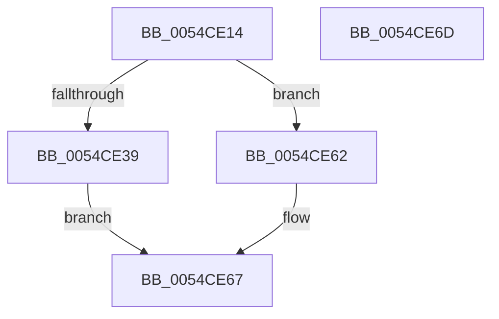

# HalpHvGetMachineCheckContext

- RVA: `0x0054CE14`–`0x0054CE6E` (길이 `90` bytes)
- VA: `0x000000014054CE14`
- 실행 섹션: `.text`
- PDB 이름 있음: `예`; PDB Function 태그: `아니요`
- unwind 정보 RVA: `0x0007F554`
- 디코드: `27`개 명령, `90/90` bytes 표시
- 미해석 바이트: `0` (있으면 어셈블리에 `.byte`로 보존)

> 이 문서는 커널 이미지의 기계어와 PDB 기호를 분석해 생성했습니다. 4번과 5번은 함수 원형과 자료형을 바이너리 사용 방식에서 추정한 C 해석이며 원본 소스 복구 결과는 아닙니다.

## 1. Dependencies

- 직접 호출 지점: **1**; 고유 호출 대상: **1**
- 직접 호출자로 확인된 함수: **2**
- RIP 상대 이미지 참조: **1**

### Outgoing calls
- `0x0054CE45` → [guard_dispatch_icall](../6B/guard_dispatch_icall_function_006BAAD0.md) (function, `0x006BAAD0`)

### Direct callers
- [HalpMcaPopulateErrorData](HalpMcaPopulateErrorData_function_005417AC.md) at `0x00541914`
- [HalpHvMceConsumedMemoryErrorRecovery](HalpHvMceConsumedMemoryErrorRecovery_function_0054C310.md) at `0x0054C34B`

### Static image references
- `0x0054CE1C` → RVA `0x00FC1CF8` (`.data`; read)

## 2. Other-region calls and transfers

- 다른 실행 섹션으로 향하는 call: **0**
- 별도 외부 분기/꼬리 이동을 확인하지 못했습니다.

## 3. Assembly (complete function range)

```asm
0054CE14  4C 8B DC                        mov r11, rsp
0054CE17  53                              push rbx
0054CE18  48 83 EC 40                     sub rsp, 0x40
0054CE1C  48 8B 05 D5 4E A7 00            mov rax, qword ptr [rip + 0xa74ed5]
0054CE23  48 8B DA                        mov rbx, rdx
0054CE26  33 D2                           xor edx, edx
0054CE28  89 54 24 60                     mov dword ptr [rsp + 0x60], edx
0054CE2C  49 89 53 E8                     mov qword ptr [r11 - 0x18], rdx
0054CE30  89 54 24 68                     mov dword ptr [rsp + 0x68], edx
0054CE34  48 85 C0                        test rax, rax
0054CE37  74 29                           je 0x14054ce62
0054CE39  4D 8D 4B 20                     lea r9, [r11 + 0x20]
0054CE3D  4D 8D 43 E8                     lea r8, [r11 - 0x18]
0054CE41  49 8D 53 18                     lea rdx, [r11 + 0x18]
0054CE45  E8 86 DC 16 00                  call 0x1406baad0
0054CE4A  8B 4C 24 60                     mov ecx, dword ptr [rsp + 0x60]
0054CE4E  89 0B                           mov dword ptr [rbx], ecx
0054CE50  48 8B 4C 24 30                  mov rcx, qword ptr [rsp + 0x30]
0054CE55  48 89 4B 08                     mov qword ptr [rbx + 8], rcx
0054CE59  8B 4C 24 68                     mov ecx, dword ptr [rsp + 0x68]
0054CE5D  89 4B 10                        mov dword ptr [rbx + 0x10], ecx
0054CE60  EB 05                           jmp 0x14054ce67
0054CE62  B8 01 00 00 C0                  mov eax, 0xc0000001
0054CE67  48 83 C4 40                     add rsp, 0x40
0054CE6B  5B                              pop rbx
0054CE6C  C3                              ret
0054CE6D  CC                              int3
```

## 4. C-style interpretation (structured pseudocode)

```c
__int64 __fastcall HalpHvGetMachineCheckContext(__int64 a1, __int64 a2)
{
    __int64 result;
    __int64 v_rsp;
    unsigned __int64 v_stack_m18;
    unsigned int v_stack_p18;
    unsigned int v_stack_p20;

    v_rsp = (v_rsp) - (64);
    a2 = 0;
    v_stack_p18 = 0;
    *(unsigned __int64 *)(v_rsp - 24) = 0;
    v_stack_p20 = 0;
    if (*(unsigned __int64 *)(v_rip + 10964693) == 0) goto loc_0054CE62;
    result = guard_dispatch_icall(a1, v_rsp + 24, v_rsp - 24, v_rsp + 32);
    *(unsigned int *)(a2) = (unsigned int)((unsigned int)(v_stack_p18));
    *(unsigned __int64 *)(a2 + 8) = v_stack_m18;
    *(unsigned int *)(a2 + 16) = (unsigned int)((unsigned int)(v_stack_p20));
    goto loc_0054CE67;
loc_0054CE62:
loc_0054CE67:
    v_rsp = (v_rsp) + (64);
    return (unsigned int)(0xC0000001ULL);
}
```

## 5. (Beta) C Style

```c
int64_t HalpHvGetMachineCheckContext(int64_t Arg1, void *Arg2)
{
    uint8_t *arg2 = (uint8_t *)Arg2;

    int64_t result;
    int64_t local_rsp;
    uint64_t v_stack_m18;
    uint32_t v_stack_p18;
    uint32_t v_stack_p20;

    local_rsp = (local_rsp) - (64);
    Arg2 = 0;
    v_stack_p18 = 0;
    *(uint64_t *)(local_rsp - 0x18) = 0;
    v_stack_p20 = 0;
    if (*(uint64_t *)(v_rip + 0xA74ED5) == 0) goto loc_0054CE62;
    result = guard_dispatch_icall(Arg1, local_rsp + 24, local_rsp - 24, local_rsp + 32);
    *(uint32_t *)(arg2) = (uint32_t)((uint32_t)(v_stack_p18));
    *(uint64_t *)(arg2 + 0x8) = v_stack_m18;
    *(uint32_t *)(arg2 + 0x10) = (uint32_t)((uint32_t)(v_stack_p20));
    goto loc_0054CE67;
loc_0054CE62:
loc_0054CE67:
    local_rsp = (local_rsp) + (64);
    return (uint32_t)(0xC0000001ULL);
}
```

### 관측된 메모리 오프셋

구조체 형식이 확인되지 않은 접근은 인자 기준의 오프셋으로만 기록했습니다.

| 기준 인자 | 오프셋 표현 | 폭 (bit) | 접근 |
|---|---:|---:|---|
| `Arg2` | `+ 0x0` | `32` | `W` |
| `Arg2` | `+ 0x8` | `64` | `W` |
| `Arg2` | `+ 0x10` | `32` | `W` |

## 6. Execution-region graph

[열기: 2D/3D 그래프와 함수 탐색 컨트롤 패널](../../../control-panel.html?section=text&rva=0x0054CE14&view=graph)

- 2D 그래프는 위에서 아래로 흐르고, 3D 그래프는 빈 공간을 드래그해 회전합니다. Shift+드래그는 이동, 휠은 확대·축소, 함수 노드 선택은 대상 보고서 이동입니다.

### Static fallback


