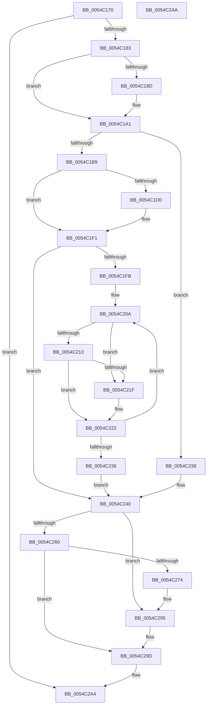

# HalpHvInitMcaStatusMsrCache

- RVA: `0x0054C170`–`0x0054C2AB` (길이 `315` bytes)
- VA: `0x000000014054C170`
- 실행 섹션: `.text`
- PDB 이름 있음: `예`; PDB Function 태그: `아니요`
- unwind 정보 RVA: `0x00064C80`
- 디코드: `78`개 명령, `315/315` bytes 표시
- 미해석 바이트: `0` (있으면 어셈블리에 `.byte`로 보존)

> 이 문서는 커널 이미지의 기계어와 PDB 기호를 분석해 생성했습니다. 4번과 5번은 함수 원형과 자료형을 바이너리 사용 방식에서 추정한 C 해석이며 원본 소스 복구 결과는 아닙니다.

## 1. Dependencies

- 직접 호출 지점: **6**; 고유 호출 대상: **4**
- 직접 호출자로 확인된 함수: **1**
- RIP 상대 이미지 참조: **13**

### Outgoing calls
- `0x0054C1BC` → [HalpMmAllocCtxAlloc](../3E/HalpMmAllocCtxAlloc_function_003E10B8.md) (function, `0x003E10B8`)
- `0x0054C1EB` → [KeBugCheckEx](../4F/KeBugCheckEx_function_004FD660.md) (function, `0x004FD660`)
- `0x0054C20A` → [HalpGetCpuVendor](../48/HalpGetCpuVendor_function_004879E4.md) (function, `0x004879E4`)
- `0x0054C240` → [HalpQueryMaximumRegisteredProcessorCount](HalpQueryMaximumRegisteredProcessorCount_function_00543BE8.md) (function, `0x00543BE8`)
- `0x0054C263` → [HalpMmAllocCtxAlloc](../3E/HalpMmAllocCtxAlloc_function_003E10B8.md) (function, `0x003E10B8`)
- `0x0054C28F` → [KeBugCheckEx](../4F/KeBugCheckEx_function_004FD660.md) (function, `0x004FD660`)

### Direct callers
- [HalpMceInit](../../pagelk/B7/HalpMceInit_function_00B7B144.md) at `0x00B7B265`

### Static image references
- `0x0054C176` → RVA `0x00FC21D0` (`.data`; read)
- `0x0054C183` → RVA `0x00E100E0` (`.data`; read)
- `0x0054C19B` → RVA `0x00E100E0` (`.data`; write)
- `0x0054C1AA` → RVA `0x00FC21CC` (`.data`; write)
- `0x0054C1C1` → RVA `0x00FC21E0` (`.data`; write)
- `0x0054C1D0` → RVA `0x00023EB8` (`.rdata`; read)
- `0x0054C1F1` → RVA `0x00FC21CC` (`.data`; read)
- `0x0054C213` → RVA `0x00E10258` (`.data`; read)
- `0x0054C238` → RVA `0x00FC21E0` (`.data`; read/write)
- `0x0054C24D` → RVA `0x00FC21C8` (`.data`; write)
- `0x0054C268` → RVA `0x00FC21D8` (`.data`; write)
- `0x0054C295` → RVA `0x00FC21D8` (`.data`; read/write)
- `0x0054C29D` → RVA `0x00FC21D0` (`.data`; write)

## 2. Other-region calls and transfers

- 다른 실행 섹션으로 향하는 call: **0**
- 별도 외부 분기/꼬리 이동을 확인하지 못했습니다.

## 3. Assembly (complete function range)

```asm
0054C170  40 53                           push rbx
0054C172  48 83 EC 30                     sub rsp, 0x30
0054C176  80 3D 53 60 A7 00 00            cmp byte ptr [rip + 0xa76053], 0
0054C17D  0F 85 21 01 00 00               jne 0x14054c2a4
0054C183  8A 05 57 3F 8C 00               mov al, byte ptr [rip + 0x8c3f57]
0054C189  84 C0                           test al, al
0054C18B  75 14                           jne 0x14054c1a1
0054C18D  B9 79 01 00 00                  mov ecx, 0x179
0054C192  0F 32                           rdmsr
0054C194  48 C1 E2 20                     shl rdx, 0x20
0054C198  48 0B C2                        or rax, rdx
0054C19B  88 05 3F 3F 8C 00               mov byte ptr [rip + 0x8c3f3f], al
0054C1A1  8A 05 39 3F 8C 00               mov al, byte ptr [rip + 0x8c3f39]
0054C1A7  0F B6 D8                        movzx ebx, al
0054C1AA  89 1D 1C 60 A7 00               mov dword ptr [rip + 0xa7601c], ebx
0054C1B0  48 C1 E3 02                     shl rbx, 2
0054C1B4  48 85 DB                        test rbx, rbx
0054C1B7  74 7F                           je 0x14054c238
0054C1B9  48 8B D3                        mov rdx, rbx
0054C1BC  E8 F7 4E E9 FF                  call 0x1403e10b8
0054C1C1  48 89 05 18 60 A7 00            mov qword ptr [rip + 0xa76018], rax
0054C1C8  48 8B D0                        mov rdx, rax
0054C1CB  48 85 C0                        test rax, rax
0054C1CE  75 21                           jne 0x14054c1f1
0054C1D0  4C 8D 0D E1 7C AD FF            lea r9, [rip - 0x52831f]
0054C1D7  48 C7 44 24 20 3E 06 00 00      mov qword ptr [rsp + 0x20], 0x63e
0054C1E0  45 33 C0                        xor r8d, r8d
0054C1E3  48 8B D3                        mov rdx, rbx
0054C1E6  B9 AC 00 00 00                  mov ecx, 0xac
0054C1EB  E8 70 14 FB FF                  call 0x1404fd660
0054C1F0  CC                              int3
0054C1F1  8B 05 D5 5F A7 00               mov eax, dword ptr [rip + 0xa75fd5]
0054C1F7  85 C0                           test eax, eax
0054C1F9  74 45                           je 0x14054c240
0054C1FB  41 B8 01 04 00 00               mov r8d, 0x401
0054C201  41 B9 01 20 00 C0               mov r9d, 0xc0002001
0054C207  44 8B D0                        mov r10d, eax
0054C20A  E8 D5 B7 F3 FF                  call 0x1404879e4
0054C20F  3C 01                           cmp al, 1
0054C211  75 0C                           jne 0x14054c21f
0054C213  80 3D 3E 40 8C 00 00            cmp byte ptr [rip + 0x8c403e], 0
0054C21A  41 8B C1                        mov eax, r9d
0054C21D  75 03                           jne 0x14054c222
0054C21F  41 8B C0                        mov eax, r8d
0054C222  89 02                           mov dword ptr [rdx], eax
0054C224  41 83 C1 10                     add r9d, 0x10
0054C228  48 83 C2 04                     add rdx, 4
0054C22C  41 83 C0 04                     add r8d, 4
0054C230  49 83 EA 01                     sub r10, 1
0054C234  75 D4                           jne 0x14054c20a
0054C236  EB 08                           jmp 0x14054c240
0054C238  48 83 25 A0 5F A7 00 00         and qword ptr [rip + 0xa75fa0], 0
0054C240  E8 A3 79 FF FF                  call 0x140543be8
0054C245  8B D8                           mov ebx, eax
0054C247  8B 05 7F 5F A7 00               mov eax, dword ptr [rip + 0xa75f7f]
0054C24D  89 1D 75 5F A7 00               mov dword ptr [rip + 0xa75f75], ebx
0054C253  48 0F AF D8                     imul rbx, rax
0054C257  48 C1 E3 03                     shl rbx, 3
0054C25B  48 85 DB                        test rbx, rbx
0054C25E  74 35                           je 0x14054c295
0054C260  48 8B D3                        mov rdx, rbx
0054C263  E8 50 4E E9 FF                  call 0x1403e10b8
0054C268  48 89 05 69 5F A7 00            mov qword ptr [rip + 0xa75f69], rax
0054C26F  48 85 C0                        test rax, rax
0054C272  75 29                           jne 0x14054c29d
0054C274  4C 8D 0D 3D 7C AD FF            lea r9, [rip - 0x5283c3]
0054C27B  48 C7 44 24 20 58 06 00 00      mov qword ptr [rsp + 0x20], 0x658
0054C284  45 33 C0                        xor r8d, r8d
0054C287  48 8B D3                        mov rdx, rbx
0054C28A  B9 AC 00 00 00                  mov ecx, 0xac
0054C28F  E8 CC 13 FB FF                  call 0x1404fd660
0054C294  CC                              int3
0054C295  48 83 25 3B 5F A7 00 00         and qword ptr [rip + 0xa75f3b], 0
0054C29D  C6 05 2C 5F A7 00 01            mov byte ptr [rip + 0xa75f2c], 1
0054C2A4  48 83 C4 30                     add rsp, 0x30
0054C2A8  5B                              pop rbx
0054C2A9  C3                              ret
0054C2AA  CC                              int3
```

## 4. C-style interpretation (structured pseudocode)

```c
__int64 __fastcall HalpHvInitMcaStatusMsrCache(__int64 a1, __int64 a2, int a3)
{
    __int64 result;
    __int64 v_r10;
    __int64 v_rbx;
    __int64 v_rsp;
    unsigned __int64 v_stack_m18;

    v_rsp = (v_rsp) - (48);
    if ((*(unsigned __int8 *)(v_rip + 10969171)) != 0) goto loc_0054C2A4;
    result = *(unsigned __int8 *)(v_rip + 9191255);
    if ((unsigned __int8)(*(unsigned __int8 *)(v_rip + 9191255)) == 0) {
        a1 = 377;
        a2 = (a2) << (32);
        result = (*(unsigned __int8 *)(v_rip + 9191255)) | (a2);
        *(unsigned __int8 *)(v_rip + 9191231) = (unsigned __int8)(result);
    }
    *(unsigned int *)(v_rip + 10969116) = (unsigned int)((unsigned __int8)(*(unsigned __int8 *)(v_rip + 9191225)));
    v_rbx = ((unsigned __int8)(*(unsigned __int8 *)(v_rip + 9191225))) << (2);
    if (v_rbx == 0) goto loc_0054C238;
    result = HalpMmAllocCtxAlloc(a1, v_rbx, a3, a4);
    *(unsigned __int64 *)(v_rip + 10969112) = result;
    if (result == 0) {
        a4 = v_rip - 5407519;
        v_stack_m18 = 0x63EULL;
        a3 = 0;
        a2 = v_rbx;
        a1 = 172;
        result = KeBugCheckEx(a1, a2, a3, a4);
    }
    if ((unsigned int)((unsigned int)(*(unsigned int *)(v_rip + 10969045))) == 0) goto loc_0054C240;
loc_0054C20A:
    result = HalpGetCpuVendor(a1, a2, (unsigned int)(0x401ULL), (unsigned int)(0xC0002001ULL));
    if (((unsigned __int8)(result)) != 1) goto loc_0054C21F;
    result = (unsigned int)((unsigned int)((unsigned int)(0xC0002001ULL)));
    if ((*(unsigned __int8 *)(v_rip + 9191486)) == 0) {
        result = (unsigned int)((unsigned int)(0x401ULL));
    }
    *(unsigned int *)(a2) = (unsigned int)(result);
    a4 = (unsigned int)(((unsigned int)(0xC0002001ULL)) + (16));
    a2 = (a2) + (4);
    a3 = (unsigned int)(((unsigned int)(0x401ULL)) + (4));
    v_r10 = ((unsigned int)((unsigned int)((unsigned int)(*(unsigned int *)(v_rip + 10969045))))) - (1);
    if (condition_is_not_equal) goto loc_0054C20A;
    goto loc_0054C240;
loc_0054C238:
loc_0054C240:
    result = HalpQueryMaximumRegisteredProcessorCount(a1, a2, a3, a4);
    *(unsigned int *)(v_rip + 10968949) = (unsigned int)((unsigned int)((unsigned int)(result)));
    v_rbx = ((unsigned int)((unsigned int)(result))) * ((unsigned int)(*(unsigned int *)(v_rip + 10968959)));
    v_rbx = (v_rbx) << (3);
    if (v_rbx == 0) goto loc_0054C295;
    result = HalpMmAllocCtxAlloc(a1, v_rbx, a3, a4);
    *(unsigned __int64 *)(v_rip + 10968937) = result;
    if (result != 0) goto loc_0054C29D;
    v_stack_m18 = 0x658ULL;
    a3 = 0;
    result = KeBugCheckEx(172, v_rbx, a3, v_rip - 5407683);
loc_0054C295:
loc_0054C29D:
    *(unsigned __int8 *)(v_rip + 10968876) = 1;
loc_0054C2A4:
    v_rsp = (v_rsp) + (48);
    return result;
}
```

## 5. (Beta) C Style

```c
int64_t HalpHvInitMcaStatusMsrCache(int64_t Arg1, int64_t Arg2, int32_t Arg3)
{
    int64_t result;
    int64_t local_r10;
    int64_t local_rbx;
    int64_t local_rsp;
    uint64_t v_stack_m18;

    local_rsp = (local_rsp) - (48);
    if ((*(uint8_t *)(v_rip + 0xA76053)) != 0) goto loc_0054C2A4;
    result = *(uint8_t *)(v_rip + 0x8C3F57);
    if ((uint8_t)(*(uint8_t *)(v_rip + 0x8C3F57)) == 0) {
        Arg1 = 377;
        Arg2 = (Arg2) << (32);
        result = (*(uint8_t *)(v_rip + 0x8C3F57)) | (Arg2);
        *(uint8_t *)(v_rip + 0x8C3F3F) = (uint8_t)(result);
    }
    *(uint32_t *)(v_rip + 0xA7601C) = (uint32_t)((uint8_t)(*(uint8_t *)(v_rip + 0x8C3F39)));
    local_rbx = ((uint8_t)(*(uint8_t *)(v_rip + 0x8C3F39))) << (2);
    if (local_rbx == 0) goto loc_0054C238;
    result = HalpMmAllocCtxAlloc(Arg1, local_rbx, Arg3, a4);
    *(uint64_t *)(v_rip + 0xA76018) = result;
    if (result == 0) {
        a4 = v_rip - 5407519;
        v_stack_m18 = 0x63EULL;
        Arg3 = 0;
        Arg2 = local_rbx;
        Arg1 = 172;
        result = KeBugCheckEx(Arg1, Arg2, Arg3, a4);
    }
    if ((uint32_t)((uint32_t)(*(uint32_t *)(v_rip + 0xA75FD5))) == 0) goto loc_0054C240;
loc_0054C20A:
    result = HalpGetCpuVendor(Arg1, Arg2, (uint32_t)(0x401ULL), (uint32_t)(0xC0002001ULL));
    if (((uint8_t)(result)) != 1) goto loc_0054C21F;
    result = (uint32_t)((uint32_t)((uint32_t)(0xC0002001ULL)));
    if ((*(uint8_t *)(v_rip + 0x8C403E)) == 0) {
        result = (uint32_t)((uint32_t)(0x401ULL));
    }
    *(uint32_t *)(Arg2) = (uint32_t)(result);
    a4 = (uint32_t)(((uint32_t)(0xC0002001ULL)) + (16));
    Arg2 = (Arg2) + (4);
    Arg3 = (uint32_t)(((uint32_t)(0x401ULL)) + (4));
    local_r10 = ((uint32_t)((uint32_t)((uint32_t)(*(uint32_t *)(v_rip + 0xA75FD5))))) - (1);
    if (condition_is_not_equal) goto loc_0054C20A;
    goto loc_0054C240;
loc_0054C238:
loc_0054C240:
    result = HalpQueryMaximumRegisteredProcessorCount(Arg1, Arg2, Arg3, a4);
    *(uint32_t *)(v_rip + 0xA75F75) = (uint32_t)((uint32_t)((uint32_t)(result)));
    local_rbx = ((uint32_t)((uint32_t)(result))) * ((uint32_t)(*(uint32_t *)(v_rip + 0xA75F7F)));
    local_rbx = (local_rbx) << (3);
    if (local_rbx == 0) goto loc_0054C295;
    result = HalpMmAllocCtxAlloc(Arg1, local_rbx, Arg3, a4);
    *(uint64_t *)(v_rip + 0xA75F69) = result;
    if (result != 0) goto loc_0054C29D;
    v_stack_m18 = 0x658ULL;
    Arg3 = 0;
    result = KeBugCheckEx(172, local_rbx, Arg3, v_rip - 5407683);
loc_0054C295:
loc_0054C29D:
    *(uint8_t *)(v_rip + 0xA75F2C) = 1;
loc_0054C2A4:
    local_rsp = (local_rsp) + (48);
    return result;
}
```

## 6. Execution-region graph

[열기: 2D/3D 그래프와 함수 탐색 컨트롤 패널](../../../control-panel.html?section=text&rva=0x0054C170&view=graph)

- 2D 그래프는 위에서 아래로 흐르고, 3D 그래프는 빈 공간을 드래그해 회전합니다. Shift+드래그는 이동, 휠은 확대·축소, 함수 노드 선택은 대상 보고서 이동입니다.

### Static fallback


