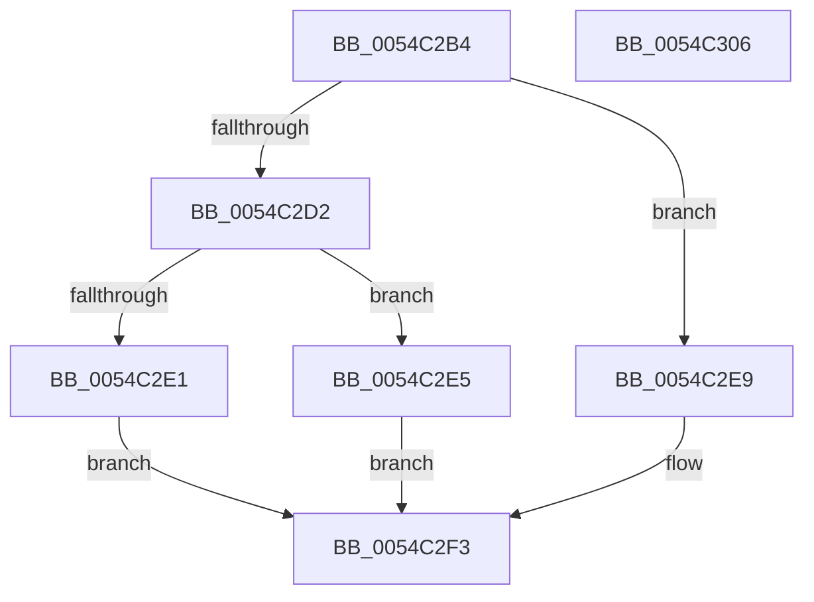

# HalpHvIsFrequencyAvailable

- RVA: `0x0054C2B4`–`0x0054C307` (길이 `83` bytes)
- VA: `0x000000014054C2B4`
- 실행 섹션: `.text`
- PDB 이름 있음: `예`; PDB Function 태그: `아니요`
- unwind 정보 RVA: `0x000AB2E4`
- 디코드: `27`개 명령, `83/83` bytes 표시
- 미해석 바이트: `0` (있으면 어셈블리에 `.byte`로 보존)

> 이 문서는 커널 이미지의 기계어와 PDB 기호를 분석해 생성했습니다. 4번과 5번은 함수 원형과 자료형을 바이너리 사용 방식에서 추정한 C 해석이며 원본 소스 복구 결과는 아닙니다.

## 1. Dependencies

- 직접 호출 지점: **3**; 고유 호출 대상: **3**
- 직접 호출자로 확인된 함수: **3**
- RIP 상대 이미지 참조: **1**

### Outgoing calls
- `0x0054C2C9` → [HalpIsMicrosoftCompatibleHvLoaded](../4A/HalpIsMicrosoftCompatibleHvLoaded_function_004AFAAC.md) (function, `0x004AFAAC`)
- `0x0054C2E9` → [HalpIsXboxNanovisorPresent](HalpIsXboxNanovisorPresent_function_0054C3C0.md) (function, `0x0054C3C0`)
- `0x0054C2FB` → [_security_check_cookie](../6A/_security_check_cookie_function_006AC640.md) (function, `0x006AC640`)

### Direct callers
- [HalpHvGetApicFrequency](HalpHvGetApicFrequency_function_0054C110.md) at `0x0054C117`
- [HalpHvGetTscFrequency](HalpHvGetTscFrequency_function_0054C140.md) at `0x0054C147`
- [sub_006FC0AA](../6F/Unknown_function_006FC0AA.md) at `0x006FC0AA`

### Static image references
- `0x0054C2BA` → RVA `0x00E0A740` (`.data`; read)

## 2. Other-region calls and transfers

- 다른 실행 섹션으로 향하는 call: **0**
- 별도 외부 분기/꼬리 이동을 확인하지 못했습니다.

## 3. Assembly (complete function range)

```asm
0054C2B4  40 53                           push rbx
0054C2B6  48 83 EC 40                     sub rsp, 0x40
0054C2BA  48 8B 05 7F E4 8B 00            mov rax, qword ptr [rip + 0x8be47f]
0054C2C1  48 33 C4                        xor rax, rsp
0054C2C4  48 89 44 24 30                  mov qword ptr [rsp + 0x30], rax
0054C2C9  E8 DE 37 F6 FF                  call 0x1404afaac
0054C2CE  84 C0                           test al, al
0054C2D0  74 17                           je 0x14054c2e9
0054C2D2  33 C9                           xor ecx, ecx
0054C2D4  B8 03 00 00 40                  mov eax, 0x40000003
0054C2D9  0F A2                           cpuid
0054C2DB  0F BA E2 08                     bt edx, 8
0054C2DF  72 04                           jb 0x14054c2e5
0054C2E1  32 C0                           xor al, al
0054C2E3  EB 0E                           jmp 0x14054c2f3
0054C2E5  B0 01                           mov al, 1
0054C2E7  EB 0A                           jmp 0x14054c2f3
0054C2E9  E8 D2 00 00 00                  call 0x14054c3c0
0054C2EE  84 C0                           test al, al
0054C2F0  0F 95 C0                        setne al
0054C2F3  48 8B 4C 24 30                  mov rcx, qword ptr [rsp + 0x30]
0054C2F8  48 33 CC                        xor rcx, rsp
0054C2FB  E8 40 03 16 00                  call 0x1406ac640
0054C300  48 83 C4 40                     add rsp, 0x40
0054C304  5B                              pop rbx
0054C305  C3                              ret
0054C306  CC                              int3
```

## 4. C-style interpretation (structured pseudocode)

```c
__int64 __fastcall HalpHvIsFrequencyAvailable(int a1, int a2)
{
    __int64 result;
    __int64 v_rsp;
    unsigned __int64 v_stack_m18;

    v_rsp = (v_rsp) - (64);
    result = (*(unsigned __int64 *)(v_rip + 9167999)) ^ (v_rsp);
    v_stack_m18 = result;
    result = HalpIsMicrosoftCompatibleHvLoaded(a1, a2, a3, a4);
    if ((unsigned __int8)(result) == 0) goto loc_0054C2E9;
    a1 = 0;
    if (condition_is_below) goto loc_0054C2E5;
    result = 0;
    goto loc_0054C2F3;
loc_0054C2E5:
    goto loc_0054C2F3;
loc_0054C2E9:
    result = HalpIsXboxNanovisorPresent(a1, a2, a3, a4);
    result = ((unsigned __int8)(result) != 0) ? 1 : 0;
loc_0054C2F3:
    a1 = (v_stack_m18) ^ (v_rsp);
    result = _security_check_cookie(a1, a2, a3, a4);
    v_rsp = (v_rsp) + (64);
    return result;
}
```

## 5. (Beta) C Style

```c
int64_t HalpHvIsFrequencyAvailable(int32_t Arg1, int32_t Arg2)
{
    int64_t result;
    int64_t local_rsp;
    uint64_t v_stack_m18;

    local_rsp = (local_rsp) - (64);
    result = (*(uint64_t *)(v_rip + 0x8BE47F)) ^ (local_rsp);
    v_stack_m18 = result;
    result = HalpIsMicrosoftCompatibleHvLoaded(Arg1, Arg2, a3, a4);
    if ((uint8_t)(result) == 0) goto loc_0054C2E9;
    Arg1 = 0;
    if (condition_is_below) goto loc_0054C2E5;
    result = 0;
    goto loc_0054C2F3;
loc_0054C2E5:
    goto loc_0054C2F3;
loc_0054C2E9:
    result = HalpIsXboxNanovisorPresent(Arg1, Arg2, a3, a4);
    result = ((uint8_t)(result) != 0) ? 1 : 0;
loc_0054C2F3:
    Arg1 = (v_stack_m18) ^ (local_rsp);
    result = _security_check_cookie(Arg1, Arg2, a3, a4);
    local_rsp = (local_rsp) + (64);
    return result;
}
```

## 6. Execution-region graph

[열기: 2D/3D 그래프와 함수 탐색 컨트롤 패널](../../../control-panel.html?section=text&rva=0x0054C2B4&view=graph)

- 2D 그래프는 위에서 아래로 흐르고, 3D 그래프는 빈 공간을 드래그해 회전합니다. Shift+드래그는 이동, 휠은 확대·축소, 함수 노드 선택은 대상 보고서 이동입니다.

### Static fallback


