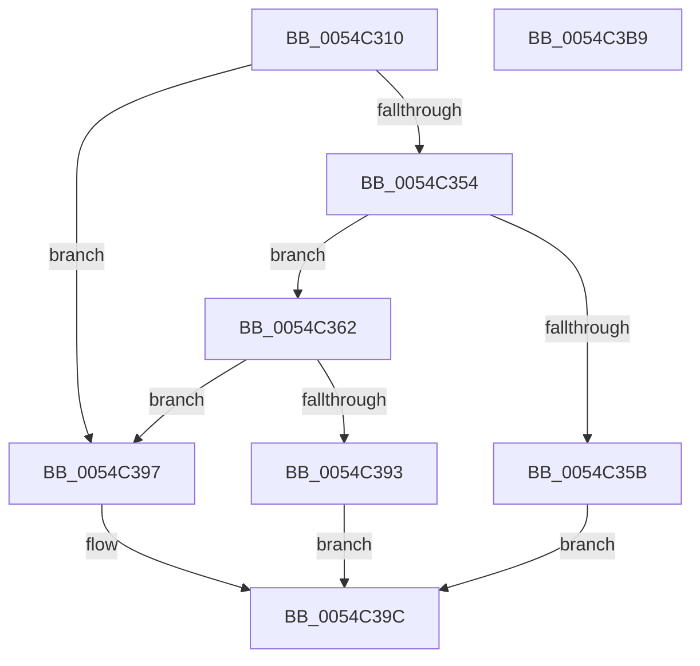

# HalpHvMceConsumedMemoryErrorRecovery

- RVA: `0x0054C310`–`0x0054C3BA` (길이 `170` bytes)
- VA: `0x000000014054C310`
- 실행 섹션: `.text`
- PDB 이름 있음: `예`; PDB Function 태그: `아니요`
- unwind 정보 RVA: `0x000B6754`
- 디코드: `46`개 명령, `170/170` bytes 표시
- 미해석 바이트: `0` (있으면 어셈블리에 `.byte`로 보존)

> 이 문서는 커널 이미지의 기계어와 PDB 기호를 분석해 생성했습니다. 4번과 5번은 함수 원형과 자료형을 바이너리 사용 방식에서 추정한 C 해석이며 원본 소스 복구 결과는 아닙니다.

## 1. Dependencies

- 직접 호출 지점: **3**; 고유 호출 대상: **3**
- 직접 호출자로 확인된 함수: **2**
- RIP 상대 이미지 참조: **1**

### Outgoing calls
- `0x0054C34B` → [HalpHvGetMachineCheckContext](HalpHvGetMachineCheckContext_function_0054CE14.md) (function, `0x0054CE14`)
- `0x0054C38A` → [HalpMemoryErrorDeferredRecovery](../55/HalpMemoryErrorDeferredRecovery_function_00556918.md) (function, `0x00556918`)
- `0x0054C3A4` → [_security_check_cookie](../6A/_security_check_cookie_function_006AC640.md) (function, `0x006AC640`)

### Direct callers
- [HalpMceRecoveryMemoryErrorAmd](../55/HalpMceRecoveryMemoryErrorAmd_function_00556024.md) at `0x005560D3`
- [HalpMceRecoveryMemoryErrorIntel](../55/HalpMceRecoveryMemoryErrorIntel_function_00556138.md) at `0x00556231`

### Static image references
- `0x0054C31F` → RVA `0x00E0A740` (`.data`; read)

## 2. Other-region calls and transfers

- 다른 실행 섹션으로 향하는 call: **0**
- 별도 외부 분기/꼬리 이동을 확인하지 못했습니다.

## 3. Assembly (complete function range)

```asm
0054C310  48 89 5C 24 08                  mov qword ptr [rsp + 8], rbx
0054C315  48 89 74 24 10                  mov qword ptr [rsp + 0x10], rsi
0054C31A  57                              push rdi
0054C31B  48 83 EC 60                     sub rsp, 0x60
0054C31F  48 8B 05 1A E4 8B 00            mov rax, qword ptr [rip + 0x8be41a]
0054C326  48 33 C4                        xor rax, rsp
0054C329  48 89 44 24 58                  mov qword ptr [rsp + 0x58], rax
0054C32E  48 8B F2                        mov rsi, rdx
0054C331  33 C0                           xor eax, eax
0054C333  0F 57 C0                        xorps xmm0, xmm0
0054C336  89 44 24 50                     mov dword ptr [rsp + 0x50], eax
0054C33A  48 8D 54 24 40                  lea rdx, [rsp + 0x40]
0054C33F  41 8A D9                        mov bl, r9b
0054C342  0F 11 44 24 40                  movups xmmword ptr [rsp + 0x40], xmm0
0054C347  41 0F B7 F8                     movzx edi, r8w
0054C34B  E8 C4 0A 00 00                  call 0x14054ce14
0054C350  85 C0                           test eax, eax
0054C352  78 43                           js 0x14054c397
0054C354  83 7C 24 40 03                  cmp dword ptr [rsp + 0x40], 3
0054C359  74 07                           je 0x14054c362
0054C35B  B8 BB 00 00 C0                  mov eax, 0xc00000bb
0054C360  EB 3A                           jmp 0x14054c39c
0054C362  83 64 24 38 00                  and dword ptr [rsp + 0x38], 0
0054C367  B2 01                           mov dl, 1
0054C369  8A 84 24 90 00 00 00            mov al, byte ptr [rsp + 0x90]
0054C370  48 8B CE                        mov rcx, rsi
0054C373  44 8B 4C 24 50                  mov r9d, dword ptr [rsp + 0x50]
0054C378  4C 8B 44 24 48                  mov r8, qword ptr [rsp + 0x48]
0054C37D  88 44 24 30                     mov byte ptr [rsp + 0x30], al
0054C381  88 5C 24 28                     mov byte ptr [rsp + 0x28], bl
0054C385  66 89 7C 24 20                  mov word ptr [rsp + 0x20], di
0054C38A  E8 89 A5 00 00                  call 0x140556918
0054C38F  85 C0                           test eax, eax
0054C391  78 04                           js 0x14054c397
0054C393  33 C0                           xor eax, eax
0054C395  EB 05                           jmp 0x14054c39c
0054C397  B8 01 00 00 C0                  mov eax, 0xc0000001
0054C39C  48 8B 4C 24 58                  mov rcx, qword ptr [rsp + 0x58]
0054C3A1  48 33 CC                        xor rcx, rsp
0054C3A4  E8 97 02 16 00                  call 0x1406ac640
0054C3A9  48 8B 5C 24 70                  mov rbx, qword ptr [rsp + 0x70]
0054C3AE  48 8B 74 24 78                  mov rsi, qword ptr [rsp + 0x78]
0054C3B3  48 83 C4 60                     add rsp, 0x60
0054C3B7  5F                              pop rdi
0054C3B8  C3                              ret
0054C3B9  CC                              int3
```

## 4. C-style interpretation (structured pseudocode)

```c
__int64 __fastcall HalpHvMceConsumedMemoryErrorRecovery(__int64 a1, __int64 a2, unsigned __int16 a3, unsigned __int8 a4, unsigned __int8 a5)
{
    __int64 result;
    __int64 v_rsp;
    unsigned __int64 v_stack_m10;
    unsigned int v_stack_m18;
    unsigned __int64 v_stack_m20;
    unsigned __int64 v_stack_m28;
    unsigned int v_stack_m30;
    unsigned __int8 v_stack_m38;
    unsigned __int8 v_stack_m40;
    unsigned __int16 v_stack_m48;
    unsigned __int64 v_stack_p10;
    unsigned __int64 v_stack_p8;

    v_stack_p8 = v_rbx;
    v_stack_p10 = v_rsi;
    v_rsp = (v_rsp) - (96);
    result = (*(unsigned __int64 *)(v_rip + 9167898)) ^ (v_rsp);
    v_stack_m10 = result;
    result = 0;
    v_stack_m18 = 0;
    v_stack_m28 = v_xmm0;
    result = HalpHvGetMachineCheckContext(a1, v_stack_m28, a3, a4);
    if (sign_flag) goto loc_0054C397;
    if (v_stack_m28 == 3) goto loc_0054C362;
    goto loc_0054C39C;
loc_0054C362:
    v_stack_m38 = a5;
    v_stack_m40 = a4;
    v_stack_m48 = a3;
    result = HalpMemoryErrorDeferredRecovery(a2, 1, v_stack_m20, (unsigned int)(v_stack_m18));
    if (sign_flag) goto loc_0054C397;
    result = 0;
    goto loc_0054C39C;
loc_0054C397:
loc_0054C39C:
    a1 = (v_stack_m10) ^ (v_rsp);
    result = _security_check_cookie(a1, 1, v_stack_m20, (unsigned int)(v_stack_m18));
    v_rsp = (v_rsp) + (96);
    return result;
}
```

## 5. (Beta) C Style

```c
int64_t HalpHvMceConsumedMemoryErrorRecovery(int64_t Arg1, int64_t Arg2, uint16_t Arg3, uint8_t Arg4, uint8_t Arg5)
{
    int64_t result;
    int64_t local_rsp;
    uint64_t v_stack_m10;
    uint32_t v_stack_m18;
    uint64_t v_stack_m20;
    uint64_t v_stack_m28;
    uint32_t v_stack_m30;
    uint8_t v_stack_m38;
    uint8_t v_stack_m40;
    uint16_t v_stack_m48;
    uint64_t v_stack_p10;
    uint64_t v_stack_p8;

    v_stack_p8 = local_rbx;
    v_stack_p10 = local_rsi;
    local_rsp = (local_rsp) - (96);
    result = (*(uint64_t *)(v_rip + 0x8BE41A)) ^ (local_rsp);
    v_stack_m10 = result;
    result = 0;
    v_stack_m18 = 0;
    v_stack_m28 = v_xmm0;
    result = HalpHvGetMachineCheckContext(Arg1, v_stack_m28, Arg3, Arg4);
    if (sign_flag) goto loc_0054C397;
    if (v_stack_m28 == 3) goto loc_0054C362;
    goto loc_0054C39C;
loc_0054C362:
    v_stack_m38 = Arg5;
    v_stack_m40 = Arg4;
    v_stack_m48 = Arg3;
    result = HalpMemoryErrorDeferredRecovery(Arg2, 1, v_stack_m20, (uint32_t)(v_stack_m18));
    if (sign_flag) goto loc_0054C397;
    result = 0;
    goto loc_0054C39C;
loc_0054C397:
loc_0054C39C:
    Arg1 = (v_stack_m10) ^ (local_rsp);
    result = _security_check_cookie(Arg1, 1, v_stack_m20, (uint32_t)(v_stack_m18));
    local_rsp = (local_rsp) + (96);
    return result;
}
```

## 6. Execution-region graph

[열기: 2D/3D 그래프와 함수 탐색 컨트롤 패널](../../../control-panel.html?section=text&rva=0x0054C310&view=graph)

- 2D 그래프는 위에서 아래로 흐르고, 3D 그래프는 빈 공간을 드래그해 회전합니다. Shift+드래그는 이동, 휠은 확대·축소, 함수 노드 선택은 대상 보고서 이동입니다.

### Static fallback


