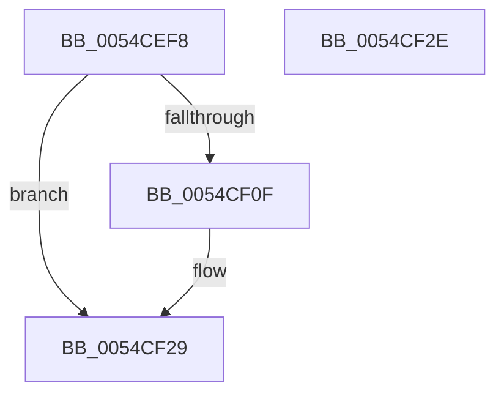

# HalpHvSetMachineCheckHandlerState

- RVA: `0x0054CEF8`–`0x0054CF2F` (길이 `55` bytes)
- VA: `0x000000014054CEF8`
- 실행 섹션: `.text`
- PDB 이름 있음: `예`; PDB Function 태그: `아니요`
- unwind 정보 RVA: `0x0005C788`
- 디코드: `14`개 명령, `55/55` bytes 표시
- 미해석 바이트: `0` (있으면 어셈블리에 `.byte`로 보존)

> 이 문서는 커널 이미지의 기계어와 PDB 기호를 분석해 생성했습니다. 4번과 5번은 함수 원형과 자료형을 바이너리 사용 방식에서 추정한 C 해석이며 원본 소스 복구 결과는 아닙니다.

## 1. Dependencies

- 직접 호출 지점: **1**; 고유 호출 대상: **1**
- 직접 호출자로 확인된 함수: **2**
- RIP 상대 이미지 참조: **1**

### Outgoing calls
- `0x0054CF24` → [guard_dispatch_icall](../6B/guard_dispatch_icall_function_006BAAD0.md) (function, `0x006BAAD0`)

### Direct callers
- [HalpPostSleepMP](../../pagelk/B5/HalpPostSleepMP_function_00B5ECC4.md) at `0x00B5EDAD`
- [HalpMceInit](../../pagelk/B7/HalpMceInit_function_00B7B144.md) at `0x00B7B26A`

### Static image references
- `0x0054CEFC` → RVA `0x00FC1D10` (`.data`; read)

## 2. Other-region calls and transfers

- 다른 실행 섹션으로 향하는 call: **0**
- 별도 외부 분기/꼬리 이동을 확인하지 못했습니다.

## 3. Assembly (complete function range)

```asm
0054CEF8  48 83 EC 28                     sub rsp, 0x28
0054CEFC  48 8B 15 0D 4E A7 00            mov rdx, qword ptr [rip + 0xa74e0d]
0054CF03  33 C0                           xor eax, eax
0054CF05  48 89 44 24 38                  mov qword ptr [rsp + 0x38], rax
0054CF0A  48 85 D2                        test rdx, rdx
0054CF0D  74 1A                           je 0x14054cf29
0054CF0F  48 8D 4C 24 38                  lea rcx, [rsp + 0x38]
0054CF14  C7 44 24 38 01 00 00 00         mov dword ptr [rsp + 0x38], 1
0054CF1C  48 8B C2                        mov rax, rdx
0054CF1F  C6 44 24 3C 01                  mov byte ptr [rsp + 0x3c], 1
0054CF24  E8 A7 DB 16 00                  call 0x1406baad0
0054CF29  48 83 C4 28                     add rsp, 0x28
0054CF2D  C3                              ret
0054CF2E  CC                              int3
```

## 4. C-style interpretation (structured pseudocode)

```c
__int64 __fastcall HalpHvSetMachineCheckHandlerState(void)
{
    __int64 result;
    __int64 v_rsp;
    unsigned __int64 v_stack_p10;
    unsigned __int8 v_stack_p14;

    v_rsp = (v_rsp) - (40);
    result = 0;
    v_stack_p10 = 0;
    if (*(unsigned __int64 *)(v_rip + 10964493) != 0) {
        a1 = v_stack_p10;
        v_stack_p10 = 1;
        result = *(unsigned __int64 *)(v_rip + 10964493);
        v_stack_p14 = 1;
        result = guard_dispatch_icall(a1, *(unsigned __int64 *)(v_rip + 10964493), a3, a4);
    }
    v_rsp = (v_rsp) + (40);
    return result;
}
```

## 5. (Beta) C Style

```c
void HalpHvSetMachineCheckHandlerState(void)
{
    int64_t result;
    int64_t local_rsp;
    uint64_t v_stack_p10;
    uint8_t v_stack_p14;

    local_rsp = (local_rsp) - (40);
    result = 0;
    v_stack_p10 = 0;
    if (*(uint64_t *)(v_rip + 0xA74E0D) != 0) {
        a1 = v_stack_p10;
        v_stack_p10 = 1;
        result = *(uint64_t *)(v_rip + 0xA74E0D);
        v_stack_p14 = 1;
        result = guard_dispatch_icall(a1, *(uint64_t *)(v_rip + 0xA74E0D), a3, a4);
    }
    local_rsp = (local_rsp) + (40);
    return result;
}
```

## 6. Execution-region graph

[열기: 2D/3D 그래프와 함수 탐색 컨트롤 패널](../../../control-panel.html?section=text&rva=0x0054CEF8&view=graph)

- 2D 그래프는 위에서 아래로 흐르고, 3D 그래프는 빈 공간을 드래그해 회전합니다. Shift+드래그는 이동, 휠은 확대·축소, 함수 노드 선택은 대상 보고서 이동입니다.

### Static fallback


