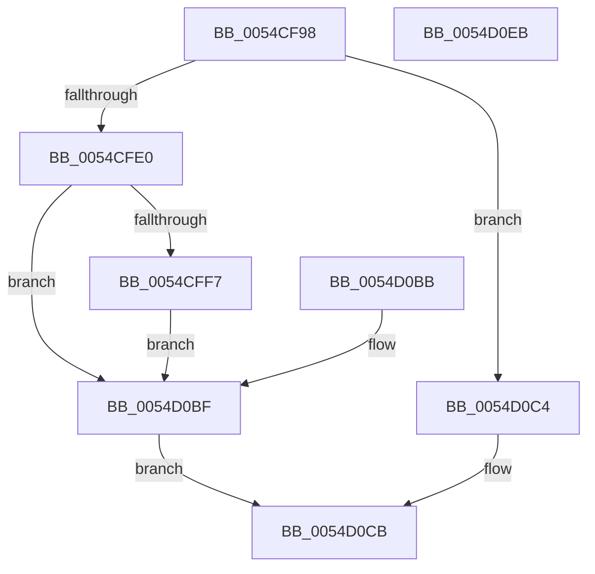

# HalpHvStartVirtualProcessor

- RVA: `0x0054CF98`–`0x0054D0EC` (길이 `340` bytes)
- VA: `0x000000014054CF98`
- 실행 섹션: `.text`
- PDB 이름 있음: `예`; PDB Function 태그: `아니요`
- unwind 정보 RVA: `0x000C3FFC`
- 디코드: `78`개 명령, `340/340` bytes 표시
- 미해석 바이트: `0` (있으면 어셈블리에 `.byte`로 보존)

> 이 문서는 커널 이미지의 기계어와 PDB 기호를 분석해 생성했습니다. 4번과 5번은 함수 원형과 자료형을 바이너리 사용 방식에서 추정한 C 해석이며 원본 소스 복구 결과는 아닙니다.

## 1. Dependencies

- 직접 호출 지점: **5**; 고유 호출 대상: **5**
- 직접 호출자로 확인된 함수: **1**
- RIP 상대 이미지 참조: **2**

### Outgoing calls
- `0x0054CFA3` → [_chkstk](../6B/_chkstk_function_006BA960.md) (function, `0x006BA960`)
- `0x0054CFEA` → [HalpIsXboxNanovisorPresent](HalpIsXboxNanovisorPresent_function_0054C3C0.md) (function, `0x0054C3C0`)
- `0x0054D093` → [MmGetPhysicalAddress](../23/MmGetPhysicalAddress_function_0023A500.md) (function, `0x0023A500`)
- `0x0054D0C6` → [guard_dispatch_icall](../6B/guard_dispatch_icall_function_006BAAD0.md) (function, `0x006BAAD0`)
- `0x0054D0D5` → [_security_check_cookie](../6A/_security_check_cookie_function_006AC640.md) (function, `0x006AC640`)

### Direct callers
- [HalpHvStartProcessor](../55/HalpHvStartProcessor_function_0055A23C.md) at `0x0055A3E6`

### Static image references
- `0x0054CFBA` → RVA `0x00E0A740` (`.data`; read)
- `0x0054CFD0` → RVA `0x00FC1D38` (`.data`; read)

## 2. Other-region calls and transfers

- 다른 실행 섹션으로 향하는 call: **0**
- 별도 외부 분기/꼬리 이동을 확인하지 못했습니다.

## 3. Assembly (complete function range)

```asm
0054CF98  48 89 5C 24 18                  mov qword ptr [rsp + 0x18], rbx
0054CF9D  55                              push rbp
0054CF9E  B8 30 30 00 00                  mov eax, 0x3030
0054CFA3  E8 B8 D9 16 00                  call 0x1406ba960
0054CFA8  48 2B E0                        sub rsp, rax
0054CFAB  48 8D AC 24 20 10 00 00         lea rbp, [rsp + 0x1020]
0054CFB3  48 81 E5 00 F0 FF FF            and rbp, 0xfffffffffffff000
0054CFBA  48 8B 05 7F D7 8B 00            mov rax, qword ptr [rip + 0x8bd77f]
0054CFC1  48 33 C4                        xor rax, rsp
0054CFC4  48 89 85 00 20 00 00            mov qword ptr [rbp + 0x2000], rax
0054CFCB  4C 8B DA                        mov r11, rdx
0054CFCE  8B D9                           mov ebx, ecx
0054CFD0  48 8B 05 61 4D A7 00            mov rax, qword ptr [rip + 0xa74d61]
0054CFD7  48 85 C0                        test rax, rax
0054CFDA  0F 85 E4 00 00 00               jne 0x14054d0c4
0054CFE0  41 BA 01 00 00 C0               mov r10d, 0xc0000001
0054CFE6  44 89 55 00                     mov dword ptr [rbp], r10d
0054CFEA  E8 D1 F3 FF FF                  call 0x14054c3c0
0054CFEF  84 C0                           test al, al
0054CFF1  0F 84 C8 00 00 00               je 0x14054d0bf
0054CFF7  48 8D 85 00 10 00 00            lea rax, [rbp + 0x1000]
0054CFFE  41 0F 10 03                     movups xmm0, xmmword ptr [r11]
0054D002  0F 11 00                        movups xmmword ptr [rax], xmm0
0054D005  41 0F 10 4B 10                  movups xmm1, xmmword ptr [r11 + 0x10]
0054D00A  0F 11 48 10                     movups xmmword ptr [rax + 0x10], xmm1
0054D00E  41 0F 10 43 20                  movups xmm0, xmmword ptr [r11 + 0x20]
0054D013  0F 11 40 20                     movups xmmword ptr [rax + 0x20], xmm0
0054D017  41 0F 10 4B 30                  movups xmm1, xmmword ptr [r11 + 0x30]
0054D01C  0F 11 48 30                     movups xmmword ptr [rax + 0x30], xmm1
0054D020  41 0F 10 43 40                  movups xmm0, xmmword ptr [r11 + 0x40]
0054D025  0F 11 40 40                     movups xmmword ptr [rax + 0x40], xmm0
0054D029  41 0F 10 4B 50                  movups xmm1, xmmword ptr [r11 + 0x50]
0054D02E  0F 11 48 50                     movups xmmword ptr [rax + 0x50], xmm1
0054D032  41 0F 10 43 60                  movups xmm0, xmmword ptr [r11 + 0x60]
0054D037  0F 11 40 60                     movups xmmword ptr [rax + 0x60], xmm0
0054D03B  B9 80 00 00 00                  mov ecx, 0x80
0054D040  48 03 C1                        add rax, rcx
0054D043  41 0F 10 43 70                  movups xmm0, xmmword ptr [r11 + 0x70]
0054D048  0F 11 40 F0                     movups xmmword ptr [rax - 0x10], xmm0
0054D04C  4C 03 D9                        add r11, rcx
0054D04F  41 0F 10 0B                     movups xmm1, xmmword ptr [r11]
0054D053  0F 11 08                        movups xmmword ptr [rax], xmm1
0054D056  41 0F 10 43 10                  movups xmm0, xmmword ptr [r11 + 0x10]
0054D05B  0F 11 40 10                     movups xmmword ptr [rax + 0x10], xmm0
0054D05F  41 0F 10 4B 20                  movups xmm1, xmmword ptr [r11 + 0x20]
0054D064  0F 11 48 20                     movups xmmword ptr [rax + 0x20], xmm1
0054D068  41 0F 10 43 30                  movups xmm0, xmmword ptr [r11 + 0x30]
0054D06D  0F 11 40 30                     movups xmmword ptr [rax + 0x30], xmm0
0054D071  41 0F 10 4B 40                  movups xmm1, xmmword ptr [r11 + 0x40]
0054D076  0F 11 48 40                     movups xmmword ptr [rax + 0x40], xmm1
0054D07A  41 0F 10 43 50                  movups xmm0, xmmword ptr [r11 + 0x50]
0054D07F  0F 11 40 50                     movups xmmword ptr [rax + 0x50], xmm0
0054D083  48 0F BA AD B8 10 00 00 0A      bts qword ptr [rbp + 0x10b8], 0xa
0054D08C  48 8D 8D 00 10 00 00            lea rcx, [rbp + 0x1000]
0054D093  E8 68 D4 CE FF                  call 0x14023a500
0054D098  0F B6 D3                        movzx edx, bl
0054D09B  48 25 00 F0 FF FF               and rax, 0xfffffffffffff000
0054D0A1  48 0B D0                        or rdx, rax
0054D0A4  48 8B C2                        mov rax, rdx
0054D0A7  48 C1 EA 20                     shr rdx, 0x20
0054D0AB  B9 74 00 00 40                  mov ecx, 0x40000074
0054D0B0  0F 30                           wrmsr
0054D0B2  45 33 D2                        xor r10d, r10d
0054D0B5  44 89 55 00                     mov dword ptr [rbp], r10d
0054D0B9  EB 04                           jmp 0x14054d0bf
0054D0BB  44 8B 55 00                     mov r10d, dword ptr [rbp]
0054D0BF  41 8B C2                        mov eax, r10d
0054D0C2  EB 07                           jmp 0x14054d0cb
0054D0C4  8B CB                           mov ecx, ebx
0054D0C6  E8 05 DA 16 00                  call 0x1406baad0
0054D0CB  48 8B 8D 00 20 00 00            mov rcx, qword ptr [rbp + 0x2000]
0054D0D2  48 33 CC                        xor rcx, rsp
0054D0D5  E8 66 F5 15 00                  call 0x1406ac640
0054D0DA  48 8B 9C 24 50 30 00 00         mov rbx, qword ptr [rsp + 0x3050]
0054D0E2  48 81 C4 30 30 00 00            add rsp, 0x3030
0054D0E9  5D                              pop rbp
0054D0EA  C3                              ret
0054D0EB  CC                              int3
```

## 4. C-style interpretation (structured pseudocode)

```c
__int64 __fastcall HalpHvStartVirtualProcessor(int a1, __int64 a2, __int64 a3, __int64 a4, __int64 a5, __int64 a6, __int64 a7, __int64 a8, __int64 a9, __int64 a10, __int64 a11, __int64 a12, __int64 a13, __int64 a14, __int64 a15, __int64 a16, __int64 a17, __int64 a18, __int64 a19, __int64 a20, __int64 a21, __int64 a22, __int64 a23, __int64 a24, __int64 a25, __int64 a26, __int64 a27, __int64 a28, __int64 a29, __int64 a30, __int64 a31, __int64 a32, __int64 a33, __int64 a34, __int64 a35, __int64 a36, __int64 a37, __int64 a38, __int64 a39, __int64 a40, __int64 a41, __int64 a42, __int64 a43, __int64 a44, __int64 a45, __int64 a46, __int64 a47, __int64 a48, __int64 a49, __int64 a50, __int64 a51, __int64 a52, __int64 a53, __int64 a54, __int64 a55, __int64 a56, __int64 a57, __int64 a58, __int64 a59, __int64 a60, __int64 a61, __int64 a62, __int64 a63, __int64 a64, __int64 a65, __int64 a66, __int64 a67, __int64 a68, __int64 a69, __int64 a70, __int64 a71, __int64 a72, __int64 a73, __int64 a74, __int64 a75, __int64 a76, __int64 a77, __int64 a78, __int64 a79, __int64 a80, __int64 a81, __int64 a82, __int64 a83, __int64 a84, __int64 a85, __int64 a86, __int64 a87, __int64 a88, __int64 a89, __int64 a90, __int64 a91, __int64 a92, __int64 a93, __int64 a94, __int64 a95, __int64 a96, __int64 a97, __int64 a98, __int64 a99, __int64 a100, __int64 a101, __int64 a102, __int64 a103, __int64 a104, __int64 a105, __int64 a106, __int64 a107, __int64 a108, __int64 a109, __int64 a110, __int64 a111, __int64 a112, __int64 a113, __int64 a114, __int64 a115, __int64 a116, __int64 a117, __int64 a118, __int64 a119, __int64 a120, __int64 a121, __int64 a122, __int64 a123, __int64 a124, __int64 a125, __int64 a126, __int64 a127, __int64 a128, __int64 a129, __int64 a130, __int64 a131, __int64 a132, __int64 a133, __int64 a134, __int64 a135, __int64 a136, __int64 a137, __int64 a138, __int64 a139, __int64 a140, __int64 a141, __int64 a142, __int64 a143, __int64 a144, __int64 a145, __int64 a146, __int64 a147, __int64 a148, __int64 a149, __int64 a150, __int64 a151, __int64 a152, __int64 a153, __int64 a154, __int64 a155, __int64 a156, __int64 a157, __int64 a158, __int64 a159, __int64 a160, __int64 a161, __int64 a162, __int64 a163, __int64 a164, __int64 a165, __int64 a166, __int64 a167, __int64 a168, __int64 a169, __int64 a170, __int64 a171, __int64 a172, __int64 a173, __int64 a174, __int64 a175, __int64 a176, __int64 a177, __int64 a178, __int64 a179, __int64 a180, __int64 a181, __int64 a182, __int64 a183, __int64 a184, __int64 a185, __int64 a186, __int64 a187, __int64 a188, __int64 a189, __int64 a190, __int64 a191, __int64 a192, __int64 a193, __int64 a194, __int64 a195, __int64 a196, __int64 a197, __int64 a198, __int64 a199, __int64 a200, __int64 a201, __int64 a202, __int64 a203, __int64 a204, __int64 a205, __int64 a206, __int64 a207, __int64 a208, __int64 a209, __int64 a210, __int64 a211, __int64 a212, __int64 a213, __int64 a214, __int64 a215, __int64 a216, __int64 a217, __int64 a218, __int64 a219, __int64 a220, __int64 a221, __int64 a222, __int64 a223, __int64 a224, __int64 a225, __int64 a226, __int64 a227, __int64 a228, __int64 a229, __int64 a230, __int64 a231, __int64 a232, __int64 a233, __int64 a234, __int64 a235, __int64 a236, __int64 a237, __int64 a238, __int64 a239, __int64 a240, __int64 a241, __int64 a242, __int64 a243, __int64 a244, __int64 a245, __int64 a246, __int64 a247, __int64 a248, __int64 a249, __int64 a250, __int64 a251, __int64 a252, __int64 a253, __int64 a254, __int64 a255, __int64 a256, __int64 a257, __int64 a258, __int64 a259, __int64 a260, __int64 a261, __int64 a262, __int64 a263, __int64 a264, __int64 a265, __int64 a266, __int64 a267, __int64 a268, __int64 a269, __int64 a270, __int64 a271, __int64 a272, __int64 a273, __int64 a274, __int64 a275, __int64 a276, __int64 a277, __int64 a278, __int64 a279, __int64 a280, __int64 a281, __int64 a282, __int64 a283, __int64 a284, __int64 a285, __int64 a286, __int64 a287, __int64 a288, __int64 a289, __int64 a290, __int64 a291, __int64 a292, __int64 a293, __int64 a294, __int64 a295, __int64 a296, __int64 a297, __int64 a298, __int64 a299, __int64 a300, __int64 a301, __int64 a302, __int64 a303, __int64 a304, __int64 a305, __int64 a306, __int64 a307, __int64 a308, __int64 a309, __int64 a310, __int64 a311, __int64 a312, __int64 a313, __int64 a314, __int64 a315, __int64 a316, __int64 a317, __int64 a318, __int64 a319, __int64 a320, __int64 a321, __int64 a322, __int64 a323, __int64 a324, __int64 a325, __int64 a326, __int64 a327, __int64 a328, __int64 a329, __int64 a330, __int64 a331, __int64 a332, __int64 a333, __int64 a334, __int64 a335, __int64 a336, __int64 a337, __int64 a338, __int64 a339, __int64 a340, __int64 a341, __int64 a342, __int64 a343, __int64 a344, __int64 a345, __int64 a346, __int64 a347, __int64 a348, __int64 a349, __int64 a350, __int64 a351, __int64 a352, __int64 a353, __int64 a354, __int64 a355, __int64 a356, __int64 a357, __int64 a358, __int64 a359, __int64 a360, __int64 a361, __int64 a362, __int64 a363, __int64 a364, __int64 a365, __int64 a366, __int64 a367, __int64 a368, __int64 a369, __int64 a370, __int64 a371, __int64 a372, __int64 a373, __int64 a374, __int64 a375, __int64 a376, __int64 a377, __int64 a378, __int64 a379, __int64 a380, __int64 a381, __int64 a382, __int64 a383, __int64 a384, __int64 a385, __int64 a386, __int64 a387, __int64 a388, __int64 a389, __int64 a390, __int64 a391, __int64 a392, __int64 a393, __int64 a394, __int64 a395, __int64 a396, __int64 a397, __int64 a398, __int64 a399, __int64 a400, __int64 a401, __int64 a402, __int64 a403, __int64 a404, __int64 a405, __int64 a406, __int64 a407, __int64 a408, __int64 a409, __int64 a410, __int64 a411, __int64 a412, __int64 a413, __int64 a414, __int64 a415, __int64 a416, __int64 a417, __int64 a418, __int64 a419, __int64 a420, __int64 a421, __int64 a422, __int64 a423, __int64 a424, __int64 a425, __int64 a426, __int64 a427, __int64 a428, __int64 a429, __int64 a430, __int64 a431, __int64 a432, __int64 a433, __int64 a434, __int64 a435, __int64 a436, __int64 a437, __int64 a438, __int64 a439, __int64 a440, __int64 a441, __int64 a442, __int64 a443, __int64 a444, __int64 a445, __int64 a446, __int64 a447, __int64 a448, __int64 a449, __int64 a450, __int64 a451, __int64 a452, __int64 a453, __int64 a454, __int64 a455, __int64 a456, __int64 a457, __int64 a458, __int64 a459, __int64 a460, __int64 a461, __int64 a462, __int64 a463, __int64 a464, __int64 a465, __int64 a466, __int64 a467, __int64 a468, __int64 a469, __int64 a470, __int64 a471, __int64 a472, __int64 a473, __int64 a474, __int64 a475, __int64 a476, __int64 a477, __int64 a478, __int64 a479, __int64 a480, __int64 a481, __int64 a482, __int64 a483, __int64 a484, __int64 a485, __int64 a486, __int64 a487, __int64 a488, __int64 a489, __int64 a490, __int64 a491, __int64 a492, __int64 a493, __int64 a494, __int64 a495, __int64 a496, __int64 a497, __int64 a498, __int64 a499, __int64 a500, __int64 a501, __int64 a502, __int64 a503, __int64 a504, __int64 a505, __int64 a506, __int64 a507, __int64 a508, __int64 a509, __int64 a510, __int64 a511, __int64 a512, __int64 a513, __int64 a514, __int64 a515, __int64 a516, __int64 a517, __int64 a518, __int64 a519, __int64 a520, __int64 a521, __int64 a522, __int64 a523, __int64 a524, __int64 a525, __int64 a526, __int64 a527, __int64 a528, __int64 a529, __int64 a530, __int64 a531, __int64 a532, __int64 a533, __int64 a534, __int64 a535, __int64 a536, __int64 a537, __int64 a538, __int64 a539, __int64 a540, __int64 a541, __int64 a542, __int64 a543, __int64 a544, __int64 a545, __int64 a546, __int64 a547, __int64 a548, __int64 a549, __int64 a550, __int64 a551, __int64 a552, __int64 a553, __int64 a554, __int64 a555, __int64 a556, __int64 a557, __int64 a558, __int64 a559, __int64 a560, __int64 a561, __int64 a562, __int64 a563, __int64 a564, __int64 a565, __int64 a566, __int64 a567, __int64 a568, __int64 a569, __int64 a570, __int64 a571, __int64 a572, __int64 a573, __int64 a574, __int64 a575, __int64 a576, __int64 a577, __int64 a578, __int64 a579, __int64 a580, __int64 a581, __int64 a582, __int64 a583, __int64 a584, __int64 a585, __int64 a586, __int64 a587, __int64 a588, __int64 a589, __int64 a590, __int64 a591, __int64 a592, __int64 a593, __int64 a594, __int64 a595, __int64 a596, __int64 a597, __int64 a598, __int64 a599, __int64 a600, __int64 a601, __int64 a602, __int64 a603, __int64 a604, __int64 a605, __int64 a606, __int64 a607, __int64 a608, __int64 a609, __int64 a610, __int64 a611, __int64 a612, __int64 a613, __int64 a614, __int64 a615, __int64 a616, __int64 a617, __int64 a618, __int64 a619, __int64 a620, __int64 a621, __int64 a622, __int64 a623, __int64 a624, __int64 a625, __int64 a626, __int64 a627, __int64 a628, __int64 a629, __int64 a630, __int64 a631, __int64 a632, __int64 a633, __int64 a634, __int64 a635, __int64 a636, __int64 a637, __int64 a638, __int64 a639, __int64 a640, __int64 a641, __int64 a642, __int64 a643, __int64 a644, __int64 a645, __int64 a646, __int64 a647, __int64 a648, __int64 a649, __int64 a650, __int64 a651, __int64 a652, __int64 a653, __int64 a654, __int64 a655, __int64 a656, __int64 a657, __int64 a658, __int64 a659, __int64 a660, __int64 a661, __int64 a662, __int64 a663, __int64 a664, __int64 a665, __int64 a666, __int64 a667, __int64 a668, __int64 a669, __int64 a670, __int64 a671, __int64 a672, __int64 a673, __int64 a674, __int64 a675, __int64 a676, __int64 a677, __int64 a678, __int64 a679, __int64 a680, __int64 a681, __int64 a682, __int64 a683, __int64 a684, __int64 a685, __int64 a686, __int64 a687, __int64 a688, __int64 a689, __int64 a690, __int64 a691, __int64 a692, __int64 a693, __int64 a694, __int64 a695, __int64 a696, __int64 a697, __int64 a698, __int64 a699, __int64 a700, __int64 a701, __int64 a702, __int64 a703, __int64 a704, __int64 a705, __int64 a706, __int64 a707, __int64 a708, __int64 a709, __int64 a710, __int64 a711, __int64 a712, __int64 a713, __int64 a714, __int64 a715, __int64 a716, __int64 a717, __int64 a718, __int64 a719, __int64 a720, __int64 a721, __int64 a722, __int64 a723, __int64 a724, __int64 a725, __int64 a726, __int64 a727, __int64 a728, __int64 a729, __int64 a730, __int64 a731, __int64 a732, __int64 a733, __int64 a734, __int64 a735, __int64 a736, __int64 a737, __int64 a738, __int64 a739, __int64 a740, __int64 a741, __int64 a742, __int64 a743, __int64 a744, __int64 a745, __int64 a746, __int64 a747, __int64 a748, __int64 a749, __int64 a750, __int64 a751, __int64 a752, __int64 a753, __int64 a754, __int64 a755, __int64 a756, __int64 a757, __int64 a758, __int64 a759, __int64 a760, __int64 a761, __int64 a762, __int64 a763, __int64 a764, __int64 a765, __int64 a766, __int64 a767, __int64 a768, __int64 a769, __int64 a770, __int64 a771, __int64 a772, __int64 a773, __int64 a774, __int64 a775, __int64 a776, __int64 a777, __int64 a778, __int64 a779, __int64 a780, __int64 a781, __int64 a782, __int64 a783, __int64 a784, __int64 a785, __int64 a786, __int64 a787, __int64 a788, __int64 a789, __int64 a790, __int64 a791, __int64 a792, __int64 a793, __int64 a794, __int64 a795, __int64 a796, __int64 a797, __int64 a798, __int64 a799, __int64 a800, __int64 a801, __int64 a802, __int64 a803, __int64 a804, __int64 a805, __int64 a806, __int64 a807, __int64 a808, __int64 a809, __int64 a810, __int64 a811, __int64 a812, __int64 a813, __int64 a814, __int64 a815, __int64 a816, __int64 a817, __int64 a818, __int64 a819, __int64 a820, __int64 a821, __int64 a822, __int64 a823, __int64 a824, __int64 a825, __int64 a826, __int64 a827, __int64 a828, __int64 a829, __int64 a830, __int64 a831, __int64 a832, __int64 a833, __int64 a834, __int64 a835, __int64 a836, __int64 a837, __int64 a838, __int64 a839, __int64 a840, __int64 a841, __int64 a842, __int64 a843, __int64 a844, __int64 a845, __int64 a846, __int64 a847, __int64 a848, __int64 a849, __int64 a850, __int64 a851, __int64 a852, __int64 a853, __int64 a854, __int64 a855, __int64 a856, __int64 a857, __int64 a858, __int64 a859, __int64 a860, __int64 a861, __int64 a862, __int64 a863, __int64 a864, __int64 a865, __int64 a866, __int64 a867, __int64 a868, __int64 a869, __int64 a870, __int64 a871, __int64 a872, __int64 a873, __int64 a874, __int64 a875, __int64 a876, __int64 a877, __int64 a878, __int64 a879, __int64 a880, __int64 a881, __int64 a882, __int64 a883, __int64 a884, __int64 a885, __int64 a886, __int64 a887, __int64 a888, __int64 a889, __int64 a890, __int64 a891, __int64 a892, __int64 a893, __int64 a894, __int64 a895, __int64 a896, __int64 a897, __int64 a898, __int64 a899, __int64 a900, __int64 a901, __int64 a902, __int64 a903, __int64 a904, __int64 a905, __int64 a906, __int64 a907, __int64 a908, __int64 a909, __int64 a910, __int64 a911, __int64 a912, __int64 a913, __int64 a914, __int64 a915, __int64 a916, __int64 a917, __int64 a918, __int64 a919, __int64 a920, __int64 a921, __int64 a922, __int64 a923, __int64 a924, __int64 a925, __int64 a926, __int64 a927, __int64 a928, __int64 a929, __int64 a930, __int64 a931, __int64 a932, __int64 a933, __int64 a934, __int64 a935, __int64 a936, __int64 a937, __int64 a938, __int64 a939, __int64 a940, __int64 a941, __int64 a942, __int64 a943, __int64 a944, __int64 a945, __int64 a946, __int64 a947, __int64 a948, __int64 a949, __int64 a950, __int64 a951, __int64 a952, __int64 a953, __int64 a954, __int64 a955, __int64 a956, __int64 a957, __int64 a958, __int64 a959, __int64 a960, __int64 a961, __int64 a962, __int64 a963, __int64 a964, __int64 a965, __int64 a966, __int64 a967, __int64 a968, __int64 a969, __int64 a970, __int64 a971, __int64 a972, __int64 a973, __int64 a974, __int64 a975, __int64 a976, __int64 a977, __int64 a978, __int64 a979, __int64 a980, __int64 a981, __int64 a982, __int64 a983, __int64 a984, __int64 a985, __int64 a986, __int64 a987, __int64 a988, __int64 a989, __int64 a990, __int64 a991, __int64 a992, __int64 a993, __int64 a994, __int64 a995, __int64 a996, __int64 a997, __int64 a998, __int64 a999, __int64 a1000, __int64 a1001, __int64 a1002, __int64 a1003, __int64 a1004, __int64 a1005, __int64 a1006, __int64 a1007, __int64 a1008, __int64 a1009, __int64 a1010, __int64 a1011, __int64 a1012, __int64 a1013, __int64 a1014, __int64 a1015, __int64 a1016, __int64 a1017, __int64 a1018, __int64 a1019, __int64 a1020, __int64 a1021, __int64 a1022, __int64 a1023, __int64 a1024, __int64 a1025, __int64 a1026, __int64 a1027, __int64 a1028, __int64 a1029, __int64 a1030, __int64 a1031, __int64 a1032, __int64 a1033, __int64 a1034, __int64 a1035, __int64 a1036, __int64 a1037, __int64 a1038, __int64 a1039, __int64 a1040, __int64 a1041, __int64 a1042, __int64 a1043, __int64 a1044, __int64 a1045, __int64 a1046, __int64 a1047, __int64 a1048, __int64 a1049, __int64 a1050, __int64 a1051, __int64 a1052, __int64 a1053, __int64 a1054, __int64 a1055, __int64 a1056, __int64 a1057, __int64 a1058, __int64 a1059, __int64 a1060, __int64 a1061, __int64 a1062, __int64 a1063, __int64 a1064, __int64 a1065, __int64 a1066, __int64 a1067, __int64 a1068, __int64 a1069, __int64 a1070, __int64 a1071, __int64 a1072, __int64 a1073, __int64 a1074, __int64 a1075, __int64 a1076, __int64 a1077, __int64 a1078, __int64 a1079, __int64 a1080, __int64 a1081, __int64 a1082, __int64 a1083, __int64 a1084, __int64 a1085, __int64 a1086, __int64 a1087, __int64 a1088, __int64 a1089, __int64 a1090, __int64 a1091, __int64 a1092, __int64 a1093, __int64 a1094, __int64 a1095, __int64 a1096, __int64 a1097, __int64 a1098, __int64 a1099, __int64 a1100, __int64 a1101, __int64 a1102, __int64 a1103, __int64 a1104, __int64 a1105, __int64 a1106, __int64 a1107, __int64 a1108, __int64 a1109, __int64 a1110, __int64 a1111, __int64 a1112, __int64 a1113, __int64 a1114, __int64 a1115, __int64 a1116, __int64 a1117, __int64 a1118, __int64 a1119, __int64 a1120, __int64 a1121, __int64 a1122, __int64 a1123, __int64 a1124, __int64 a1125, __int64 a1126, __int64 a1127, __int64 a1128, __int64 a1129, __int64 a1130, __int64 a1131, __int64 a1132, __int64 a1133, __int64 a1134, __int64 a1135, __int64 a1136, __int64 a1137, __int64 a1138, __int64 a1139, __int64 a1140, __int64 a1141, __int64 a1142, __int64 a1143, __int64 a1144, __int64 a1145, __int64 a1146, __int64 a1147, __int64 a1148, __int64 a1149, __int64 a1150, __int64 a1151, __int64 a1152, __int64 a1153, __int64 a1154, __int64 a1155, __int64 a1156, __int64 a1157, __int64 a1158, __int64 a1159, __int64 a1160, __int64 a1161, __int64 a1162, __int64 a1163, __int64 a1164, __int64 a1165, __int64 a1166, __int64 a1167, __int64 a1168, __int64 a1169, __int64 a1170, __int64 a1171, __int64 a1172, __int64 a1173, __int64 a1174, __int64 a1175, __int64 a1176, __int64 a1177, __int64 a1178, __int64 a1179, __int64 a1180, __int64 a1181, __int64 a1182, __int64 a1183, __int64 a1184, __int64 a1185, __int64 a1186, __int64 a1187, __int64 a1188, __int64 a1189, __int64 a1190, __int64 a1191, __int64 a1192, __int64 a1193, __int64 a1194, __int64 a1195, __int64 a1196, __int64 a1197, __int64 a1198, __int64 a1199, __int64 a1200, __int64 a1201, __int64 a1202, __int64 a1203, __int64 a1204, __int64 a1205, __int64 a1206, __int64 a1207, __int64 a1208, __int64 a1209, __int64 a1210, __int64 a1211, __int64 a1212, __int64 a1213, __int64 a1214, __int64 a1215, __int64 a1216, __int64 a1217, __int64 a1218, __int64 a1219, __int64 a1220, __int64 a1221, __int64 a1222, __int64 a1223, __int64 a1224, __int64 a1225, __int64 a1226, __int64 a1227, __int64 a1228, __int64 a1229, __int64 a1230, __int64 a1231, __int64 a1232, __int64 a1233, __int64 a1234, __int64 a1235, __int64 a1236, __int64 a1237, __int64 a1238, __int64 a1239, __int64 a1240, __int64 a1241, __int64 a1242, __int64 a1243, __int64 a1244, __int64 a1245, __int64 a1246, __int64 a1247, __int64 a1248, __int64 a1249, __int64 a1250, __int64 a1251, __int64 a1252, __int64 a1253, __int64 a1254, __int64 a1255, __int64 a1256, __int64 a1257, __int64 a1258, __int64 a1259, __int64 a1260, __int64 a1261, __int64 a1262, __int64 a1263, __int64 a1264, __int64 a1265, __int64 a1266, __int64 a1267, __int64 a1268, __int64 a1269, __int64 a1270, __int64 a1271, __int64 a1272, __int64 a1273, __int64 a1274, __int64 a1275, __int64 a1276, __int64 a1277, __int64 a1278, __int64 a1279, __int64 a1280, __int64 a1281, __int64 a1282, __int64 a1283, __int64 a1284, __int64 a1285, __int64 a1286, __int64 a1287, __int64 a1288, __int64 a1289, __int64 a1290, __int64 a1291, __int64 a1292, __int64 a1293, __int64 a1294, __int64 a1295, __int64 a1296, __int64 a1297, __int64 a1298, __int64 a1299, __int64 a1300, __int64 a1301, __int64 a1302, __int64 a1303, __int64 a1304, __int64 a1305, __int64 a1306, __int64 a1307, __int64 a1308, __int64 a1309, __int64 a1310, __int64 a1311, __int64 a1312, __int64 a1313, __int64 a1314, __int64 a1315, __int64 a1316, __int64 a1317, __int64 a1318, __int64 a1319, __int64 a1320, __int64 a1321, __int64 a1322, __int64 a1323, __int64 a1324, __int64 a1325, __int64 a1326, __int64 a1327, __int64 a1328, __int64 a1329, __int64 a1330, __int64 a1331, __int64 a1332, __int64 a1333, __int64 a1334, __int64 a1335, __int64 a1336, __int64 a1337, __int64 a1338, __int64 a1339, __int64 a1340, __int64 a1341, __int64 a1342, __int64 a1343, __int64 a1344, __int64 a1345, __int64 a1346, __int64 a1347, __int64 a1348, __int64 a1349, __int64 a1350, __int64 a1351, __int64 a1352, __int64 a1353, __int64 a1354, __int64 a1355, __int64 a1356, __int64 a1357, __int64 a1358, __int64 a1359, __int64 a1360, __int64 a1361, __int64 a1362, __int64 a1363, __int64 a1364, __int64 a1365, __int64 a1366, __int64 a1367, __int64 a1368, __int64 a1369, __int64 a1370, __int64 a1371, __int64 a1372, __int64 a1373, __int64 a1374, __int64 a1375, __int64 a1376, __int64 a1377, __int64 a1378, __int64 a1379, __int64 a1380, __int64 a1381, __int64 a1382, __int64 a1383, __int64 a1384, __int64 a1385, __int64 a1386, __int64 a1387, __int64 a1388, __int64 a1389, __int64 a1390, __int64 a1391, __int64 a1392, __int64 a1393, __int64 a1394, __int64 a1395, __int64 a1396, __int64 a1397, __int64 a1398, __int64 a1399, __int64 a1400, __int64 a1401, __int64 a1402, __int64 a1403, __int64 a1404, __int64 a1405, __int64 a1406, __int64 a1407, __int64 a1408, __int64 a1409, __int64 a1410, __int64 a1411, __int64 a1412, __int64 a1413, __int64 a1414, __int64 a1415, __int64 a1416, __int64 a1417, __int64 a1418, __int64 a1419, __int64 a1420, __int64 a1421, __int64 a1422, __int64 a1423, __int64 a1424, __int64 a1425, __int64 a1426, __int64 a1427, __int64 a1428, __int64 a1429, __int64 a1430, __int64 a1431, __int64 a1432, __int64 a1433, __int64 a1434, __int64 a1435, __int64 a1436, __int64 a1437, __int64 a1438, __int64 a1439, __int64 a1440, __int64 a1441, __int64 a1442, __int64 a1443, __int64 a1444, __int64 a1445, __int64 a1446, __int64 a1447, __int64 a1448, __int64 a1449, __int64 a1450, __int64 a1451, __int64 a1452, __int64 a1453, __int64 a1454, __int64 a1455, __int64 a1456, __int64 a1457, __int64 a1458, __int64 a1459, __int64 a1460, __int64 a1461, __int64 a1462, __int64 a1463, __int64 a1464, __int64 a1465, __int64 a1466, __int64 a1467, __int64 a1468, __int64 a1469, __int64 a1470, __int64 a1471, __int64 a1472, __int64 a1473, __int64 a1474, __int64 a1475, __int64 a1476, __int64 a1477, __int64 a1478, __int64 a1479, __int64 a1480, __int64 a1481, __int64 a1482, __int64 a1483, __int64 a1484, __int64 a1485, __int64 a1486, __int64 a1487, __int64 a1488, __int64 a1489, __int64 a1490, __int64 a1491, __int64 a1492, __int64 a1493, __int64 a1494, __int64 a1495, __int64 a1496, __int64 a1497, __int64 a1498, __int64 a1499, __int64 a1500, __int64 a1501, __int64 a1502, __int64 a1503, __int64 a1504, __int64 a1505, __int64 a1506, __int64 a1507, __int64 a1508, __int64 a1509, __int64 a1510, __int64 a1511, __int64 a1512, __int64 a1513, __int64 a1514, __int64 a1515, __int64 a1516, __int64 a1517, __int64 a1518, __int64 a1519, __int64 a1520, __int64 a1521, __int64 a1522, __int64 a1523, __int64 a1524, __int64 a1525, __int64 a1526, __int64 a1527, __int64 a1528, __int64 a1529, __int64 a1530, __int64 a1531, __int64 a1532, __int64 a1533, __int64 a1534, __int64 a1535, __int64 a1536, __int64 a1537, __int64 a1538, __int64 a1539, __int64 a1540, __int64 a1541, __int64 a1542, __int64 a1543, __int64 a1544, __int64 a1545)
{
    __int64 result;
    __int64 v_r10;
    __int64 v_r11;
    __int64 v_rbp;
    __int64 v_rsp;
    unsigned int v_stack_p1018;
    unsigned __int64 v_stack_p18;
    unsigned __int64 v_stack_p3018;

    v_stack_p18 = v_rbx;
    result = _chkstk(a1, a2, a3, a4);
    v_rsp = (v_rsp) - (result);
    v_rbp = (a515) & (0xFFFFFFFFFFFFF000ULL);
    result = (*(unsigned __int64 *)(v_rip + 9164671)) ^ (v_rsp);
    v_stack_p3018 = result;
    if (*(unsigned __int64 *)(v_rip + 10964321) != 0) goto loc_0054D0C4;
    v_stack_p1018 = (unsigned int)((unsigned int)(0xC0000001ULL));
    result = HalpIsXboxNanovisorPresent(a1, a2, a3, a4);
    if ((unsigned __int8)(result) == 0) goto loc_0054D0BF;
    *(unsigned __int64 *)(a1027) = v_xmm0;
    *(unsigned __int64 *)(a1027 + 16) = v_xmm1;
    *(unsigned __int64 *)(a1027 + 32) = v_xmm0;
    *(unsigned __int64 *)(a1027 + 48) = v_xmm1;
    *(unsigned __int64 *)(a1027 + 64) = v_xmm0;
    *(unsigned __int64 *)(a1027 + 80) = v_xmm1;
    *(unsigned __int64 *)(a1027 + 96) = v_xmm0;
    result = (a1027) + (128);
    *(unsigned __int64 *)(result - 16) = v_xmm0;
    v_r11 = (a2) + (128);
    *(unsigned __int64 *)(result) = v_xmm1;
    *(unsigned __int64 *)(result + 16) = v_xmm0;
    *(unsigned __int64 *)(result + 32) = v_xmm1;
    *(unsigned __int64 *)(result + 48) = v_xmm0;
    *(unsigned __int64 *)(result + 64) = v_xmm1;
    *(unsigned __int64 *)(result + 80) = v_xmm0;
    result = MmGetPhysicalAddress(a1027, a2, a3, a4);
    result = (result) & (0xFFFFFFFFFFFFF000ULL);
    a2 = ((unsigned __int8)((unsigned int)(a1))) | (result);
    a2 = (a2) >> (32);
    v_r10 = 0;
    v_stack_p1018 = 0;
    goto loc_0054D0BF;
loc_0054D0BF:
    goto loc_0054D0CB;
loc_0054D0C4:
    result = guard_dispatch_icall((unsigned int)((unsigned int)((unsigned int)(a1))), a2, a3, a4);
loc_0054D0CB:
    a1 = (a1539) ^ (v_rsp);
    result = _security_check_cookie(a1, a2, a3, a4);
    v_rsp = (v_rsp) + (0x3030ULL);
    return result;
}
```

## 5. (Beta) C Style

```c
int64_t HalpHvStartVirtualProcessor(int32_t Arg1, int64_t Arg2, int64_t Arg3, int64_t Arg4, uint64_t Arg5, uint64_t Arg6, uint64_t Arg7, uint64_t Arg8, uint64_t Arg9, uint64_t Arg10, uint64_t Arg11, uint64_t Arg12, uint64_t Arg13, uint64_t Arg14, uint64_t Arg15, uint64_t Arg16, uint64_t Arg17, uint64_t Arg18, uint64_t Arg19, uint64_t Arg20, uint64_t Arg21, uint64_t Arg22, uint64_t Arg23, uint64_t Arg24, uint64_t Arg25, uint64_t Arg26, uint64_t Arg27, uint64_t Arg28, uint64_t Arg29, uint64_t Arg30, uint64_t Arg31, uint64_t Arg32, uint64_t Arg33, uint64_t Arg34, uint64_t Arg35, uint64_t Arg36, uint64_t Arg37, uint64_t Arg38, uint64_t Arg39, uint64_t Arg40, uint64_t Arg41, uint64_t Arg42, uint64_t Arg43, uint64_t Arg44, uint64_t Arg45, uint64_t Arg46, uint64_t Arg47, uint64_t Arg48, uint64_t Arg49, uint64_t Arg50, uint64_t Arg51, uint64_t Arg52, uint64_t Arg53, uint64_t Arg54, uint64_t Arg55, uint64_t Arg56, uint64_t Arg57, uint64_t Arg58, uint64_t Arg59, uint64_t Arg60, uint64_t Arg61, uint64_t Arg62, uint64_t Arg63, uint64_t Arg64, uint64_t Arg65, uint64_t Arg66, uint64_t Arg67, uint64_t Arg68, uint64_t Arg69, uint64_t Arg70, uint64_t Arg71, uint64_t Arg72, uint64_t Arg73, uint64_t Arg74, uint64_t Arg75, uint64_t Arg76, uint64_t Arg77, uint64_t Arg78, uint64_t Arg79, uint64_t Arg80, uint64_t Arg81, uint64_t Arg82, uint64_t Arg83, uint64_t Arg84, uint64_t Arg85, uint64_t Arg86, uint64_t Arg87, uint64_t Arg88, uint64_t Arg89, uint64_t Arg90, uint64_t Arg91, uint64_t Arg92, uint64_t Arg93, uint64_t Arg94, uint64_t Arg95, uint64_t Arg96, uint64_t Arg97, uint64_t Arg98, uint64_t Arg99, uint64_t Arg100, uint64_t Arg101, uint64_t Arg102, uint64_t Arg103, uint64_t Arg104, uint64_t Arg105, uint64_t Arg106, uint64_t Arg107, uint64_t Arg108, uint64_t Arg109, uint64_t Arg110, uint64_t Arg111, uint64_t Arg112, uint64_t Arg113, uint64_t Arg114, uint64_t Arg115, uint64_t Arg116, uint64_t Arg117, uint64_t Arg118, uint64_t Arg119, uint64_t Arg120, uint64_t Arg121, uint64_t Arg122, uint64_t Arg123, uint64_t Arg124, uint64_t Arg125, uint64_t Arg126, uint64_t Arg127, uint64_t Arg128, uint64_t Arg129, uint64_t Arg130, uint64_t Arg131, uint64_t Arg132, uint64_t Arg133, uint64_t Arg134, uint64_t Arg135, uint64_t Arg136, uint64_t Arg137, uint64_t Arg138, uint64_t Arg139, uint64_t Arg140, uint64_t Arg141, uint64_t Arg142, uint64_t Arg143, uint64_t Arg144, uint64_t Arg145, uint64_t Arg146, uint64_t Arg147, uint64_t Arg148, uint64_t Arg149, uint64_t Arg150, uint64_t Arg151, uint64_t Arg152, uint64_t Arg153, uint64_t Arg154, uint64_t Arg155, uint64_t Arg156, uint64_t Arg157, uint64_t Arg158, uint64_t Arg159, uint64_t Arg160, uint64_t Arg161, uint64_t Arg162, uint64_t Arg163, uint64_t Arg164, uint64_t Arg165, uint64_t Arg166, uint64_t Arg167, uint64_t Arg168, uint64_t Arg169, uint64_t Arg170, uint64_t Arg171, uint64_t Arg172, uint64_t Arg173, uint64_t Arg174, uint64_t Arg175, uint64_t Arg176, uint64_t Arg177, uint64_t Arg178, uint64_t Arg179, uint64_t Arg180, uint64_t Arg181, uint64_t Arg182, uint64_t Arg183, uint64_t Arg184, uint64_t Arg185, uint64_t Arg186, uint64_t Arg187, uint64_t Arg188, uint64_t Arg189, uint64_t Arg190, uint64_t Arg191, uint64_t Arg192, uint64_t Arg193, uint64_t Arg194, uint64_t Arg195, uint64_t Arg196, uint64_t Arg197, uint64_t Arg198, uint64_t Arg199, uint64_t Arg200, uint64_t Arg201, uint64_t Arg202, uint64_t Arg203, uint64_t Arg204, uint64_t Arg205, uint64_t Arg206, uint64_t Arg207, uint64_t Arg208, uint64_t Arg209, uint64_t Arg210, uint64_t Arg211, uint64_t Arg212, uint64_t Arg213, uint64_t Arg214, uint64_t Arg215, uint64_t Arg216, uint64_t Arg217, uint64_t Arg218, uint64_t Arg219, uint64_t Arg220, uint64_t Arg221, uint64_t Arg222, uint64_t Arg223, uint64_t Arg224, uint64_t Arg225, uint64_t Arg226, uint64_t Arg227, uint64_t Arg228, uint64_t Arg229, uint64_t Arg230, uint64_t Arg231, uint64_t Arg232, uint64_t Arg233, uint64_t Arg234, uint64_t Arg235, uint64_t Arg236, uint64_t Arg237, uint64_t Arg238, uint64_t Arg239, uint64_t Arg240, uint64_t Arg241, uint64_t Arg242, uint64_t Arg243, uint64_t Arg244, uint64_t Arg245, uint64_t Arg246, uint64_t Arg247, uint64_t Arg248, uint64_t Arg249, uint64_t Arg250, uint64_t Arg251, uint64_t Arg252, uint64_t Arg253, uint64_t Arg254, uint64_t Arg255, uint64_t Arg256, uint64_t Arg257, uint64_t Arg258, uint64_t Arg259, uint64_t Arg260, uint64_t Arg261, uint64_t Arg262, uint64_t Arg263, uint64_t Arg264, uint64_t Arg265, uint64_t Arg266, uint64_t Arg267, uint64_t Arg268, uint64_t Arg269, uint64_t Arg270, uint64_t Arg271, uint64_t Arg272, uint64_t Arg273, uint64_t Arg274, uint64_t Arg275, uint64_t Arg276, uint64_t Arg277, uint64_t Arg278, uint64_t Arg279, uint64_t Arg280, uint64_t Arg281, uint64_t Arg282, uint64_t Arg283, uint64_t Arg284, uint64_t Arg285, uint64_t Arg286, uint64_t Arg287, uint64_t Arg288, uint64_t Arg289, uint64_t Arg290, uint64_t Arg291, uint64_t Arg292, uint64_t Arg293, uint64_t Arg294, uint64_t Arg295, uint64_t Arg296, uint64_t Arg297, uint64_t Arg298, uint64_t Arg299, uint64_t Arg300, uint64_t Arg301, uint64_t Arg302, uint64_t Arg303, uint64_t Arg304, uint64_t Arg305, uint64_t Arg306, uint64_t Arg307, uint64_t Arg308, uint64_t Arg309, uint64_t Arg310, uint64_t Arg311, uint64_t Arg312, uint64_t Arg313, uint64_t Arg314, uint64_t Arg315, uint64_t Arg316, uint64_t Arg317, uint64_t Arg318, uint64_t Arg319, uint64_t Arg320, uint64_t Arg321, uint64_t Arg322, uint64_t Arg323, uint64_t Arg324, uint64_t Arg325, uint64_t Arg326, uint64_t Arg327, uint64_t Arg328, uint64_t Arg329, uint64_t Arg330, uint64_t Arg331, uint64_t Arg332, uint64_t Arg333, uint64_t Arg334, uint64_t Arg335, uint64_t Arg336, uint64_t Arg337, uint64_t Arg338, uint64_t Arg339, uint64_t Arg340, uint64_t Arg341, uint64_t Arg342, uint64_t Arg343, uint64_t Arg344, uint64_t Arg345, uint64_t Arg346, uint64_t Arg347, uint64_t Arg348, uint64_t Arg349, uint64_t Arg350, uint64_t Arg351, uint64_t Arg352, uint64_t Arg353, uint64_t Arg354, uint64_t Arg355, uint64_t Arg356, uint64_t Arg357, uint64_t Arg358, uint64_t Arg359, uint64_t Arg360, uint64_t Arg361, uint64_t Arg362, uint64_t Arg363, uint64_t Arg364, uint64_t Arg365, uint64_t Arg366, uint64_t Arg367, uint64_t Arg368, uint64_t Arg369, uint64_t Arg370, uint64_t Arg371, uint64_t Arg372, uint64_t Arg373, uint64_t Arg374, uint64_t Arg375, uint64_t Arg376, uint64_t Arg377, uint64_t Arg378, uint64_t Arg379, uint64_t Arg380, uint64_t Arg381, uint64_t Arg382, uint64_t Arg383, uint64_t Arg384, uint64_t Arg385, uint64_t Arg386, uint64_t Arg387, uint64_t Arg388, uint64_t Arg389, uint64_t Arg390, uint64_t Arg391, uint64_t Arg392, uint64_t Arg393, uint64_t Arg394, uint64_t Arg395, uint64_t Arg396, uint64_t Arg397, uint64_t Arg398, uint64_t Arg399, uint64_t Arg400, uint64_t Arg401, uint64_t Arg402, uint64_t Arg403, uint64_t Arg404, uint64_t Arg405, uint64_t Arg406, uint64_t Arg407, uint64_t Arg408, uint64_t Arg409, uint64_t Arg410, uint64_t Arg411, uint64_t Arg412, uint64_t Arg413, uint64_t Arg414, uint64_t Arg415, uint64_t Arg416, uint64_t Arg417, uint64_t Arg418, uint64_t Arg419, uint64_t Arg420, uint64_t Arg421, uint64_t Arg422, uint64_t Arg423, uint64_t Arg424, uint64_t Arg425, uint64_t Arg426, uint64_t Arg427, uint64_t Arg428, uint64_t Arg429, uint64_t Arg430, uint64_t Arg431, uint64_t Arg432, uint64_t Arg433, uint64_t Arg434, uint64_t Arg435, uint64_t Arg436, uint64_t Arg437, uint64_t Arg438, uint64_t Arg439, uint64_t Arg440, uint64_t Arg441, uint64_t Arg442, uint64_t Arg443, uint64_t Arg444, uint64_t Arg445, uint64_t Arg446, uint64_t Arg447, uint64_t Arg448, uint64_t Arg449, uint64_t Arg450, uint64_t Arg451, uint64_t Arg452, uint64_t Arg453, uint64_t Arg454, uint64_t Arg455, uint64_t Arg456, uint64_t Arg457, uint64_t Arg458, uint64_t Arg459, uint64_t Arg460, uint64_t Arg461, uint64_t Arg462, uint64_t Arg463, uint64_t Arg464, uint64_t Arg465, uint64_t Arg466, uint64_t Arg467, uint64_t Arg468, uint64_t Arg469, uint64_t Arg470, uint64_t Arg471, uint64_t Arg472, uint64_t Arg473, uint64_t Arg474, uint64_t Arg475, uint64_t Arg476, uint64_t Arg477, uint64_t Arg478, uint64_t Arg479, uint64_t Arg480, uint64_t Arg481, uint64_t Arg482, uint64_t Arg483, uint64_t Arg484, uint64_t Arg485, uint64_t Arg486, uint64_t Arg487, uint64_t Arg488, uint64_t Arg489, uint64_t Arg490, uint64_t Arg491, uint64_t Arg492, uint64_t Arg493, uint64_t Arg494, uint64_t Arg495, uint64_t Arg496, uint64_t Arg497, uint64_t Arg498, uint64_t Arg499, uint64_t Arg500, uint64_t Arg501, uint64_t Arg502, uint64_t Arg503, uint64_t Arg504, uint64_t Arg505, uint64_t Arg506, uint64_t Arg507, uint64_t Arg508, uint64_t Arg509, uint64_t Arg510, uint64_t Arg511, uint64_t Arg512, uint64_t Arg513, uint64_t Arg514, int64_t Arg515, uint64_t Arg516, uint64_t Arg517, uint64_t Arg518, uint64_t Arg519, uint64_t Arg520, uint64_t Arg521, uint64_t Arg522, uint64_t Arg523, uint64_t Arg524, uint64_t Arg525, uint64_t Arg526, uint64_t Arg527, uint64_t Arg528, uint64_t Arg529, uint64_t Arg530, uint64_t Arg531, uint64_t Arg532, uint64_t Arg533, uint64_t Arg534, uint64_t Arg535, uint64_t Arg536, uint64_t Arg537, uint64_t Arg538, uint64_t Arg539, uint64_t Arg540, uint64_t Arg541, uint64_t Arg542, uint64_t Arg543, uint64_t Arg544, uint64_t Arg545, uint64_t Arg546, uint64_t Arg547, uint64_t Arg548, uint64_t Arg549, uint64_t Arg550, uint64_t Arg551, uint64_t Arg552, uint64_t Arg553, uint64_t Arg554, uint64_t Arg555, uint64_t Arg556, uint64_t Arg557, uint64_t Arg558, uint64_t Arg559, uint64_t Arg560, uint64_t Arg561, uint64_t Arg562, uint64_t Arg563, uint64_t Arg564, uint64_t Arg565, uint64_t Arg566, uint64_t Arg567, uint64_t Arg568, uint64_t Arg569, uint64_t Arg570, uint64_t Arg571, uint64_t Arg572, uint64_t Arg573, uint64_t Arg574, uint64_t Arg575, uint64_t Arg576, uint64_t Arg577, uint64_t Arg578, uint64_t Arg579, uint64_t Arg580, uint64_t Arg581, uint64_t Arg582, uint64_t Arg583, uint64_t Arg584, uint64_t Arg585, uint64_t Arg586, uint64_t Arg587, uint64_t Arg588, uint64_t Arg589, uint64_t Arg590, uint64_t Arg591, uint64_t Arg592, uint64_t Arg593, uint64_t Arg594, uint64_t Arg595, uint64_t Arg596, uint64_t Arg597, uint64_t Arg598, uint64_t Arg599, uint64_t Arg600, uint64_t Arg601, uint64_t Arg602, uint64_t Arg603, uint64_t Arg604, uint64_t Arg605, uint64_t Arg606, uint64_t Arg607, uint64_t Arg608, uint64_t Arg609, uint64_t Arg610, uint64_t Arg611, uint64_t Arg612, uint64_t Arg613, uint64_t Arg614, uint64_t Arg615, uint64_t Arg616, uint64_t Arg617, uint64_t Arg618, uint64_t Arg619, uint64_t Arg620, uint64_t Arg621, uint64_t Arg622, uint64_t Arg623, uint64_t Arg624, uint64_t Arg625, uint64_t Arg626, uint64_t Arg627, uint64_t Arg628, uint64_t Arg629, uint64_t Arg630, uint64_t Arg631, uint64_t Arg632, uint64_t Arg633, uint64_t Arg634, uint64_t Arg635, uint64_t Arg636, uint64_t Arg637, uint64_t Arg638, uint64_t Arg639, uint64_t Arg640, uint64_t Arg641, uint64_t Arg642, uint64_t Arg643, uint64_t Arg644, uint64_t Arg645, uint64_t Arg646, uint64_t Arg647, uint64_t Arg648, uint64_t Arg649, uint64_t Arg650, uint64_t Arg651, uint64_t Arg652, uint64_t Arg653, uint64_t Arg654, uint64_t Arg655, uint64_t Arg656, uint64_t Arg657, uint64_t Arg658, uint64_t Arg659, uint64_t Arg660, uint64_t Arg661, uint64_t Arg662, uint64_t Arg663, uint64_t Arg664, uint64_t Arg665, uint64_t Arg666, uint64_t Arg667, uint64_t Arg668, uint64_t Arg669, uint64_t Arg670, uint64_t Arg671, uint64_t Arg672, uint64_t Arg673, uint64_t Arg674, uint64_t Arg675, uint64_t Arg676, uint64_t Arg677, uint64_t Arg678, uint64_t Arg679, uint64_t Arg680, uint64_t Arg681, uint64_t Arg682, uint64_t Arg683, uint64_t Arg684, uint64_t Arg685, uint64_t Arg686, uint64_t Arg687, uint64_t Arg688, uint64_t Arg689, uint64_t Arg690, uint64_t Arg691, uint64_t Arg692, uint64_t Arg693, uint64_t Arg694, uint64_t Arg695, uint64_t Arg696, uint64_t Arg697, uint64_t Arg698, uint64_t Arg699, uint64_t Arg700, uint64_t Arg701, uint64_t Arg702, uint64_t Arg703, uint64_t Arg704, uint64_t Arg705, uint64_t Arg706, uint64_t Arg707, uint64_t Arg708, uint64_t Arg709, uint64_t Arg710, uint64_t Arg711, uint64_t Arg712, uint64_t Arg713, uint64_t Arg714, uint64_t Arg715, uint64_t Arg716, uint64_t Arg717, uint64_t Arg718, uint64_t Arg719, uint64_t Arg720, uint64_t Arg721, uint64_t Arg722, uint64_t Arg723, uint64_t Arg724, uint64_t Arg725, uint64_t Arg726, uint64_t Arg727, uint64_t Arg728, uint64_t Arg729, uint64_t Arg730, uint64_t Arg731, uint64_t Arg732, uint64_t Arg733, uint64_t Arg734, uint64_t Arg735, uint64_t Arg736, uint64_t Arg737, uint64_t Arg738, uint64_t Arg739, uint64_t Arg740, uint64_t Arg741, uint64_t Arg742, uint64_t Arg743, uint64_t Arg744, uint64_t Arg745, uint64_t Arg746, uint64_t Arg747, uint64_t Arg748, uint64_t Arg749, uint64_t Arg750, uint64_t Arg751, uint64_t Arg752, uint64_t Arg753, uint64_t Arg754, uint64_t Arg755, uint64_t Arg756, uint64_t Arg757, uint64_t Arg758, uint64_t Arg759, uint64_t Arg760, uint64_t Arg761, uint64_t Arg762, uint64_t Arg763, uint64_t Arg764, uint64_t Arg765, uint64_t Arg766, uint64_t Arg767, uint64_t Arg768, uint64_t Arg769, uint64_t Arg770, uint64_t Arg771, uint64_t Arg772, uint64_t Arg773, uint64_t Arg774, uint64_t Arg775, uint64_t Arg776, uint64_t Arg777, uint64_t Arg778, uint64_t Arg779, uint64_t Arg780, uint64_t Arg781, uint64_t Arg782, uint64_t Arg783, uint64_t Arg784, uint64_t Arg785, uint64_t Arg786, uint64_t Arg787, uint64_t Arg788, uint64_t Arg789, uint64_t Arg790, uint64_t Arg791, uint64_t Arg792, uint64_t Arg793, uint64_t Arg794, uint64_t Arg795, uint64_t Arg796, uint64_t Arg797, uint64_t Arg798, uint64_t Arg799, uint64_t Arg800, uint64_t Arg801, uint64_t Arg802, uint64_t Arg803, uint64_t Arg804, uint64_t Arg805, uint64_t Arg806, uint64_t Arg807, uint64_t Arg808, uint64_t Arg809, uint64_t Arg810, uint64_t Arg811, uint64_t Arg812, uint64_t Arg813, uint64_t Arg814, uint64_t Arg815, uint64_t Arg816, uint64_t Arg817, uint64_t Arg818, uint64_t Arg819, uint64_t Arg820, uint64_t Arg821, uint64_t Arg822, uint64_t Arg823, uint64_t Arg824, uint64_t Arg825, uint64_t Arg826, uint64_t Arg827, uint64_t Arg828, uint64_t Arg829, uint64_t Arg830, uint64_t Arg831, uint64_t Arg832, uint64_t Arg833, uint64_t Arg834, uint64_t Arg835, uint64_t Arg836, uint64_t Arg837, uint64_t Arg838, uint64_t Arg839, uint64_t Arg840, uint64_t Arg841, uint64_t Arg842, uint64_t Arg843, uint64_t Arg844, uint64_t Arg845, uint64_t Arg846, uint64_t Arg847, uint64_t Arg848, uint64_t Arg849, uint64_t Arg850, uint64_t Arg851, uint64_t Arg852, uint64_t Arg853, uint64_t Arg854, uint64_t Arg855, uint64_t Arg856, uint64_t Arg857, uint64_t Arg858, uint64_t Arg859, uint64_t Arg860, uint64_t Arg861, uint64_t Arg862, uint64_t Arg863, uint64_t Arg864, uint64_t Arg865, uint64_t Arg866, uint64_t Arg867, uint64_t Arg868, uint64_t Arg869, uint64_t Arg870, uint64_t Arg871, uint64_t Arg872, uint64_t Arg873, uint64_t Arg874, uint64_t Arg875, uint64_t Arg876, uint64_t Arg877, uint64_t Arg878, uint64_t Arg879, uint64_t Arg880, uint64_t Arg881, uint64_t Arg882, uint64_t Arg883, uint64_t Arg884, uint64_t Arg885, uint64_t Arg886, uint64_t Arg887, uint64_t Arg888, uint64_t Arg889, uint64_t Arg890, uint64_t Arg891, uint64_t Arg892, uint64_t Arg893, uint64_t Arg894, uint64_t Arg895, uint64_t Arg896, uint64_t Arg897, uint64_t Arg898, uint64_t Arg899, uint64_t Arg900, uint64_t Arg901, uint64_t Arg902, uint64_t Arg903, uint64_t Arg904, uint64_t Arg905, uint64_t Arg906, uint64_t Arg907, uint64_t Arg908, uint64_t Arg909, uint64_t Arg910, uint64_t Arg911, uint64_t Arg912, uint64_t Arg913, uint64_t Arg914, uint64_t Arg915, uint64_t Arg916, uint64_t Arg917, uint64_t Arg918, uint64_t Arg919, uint64_t Arg920, uint64_t Arg921, uint64_t Arg922, uint64_t Arg923, uint64_t Arg924, uint64_t Arg925, uint64_t Arg926, uint64_t Arg927, uint64_t Arg928, uint64_t Arg929, uint64_t Arg930, uint64_t Arg931, uint64_t Arg932, uint64_t Arg933, uint64_t Arg934, uint64_t Arg935, uint64_t Arg936, uint64_t Arg937, uint64_t Arg938, uint64_t Arg939, uint64_t Arg940, uint64_t Arg941, uint64_t Arg942, uint64_t Arg943, uint64_t Arg944, uint64_t Arg945, uint64_t Arg946, uint64_t Arg947, uint64_t Arg948, uint64_t Arg949, uint64_t Arg950, uint64_t Arg951, uint64_t Arg952, uint64_t Arg953, uint64_t Arg954, uint64_t Arg955, uint64_t Arg956, uint64_t Arg957, uint64_t Arg958, uint64_t Arg959, uint64_t Arg960, uint64_t Arg961, uint64_t Arg962, uint64_t Arg963, uint64_t Arg964, uint64_t Arg965, uint64_t Arg966, uint64_t Arg967, uint64_t Arg968, uint64_t Arg969, uint64_t Arg970, uint64_t Arg971, uint64_t Arg972, uint64_t Arg973, uint64_t Arg974, uint64_t Arg975, uint64_t Arg976, uint64_t Arg977, uint64_t Arg978, uint64_t Arg979, uint64_t Arg980, uint64_t Arg981, uint64_t Arg982, uint64_t Arg983, uint64_t Arg984, uint64_t Arg985, uint64_t Arg986, uint64_t Arg987, uint64_t Arg988, uint64_t Arg989, uint64_t Arg990, uint64_t Arg991, uint64_t Arg992, uint64_t Arg993, uint64_t Arg994, uint64_t Arg995, uint64_t Arg996, uint64_t Arg997, uint64_t Arg998, uint64_t Arg999, uint64_t Arg1000, uint64_t Arg1001, uint64_t Arg1002, uint64_t Arg1003, uint64_t Arg1004, uint64_t Arg1005, uint64_t Arg1006, uint64_t Arg1007, uint64_t Arg1008, uint64_t Arg1009, uint64_t Arg1010, uint64_t Arg1011, uint64_t Arg1012, uint64_t Arg1013, uint64_t Arg1014, uint64_t Arg1015, uint64_t Arg1016, uint64_t Arg1017, uint64_t Arg1018, uint64_t Arg1019, uint64_t Arg1020, uint64_t Arg1021, uint64_t Arg1022, uint64_t Arg1023, uint64_t Arg1024, uint64_t Arg1025, uint64_t Arg1026, int64_t Arg1027, uint64_t Arg1028, uint64_t Arg1029, uint64_t Arg1030, uint64_t Arg1031, uint64_t Arg1032, uint64_t Arg1033, uint64_t Arg1034, uint64_t Arg1035, uint64_t Arg1036, uint64_t Arg1037, uint64_t Arg1038, uint64_t Arg1039, uint64_t Arg1040, uint64_t Arg1041, uint64_t Arg1042, uint64_t Arg1043, uint64_t Arg1044, uint64_t Arg1045, uint64_t Arg1046, uint64_t Arg1047, uint64_t Arg1048, uint64_t Arg1049, int64_t Arg1050, uint64_t Arg1051, uint64_t Arg1052, uint64_t Arg1053, uint64_t Arg1054, uint64_t Arg1055, uint64_t Arg1056, uint64_t Arg1057, uint64_t Arg1058, uint64_t Arg1059, uint64_t Arg1060, uint64_t Arg1061, uint64_t Arg1062, uint64_t Arg1063, uint64_t Arg1064, uint64_t Arg1065, uint64_t Arg1066, uint64_t Arg1067, uint64_t Arg1068, uint64_t Arg1069, uint64_t Arg1070, uint64_t Arg1071, uint64_t Arg1072, uint64_t Arg1073, uint64_t Arg1074, uint64_t Arg1075, uint64_t Arg1076, uint64_t Arg1077, uint64_t Arg1078, uint64_t Arg1079, uint64_t Arg1080, uint64_t Arg1081, uint64_t Arg1082, uint64_t Arg1083, uint64_t Arg1084, uint64_t Arg1085, uint64_t Arg1086, uint64_t Arg1087, uint64_t Arg1088, uint64_t Arg1089, uint64_t Arg1090, uint64_t Arg1091, uint64_t Arg1092, uint64_t Arg1093, uint64_t Arg1094, uint64_t Arg1095, uint64_t Arg1096, uint64_t Arg1097, uint64_t Arg1098, uint64_t Arg1099, uint64_t Arg1100, uint64_t Arg1101, uint64_t Arg1102, uint64_t Arg1103, uint64_t Arg1104, uint64_t Arg1105, uint64_t Arg1106, uint64_t Arg1107, uint64_t Arg1108, uint64_t Arg1109, uint64_t Arg1110, uint64_t Arg1111, uint64_t Arg1112, uint64_t Arg1113, uint64_t Arg1114, uint64_t Arg1115, uint64_t Arg1116, uint64_t Arg1117, uint64_t Arg1118, uint64_t Arg1119, uint64_t Arg1120, uint64_t Arg1121, uint64_t Arg1122, uint64_t Arg1123, uint64_t Arg1124, uint64_t Arg1125, uint64_t Arg1126, uint64_t Arg1127, uint64_t Arg1128, uint64_t Arg1129, uint64_t Arg1130, uint64_t Arg1131, uint64_t Arg1132, uint64_t Arg1133, uint64_t Arg1134, uint64_t Arg1135, uint64_t Arg1136, uint64_t Arg1137, uint64_t Arg1138, uint64_t Arg1139, uint64_t Arg1140, uint64_t Arg1141, uint64_t Arg1142, uint64_t Arg1143, uint64_t Arg1144, uint64_t Arg1145, uint64_t Arg1146, uint64_t Arg1147, uint64_t Arg1148, uint64_t Arg1149, uint64_t Arg1150, uint64_t Arg1151, uint64_t Arg1152, uint64_t Arg1153, uint64_t Arg1154, uint64_t Arg1155, uint64_t Arg1156, uint64_t Arg1157, uint64_t Arg1158, uint64_t Arg1159, uint64_t Arg1160, uint64_t Arg1161, uint64_t Arg1162, uint64_t Arg1163, uint64_t Arg1164, uint64_t Arg1165, uint64_t Arg1166, uint64_t Arg1167, uint64_t Arg1168, uint64_t Arg1169, uint64_t Arg1170, uint64_t Arg1171, uint64_t Arg1172, uint64_t Arg1173, uint64_t Arg1174, uint64_t Arg1175, uint64_t Arg1176, uint64_t Arg1177, uint64_t Arg1178, uint64_t Arg1179, uint64_t Arg1180, uint64_t Arg1181, uint64_t Arg1182, uint64_t Arg1183, uint64_t Arg1184, uint64_t Arg1185, uint64_t Arg1186, uint64_t Arg1187, uint64_t Arg1188, uint64_t Arg1189, uint64_t Arg1190, uint64_t Arg1191, uint64_t Arg1192, uint64_t Arg1193, uint64_t Arg1194, uint64_t Arg1195, uint64_t Arg1196, uint64_t Arg1197, uint64_t Arg1198, uint64_t Arg1199, uint64_t Arg1200, uint64_t Arg1201, uint64_t Arg1202, uint64_t Arg1203, uint64_t Arg1204, uint64_t Arg1205, uint64_t Arg1206, uint64_t Arg1207, uint64_t Arg1208, uint64_t Arg1209, uint64_t Arg1210, uint64_t Arg1211, uint64_t Arg1212, uint64_t Arg1213, uint64_t Arg1214, uint64_t Arg1215, uint64_t Arg1216, uint64_t Arg1217, uint64_t Arg1218, uint64_t Arg1219, uint64_t Arg1220, uint64_t Arg1221, uint64_t Arg1222, uint64_t Arg1223, uint64_t Arg1224, uint64_t Arg1225, uint64_t Arg1226, uint64_t Arg1227, uint64_t Arg1228, uint64_t Arg1229, uint64_t Arg1230, uint64_t Arg1231, uint64_t Arg1232, uint64_t Arg1233, uint64_t Arg1234, uint64_t Arg1235, uint64_t Arg1236, uint64_t Arg1237, uint64_t Arg1238, uint64_t Arg1239, uint64_t Arg1240, uint64_t Arg1241, uint64_t Arg1242, uint64_t Arg1243, uint64_t Arg1244, uint64_t Arg1245, uint64_t Arg1246, uint64_t Arg1247, uint64_t Arg1248, uint64_t Arg1249, uint64_t Arg1250, uint64_t Arg1251, uint64_t Arg1252, uint64_t Arg1253, uint64_t Arg1254, uint64_t Arg1255, uint64_t Arg1256, uint64_t Arg1257, uint64_t Arg1258, uint64_t Arg1259, uint64_t Arg1260, uint64_t Arg1261, uint64_t Arg1262, uint64_t Arg1263, uint64_t Arg1264, uint64_t Arg1265, uint64_t Arg1266, uint64_t Arg1267, uint64_t Arg1268, uint64_t Arg1269, uint64_t Arg1270, uint64_t Arg1271, uint64_t Arg1272, uint64_t Arg1273, uint64_t Arg1274, uint64_t Arg1275, uint64_t Arg1276, uint64_t Arg1277, uint64_t Arg1278, uint64_t Arg1279, uint64_t Arg1280, uint64_t Arg1281, uint64_t Arg1282, uint64_t Arg1283, uint64_t Arg1284, uint64_t Arg1285, uint64_t Arg1286, uint64_t Arg1287, uint64_t Arg1288, uint64_t Arg1289, uint64_t Arg1290, uint64_t Arg1291, uint64_t Arg1292, uint64_t Arg1293, uint64_t Arg1294, uint64_t Arg1295, uint64_t Arg1296, uint64_t Arg1297, uint64_t Arg1298, uint64_t Arg1299, uint64_t Arg1300, uint64_t Arg1301, uint64_t Arg1302, uint64_t Arg1303, uint64_t Arg1304, uint64_t Arg1305, uint64_t Arg1306, uint64_t Arg1307, uint64_t Arg1308, uint64_t Arg1309, uint64_t Arg1310, uint64_t Arg1311, uint64_t Arg1312, uint64_t Arg1313, uint64_t Arg1314, uint64_t Arg1315, uint64_t Arg1316, uint64_t Arg1317, uint64_t Arg1318, uint64_t Arg1319, uint64_t Arg1320, uint64_t Arg1321, uint64_t Arg1322, uint64_t Arg1323, uint64_t Arg1324, uint64_t Arg1325, uint64_t Arg1326, uint64_t Arg1327, uint64_t Arg1328, uint64_t Arg1329, uint64_t Arg1330, uint64_t Arg1331, uint64_t Arg1332, uint64_t Arg1333, uint64_t Arg1334, uint64_t Arg1335, uint64_t Arg1336, uint64_t Arg1337, uint64_t Arg1338, uint64_t Arg1339, uint64_t Arg1340, uint64_t Arg1341, uint64_t Arg1342, uint64_t Arg1343, uint64_t Arg1344, uint64_t Arg1345, uint64_t Arg1346, uint64_t Arg1347, uint64_t Arg1348, uint64_t Arg1349, uint64_t Arg1350, uint64_t Arg1351, uint64_t Arg1352, uint64_t Arg1353, uint64_t Arg1354, uint64_t Arg1355, uint64_t Arg1356, uint64_t Arg1357, uint64_t Arg1358, uint64_t Arg1359, uint64_t Arg1360, uint64_t Arg1361, uint64_t Arg1362, uint64_t Arg1363, uint64_t Arg1364, uint64_t Arg1365, uint64_t Arg1366, uint64_t Arg1367, uint64_t Arg1368, uint64_t Arg1369, uint64_t Arg1370, uint64_t Arg1371, uint64_t Arg1372, uint64_t Arg1373, uint64_t Arg1374, uint64_t Arg1375, uint64_t Arg1376, uint64_t Arg1377, uint64_t Arg1378, uint64_t Arg1379, uint64_t Arg1380, uint64_t Arg1381, uint64_t Arg1382, uint64_t Arg1383, uint64_t Arg1384, uint64_t Arg1385, uint64_t Arg1386, uint64_t Arg1387, uint64_t Arg1388, uint64_t Arg1389, uint64_t Arg1390, uint64_t Arg1391, uint64_t Arg1392, uint64_t Arg1393, uint64_t Arg1394, uint64_t Arg1395, uint64_t Arg1396, uint64_t Arg1397, uint64_t Arg1398, uint64_t Arg1399, uint64_t Arg1400, uint64_t Arg1401, uint64_t Arg1402, uint64_t Arg1403, uint64_t Arg1404, uint64_t Arg1405, uint64_t Arg1406, uint64_t Arg1407, uint64_t Arg1408, uint64_t Arg1409, uint64_t Arg1410, uint64_t Arg1411, uint64_t Arg1412, uint64_t Arg1413, uint64_t Arg1414, uint64_t Arg1415, uint64_t Arg1416, uint64_t Arg1417, uint64_t Arg1418, uint64_t Arg1419, uint64_t Arg1420, uint64_t Arg1421, uint64_t Arg1422, uint64_t Arg1423, uint64_t Arg1424, uint64_t Arg1425, uint64_t Arg1426, uint64_t Arg1427, uint64_t Arg1428, uint64_t Arg1429, uint64_t Arg1430, uint64_t Arg1431, uint64_t Arg1432, uint64_t Arg1433, uint64_t Arg1434, uint64_t Arg1435, uint64_t Arg1436, uint64_t Arg1437, uint64_t Arg1438, uint64_t Arg1439, uint64_t Arg1440, uint64_t Arg1441, uint64_t Arg1442, uint64_t Arg1443, uint64_t Arg1444, uint64_t Arg1445, uint64_t Arg1446, uint64_t Arg1447, uint64_t Arg1448, uint64_t Arg1449, uint64_t Arg1450, uint64_t Arg1451, uint64_t Arg1452, uint64_t Arg1453, uint64_t Arg1454, uint64_t Arg1455, uint64_t Arg1456, uint64_t Arg1457, uint64_t Arg1458, uint64_t Arg1459, uint64_t Arg1460, uint64_t Arg1461, uint64_t Arg1462, uint64_t Arg1463, uint64_t Arg1464, uint64_t Arg1465, uint64_t Arg1466, uint64_t Arg1467, uint64_t Arg1468, uint64_t Arg1469, uint64_t Arg1470, uint64_t Arg1471, uint64_t Arg1472, uint64_t Arg1473, uint64_t Arg1474, uint64_t Arg1475, uint64_t Arg1476, uint64_t Arg1477, uint64_t Arg1478, uint64_t Arg1479, uint64_t Arg1480, uint64_t Arg1481, uint64_t Arg1482, uint64_t Arg1483, uint64_t Arg1484, uint64_t Arg1485, uint64_t Arg1486, uint64_t Arg1487, uint64_t Arg1488, uint64_t Arg1489, uint64_t Arg1490, uint64_t Arg1491, uint64_t Arg1492, uint64_t Arg1493, uint64_t Arg1494, uint64_t Arg1495, uint64_t Arg1496, uint64_t Arg1497, uint64_t Arg1498, uint64_t Arg1499, uint64_t Arg1500, uint64_t Arg1501, uint64_t Arg1502, uint64_t Arg1503, uint64_t Arg1504, uint64_t Arg1505, uint64_t Arg1506, uint64_t Arg1507, uint64_t Arg1508, uint64_t Arg1509, uint64_t Arg1510, uint64_t Arg1511, uint64_t Arg1512, uint64_t Arg1513, uint64_t Arg1514, uint64_t Arg1515, uint64_t Arg1516, uint64_t Arg1517, uint64_t Arg1518, uint64_t Arg1519, uint64_t Arg1520, uint64_t Arg1521, uint64_t Arg1522, uint64_t Arg1523, uint64_t Arg1524, uint64_t Arg1525, uint64_t Arg1526, uint64_t Arg1527, uint64_t Arg1528, uint64_t Arg1529, uint64_t Arg1530, uint64_t Arg1531, uint64_t Arg1532, uint64_t Arg1533, uint64_t Arg1534, uint64_t Arg1535, uint64_t Arg1536, uint64_t Arg1537, uint64_t Arg1538, int64_t Arg1539, uint64_t Arg1540, uint64_t Arg1541, uint64_t Arg1542, uint64_t Arg1543, uint64_t Arg1544, int64_t Arg1545)
{
    int64_t result;
    int64_t local_r10;
    int64_t local_r11;
    int64_t local_rbp;
    int64_t local_rsp;
    uint32_t v_stack_p1018;
    uint64_t v_stack_p18;
    uint64_t v_stack_p3018;

    v_stack_p18 = local_rbx;
    result = _chkstk(Arg1, Arg2, Arg3, Arg4);
    local_rsp = (local_rsp) - (result);
    local_rbp = (Arg515) & (0xFFFFFFFFFFFFF000ULL);
    result = (*(uint64_t *)(v_rip + 0x8BD77F)) ^ (local_rsp);
    v_stack_p3018 = result;
    if (*(uint64_t *)(v_rip + 0xA74D61) != 0) goto loc_0054D0C4;
    v_stack_p1018 = (uint32_t)((uint32_t)(0xC0000001ULL));
    result = HalpIsXboxNanovisorPresent(Arg1, Arg2, Arg3, Arg4);
    if ((uint8_t)(result) == 0) goto loc_0054D0BF;
    *(uint64_t *)(Arg1027) = v_xmm0;
    *(uint64_t *)(Arg1027 + 0x10) = v_xmm1;
    *(uint64_t *)(Arg1027 + 0x20) = v_xmm0;
    *(uint64_t *)(Arg1027 + 0x30) = v_xmm1;
    *(uint64_t *)(Arg1027 + 0x40) = v_xmm0;
    *(uint64_t *)(Arg1027 + 0x50) = v_xmm1;
    *(uint64_t *)(Arg1027 + 0x60) = v_xmm0;
    result = (Arg1027) + (128);
    *(uint64_t *)(result - 0x10) = v_xmm0;
    local_r11 = (Arg2) + (128);
    *(uint64_t *)(result) = v_xmm1;
    *(uint64_t *)(result + 0x10) = v_xmm0;
    *(uint64_t *)(result + 0x20) = v_xmm1;
    *(uint64_t *)(result + 0x30) = v_xmm0;
    *(uint64_t *)(result + 0x40) = v_xmm1;
    *(uint64_t *)(result + 0x50) = v_xmm0;
    result = MmGetPhysicalAddress(Arg1027, Arg2, Arg3, Arg4);
    result = (result) & (0xFFFFFFFFFFFFF000ULL);
    Arg2 = ((uint8_t)((uint32_t)(Arg1))) | (result);
    Arg2 = (Arg2) >> (32);
    local_r10 = 0;
    v_stack_p1018 = 0;
    goto loc_0054D0BF;
loc_0054D0BF:
    goto loc_0054D0CB;
loc_0054D0C4:
    result = guard_dispatch_icall((uint32_t)((uint32_t)((uint32_t)(Arg1))), Arg2, Arg3, Arg4);
loc_0054D0CB:
    Arg1 = (Arg1539) ^ (local_rsp);
    result = _security_check_cookie(Arg1, Arg2, Arg3, Arg4);
    local_rsp = (local_rsp) + (0x3030ULL);
    return result;
}
```

## 6. Execution-region graph

[열기: 2D/3D 그래프와 함수 탐색 컨트롤 패널](../../../control-panel.html?section=text&rva=0x0054CF98&view=graph)

- 2D 그래프는 위에서 아래로 흐르고, 3D 그래프는 빈 공간을 드래그해 회전합니다. Shift+드래그는 이동, 휠은 확대·축소, 함수 노드 선택은 대상 보고서 이동입니다.

### Static fallback


