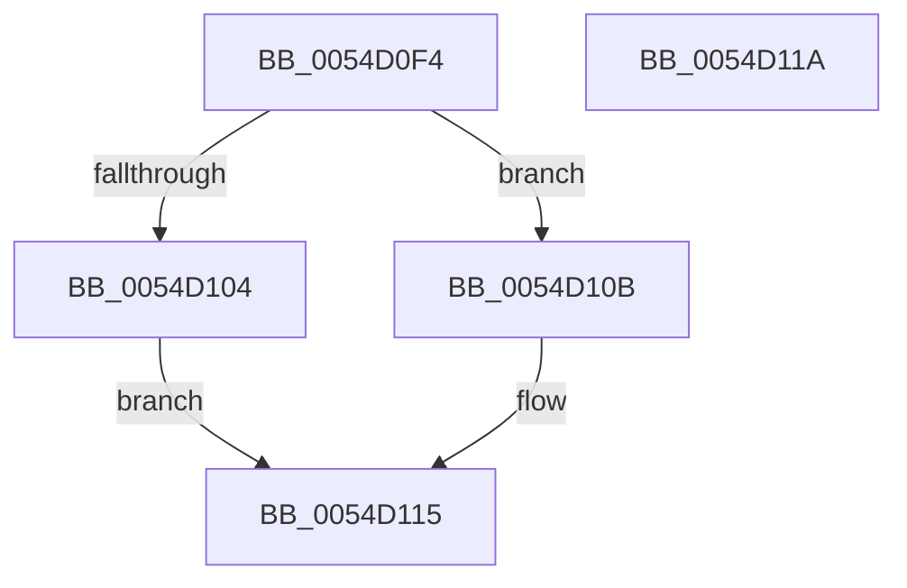

# HalpHvVpStartEnabled

- RVA: `0x0054D0F4`–`0x0054D11B` (길이 `39` bytes)
- VA: `0x000000014054D0F4`
- 실행 섹션: `.text`
- PDB 이름 있음: `예`; PDB Function 태그: `아니요`
- unwind 정보 RVA: `0x0005C788`
- 디코드: `12`개 명령, `39/39` bytes 표시
- 미해석 바이트: `0` (있으면 어셈블리에 `.byte`로 보존)

> 이 문서는 커널 이미지의 기계어와 PDB 기호를 분석해 생성했습니다. 4번과 5번은 함수 원형과 자료형을 바이너리 사용 방식에서 추정한 C 해석이며 원본 소스 복구 결과는 아닙니다.

## 1. Dependencies

- 직접 호출 지점: **2**; 고유 호출 대상: **2**
- 직접 호출자로 확인된 함수: **2**
- RIP 상대 이미지 참조: **1**

### Outgoing calls
- `0x0054D104` → [guard_dispatch_icall](../6B/guard_dispatch_icall_function_006BAAD0.md) (function, `0x006BAAD0`)
- `0x0054D10B` → [HalpIsXboxNanovisorPresent](HalpIsXboxNanovisorPresent_function_0054C3C0.md) (function, `0x0054C3C0`)

### Direct callers
- [HalpInterruptBuildGlobalStartupStub](HalpInterruptBuildGlobalStartupStub_function_0054343C.md) at `0x00543444`
- [HalpInterruptStartProcessor](../../pagelk/B5/HalpInterruptStartProcessor_function_00B5BEF0.md) at `0x00B5BF81`

### Static image references
- `0x0054D0F8` → RVA `0x00FC1D30` (`.data`; read)

## 2. Other-region calls and transfers

- 다른 실행 섹션으로 향하는 call: **0**
- 별도 외부 분기/꼬리 이동을 확인하지 못했습니다.

## 3. Assembly (complete function range)

```asm
0054D0F4  48 83 EC 28                     sub rsp, 0x28
0054D0F8  48 8B 05 31 4C A7 00            mov rax, qword ptr [rip + 0xa74c31]
0054D0FF  48 85 C0                        test rax, rax
0054D102  74 07                           je 0x14054d10b
0054D104  E8 C7 D9 16 00                  call 0x1406baad0
0054D109  EB 0A                           jmp 0x14054d115
0054D10B  E8 B0 F2 FF FF                  call 0x14054c3c0
0054D110  84 C0                           test al, al
0054D112  0F 95 C0                        setne al
0054D115  48 83 C4 28                     add rsp, 0x28
0054D119  C3                              ret
0054D11A  CC                              int3
```

## 4. C-style interpretation (structured pseudocode)

```c
__int64 __fastcall HalpHvVpStartEnabled(void)
{
    __int64 result;
    __int64 v_rsp;

    v_rsp = (v_rsp) - (40);
    if (*(unsigned __int64 *)(v_rip + 10964017) == 0) goto loc_0054D10B;
    result = guard_dispatch_icall(a1, a2, a3, a4);
    goto loc_0054D115;
loc_0054D10B:
    result = HalpIsXboxNanovisorPresent(a1, a2, a3, a4);
    result = ((unsigned __int8)(result) != 0) ? 1 : 0;
loc_0054D115:
    v_rsp = (v_rsp) + (40);
    return result;
}
```

## 5. (Beta) C Style

```c
void HalpHvVpStartEnabled(void)
{
    int64_t result;
    int64_t local_rsp;

    local_rsp = (local_rsp) - (40);
    if (*(uint64_t *)(v_rip + 0xA74C31) == 0) goto loc_0054D10B;
    result = guard_dispatch_icall(a1, a2, a3, a4);
    goto loc_0054D115;
loc_0054D10B:
    result = HalpIsXboxNanovisorPresent(a1, a2, a3, a4);
    result = ((uint8_t)(result) != 0) ? 1 : 0;
loc_0054D115:
    local_rsp = (local_rsp) + (40);
    return result;
}
```

## 6. Execution-region graph

[열기: 2D/3D 그래프와 함수 탐색 컨트롤 패널](../../../control-panel.html?section=text&rva=0x0054D0F4&view=graph)

- 2D 그래프는 위에서 아래로 흐르고, 3D 그래프는 빈 공간을 드래그해 회전합니다. Shift+드래그는 이동, 휠은 확대·축소, 함수 노드 선택은 대상 보고서 이동입니다.

### Static fallback


