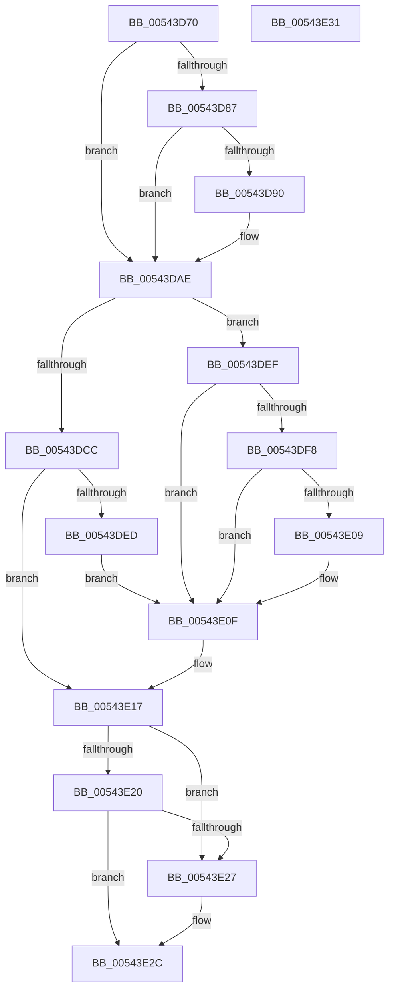

# HalpInitializeInterruptsBspLate

- RVA: `0x00543D70`–`0x00543E32` (길이 `194` bytes)
- VA: `0x0000000140543D70`
- 실행 섹션: `.text`
- PDB 이름 있음: `예`; PDB Function 태그: `아니요`
- unwind 정보 RVA: `0x0005D2F4`
- 디코드: `45`개 명령, `194/194` bytes 표시
- 미해석 바이트: `0` (있으면 어셈블리에 `.byte`로 보존)

> 이 문서는 커널 이미지의 기계어와 PDB 기호를 분석해 생성했습니다. 4번과 5번은 함수 원형과 자료형을 바이너리 사용 방식에서 추정한 C 해석이며 원본 소스 복구 결과는 아닙니다.

## 1. Dependencies

- 직접 호출 지점: **5**; 고유 호출 대상: **5**
- 직접 호출자로 확인된 함수: **1**
- RIP 상대 이미지 참조: **4**

### Outgoing calls
- `0x00543D87` → [HalpInitializeInterruptRemappingBspLate](../../page/70/HalpInitializeInterruptRemappingBspLate_function_0070A708.md) (function, `0x0070A708`)
- `0x00543DA8` → [KeBugCheckEx](../4F/KeBugCheckEx_function_004FD660.md) (function, `0x004FD660`)
- `0x00543DEF` → [HalpIsHvRemappingInterrupts](../../page/70/HalpIsHvRemappingInterrupts_function_00707374.md) (function, `0x00707374`)
- `0x00543E17` → [HalpInterruptModel](../4A/HalpInterruptModel_function_004ACA38.md) (function, `0x004ACA38`)
- `0x00543E27` → [HalpInterruptRemapFixedLines](HalpInterruptRemapFixedLines_function_00544210.md) (function, `0x00544210`)

### Direct callers
- [HalpInterruptInitSystem](../../pagelk/B5/HalpInterruptInitSystem_function_00B5D550.md) at `0x00B5D671`

### Static image references
- `0x00543D74` → RVA `0x00E101F0` (`.data`; read)
- `0x00543DCC` → RVA `0x00F90960` (`.data`; read)
- `0x00543DD8` → RVA `0x00F90968` (`.data`; read)
- `0x00543E0F` → RVA `0x00E0A780` (`.data`; write)

## 2. Other-region calls and transfers

- 다른 실행 섹션으로 향하는 call: **2**
  - `0x00543D87` → [HalpInitializeInterruptRemappingBspLate](../../page/70/HalpInitializeInterruptRemappingBspLate_function_0070A708.md) (`.text` → `PAGE`)
  - `0x00543DEF` → [HalpIsHvRemappingInterrupts](../../page/70/HalpIsHvRemappingInterrupts_function_00707374.md) (`.text` → `PAGE`)
- 별도 외부 분기/꼬리 이동을 확인하지 못했습니다.

## 3. Assembly (complete function range)

```asm
00543D70  48 83 EC 38                     sub rsp, 0x38
00543D74  48 8B 05 75 C4 8C 00            mov rax, qword ptr [rip + 0x8cc475]
00543D7B  F7 80 F4 00 00 00 00 01 00 00   test dword ptr [rax + 0xf4], 0x100
00543D85  74 27                           je 0x140543dae
00543D87  E8 7C 69 1C 00                  call 0x14070a708
00543D8C  85 C0                           test eax, eax
00543D8E  79 1E                           jns 0x140543dae
00543D90  48 83 64 24 20 00               and qword ptr [rsp + 0x20], 0
00543D96  B9 5C 00 00 00                  mov ecx, 0x5c
00543D9B  BA 00 70 00 00                  mov edx, 0x7000
00543DA0  44 8D 49 A5                     lea r9d, [rcx - 0x5b]
00543DA4  44 8D 41 A7                     lea r8d, [rcx - 0x59]
00543DA8  E8 B3 98 FB FF                  call 0x1404fd660
00543DAD  CC                              int3
00543DAE  48 8B 05 3B C4 8C 00            mov rax, qword ptr [rip + 0x8cc43b]
00543DB5  41 B8 00 08 00 00               mov r8d, 0x800
00543DBB  BA 01 00 00 00                  mov edx, 1
00543DC0  F7 80 F4 00 00 00 00 01 00 00   test dword ptr [rax + 0xf4], 0x100
00543DCA  74 23                           je 0x140543def
00543DCC  F6 05 8D CB A4 00 04            test byte ptr [rip + 0xa4cb8d], 4
00543DD3  B9 FF 07 00 00                  mov ecx, 0x7ff
00543DD8  66 44 0F 45 05 87 CB A4 00      cmovne r8w, word ptr [rip + 0xa4cb87]
00543DE1  41 0F B7 C0                     movzx eax, r8w
00543DE5  66 2B C2                        sub ax, dx
00543DE8  66 3B C1                        cmp ax, cx
00543DEB  77 2A                           ja 0x140543e17
00543DED  EB 20                           jmp 0x140543e0f
00543DEF  E8 80 35 1C 00                  call 0x140707374
00543DF4  84 C0                           test al, al
00543DF6  74 17                           je 0x140543e0f
00543DF8  65 48 8B 04 25 20 00 00 00      mov rax, qword ptr gs:[0x20]
00543E01  38 90 8D 00 00 00               cmp byte ptr [rax + 0x8d], dl
00543E07  75 06                           jne 0x140543e0f
00543E09  41 B8 00 02 00 00               mov r8d, 0x200
00543E0F  66 44 89 05 69 69 8C 00         mov word ptr [rip + 0x8c6969], r8w
00543E17  E8 1C 8C F6 FF                  call 0x1404aca38
00543E1C  3B C2                           cmp eax, edx
00543E1E  74 07                           je 0x140543e27
00543E20  83 C0 FE                        add eax, -2
00543E23  3B C2                           cmp eax, edx
00543E25  77 05                           ja 0x140543e2c
00543E27  E8 E4 03 00 00                  call 0x140544210
00543E2C  48 83 C4 38                     add rsp, 0x38
00543E30  C3                              ret
00543E31  CC                              int3
```

## 4. C-style interpretation (structured pseudocode)

```c
__int64 __fastcall HalpInitializeInterruptsBspLate(void)
{
    __int64 result;
    __int64 v_rsp;
    unsigned __int64 v_stack_m18;

    v_rsp = (v_rsp) - (56);
    if (((*(unsigned int *)(*(unsigned __int64 *)(v_rip + 9225333) + 244)) & (256)) == 0) goto loc_00543DAE;
    result = HalpInitializeInterruptRemappingBspLate(a1, a2, a3, a4);
    if (sign_flag) {
        a1 = 92;
        a2 = 0x7000ULL;
        a4 = a1 - 91;
        a3 = a1 - 89;
        result = KeBugCheckEx(a1, a2, a3, a4);
    }
    if (((*(unsigned int *)(*(unsigned __int64 *)(v_rip + 9225275) + 244)) & (256)) == 0) goto loc_00543DEF;
    a3 = (unsigned int)(0x800ULL);
    if (((*(unsigned __int8 *)(v_rip + 10800013)) & (4)) != 0) { a3 = *(unsigned __int16 *)(v_rip + 10800007); }
    result = (unsigned __int16)(((unsigned __int16)(a3)) - (1));
    if (((unsigned __int16)(result)) > ((unsigned __int16)((unsigned int)(0x7FFULL)))) goto loc_00543E17;
    goto loc_00543E0F;
loc_00543DEF:
    result = HalpIsHvRemappingInterrupts((unsigned int)(0x7FFULL), 1, a3, a4);
    if ((unsigned __int8)(result) == 0) goto loc_00543E0F;
    if ((*(unsigned __int8 *)(*(unsigned __int64 *)(gs_base + (0 + 32)) + 141)) == 1) {
        a3 = 512;
    }
    *(unsigned __int16 *)(v_rip + 9202025) = (unsigned __int16)(a3);
loc_00543E17:
    result = HalpInterruptModel((unsigned int)(0x7FFULL), 1, a3, a4);
    if (((unsigned int)(result)) == 1) goto loc_00543E27;
    result = (unsigned int)((result) + (-2));
    if (((unsigned int)(result)) <= 1) {
        result = HalpInterruptRemapFixedLines((unsigned int)(0x7FFULL), 1, a3, a4);
    }
    v_rsp = (v_rsp) + (56);
    return result;
}
```

## 5. (Beta) C Style

```c
void HalpInitializeInterruptsBspLate(void)
{
    int64_t result;
    int64_t local_rsp;
    uint64_t v_stack_m18;

    local_rsp = (local_rsp) - (56);
    if (((*(uint32_t *)(*(uint64_t *)(v_rip + 0x8CC475) + 0xF4)) & (256)) == 0) goto loc_00543DAE;
    result = HalpInitializeInterruptRemappingBspLate(a1, a2, a3, a4);
    if (sign_flag) {
        a1 = 92;
        a2 = 0x7000ULL;
        a4 = a1 - 91;
        a3 = a1 - 89;
        result = KeBugCheckEx(a1, a2, a3, a4);
    }
    if (((*(uint32_t *)(*(uint64_t *)(v_rip + 0x8CC43B) + 0xF4)) & (256)) == 0) goto loc_00543DEF;
    a3 = (uint32_t)(0x800ULL);
    if (((*(uint8_t *)(v_rip + 0xA4CB8D)) & (4)) != 0) { a3 = *(uint16_t *)(v_rip + 0xA4CB87); }
    result = (uint16_t)(((uint16_t)(a3)) - (1));
    if (((uint16_t)(result)) > ((uint16_t)((uint32_t)(0x7FFULL)))) goto loc_00543E17;
    goto loc_00543E0F;
loc_00543DEF:
    result = HalpIsHvRemappingInterrupts((uint32_t)(0x7FFULL), 1, a3, a4);
    if ((uint8_t)(result) == 0) goto loc_00543E0F;
    if ((*(uint8_t *)(*(uint64_t *)(gs_base + (0 + 0x20)) + 0x8D)) == 1) {
        a3 = 512;
    }
    *(uint16_t *)(v_rip + 0x8C6969) = (uint16_t)(a3);
loc_00543E17:
    result = HalpInterruptModel((uint32_t)(0x7FFULL), 1, a3, a4);
    if (((uint32_t)(result)) == 1) goto loc_00543E27;
    result = (uint32_t)((result) + (-2));
    if (((uint32_t)(result)) <= 1) {
        result = HalpInterruptRemapFixedLines((uint32_t)(0x7FFULL), 1, a3, a4);
    }
    local_rsp = (local_rsp) + (56);
    return result;
}
```

## 6. Execution-region graph

[열기: 2D/3D 그래프와 함수 탐색 컨트롤 패널](../../../control-panel.html?section=text&rva=0x00543D70&view=graph)

- 2D 그래프는 위에서 아래로 흐르고, 3D 그래프는 빈 공간을 드래그해 회전합니다. Shift+드래그는 이동, 휠은 확대·축소, 함수 노드 선택은 대상 보고서 이동입니다.

### Static fallback


