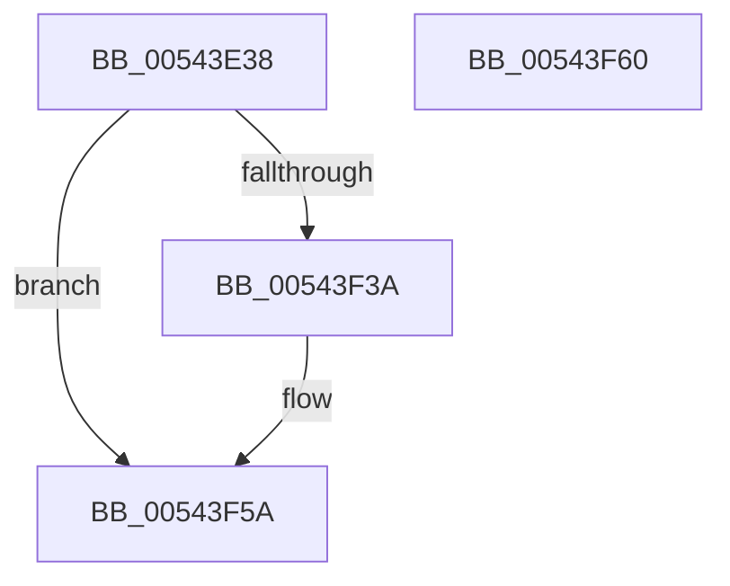

# HalpInitializeInterruptsPn

- RVA: `0x00543E38`–`0x00543F61` (길이 `297` bytes)
- VA: `0x0000000140543E38`
- 실행 섹션: `.text`
- PDB 이름 있음: `예`; PDB Function 태그: `아니요`
- unwind 정보 RVA: `0x00064C80`
- 디코드: `64`개 명령, `297/297` bytes 표시
- 미해석 바이트: `0` (있으면 어셈블리에 `.byte`로 보존)

> 이 문서는 커널 이미지의 기계어와 PDB 기호를 분석해 생성했습니다. 4번과 5번은 함수 원형과 자료형을 바이너리 사용 방식에서 추정한 C 해석이며 원본 소스 복구 결과는 아닙니다.

## 1. Dependencies

- 직접 호출 지점: **11**; 고유 호출 대상: **4**
- 직접 호출자로 확인된 함수: **1**
- RIP 상대 이미지 참조: **9**

### Outgoing calls
- `0x00543E72` → [HalpInterruptSetIdtEntry](../55/HalpInterruptSetIdtEntry_function_0055BAE0.md) (function, `0x0055BAE0`)
- `0x00543E89` → [HalpInterruptSetIdtEntry](../55/HalpInterruptSetIdtEntry_function_0055BAE0.md) (function, `0x0055BAE0`)
- `0x00543EA6` → [HalpInterruptSetIdtEntry](../55/HalpInterruptSetIdtEntry_function_0055BAE0.md) (function, `0x0055BAE0`)
- `0x00543EBF` → [HalpInterruptSetIdtEntry](../55/HalpInterruptSetIdtEntry_function_0055BAE0.md) (function, `0x0055BAE0`)
- `0x00543ED8` → [HalpInterruptSetIdtEntry](../55/HalpInterruptSetIdtEntry_function_0055BAE0.md) (function, `0x0055BAE0`)
- `0x00543EF1` → [HalpInterruptSetIdtEntry](../55/HalpInterruptSetIdtEntry_function_0055BAE0.md) (function, `0x0055BAE0`)
- `0x00543F0E` → [HalpInterruptSetIdtEntry](../55/HalpInterruptSetIdtEntry_function_0055BAE0.md) (function, `0x0055BAE0`)
- `0x00543F27` → [HalpInterruptSetIdtEntry](../55/HalpInterruptSetIdtEntry_function_0055BAE0.md) (function, `0x0055BAE0`)
- `0x00543F2C` → [HalpInterruptReinitializeThisProcessor](../4E/HalpInterruptReinitializeThisProcessor_function_004E29E0.md) (function, `0x004E29E0`)
- `0x00543F31` → [HalpInterruptInitializeIpis](HalpInterruptInitializeIpis_function_005462AC.md) (function, `0x005462AC`)
- `0x00543F54` → [KeBugCheckEx](../4F/KeBugCheckEx_function_004FD660.md) (function, `0x004FD660`)

### Direct callers
- [HalpInterruptInitSystem](../../pagelk/B5/HalpInterruptInitSystem_function_00B5D550.md) at `0x00B5D5A0`

### Static image references
- `0x00543E58` → RVA `0x00FC19B0` (`.data`; read)
- `0x00543E68` → RVA `0x0055B810` (`HalpInterruptCmciService`; read)
- `0x00543E9A` → RVA `0x0055B8A0` (`HalpInterruptSpuriousService`; read)
- `0x00543EB3` → RVA `0x0055B8D0` (`HalpInterruptStubService`; read)
- `0x00543ECC` → RVA `0x0055B850` (`HalpInterruptRebootService`; read)
- `0x00543EE5` → RVA `0x004B9450` (`HalpInterruptLocalErrorService`; read)
- `0x00543F02` → RVA `0x00445B70` (`HalpPerfInterrupt`; read)
- `0x00543F1B` → RVA `0x0055B830` (`HalpInterruptDeferredRecoveryService`; read)
- `0x00543F3A` → RVA `0x00F90694` (`.data`; read)

## 2. Other-region calls and transfers

- 다른 실행 섹션으로 향하는 call: **0**
- 별도 외부 분기/꼬리 이동을 확인하지 못했습니다.

## 3. Assembly (complete function range)

```asm
00543E38  40 53                           push rbx
00543E3A  48 83 EC 30                     sub rsp, 0x30
00543E3E  65 48 8B 14 25 18 00 00 00      mov rdx, qword ptr gs:[0x18]
00543E47  48 83 CB FF                     or rbx, 0xffffffffffffffff
00543E4B  65 8B 04 25 A4 01 00 00         mov eax, dword ptr gs:[0x1a4]
00543E53  41 B0 05                        mov r8b, 5
00543E56  8B C8                           mov ecx, eax
00543E58  48 8B 05 51 DB A7 00            mov rax, qword ptr [rip + 0xa7db51]
00543E5F  48 89 5C 24 20                  mov qword ptr [rsp + 0x20], rbx
00543E64  48 89 14 C8                     mov qword ptr [rax + rcx*8], rdx
00543E68  48 8D 15 A1 79 01 00            lea rdx, [rip + 0x179a1]
00543E6F  8D 4B 36                        lea ecx, [rbx + 0x36]
00543E72  E8 69 7C 01 00                  call 0x14055bae0
00543E77  41 B0 05                        mov r8b, 5
00543E7A  48 89 5C 24 20                  mov qword ptr [rsp + 0x20], rbx
00543E7F  48 8D 15 8A 79 01 00            lea rdx, [rip + 0x1798a]
00543E86  8D 4B 37                        lea ecx, [rbx + 0x37]
00543E89  E8 52 7C 01 00                  call 0x14055bae0
00543E8E  41 B0 0F                        mov r8b, 0xf
00543E91  48 C7 44 24 20 FE FF FF FF      mov qword ptr [rsp + 0x20], 0xfffffffffffffffe
00543E9A  48 8D 15 FF 79 01 00            lea rdx, [rip + 0x179ff]
00543EA1  B9 DF 00 00 00                  mov ecx, 0xdf
00543EA6  E8 35 7C 01 00                  call 0x14055bae0
00543EAB  41 B0 0F                        mov r8b, 0xf
00543EAE  48 89 5C 24 20                  mov qword ptr [rsp + 0x20], rbx
00543EB3  48 8D 15 16 7A 01 00            lea rdx, [rip + 0x17a16]
00543EBA  B9 D8 00 00 00                  mov ecx, 0xd8
00543EBF  E8 1C 7C 01 00                  call 0x14055bae0
00543EC4  41 B0 0F                        mov r8b, 0xf
00543EC7  48 89 5C 24 20                  mov qword ptr [rsp + 0x20], rbx
00543ECC  48 8D 15 7D 79 01 00            lea rdx, [rip + 0x1797d]
00543ED3  B9 D7 00 00 00                  mov ecx, 0xd7
00543ED8  E8 03 7C 01 00                  call 0x14055bae0
00543EDD  41 B0 0F                        mov r8b, 0xf
00543EE0  48 89 5C 24 20                  mov qword ptr [rsp + 0x20], rbx
00543EE5  48 8D 15 64 55 F7 FF            lea rdx, [rip - 0x8aa9c]
00543EEC  B9 E2 00 00 00                  mov ecx, 0xe2
00543EF1  E8 EA 7B 01 00                  call 0x14055bae0
00543EF6  41 B0 0F                        mov r8b, 0xf
00543EF9  48 C7 44 24 20 FD FF FF FF      mov qword ptr [rsp + 0x20], 0xfffffffffffffffd
00543F02  48 8D 15 67 1C F0 FF            lea rdx, [rip - 0xfe399]
00543F09  B9 FE 00 00 00                  mov ecx, 0xfe
00543F0E  E8 CD 7B 01 00                  call 0x14055bae0
00543F13  41 B0 0E                        mov r8b, 0xe
00543F16  48 89 5C 24 20                  mov qword ptr [rsp + 0x20], rbx
00543F1B  48 8D 15 0E 79 01 00            lea rdx, [rip + 0x1790e]
00543F22  B9 E3 00 00 00                  mov ecx, 0xe3
00543F27  E8 B4 7B 01 00                  call 0x14055bae0
00543F2C  E8 AF EA F9 FF                  call 0x1404e29e0
00543F31  E8 76 23 00 00                  call 0x1405462ac
00543F36  85 C0                           test eax, eax
00543F38  79 20                           jns 0x140543f5a
00543F3A  4C 63 05 53 C7 A4 00            movsxd r8, dword ptr [rip + 0xa4c753]
00543F41  8D 4B 5D                        lea ecx, [rbx + 0x5d]
00543F44  48 98                           cdqe
00543F46  44 8D 4B 02                     lea r9d, [rbx + 2]
00543F4A  BA 00 02 00 00                  mov edx, 0x200
00543F4F  48 89 44 24 20                  mov qword ptr [rsp + 0x20], rax
00543F54  E8 07 97 FB FF                  call 0x1404fd660
00543F59  CC                              int3
00543F5A  48 83 C4 30                     add rsp, 0x30
00543F5E  5B                              pop rbx
00543F5F  C3                              ret
00543F60  CC                              int3
```

## 4. C-style interpretation (structured pseudocode)

```c
__int64 __fastcall HalpInitializeInterruptsPn(void)
{
    __int64 result;
    __int64 v_rbx;
    __int64 v_rsp;
    unsigned __int64 v_stack_m18;

    v_rsp = (v_rsp) - (48);
    v_rbx = (v_rbx) | (-1);
    v_stack_m18 = v_rbx;
    *(unsigned __int64 *)(*(unsigned __int64 *)(v_rip + 11000657) + (unsigned int)((unsigned int)((unsigned int)(*(unsigned int *)(gs_base + (0 + 420))))) * 8) = *(unsigned __int64 *)(gs_base + (0 + 24));
    result = HalpInterruptSetIdtEntry(v_rbx + 54, v_rip + 96673, 5, a4);
    v_stack_m18 = v_rbx;
    result = HalpInterruptSetIdtEntry(v_rbx + 55, v_rip + 96650, 5, a4);
    v_stack_m18 = -2;
    result = HalpInterruptSetIdtEntry(223, v_rip + 96767, 15, a4);
    v_stack_m18 = v_rbx;
    result = HalpInterruptSetIdtEntry(216, v_rip + 96790, 15, a4);
    v_stack_m18 = v_rbx;
    result = HalpInterruptSetIdtEntry(215, v_rip + 96637, 15, a4);
    v_stack_m18 = v_rbx;
    result = HalpInterruptSetIdtEntry(226, v_rip - 567964, 15, a4);
    v_stack_m18 = -3;
    result = HalpInterruptSetIdtEntry(254, v_rip - 1041305, 15, a4);
    v_stack_m18 = v_rbx;
    result = HalpInterruptSetIdtEntry(227, v_rip + 96526, 14, a4);
    result = HalpInterruptReinitializeThisProcessor(227, v_rip + 96526, 14, a4);
    result = HalpInterruptInitializeIpis(227, v_rip + 96526, 14, a4);
    if (sign_flag) {
        a3 = (int)(*(unsigned int *)(v_rip + 10798931));
        a1 = v_rbx + 93;
        a4 = v_rbx + 2;
        a2 = 512;
        v_stack_m18 = result;
        result = KeBugCheckEx(a1, a2, a3, a4);
    }
    v_rsp = (v_rsp) + (48);
    return result;
}
```

## 5. (Beta) C Style

```c
void HalpInitializeInterruptsPn(void)
{
    int64_t result;
    int64_t local_rbx;
    int64_t local_rsp;
    uint64_t v_stack_m18;

    local_rsp = (local_rsp) - (48);
    local_rbx = (local_rbx) | (-1);
    v_stack_m18 = local_rbx;
    *(uint64_t *)(*(uint64_t *)(v_rip + 0xA7DB51) + (uint32_t)((uint32_t)((uint32_t)(*(uint32_t *)(gs_base + (0 + 0x1A4))))) * 8) = *(uint64_t *)(gs_base + (0 + 0x18));
    result = HalpInterruptSetIdtEntry(local_rbx + 54, v_rip + 96673, 5, a4);
    v_stack_m18 = local_rbx;
    result = HalpInterruptSetIdtEntry(local_rbx + 55, v_rip + 96650, 5, a4);
    v_stack_m18 = -2;
    result = HalpInterruptSetIdtEntry(223, v_rip + 96767, 15, a4);
    v_stack_m18 = local_rbx;
    result = HalpInterruptSetIdtEntry(216, v_rip + 96790, 15, a4);
    v_stack_m18 = local_rbx;
    result = HalpInterruptSetIdtEntry(215, v_rip + 96637, 15, a4);
    v_stack_m18 = local_rbx;
    result = HalpInterruptSetIdtEntry(226, v_rip - 567964, 15, a4);
    v_stack_m18 = -3;
    result = HalpInterruptSetIdtEntry(254, v_rip - 1041305, 15, a4);
    v_stack_m18 = local_rbx;
    result = HalpInterruptSetIdtEntry(227, v_rip + 96526, 14, a4);
    result = HalpInterruptReinitializeThisProcessor(227, v_rip + 96526, 14, a4);
    result = HalpInterruptInitializeIpis(227, v_rip + 96526, 14, a4);
    if (sign_flag) {
        a3 = (int32_t)(*(uint32_t *)(v_rip + 0xA4C753));
        a1 = local_rbx + 93;
        a4 = local_rbx + 2;
        a2 = 512;
        v_stack_m18 = result;
        result = KeBugCheckEx(a1, a2, a3, a4);
    }
    local_rsp = (local_rsp) + (48);
    return result;
}
```

## 6. Execution-region graph

[열기: 2D/3D 그래프와 함수 탐색 컨트롤 패널](../../../control-panel.html?section=text&rva=0x00543E38&view=graph)

- 2D 그래프는 위에서 아래로 흐르고, 3D 그래프는 빈 공간을 드래그해 회전합니다. Shift+드래그는 이동, 휠은 확대·축소, 함수 노드 선택은 대상 보고서 이동입니다.

### Static fallback


