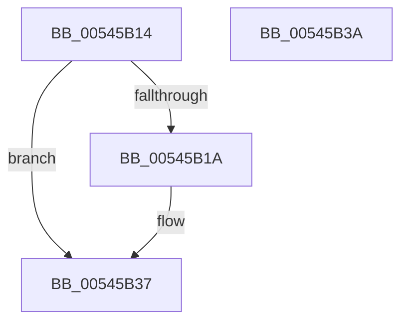

# HalpInitializeNMI

- RVA: `0x00545B14`–`0x00545B3B` (길이 `39` bytes)
- VA: `0x0000000140545B14`
- 실행 섹션: `.text`
- PDB 이름 있음: `예`; PDB Function 태그: `아니요`
- unwind 정보 RVA: `0x000DB714`
- 디코드: `9`개 명령, `39/39` bytes 표시
- 미해석 바이트: `0` (있으면 어셈블리에 `.byte`로 보존)

> 이 문서는 커널 이미지의 기계어와 PDB 기호를 분석해 생성했습니다. 4번과 5번은 함수 원형과 자료형을 바이너리 사용 방식에서 추정한 C 해석이며 원본 소스 복구 결과는 아닙니다.

## 1. Dependencies

- 직접 호출 지점: **0**; 고유 호출 대상: **0**
- 직접 호출자로 확인된 함수: **1**
- RIP 상대 이미지 참조: **3**

### Outgoing calls
- 직접 디코드된 call 명령이 없습니다.

### Direct callers
- [HalpInitializeErrSrc](../../pagelk/B5/HalpInitializeErrSrc_function_00B5BBB0.md) at `0x00B5BBE3`

### Static image references
- `0x00545B1A` → RVA `0x00E10264` (`.data`; write)
- `0x00545B27` → RVA `0x00E10260` (`.data`; write)
- `0x00545B2D` → RVA `0x00E10268` (`.data`; write)

## 2. Other-region calls and transfers

- 다른 실행 섹션으로 향하는 call: **0**
- 별도 외부 분기/꼬리 이동을 확인하지 못했습니다.

## 3. Assembly (complete function range)

```asm
00545B14  83 7A 08 03                     cmp dword ptr [rdx + 8], 3
00545B18  75 1D                           jne 0x140545b37
00545B1A  C7 05 40 A7 8C 00 01 00 00 00   mov dword ptr [rip + 0x8ca740], 1
00545B24  8B 42 1C                        mov eax, dword ptr [rdx + 0x1c]
00545B27  89 05 33 A7 8C 00               mov dword ptr [rip + 0x8ca733], eax
00545B2D  C7 05 31 A7 8C 00 00 00 00 00   mov dword ptr [rip + 0x8ca731], 0
00545B37  33 C0                           xor eax, eax
00545B39  C3                              ret
00545B3A  CC                              int3
```

## 4. C-style interpretation (structured pseudocode)

```c
__int64 __fastcall HalpInitializeNMI(__int64 a1, __int64 a2)
{
    __int64 result;

    if ((*(unsigned int *)(a2 + 8)) == 3) {
        *(unsigned int *)(v_rip + 9217856) = 1;
        result = *(unsigned int *)(a2 + 28);
        *(unsigned int *)(v_rip + 9217843) = (unsigned int)(result);
        *(unsigned int *)(v_rip + 9217841) = 0;
    }
    result = 0;
    return result;
}
```

## 5. (Beta) C Style

```c
int64_t HalpInitializeNMI(int64_t Arg1, void *Arg2)
{
    uint8_t *arg2 = (uint8_t *)Arg2;

    int64_t result;

    if ((*(uint32_t *)(arg2 + 0x8)) == 3) {
        *(uint32_t *)(v_rip + 0x8CA740) = 1;
        result = *(uint32_t *)(arg2 + 0x1C);
        *(uint32_t *)(v_rip + 0x8CA733) = (uint32_t)(result);
        *(uint32_t *)(v_rip + 0x8CA731) = 0;
    }
    result = 0;
    return result;
}
```

### 관측된 메모리 오프셋

구조체 형식이 확인되지 않은 접근은 인자 기준의 오프셋으로만 기록했습니다.

| 기준 인자 | 오프셋 표현 | 폭 (bit) | 접근 |
|---|---:|---:|---|
| `Arg2` | `+ 0x8` | `32` | `R` |
| `Arg2` | `+ 0x1C` | `32` | `R` |

## 6. Execution-region graph

[열기: 2D/3D 그래프와 함수 탐색 컨트롤 패널](../../../control-panel.html?section=text&rva=0x00545B14&view=graph)

- 2D 그래프는 위에서 아래로 흐르고, 3D 그래프는 빈 공간을 드래그해 회전합니다. Shift+드래그는 이동, 휠은 확대·축소, 함수 노드 선택은 대상 보고서 이동입니다.

### Static fallback


