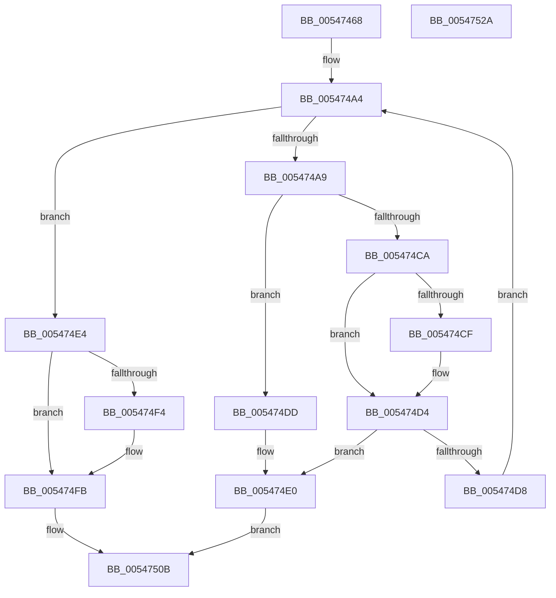

# HalpInsertProfileSource

- RVA: `0x00547468`–`0x0054752B` (길이 `195` bytes)
- VA: `0x0000000140547468`
- 실행 섹션: `.text`
- PDB 이름 있음: `예`; PDB Function 태그: `아니요`
- unwind 정보 RVA: `0x0005FEF8`
- 디코드: `58`개 명령, `195/195` bytes 표시
- 미해석 바이트: `0` (있으면 어셈블리에 `.byte`로 보존)

> 이 문서는 커널 이미지의 기계어와 PDB 기호를 분석해 생성했습니다. 4번과 5번은 함수 원형과 자료형을 바이너리 사용 방식에서 추정한 C 해석이며 원본 소스 복구 결과는 아닙니다.

## 1. Dependencies

- 직접 호출 지점: **1**; 고유 호출 대상: **1**
- 직접 호출자로 확인된 함수: **2**
- RIP 상대 이미지 참조: **1**

### Outgoing calls
- `0x005474C1` → [wcsncmp](../50/wcsncmp_function_00501CA0.md) (function, `0x00501CA0`)

### Direct callers
- [EmonAddProfileSource](../55/EmonAddProfileSource_function_0055BEA0.md) at `0x0055C008`
- [Amd64AddProfileSource](../56/Amd64AddProfileSource_function_0056B720.md) at `0x0056B886`

### Static image references
- `0x00547489` → RVA `0x00FC2C40` (`.data`; read)

## 2. Other-region calls and transfers

- 다른 실행 섹션으로 향하는 call: **0**
- 별도 외부 분기/꼬리 이동을 확인하지 못했습니다.

## 3. Assembly (complete function range)

```asm
00547468  48 8B C4                        mov rax, rsp
0054746B  48 89 58 08                     mov qword ptr [rax + 8], rbx
0054746F  48 89 68 10                     mov qword ptr [rax + 0x10], rbp
00547473  48 89 70 18                     mov qword ptr [rax + 0x18], rsi
00547477  48 89 78 20                     mov qword ptr [rax + 0x20], rdi
0054747B  41 54                           push r12
0054747D  41 56                           push r14
0054747F  41 57                           push r15
00547481  48 83 EC 20                     sub rsp, 0x20
00547485  49 83 21 00                     and qword ptr [r9], 0
00547489  4C 8D 25 B0 B7 A7 00            lea r12, [rip + 0xa7b7b0]
00547490  48 8B 35 A9 B7 A7 00            mov rsi, qword ptr [rip + 0xa7b7a9]
00547497  41 8D 78 01                     lea edi, [r8 + 1]
0054749B  49 8B DC                        mov rbx, r12
0054749E  4D 8B F9                        mov r15, r9
005474A1  4C 8B F1                        mov r14, rcx
005474A4  49 3B F4                        cmp rsi, r12
005474A7  74 3B                           je 0x1405474e4
005474A9  49 8B 96 28 01 00 00            mov rdx, qword ptr [r14 + 0x128]
005474B0  48 8D 6E F8                     lea rbp, [rsi - 8]
005474B4  48 8B 8D 28 01 00 00            mov rcx, qword ptr [rbp + 0x128]
005474BB  41 B8 FF 00 00 00               mov r8d, 0xff
005474C1  E8 DA A7 FB FF                  call 0x140501ca0
005474C6  85 C0                           test eax, eax
005474C8  74 13                           je 0x1405474dd
005474CA  3B 7D 00                        cmp edi, dword ptr [rbp]
005474CD  75 05                           jne 0x1405474d4
005474CF  48 8B 1E                        mov rbx, qword ptr [rsi]
005474D2  FF C7                           inc edi
005474D4  85 FF                           test edi, edi
005474D6  74 08                           je 0x1405474e0
005474D8  48 8B 36                        mov rsi, qword ptr [rsi]
005474DB  EB C7                           jmp 0x1405474a4
005474DD  49 89 2F                        mov qword ptr [r15], rbp
005474E0  32 C0                           xor al, al
005474E2  EB 27                           jmp 0x14054750b
005474E4  41 89 3E                        mov dword ptr [r14], edi
005474E7  49 8D 46 08                     lea rax, [r14 + 8]
005474EB  48 8B 4B 08                     mov rcx, qword ptr [rbx + 8]
005474EF  48 39 19                        cmp qword ptr [rcx], rbx
005474F2  74 07                           je 0x1405474fb
005474F4  B9 03 00 00 00                  mov ecx, 3
005474F9  CD 29                           int 0x29
005474FB  48 89 18                        mov qword ptr [rax], rbx
005474FE  48 89 48 08                     mov qword ptr [rax + 8], rcx
00547502  48 89 01                        mov qword ptr [rcx], rax
00547505  48 89 43 08                     mov qword ptr [rbx + 8], rax
00547509  B0 01                           mov al, 1
0054750B  48 8B 5C 24 40                  mov rbx, qword ptr [rsp + 0x40]
00547510  48 8B 6C 24 48                  mov rbp, qword ptr [rsp + 0x48]
00547515  48 8B 74 24 50                  mov rsi, qword ptr [rsp + 0x50]
0054751A  48 8B 7C 24 58                  mov rdi, qword ptr [rsp + 0x58]
0054751F  48 83 C4 20                     add rsp, 0x20
00547523  41 5F                           pop r15
00547525  41 5E                           pop r14
00547527  41 5C                           pop r12
00547529  C3                              ret
0054752A  CC                              int3
```

## 4. C-style interpretation (structured pseudocode)

```c
__int64 __fastcall HalpInsertProfileSource(__int64 a1, __int64 a2, __int64 a3, __int64 a4)
{
    __int64 result;
    __int64 v_rbx;
    __int64 v_rdi;
    __int64 v_rsp;
    unsigned __int64 v_stack_p10;
    unsigned __int64 v_stack_p18;
    unsigned __int64 v_stack_p20;
    unsigned __int64 v_stack_p8;

    *(unsigned __int64 *)(v_rsp + 8) = v_rbx;
    *(unsigned __int64 *)(v_rsp + 16) = v_rbp;
    *(unsigned __int64 *)(v_rsp + 24) = v_rsi;
    *(unsigned __int64 *)(v_rsp + 32) = v_rdi;
    v_rsp = (v_rsp) - (32);
loc_005474A4:
    if ((*(unsigned __int64 *)(v_rip + 10991529)) == (v_rip + 10991536)) goto loc_005474E4;
    result = wcsncmp(*(unsigned __int64 *)(*(unsigned __int64 *)(v_rip + 10991529) - 8 + 296), *(unsigned __int64 *)(a1 + 296), 255, a4);
    if ((unsigned int)(result) == 0) goto loc_005474DD;
    v_rbx = v_rip + 10991536;
    v_rdi = a3 + 1;
    if (((unsigned int)(a3 + 1)) == (*(unsigned int *)(*(unsigned __int64 *)(v_rip + 10991529) - 8))) {
        v_rbx = *(unsigned __int64 *)(*(unsigned __int64 *)(v_rip + 10991529));
        v_rdi = (unsigned int)((a3 + 1) + 1);
    }
    if ((unsigned int)(v_rdi) == 0) goto loc_005474E0;
    goto loc_005474A4;
loc_005474DD:
    *(unsigned __int64 *)(a4) = *(unsigned __int64 *)(v_rip + 10991529) - 8;
loc_005474E0:
    result = 0;
    goto loc_0054750B;
loc_005474E4:
    *(unsigned int *)(a1) = (unsigned int)(v_rdi);
    if ((*(unsigned __int64 *)(*(unsigned __int64 *)(v_rbx + 8))) != v_rbx) {
        a1 = 3;
    }
    *(unsigned __int64 *)(a1 + 8) = v_rbx;
    *(unsigned __int64 *)(a1 + 8 + 8) = a1;
    *(unsigned __int64 *)(a1) = a1 + 8;
    *(unsigned __int64 *)(v_rbx + 8) = a1 + 8;
loc_0054750B:
    v_rsp = (v_rsp) + (32);
    return 1;
}
```

## 5. (Beta) C Style

```c
int64_t HalpInsertProfileSource(void *Arg1, int64_t Arg2, void *Arg3, void *Arg4)
{
    uint8_t *arg1 = (uint8_t *)Arg1;
    uint8_t *arg3 = (uint8_t *)Arg3;
    uint8_t *arg4 = (uint8_t *)Arg4;

    int64_t result;
    int64_t local_rbx;
    int64_t local_rdi;
    int64_t local_rsp;
    uint64_t v_stack_p10;
    uint64_t v_stack_p18;
    uint64_t v_stack_p20;
    uint64_t v_stack_p8;

    *(uint64_t *)(local_rsp + 0x8) = local_rbx;
    *(uint64_t *)(local_rsp + 0x10) = local_rbp;
    *(uint64_t *)(local_rsp + 0x18) = local_rsi;
    *(uint64_t *)(local_rsp + 0x20) = local_rdi;
    local_rsp = (local_rsp) - (32);
loc_005474A4:
    if ((*(uint64_t *)(v_rip + 0xA7B7A9)) == (v_rip + 10991536)) goto loc_005474E4;
    result = wcsncmp(*(uint64_t *)(*(uint64_t *)(v_rip + 0xA7B7A9) - 0x8 + 0x128), *(uint64_t *)(arg1 + 0x128), 255, Arg4);
    if ((uint32_t)(result) == 0) goto loc_005474DD;
    local_rbx = v_rip + 10991536;
    local_rdi = Arg3 + 1;
    if (((uint32_t)(Arg3 + 1)) == (*(uint32_t *)(*(uint64_t *)(v_rip + 0xA7B7A9) - 0x8))) {
        local_rbx = *(uint64_t *)(*(uint64_t *)(v_rip + 0xA7B7A9));
        local_rdi = (uint32_t)((Arg3 + 1) + 1);
    }
    if ((uint32_t)(local_rdi) == 0) goto loc_005474E0;
    goto loc_005474A4;
loc_005474DD:
    *(uint64_t *)(arg4) = *(uint64_t *)(v_rip + 0xA7B7A9) - 8;
loc_005474E0:
    result = 0;
    goto loc_0054750B;
loc_005474E4:
    *(uint32_t *)(arg1) = (uint32_t)(local_rdi);
    if ((*(uint64_t *)(*(uint64_t *)(local_rbx + 0x8))) != local_rbx) {
        Arg1 = 3;
    }
    *(uint64_t *)(arg1 + 0x8) = local_rbx;
    *(void **)(arg1 + 0x8 + 0x8) = Arg1;
    *(void **)(arg1) = Arg1 + 8;
    *(void **)(local_rbx + 0x8) = Arg1 + 8;
loc_0054750B:
    local_rsp = (local_rsp) + (32);
    return 1;
}
```

### 관측된 메모리 오프셋

구조체 형식이 확인되지 않은 접근은 인자 기준의 오프셋으로만 기록했습니다.

| 기준 인자 | 오프셋 표현 | 폭 (bit) | 접근 |
|---|---:|---:|---|
| `Arg1` | `+ 0x0` | `32` | `W` |
| `Arg1` | `+ 0x0` | `64` | `W` |
| `Arg1` | `+ 0x8` | `64` | `R` |
| `Arg1` | `+ 0x8` | `64` | `W` |
| `Arg1` | `+ 0x128` | `64` | `R` |
| `Arg3` | `+ 0x1` | `32` | `R` |
| `Arg4` | `+ 0x0` | `64` | `R/W` |
| `Arg4` | `+ 0x0` | `64` | `W` |

## 6. Execution-region graph

[열기: 2D/3D 그래프와 함수 탐색 컨트롤 패널](../../../control-panel.html?section=text&rva=0x00547468&view=graph)

- 2D 그래프는 위에서 아래로 흐르고, 3D 그래프는 빈 공간을 드래그해 회전합니다. Shift+드래그는 이동, 휠은 확대·축소, 함수 노드 선택은 대상 보고서 이동입니다.

### Static fallback


